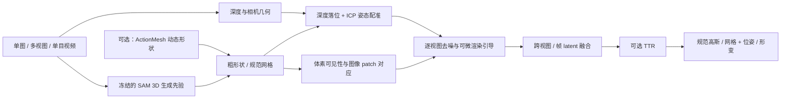
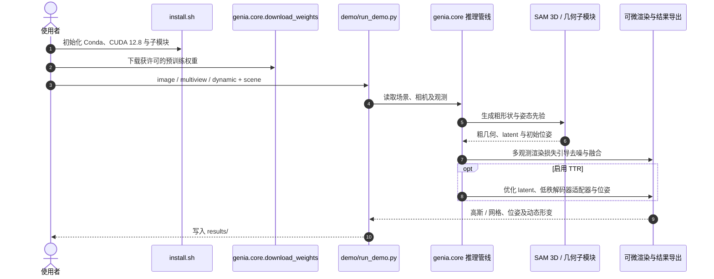

# GenIA：冻结生成先验上的测试时 3D 对齐

**GenIA（Generative Reconstruction with Test-Time Input Alignment）**（[arXiv:2610.12388](https://arxiv.org/abs/2610.12388)，[项目页](https://facebookresearch.github.io/GenIA/)，[官方代码](https://github.com/facebookresearch/GenIA)）由 **图宾根大学图宾根人工智能中心（Tübingen AI Center）与元宇宙人工智能（Meta Reality Labs）** 提出：在不重新训练 SAM 3D Objects 的前提下，于每个场景的推理过程中加入几何和光度约束，使生成出的完整物体更贴合观测图像、视角和位姿。

## 英文缩写速查

| 缩写 | 英文全称 | 简要说明 |
|------|----------|----------|
| GenIA | Generative Reconstruction with Test-Time Input Alignment | 本文的测试时输入对齐框架 |
| SAM 3D | Segment Anything Model 3D | 提供生成式粗几何、姿态和外观先验的基础模型 |
| SLAT | Structured Latent | SAM 3D 中联合编码细几何与外观的结构化 latent |
| ICP | Iterative Closest Point | 将粗形状注册到观测点图的迭代最近点算法 |
| TTR | Test-Time Refinement | 可选的逐场景测试时优化，不更新预训练主体权重 |
| 3DGS | 3D Gaussian Splatting | 解码后用于可微渲染的三维高斯表示 |

## 为什么重要

生成式重建擅长补齐单张照片看不到的背面，但其先验可能让输出在颜色、形状或空间位置上偏离输入；传统逐场景拟合则通常缺少可信的完整物体先验。GenIA 的取舍是保留 SAM 3D 的生成式补全，用深度、可见性和渲染损失校正观测可约束的部分，并把同一思路延伸到多视角和动态视频。

对机器人与仿真资产构建而言，这类输出可用于从观测图像生成对象级资产及位姿，但它不是实时 SLAM 或无需几何检查的真值重建器：粗形状仍由先验提供，动态模式也依赖外部形状预测。

## 核心信息

| 项 | 内容 |
|---|---|
| 作者 | Stefano Esposito 等 8 位作者 |
| 机构 | 图宾根大学图宾根人工智能中心；元宇宙人工智能（Meta Reality Labs） |
| 论文 | arXiv:2610.12388，2026-10-08 v1 |
| 输入设置 | 单图静态、稀疏多视图静态、单目动态视频 |
| 基础先验 | 冻结的 SAM 3D Objects；外部几何可由 ActionMesh 提供 |
| 输出 | 规范物体高斯/网格、逐帧世界位姿，动态时附逐帧形变 |
| 官方代码 | 已开源；CC BY-NC 4.0，第三方依赖许可证需分别核对 |
| 硬件与权重 | NVIDIA GPU、CUDA Toolkit 12.8；下载 SAM 3D Objects 权重前须接受 Hugging Face 许可 |

## 方法：在生成轨迹中注入观测约束

1. **粗形状。** 由 SAM 3D 首轮生成占据/粗形状，也可将外部形状注入其 shape tokens。几何先验负责未观测表面的补全。
2. **几何落位。** 利用输入深度点图估计物体平移与尺度，旋转仍由生成先验预测；再以 ICP 将粗形状配准至度量点图。多视角下将各视图姿态转至世界坐标并聚合。
3. **可见性引导外观。** 在粗几何上计算每个体素从各视图是否可见，并将其投影到图像 patch。可见区域提高对应 RGB patch 的交叉注意力权重，减少背面/遮挡特征错误地影响该体素外观。
4. **渲染引导去噪。** 每个去噪步骤临时解码当前 latent 并可微渲染，使用 RGB、SSIM、LPIPS 与深度误差形成梯度，修正该观测对应的生成速度场；多视图/帧再按体素可见性融合 latent。
5. **可选 TTR。** 生成后再优化规范外观 latent、低秩高斯解码器适配器和位姿。latent 锚定于原始预测以免观测不足时破坏先验补全；SAM 3D 主体与网格解码器保持冻结。
6. **动态对齐。** 将 ActionMesh 等提供的逐帧同拓扑形状映射至规范空间，在对应体素上融合跨帧外观，并估计稳定世界位姿；高斯随后随网格形变场变形。

### 流程总览

其中动态分支的逐帧形状输入由外部 predictor 提供；GenIA 负责的是将该几何与外观、观测视角及世界位姿对齐。

## 源码运行时序图

官方仓库含安装、权重下载和三种 demo 入口；以下按 README 的实际入口整理，**未在本环境执行**。

复现入口：接受 SAM 3D Objects 的 Hugging Face 许可后运行仓库权重下载模块，再从 `python demo/run_demo.py image`、`multiview` 或 `dynamic` 选取设置；动态示例额外使用 ActionMesh。

## 实验与评测

论文在 GSO-30、CO3D（静态）与 ActionBench、DAVIS（动态）评测。核心图像指标包括训练视角前景 PSNR、held-out 视角 LPIPS/CLIP-I，以及部分设置下只计算输入可见像素的 co-PSNR。DAVIS 没有 held-out 相机视角，作者以同时间戳合成新视角并和最近的训练图像计算 CLIP-I，因此不能将其与有真实测试视角的数据集完全等同。

- **静态单视图：** 相比 SAM 3D 等生成基线，改善对称物体的颜色/光照对齐，并保持未观测区域的生成式补全；真实场景 held-out 指标尤其有优势。像 Pixal3D、TripoSplat、CUPID 这类强输入对齐方法在合成可见区域 co-PSNR 上可能更高，但更容易出现遮挡面不完整、颜色洗淡或外观漂移。
- **静态多视图：** 在生成式基线中对输入视图的外观对齐更好；Depth-3DGS 可领先训练视角 PSNR/co-PSNR，但因只拟合观察到的几何，背面完整性不足。TTR 可进一步改善保真度。
- **动态：** 相比逐帧 SAM 3D，输出更连贯的形状、外观和跟踪；相比 Lift4D，论文报告更稳的动态结果。动态重建继承 ActionMesh 的粗几何质量，而不是独立解决视频动态几何。
- **速度与显存：** 项目页报告动态 DAVIS 运行时约为 SAM 3D 单图推理的 13 倍（含 ActionMesh），比 Lift4D 的 160 倍和 HiMoR 的 250 倍低；这仍是逐场景优化式重建，不等于视频实时处理。CO3D 单视图峰值显存 19.7 GB（无 TTR）/31.8 GB（有 TTR），SAM 3D 为 18.0 GB。
- **评测解读：** CLIP-I 对姿态错位不敏感，PSNR/LPIPS 会因位姿误差或合理但不同的背面补全而受罚；须结合几何、跟踪与可视化一起读，不能用一个图像指标代表完整 3D 质量。

## 工程实践与局限

| 项 | 实践读法 |
|---|---|
| 适合 | 需要由少量图像得到有完整背面先验的对象资产，并在输入可见区域提升外观/位姿一致性 |
| 动态前置 | 需要 ActionMesh 等提供同拓扑逐帧形状；GenIA 对齐与融合外观、位姿，不独立预测动态形状 |
| 运行环境 | NVIDIA GPU + CUDA Toolkit 12.8；TTR 需要对解码器反传，单视图 CO3D 峰值可达 31.8 GB |
| 权重门槛 | SAM 3D Objects 权重受 Hugging Face 许可约束；需先接受许可再下载 |
| 商用与依赖 | 仓库为 CC BY-NC 4.0；第三方依赖许可各异，部分也仅限非商业用途，商用需逐项核查 |
| 主要误差 | 粗形状未被观测轮廓/深度充分约束；姿态旋转仍 prior-driven；ICP 对噪声敏感，深度/相机/掩码误差会影响渲染监督 |
| 动态失败模式 | ActionMesh 形变错误、ICP 世界落位错误及较大帧间运动可传播并放大重建偏差 |
| 部署定位 | 离线资产生成/仿真准备，不应直接当作实时 SLAM、可靠碰撞模型或无监督真值 |

## 与其他工作对比

| 工作 | 关联与区别 |
|------|------|
| [SAM 3D](./paper-pai-2306-03908-sam3d.md) | GenIA 冻结 SAM 3D Objects 作为先验；差别在于测试时加入深度落位、可见性加权和渲染引导，使输出更贴合输入视角，并扩展到多视图与动态 |
| Pixal3D / TripoSplat / CUPID | 论文对照的强输入对齐方法：可见区域 co-PSNR 可能更高，但遮挡面更易缺失或外观漂移；GenIA 以生成式背面补全换取整体完整性 |
| Depth-3DGS | 逐场景拟合观测几何，训练视角 PSNR 可领先；没有对象级生成先验，未观测背面不完整 |
| Lift4D / HiMoR | 动态对照：论文报告 GenIA 结果更稳、运行时显著更低；但 GenIA 的动态几何依赖 ActionMesh，不是独立的视频到 4D 方案 |
| [LightSplat](./paper-lightsplat.md) | 在已有 3DGS 场景上做开放词汇语义理解；GenIA 解决的是从少量观测生成对齐的对象资产 |
| [Agentic Real2Sim](./paper-agentic-real2sim.md) | 面向机器人交互 episode 的 real2sim 编排；GenIA 可视作其中"对象资产生成"一环的候选，但仍需几何与碰撞验收 |

## 结论

**GenIA 的实质贡献是把冻结 3D 生成先验的「完整性」与几何/渲染驱动的「输入忠实度」组合进单场景推理；它提升的是对象重建和时序落位，而不是消除粗几何与动态形状预测的不确定性。**

1. **先看可见区域保真与背面完整性的冲突：** 对比 Pixal3D/TripoSplat/CUPID 的输入对齐优势和 GenIA 的生成式背面补全，不以单一 PSNR 排名选型。
2. **多视图优先验证姿态与遮挡：** 深度落位、旋转先验和 ICP 注册共同决定 latent 融合是否可靠；跨视角不一致可能成为外观伪影。
3. **动态方案需把 ActionMesh 计入系统：** 13× SAM 3D 的速度口径包含外部几何提取，不能视作独立的视频到 4D 网络。
4. **预算 GPU 和许可：** TTR 显存明显高于冻结推理，且 SAM 3D 权重和第三方非商用依赖可能影响团队部署与产品使用。
5. **用于机器人仿真前做几何验收：** 重点检查背面、接触面、尺度、世界位姿和非刚性形变；视觉观感好不意味着碰撞几何可用。

## 关联页面

- [SAM 3D 策展索引](./paper-pai-2306-03908-sam3d.md) — GenIA 所依赖的生成先验方向
- [LightSplat](./paper-lightsplat.md) — 对照：在已有 3DGS 上增加语义，而非生成完整对象资产
- [VGGT 几何状态综述](../overview/vggt-geometric-state-survey.md) — 多视图几何基础模型与重建路线的全景背景
- [生成式世界模型](../methods/generative-world-models.md) — 生成模型在空间重建中的能力边界

## 参考来源

- [GenIA 论文摘录](../../sources/papers/genia_arxiv_2610_12388.md)
- [官方项目页核查](../../sources/sites/genia-facebookresearch.md)
- [官方仓库与运行入口](../../sources/repos/facebookresearch-genia.md)
- [arXiv:2610.12388](https://arxiv.org/abs/2610.12388)；[项目页](https://facebookresearch.github.io/GenIA/)；[官方代码](https://github.com/facebookresearch/GenIA)

## 推荐继续阅读

- [GenIA 官方项目页](https://facebookresearch.github.io/GenIA/)
- [GenIA 官方代码仓库](https://github.com/facebookresearch/GenIA)
- [arXiv:2610.12388](https://arxiv.org/abs/2610.12388)
