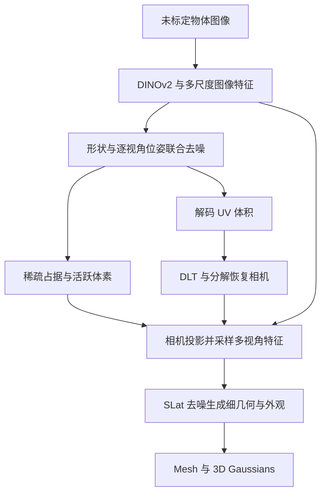
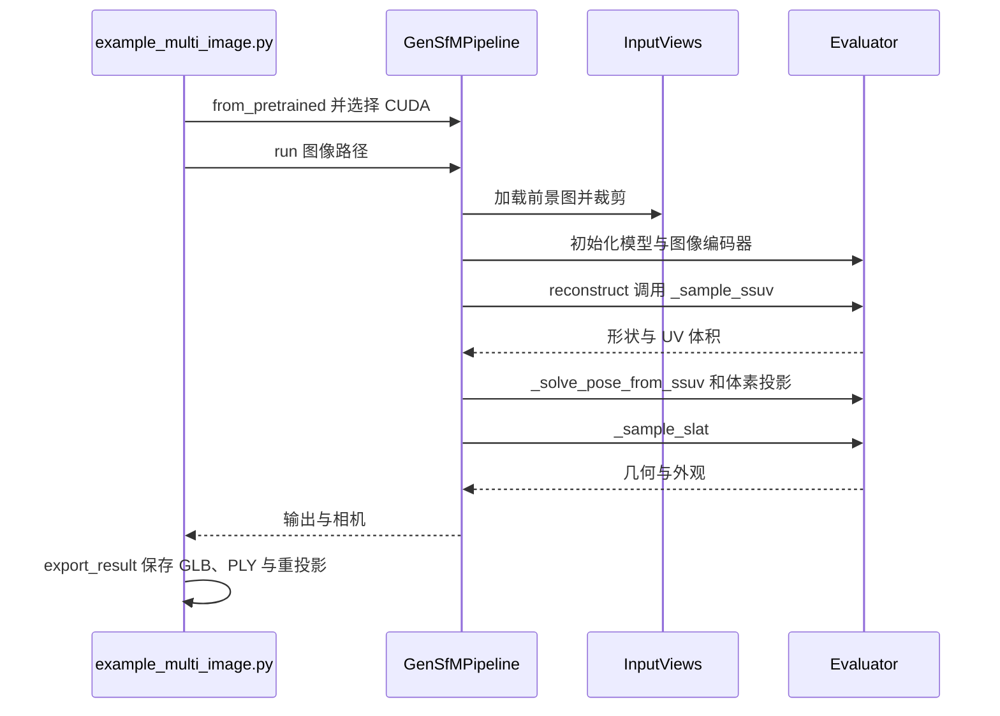

# GenSfM：生成式多视角物体重建与相机估计

## 一句话定义

GenSfM 将稀疏视图的完整物体形状与每视角相机位姿放入同一原生 3D 扩散推理过程，再用估计相机指导细节生成。

## 英文缩写速查

| 缩写 | 英文全称 | 简要说明 |
|---|---|---|
| SfM | Structure from Motion | 从多视图恢复结构和相机运动 |
| DiT | Diffusion Transformer | 联合去噪形状和位姿的骨干 |
| DLT | Direct Linear Transform | 从 3D–2D 对应估计投影矩阵 |
| SLat | Structured Latent | 活跃体素上的结构化潜表示 |

## 核心信息

| 项 | 内容 |
|---|---|
| 机构 | 香港大学、Transengram、腾讯 |
| 原文版本 | [arXiv:2610.35522v1](https://arxiv.org/html/2610.35522v1)，2026-10-26 |
| 代码 | [官方仓库](https://github.com/dotb1ue/GenSfm)，MIT；README 提供训练、评估、推理与权重入口 |
| 输入与输出 | 少量未标定的同一物体视图；输出 mesh、3D Gaussians 和相机参数 |

## 流程总览

粗阶段用紧凑的每视角 pose VAE 潜变量、视角嵌入和共享 register tokens，将形状及位姿放在同一 DiT 中去噪；细阶段对每个活跃体素投影到各视角，采样语义和纹理特征并跨视角平均。生成的不可见区域受先验影响，不能当成已观测事实。

## 源码运行时序图

依据官方 `example_multi_image.py` 和 `trellis/pipelines/gensfm.py` 的预训练模型路径：

README 建议使用 2–4 张前景 RGBA 图，四张覆盖不同侧面；首次下载权重约 5.8 GB，需 NVIDIA GPU 和 CUDA。相机外参采用 OpenCV world-to-camera，导出的 mesh 坐标需参考 `cameras.json` 的变换。

## 评测与局限

论文在 Toys4k 与 GSO 各取 400 个物体、两组四视图。在 3D 生成方法的相似 ICP 对齐协议下，TRELLIS-M 到 GenSfM 的 PSNR 分别由 24.01 升至 28.54 dB、22.28 升至 25.50 dB。该比较是论文实验结果，不能直接推断野外场景效果。相对位姿指标合并了前后手性等价类，不评估该歧义。

论文限制包括四视图物体中心评估、分布外相机误差影响细化及底座生成分布与分辨率限制；未观测部分是生成补全。项目主页本次无法访问，其资源列表尚待复核。

## 结论

该方法适合研究稀疏物体视图下的联合相机估计与生成补全。

- 真实使用时检查前景 mask 和各视角重投影。
- 为仿真使用生成资产前，应独立核验遮挡区域几何与物理属性。
- 比较结果时保留论文的数据集和对齐协议。

## 关联页面

- [Axolotl3D](./paper-axolotl3d.md)：以相机和部分点云为条件的形状补全。
- [Global 3R](./paper-glob3r.md)：相关多视角 3D 重建。

## 参考来源

- [论文归档](../../sources/papers/gensfm_arxiv_2610_35522.md)
- [代码归档](../../sources/repos/gensfm.md)
- [项目页归档](../../sources/sites/gensfm.md)
