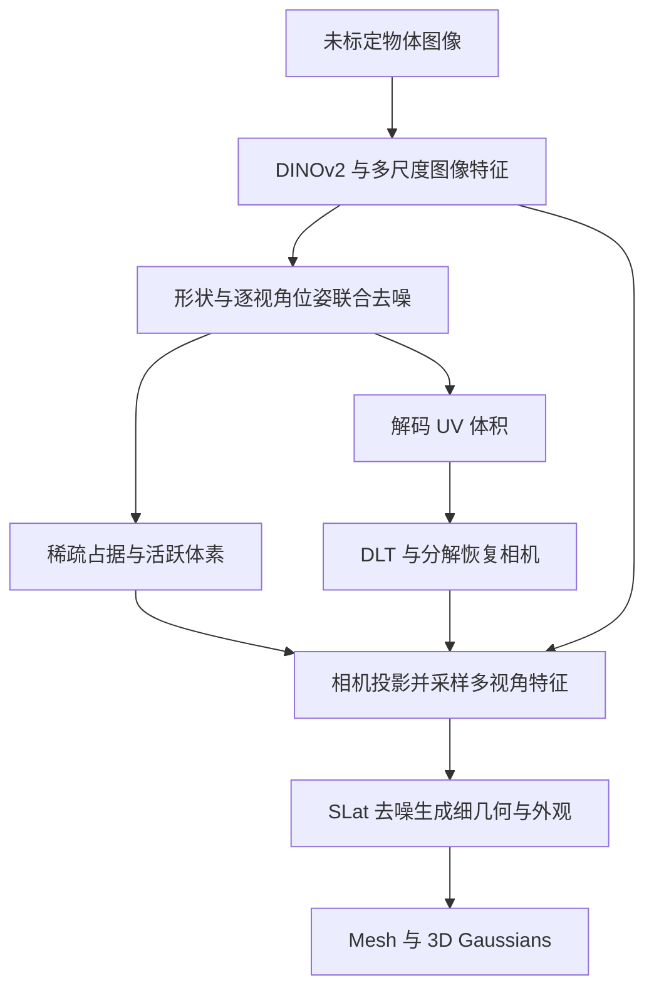
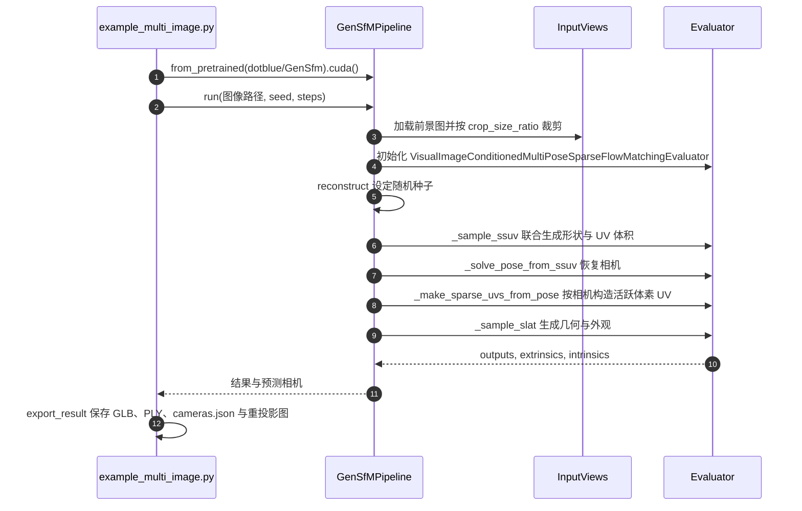

# GenSfM：生成式多视角物体重建与相机估计

## 一句话定义

GenSfM 将稀疏视图的完整物体形状与每视角相机位姿放入同一原生 3D 扩散推理过程，再用估计相机指导细节生成。

## 英文缩写速查

| 缩写 | 英文全称 | 简要说明 |
|---|---|---|
| SfM | Structure from Motion | 从多视图恢复结构和相机运动；GenSfM 名称来源 |
| DiT | Diffusion Transformer | 联合去噪形状潜变量与位姿潜变量的主干网络 |
| DLT | Direct Linear Transform | 从 3D–2D 对应最小二乘求解 3×4 投影矩阵，再经 RQ 分解得到内外参 |
| SLat | Structured Latent | TRELLIS 的结构化潜表示：活跃体素上的特征集合，细阶段生成对象 |
| UV volume | UV 体积 | 每个活跃体素投影到图像上的二维坐标场，是位姿的 3D 原生表示 |
| CFM | Conditional Flow Matching | 训练两阶段扩散生成器所用的条件流匹配目标 |
| ICP | Iterative Closest Point | 3D 生成方法评测中用于相似变换对齐的迭代最近点算法 |
| PSNR | Peak Signal-to-Noise Ratio | 新视角渲染质量指标，越高越好 |
| CD | Chamfer Distance | 双向点集距离，衡量几何误差；论文报告中位数 |

## 核心信息

| 项 | 内容 |
|---|---|
| 机构 | 香港大学、Transengram、腾讯 |
| 原文版本 | [arXiv:2610.35522v1](https://arxiv.org/html/2610.35522v1)，2026-10-26；论文注明为 NeurIPS 2026 会议版本 |
| 代码 | [官方仓库](https://github.com/dotb1ue/GenSfm)，MIT；README 提供推理、训练与评估入口 |
| 权重 | [Hugging Face `dotblue/GenSfm`](https://huggingface.co/dotblue/GenSfm)，README 称首次下载约 5.8 GB |
| 输入与输出 | 2–4 张（论文训练与评测为 N=4）同一物体的未标定视图；输出 mesh、3D Gaussians 和相机参数 |

## 为什么重要

稀疏物体视图（如两到四张照片）下，经典 SfM/MVS 依赖足够的纹理与重叠，容易失败，且无法恢复未观测区域。前馈重建网络能同时给出位姿和几何，但隐藏部分主要靠隐式先验；原生 3D 生成模型擅长补全完整形状，却通常不估计相机，直接用于未标定视图时可能得到「看似合理但与输入不一致」的几何。

机器人抓取、接触推理和数字资产构建都需要一个既与输入图像一致、又能补全背面的物体表示。GenSfM 的价值在于把「相机是什么」和「物体长什么样」放进同一个生成推理过程，而不是先重建再补全的级联流程。

## 核心原理

**输入：** 同一刚体物体的 N 张前景图像。图像经冻结的 DINOv2-L/14（语义特征）与轻量 CNN 金字塔（局部纹理）融合为条件 token。

**粗阶段（形状与位姿联合去噪）：** 每个活跃体素投影到各视角得到 UV 体积，由 pose VAE 压缩为紧凑的每视角位姿潜变量（论文取 $r=4$，相比 CUPID 的 $r=16$ 减少 64 倍 token）。形状潜变量、位姿潜变量与一组共享 register token 拼成一个多模态序列，由 DiT 在共享自注意力下做 CFM 去噪。推理后，每视角位姿解码为 UV 体积，再用 DLT 最小二乘与 RQ 分解恢复内外参。

**细阶段（位姿感知的逐体素条件）：** 用粗阶段恢复的相机把每个活跃体素投影到所有输入视角，双线性采样 DINOv2 语义特征（经冻结 SLat 编码器重编码）与 CNN 纹理特征，跨视角取平均后拼接进 SLat DiT 的输入。这样做的目的，是让每个体素获得与其对应像素绑定的外观线索，而不是只靠全局交叉注意力。

**输出：** 形状潜变量经解码得到 mesh 或 3D Gaussians，同时输出预测相机。遮挡区域由生成先验补全，不是从输入直接观测得到的事实。

## 流程总览

粗阶段用紧凑的每视角 pose VAE 潜变量、视角嵌入和共享 register tokens，将形状及位姿放在同一 DiT 中去噪；细阶段对每个活跃体素投影到各视角，采样语义和纹理特征并跨视角平均。生成的不可见区域受先验影响，不能当成已观测事实。

## 源码运行时序图

依据官方 `example_multi_image.py` 与 `trellis/pipelines/gensfm.py` 的推理路径（默认 `--pretrained dotblue/GenSfm` 分支）：

复现路径：先按 README 安装 CUDA 环境，再运行 `example_multi_image.py --pretrained dotblue/GenSfm --images ...`。上图中的内部方法名已对照官方源码 `reconstruct` 函数体核对。

## 工程实践

| 项 | 内容 |
|---|---|
| 源码开放状态（步骤 2.5） | **已开源**：官方仓库采用 MIT 许可，提供推理、训练、评估入口；Hugging Face 已发布推理权重。2026-11-13 直接复核项目主页、GitHub README、`example_multi_image.py` 与 `trellis/pipelines/gensfm.py`，可公开访问 |
| 环境 | Linux、NVIDIA GPU、CUDA 工具链（README 默认 Python 3.12、PyTorch 2.9.1、CUDA 12.8）；`from_pretrained` 首次运行需下载约 5.8 GB 权重及 DINOv2（经 Torch Hub），不含在权重包内 |
| 输入准备 | 2–4 张同一刚体物体的前景 RGBA 图，四张覆盖不同侧面为推荐；保留完整物体、孔洞与细薄结构。RGB 照片可加 `--remove-background`（rembg），混乱背景需检查 mask |
| 关键参数 | `--seed`（默认 1）；`--steps` 同时作用于两阶段；论文推理粗阶段 25 步 flow-Euler、CFG 强度 7.5，细阶段 25 步、CFG 3.0，均在 $t\in[0.5,1.0]$ 区间施加 |
| 输出与自检 | `mesh.glb`、`gaussian.ply`、`cameras.json`（OpenCV world-to-camera 外参，Z-up 模型坐标系；GLB 使用 `(x, z, -y)`，投影导出 mesh 时需应用 `data_to_mesh` 变换）、`reprojection-XX.png` 与输入图对比 |
| 调试指标 | 重投影与输入 mask 是否对齐；`cameras.json` 中内参焦距是否为正；每次运行使用新输出目录，避免覆盖 |
| 训练 | README 要求先按 DATASET.md 准备数据，并下载 TRELLIS-image-large 作为两个生成器的初始化；论文在 8 张 H200 上分别训练粗、细阶段各 1M 步 |

## 评测

论文在 Toys4k（合成）与 GSO（真实扫描）各取前 400 个物体，每物体两组互不重叠的四视图，共 800 个实例。不同基线按其输出类型采用不同对齐协议，表格之间不能直接跨表比较。

**与前馈重建方法（Table 2，输入视图点图最小二乘对齐）：** GenSfM 在两个数据集上各项指标均优于 FreeSplatter、LucidFusion 与 ReconViaGen。以 PSNR 为例，Toys4k 为 28.61 dB；几何上，双向 Chamfer Distance（CD）中位数由 1.1237 降至 0.2184（Toys4k，单位 $\times10^{-3}$）（ReconViaGen 为 21.88 dB），GSO 为 26.36 dB（ReconViaGen 为 20.88 dB）。

**与 3D 生成方法（Table 3，相似 ICP 对齐）：** 在 3D 生成方法的相似 ICP 对齐协议下，TRELLIS-M 到 GenSfM 的 PSNR 分别由 24.01 升至 28.54 dB（Toys4k）、22.28 升至 25.50 dB（GSO）；F@.01 在 Toys4k 上由 0.557 升至 0.828。该比较是论文实验结果，不能直接推断野外场景效果。

**位姿（Table 4，成对相对位姿）：** 在 Toys4k 上，预测内参版本的 RRE 为 1.60°、Acc.@5° 为 0.972，VGGT 为 10.29° 与 0.597。相对位姿指标合并了 $\mathrm{diag}(\pm1,\pm1,-1)$ 的手性等价类，因此不评估前后手性歧义。

**消融（Table 5，Toys4k）：** 逐步加入全交叉注意力、视觉条件、register tokens 与原生多视图细阶段解码器，PSNR 由 27.00 提升至 28.61，Acc.@5° 由 0.865 提升至 0.942。论文认为 register tokens 对位姿精度与 F@.01 贡献最大。

## 引用论文与技术关系（逐篇区分）

以下为 GenSfM 论文引用或对照的**六篇独立论文**；每篇具有自己的论文身份，不能当成 GenSfM 的同一详情节点。这里引用论文原文，不将尚未逐篇 ingest 的文献冒充为已建知识节点。

| 论文 | 与 GenSfM 的关系 |
|---|---|
| [TRELLIS：Structured 3D Latents（2412.01506）](https://arxiv.org/abs/2412.01506) | SS/SLat 原生 3D 生成骨干；论文以 TRELLIS-M 作对照 |
| [CUPID（2510.20776）](https://arxiv.org/abs/2510.20776) | 单视图 UV-volume 位姿编码；GenSfM 扩展为多视图联合去噪 |
| [SAM 3D（2511.16624）](https://arxiv.org/abs/2511.16624) | 原生 3D 生成对照（Table 3）；不同于 SAM 3D Body |
| [ReconViaGen（2510.23306）](https://arxiv.org/abs/2510.23306) | 前馈几何结合 3D 生成细化的级联方案，对照见 Tables 2–4 |
| [FreeSplatter（2412.09573）](https://arxiv.org/abs/2412.09573) | 无已知相机的前馈 Gaussian Splatting 重建基线，见 Tables 2、4 |
| [VGGT（2503.11651）](./paper-vggt-visual-geometry-grounded-transformer.md) | [原始论文](https://arxiv.org/abs/2503.11651)，相机/点图前馈基线，见 Table 4 |

## 与其他工作对比

| 工作 | 输入假设 | 相机来源 | 输出与适用范围 |
|---|---|---|---|
| GenSfM | 少量未标定的物体视图 | 与形状在同一 DiT 中联合去噪，再经 DLT 恢复 | 物体级 mesh / 3D Gaussians + 相机，含不可见区域的生成补全 |
| TRELLIS-M（论文基线） | 多视图物体图像 | 不估计相机 | 物体级 3D 生成；论文按相似 ICP 对齐协议与 GenSfM 比较 |
| [Axolotl3D](./paper-axolotl3d.md) | 图像 + 可见性 mask + 已知相机 + 部分点云 | 作为条件输入 | 遮挡感知形状补全，不解决相机估计 |
| [Glob3R](./paper-glob3r.md) | 场景级图像序列 | 稠密匹配 tracks → 运动平均 + BA | 全局 SfM 重建，不对未观测区域做生成补全 |

取舍：相机已知且有部分几何时，Axolotl3D 一类补全方法的条件更强；场景级、视图充足时，Glob3R 一类几何 SfM 更可审计；GenSfM 适合物体级、视图稀疏且无标定的情形，代价是遮挡区域依赖生成先验。

## 局限与风险

论文自述的限制：

- **输入范围：** 结果限于物体中心输入且 N=4；更多视图、场景级输入和野外采集（分割较松）留作未来工作。
- **分布外相机误差：** 大的位姿或标定误差可能使细阶段图像特征错配，削弱局部细化，而粗阶段 3D 先验仍能保持全局补全。
- **骨干限制：** 继承 TRELLIS 的物体分布与分辨率上限。
- **评测口径：** 基线之间使用不同对齐协议；RFOV 的优势部分来自训练数据覆盖（VGGT 未训练于变焦合成数据），并非仅由架构带来。
- **手性：** 相对位姿指标不评估前后手性歧义，而相机相关应用需要该能力。

工程风险（由论文结论推出）：

- 未观测区域是生成补全，不是观测事实。若用于仿真或接触规划，需独立核验遮挡区域几何与物理属性。
- 使用前需检查前景 mask 与各视角重投影；mask 错误会直接影响位姿与形状。
- 比较结果时应保留论文的数据集、视图数与对齐协议，不能把 Toys4k/GSO 指标外推为真实场景表现。
- 权重约 5.8 GB，且依赖特定 CUDA 环境；代码与权重许可以仓库 LICENSE 与 THIRD_PARTY.md 为准。

## 结论

**一句话总判：** GenSfM 的主要价值是把相机估计并入原生 3D 生成的同一推理过程，在稀疏物体视图下同时改善几何、外观与位姿；它更适合物体级资产构建，不宜直接当作场景级 SfM 的替代品。

1. **位姿与生成耦合** — 粗阶段联合去噪形状与位姿，论文认为这是相对级联方法的主要收益来源，而非后期视图采样。
2. **位姿表示要紧凑** — UV 体积压缩到 $r=4$ 的位姿 token，换来序列长度显著下降；论文的 pose VAE 消融显示位姿精度对该压缩不敏感。
3. **细阶段靠相机采样特征** — 依赖粗阶段相机的逐体素投影，是细节提升的关键；相机错误时此收益会反向受损。
4. **比较时守住协议** — 表 2、表 3、表 4 各用不同对齐方式，不能把数值直接拼接成一张排行榜。
5. **工程上先核验输入与重投影** — 输入 mask 与 `reprojection-XX.png` 是判断结果是否可用的第一道检查。
6. **生成补全不等于观测** — 遮挡区域的几何与物理属性应在使用前独立验证。

## 关联页面

- [Axolotl3D](./paper-axolotl3d.md)：以相机和部分点云为条件的形状补全。
- [Global 3R](./paper-glob3r.md)：相关多视角 3D 重建。

## 推荐继续阅读

- [GenSfM 论文（arXiv HTML，v1）](https://arxiv.org/html/2610.35522v1)：原文，含附录的协议与超参数。
- [GenSfM 项目页](https://dotb1ue.github.io/GenSfm/)：官方展示页，资源列表由页面脚本加载。
- [GenSfM 官方仓库](https://github.com/dotb1ue/GenSfm)：推理、训练与评估脚本，README 为运行步骤主要依据。
- [CUPID（arXiv:2510.20776）](https://arxiv.org/abs/2510.20776)：GenSfM 所借鉴的 3D 原生单图位姿与形状联合建模工作。

## 参考来源

- [论文归档](../../sources/papers/gensfm_arxiv_2610_35522.md)
- [代码归档](../../sources/repos/gensfm.md)
- [项目页归档](../../sources/sites/gensfm.md)
