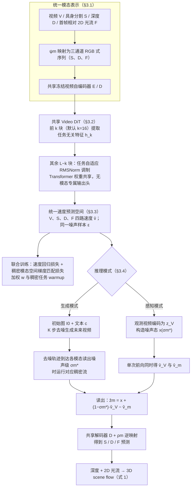

# GenSight（arXiv:2610.39232）

**GenSight**（*Seeing and Imagining as One: Unified Video Generation and 4D Perception for Embodied World Modeling*，[arXiv:2610.39232](https://arxiv.org/abs/2610.39232)，[项目页](https://gensight-rbs.github.io/)）来自 [具身智能小站 2026-10-30 盘点](../../sources/blogs/wechat_embodied_station_28_papers_event2reward_progress_rewards_2026-10-30.md)，属「世界模型与预测」组。

## 一句话定义

**GenSight 统一视频、深度、机器人分割及相对光流表示，支持未来生成和观测视频感知。**

## 英文缩写速查

| 缩写 | 英文全称 | 简要说明 |
|------|----------|----------|
| GenSight | Seeing and Imagining as One: Unified Video Generation and 4D Perception for Embodied World Modeling | 本文方法 / 基准的简称 |

## 为什么重要

- 把未来生成与稠密感知放进同一模型。它提供跨模态一致性的建模思路，价值主要体现在世界模型与感知层面。
- 开源结论：**待发布**（步骤 2.5，2026-10-30）。项目页标注 Code Coming Soon；页面链接的 gensight-rbs/gensight 经 git ls-remote 可达，但未核实其内容是否已含可运行代码。
- 同期同组工作见 [进度奖励、接触监督与规划验证：具身智能小站 10-30 期 28 篇阅读坐标](../overview/embodied-station-2026-10-30-28-papers-technology-map.md)。

## 流程总览

图依据：论文 §3.1–§3.4、Fig. 2。

## 核心机制

| 项 | 内容 |
|----|------|
| **arXiv** | [2610.39232](https://arxiv.org/abs/2610.39232) |
| **开源** | **待发布** |
| **要点** | GenSight 统一视频、深度、机器人分割及相对光流表示，支持未来生成和观测视频感知。 |
| **文内指标** | 公众号转述：它提供跨模态一致性的建模思路，价值主要体现在世界模型与感知层面。 |

## 源码运行时序图

**不适用（待发布）** — 项目页标注 Code Coming Soon；页面链接的 gensight-rbs/gensight 经 git ls-remote 可达，但未核实其内容是否已含可运行代码。 不编造运行脚本；代码公开后再补。

## 实验与评测

- 公众号转述：它提供跨模态一致性的建模思路，价值主要体现在世界模型与感知层面。
- **读法：** 本页为索引级摘要，依据公众号转述的官方摘要与仓库信息整理；逐项数字与 baseline 以原文 PDF 为准。

## 与其他工作对比

- 横向索引见 [进度奖励、接触监督与规划验证：具身智能小站 10-30 期 28 篇阅读坐标](../overview/embodied-station-2026-10-30-28-papers-technology-map.md)；同 arXiv 不重复造页。

## 结论

**把未来生成与稠密感知放进同一模型：它提供跨模态一致性的建模思路，价值主要体现在世界模型与感知层面。**

1. 开源边界：**待发布** — 项目页标注 Code Coming Soon；页面链接的 gensight-rbs/gensight 经 git ls-remote 可达，但未核实其内容是否已含可运行代码。
2. 核心机制：GenSight 统一视频、深度、机器人分割及相对光流表示，支持未来生成和观测视频感知。
3. 复现与选型前核对任务协议、硬件与基准口径，勿直接横比公众号摘录数字。

## 关联页面

- [world-action-models](../concepts/world-action-models.md)
- [generative-world-models](../methods/generative-world-models.md)
- [vla](../methods/vla.md)
- [embodied-station-2026-10-30-28-papers-technology-map](../overview/embodied-station-2026-10-30-28-papers-technology-map.md)

## 参考来源

- [gensight_arxiv_2610_39232.md](../../sources/papers/gensight_arxiv_2610_39232.md)
- [wechat_embodied_station_28_papers_event2reward_progress_rewards_2026-10-30.md](../../sources/blogs/wechat_embodied_station_28_papers_event2reward_progress_rewards_2026-10-30.md)
- [arXiv:2610.39232](https://arxiv.org/abs/2610.39232)
- [arXiv PDF](https://arxiv.org/pdf/2610.39232)：已通读方法部分（实验与附录以略读为准）：摘要、§1–§3（§3.1–§3.4 与 Fig. 2/3）、§4.1 数据与指标

## 推荐继续阅读

- [arXiv PDF](https://arxiv.org/pdf/2610.39232)
- [项目页](https://gensight-rbs.github.io/)
