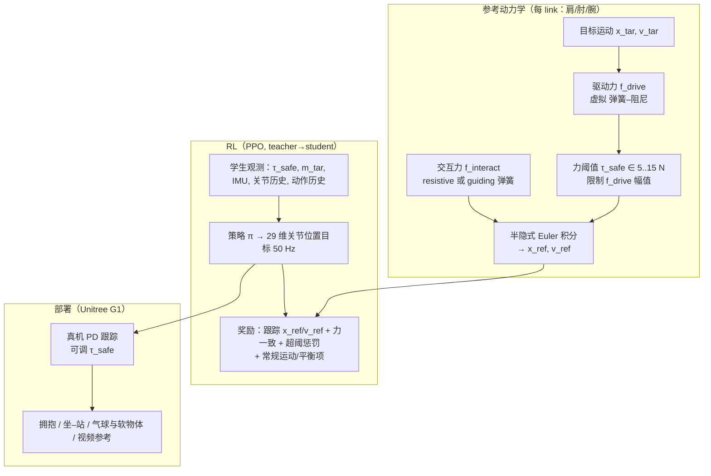
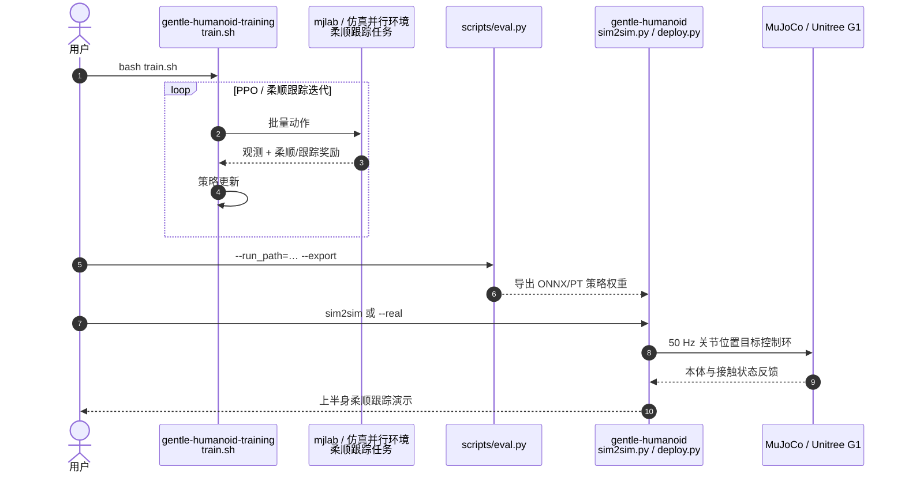

# GentleHumanoid（上半身柔顺全身运动跟踪）

**GentleHumanoid**（*Learning Upper-body Compliance for Contact-rich Human and Object Interaction*，Stanford 等，[arXiv:2511.04679](https://arxiv.org/abs/2511.04679)，[项目页](https://gentle-humanoid.axell.top/)）是在全身 motion tracking 中显式集成**上半身阻抗式柔顺**的代表工作：机器人仍跟踪全身参考动作，但肩-肘-腕链条会根据虚拟阻抗参考动力学和安全力阈值产生**可调、可部署**的力响应，而不是把外力一律当作扰动压掉。与 [SONIC](./nvidia-sonic.md) 等强调规模化刚性跟踪的路线对照，GentleHumanoid 把「跟踪成功率 vs 交互安全」写成同一套参考动力学里的驱动力 + 交互力 + 力阈值。

## 一句话定义

GentleHumanoid 在全身 motion tracking 中注入上半身阻抗式参考动力学，使 Unitree G1 能在拥抱、坐–站辅助、软物体操控等接触丰富任务中既跟踪动作又限制接触力。

## 英文缩写速查

| 缩写 | 英文全称 | 简要说明 |
|------|----------|----------|
| PPO | Proximal Policy Optimization | teacher–student 训练使用的 on-policy 策略梯度算法 |
| GMR | General Motion Retargeting | 将视频/动捕动作重定向为机器人可执行参考 |
| PD | Proportional–Derivative | 底层关节位置/阻抗控制，策略输出常为其 setpoint |
| G1 | Unitree G1 Humanoid | 论文真机验证平台（29-DoF） |
| ONNX | Open Neural Network Exchange | 跨框架部署导出格式 |
| WBC | Whole-Body Control | 全身跟踪与柔顺交互的控制基础设施 |
| Sim2Real | Simulation to Real | 把仿真中学到的策略迁移落地真机 |
| AMASS | Archive of Motion Capture as Surface Shapes | 大规模统一人体动捕数据集 |

## Survey 坐标（策展索引）

| 专题 | 编号与定位 | 来源 |
|------|------------|------|
| **42 篇 humanoid RL 运动控制长文** | **37/42** · 05 接触 · 柔顺 · 安全恢复 | [具身智能研究室 · 42 篇长文](https://mp.weixin.qq.com/s/hz9JXtJeUPRfUGzfD-pZuA) |
| **运动小脑 64 篇 / 接触稳定专题** | 09 柔顺与接触交互 / 04 接触后如何稳住 | [loco-manip-contact-category-04](../overview/loco-manip-contact-category-04-post-contact-stability.md) |

## 为什么重要

- **多连杆链条柔顺，而非单点阻抗**：拥抱与搀扶不是单个手端点受力，而是肩、肘、腕共同接触；论文用**完整上身姿态采样**作为 guiding contact 的弹簧锚点，避免各 link 独立施力导致运动学不协调。
- **训练期随机化、部署期可调阈值**：在仿真中用统一弹簧公式合成 resistive 与 guiding 交互力并随机化 $\tau_{\text{safe}} \in [5, 15]\ \text{N}$；部署时按任务直接调节（站点示例：握手/气球 **5 N**、拥抱 **10 N**、坐–站辅助 **15 N**）。
- **衔接视频参考与视觉拥抱管线**：项目页展示 **PromptHMR → GMR → 柔顺跟踪** 在噪声视频参考下的工作能力，另提供结合人体 shape 估计的视觉自主拥抱流水线。
- **工程材料完整可复现**：项目页、论文 source、官方训练/部署双仓以及 [Axellwppr/motion_tracking](https://github.com/Axellwppr/motion_tracking)（mjlab）compliance 分支均已公开并归档。

## 流程总览

## 核心原理与机制（详细）

### 1. 参考动力学与统一交互力

每个上身关键点（肩、肘、手）在根坐标系下满足：

$$
M \ddot{x} = f_{\text{drive}} + f_{\text{interact}}
$$

- **驱动力**：$f_{\text{drive}} = K_p(x_{\text{tar}}-x) + K_d(v_{\text{tar}}-v)$，$K_d = 2\sqrt{M K_p}$（临界阻尼）；$M=0.1\ \text{kg}$（论文设定）。
- **交互力**：统一弹簧 $f_{\text{interact}} = K_{\text{spring}}(x_{\text{anchor}} - x)$；resistive 时锚点为**初次接触位置**，guiding 时锚点从**人体动捕姿态分布**采样，保证肩–肘–腕多连杆力方向一致，避免各 link 独立随机受力破坏运动学一致性。
- **训练随机化**：$K_{\text{spring}} \sim U(5,250)$；约 40% 样本无外力、其余按手臂或单 link 组合激活；每 5 s 重采样锚点与激活 link 集。

### 2. 安全力阈值

$$
f_{\text{drive\_limited}} = \min\left(1,\ \frac{\tau_{\text{safe}}}{\|f_{\text{drive}}\|}\right) f_{\text{drive}}
$$

训练时 $\tau_{\text{safe}}$ 在 **$[5, 15]\ \text{N}$** 分段常值随机，并将当前阈值传入策略观测；合规奖励额外惩罚 $\|f_{\text{interact}}\| > \tau_{\text{safe}} + \delta_{\text{tol}}$（$\delta_{\text{tol}} = 10\ \text{N}$）。

### 3. Teacher–Student 与运动数据

- **Teacher** 额外观测参考动力学状态、预测/仿真交互力、连杆高度、力矩与累积误差等特权信息；**Student** 仅保留部署可得本体与阈值观测（无需全身 tactile）。
- **动作**：29 维关节位置目标，50 Hz 输出给底层 PD 跟踪，**PPO** 训练。
- **运动数据**：经 **GMR** 重定向 AMASS、InterX、LAFAN，约 **25 h @ 50 Hz**（滤除不适于交互场景的高动态片段，详见 [motion-retargeting-gmr](../methods/motion-retargeting-gmr.md)）。

## 关键实验与定量设定

| 项 | 数字/结论 |
|----|-----------|
| 力阈值 | `τ_safe ∈ [5, 15] N`（握手/气球 5 N、拥抱 10 N、坐站 15 N） |
| 参考动力学质量 | `M = 0.1 kg` |
| 弹簧随机化 | `K_spring ~ U(5, 250)`，约 40% 无外力 |
| 动作数据 | 约 **25 h @ 50 Hz**（AMASS/InterX/LAFAN 经 GMR） |
| 测力与评测 | 商用测力计 + 人台 **40 路** calibrated capacitive taxels 压力垫（对齐/错位拥抱）；定性验证人台拥抱、坐–站与气球操控 |
| 扩展管线 | 单目 RGB → PromptHMR → GMR → 柔顺跟踪；视觉人体 shape + 自主拥抱策略 |
| 平台 | Unitree G1 |

## 源码运行时序图

官方拆为训练仓 [Axellwppr/gentle-humanoid-training](https://github.com/Axellwppr/gentle-humanoid-training) 与推理/部署仓 [Axellwppr/gentle-humanoid](https://github.com/Axellwppr/gentle-humanoid)（相关 mjlab tracking 实现见 [Axellwppr/motion_tracking](https://github.com/Axellwppr/motion_tracking) 的 `compliance` 分支）。训练侧 `bash train.sh`，评估导出 `scripts/eval.py --export`；部署侧 `src/sim2sim.py` / `src/deploy.py`。

- **训练 / 部署双仓**：避免把仿真训练依赖带进真机运行时。
- **奖励与部署阻抗参数双侧对齐**：只复制策略权重而不对齐底层 PD/阈值配置会破坏柔顺行为。

## 工程实践与入口（含开源状态）

| 类型 | URL / 说明 |
|------|------------|
| 论文 | [arXiv:2511.04679](https://arxiv.org/abs/2511.04679) |
| 项目页 | [gentle-humanoid.axell.top](https://gentle-humanoid.axell.top/) |
| 代码（训练） | [github.com/Axellwppr/gentle-humanoid-training](https://github.com/Axellwppr/gentle-humanoid-training) |
| 代码（推理/部署） | [github.com/Axellwppr/gentle-humanoid](https://github.com/Axellwppr/gentle-humanoid) |
| 相关（mjlab tracking） | [github.com/Axellwppr/motion_tracking](https://github.com/Axellwppr/motion_tracking)（`compliance` 分支） |
| Tracking 演示与 GMR | [motion-tracking.axell.top](https://motion-tracking.axell.top/) · [Axellwppr/GMR](https://github.com/Axellwppr/GMR) |
| 部署与许可 | ONNX/PT 导出，`sim2sim` / `real deploy`；许可以各仓库 README 为准，工程栈细节见 [axellwppr-motion-tracking](./axellwppr-motion-tracking.md) 与 [mjlab](./mjlab.md) |

## 与其他工作对比

| 维度 | GentleHumanoid | [SONIC](./nvidia-sonic.md) / 标准全身跟踪 | 经典阻抗 / 导纳控制 | 全身触觉路线（WT-UMI 类） |
|------|----------------|---------------------------------------------|----------------------|----------------------------|
| 柔顺来源 | 上身阻抗式**参考动力学**注入 tracking | 规模化**刚性跟踪** / 无显式接触力约束 | 解析关节 / 末端阻抗律 | 触觉反馈驱动顺应 |
| 接触作用范围 | 肩–肘–腕**多连杆链条**（完整姿态采样锚点） | 主要依赖跟踪损失与数据 scaling | 常为末端点 / 单接触 | 全身接触点分布 |
| resistive / guiding | 统一弹簧式交互力**同时覆盖两者** | 不区分 | 依控制律设计 | 由触觉信号区分 |
| 力阈值可调 | 训练随机化 `τ_safe∈[5,15] N`，部署按任务设 | 统一 token / 多模态条件 | 需手工整定刚度/阻尼矩阵 | 依传感器量程 |
| 感知依赖 | 仅部署可得观测（无额外触觉） | proprioception + 参考条件 | 力/力矩传感 | 需全身 tactile 观测 |

## 结论

**GentleHumanoid 不换控制器范式，而是在参考轨迹这一层注入阻抗动力学——柔顺被建模成上身多连杆的「参考量」，而不是末端的力控律。**

- 真正起作用的是**参考动力学**：每个上身关键点满足 $M\ddot{x} = f_{\text{drive}} + f_{\text{interact}}$，交互力用**同一个弹簧**同时覆盖 resistive（锚点取初次接触位置）与 guiding（锚点从完整上身姿态分布采样），避免各 link 独立随机受力导致运动学不一致。
- 安全力阈值被做成**可部署旋钮**：训练随机化 $\tau_{\text{safe}}\in[5,15]\ \text{N}$、$K_{\text{spring}}\sim U(5,250)$、约 40% 样本无外力；部署按任务取握手/气球 5 N、拥抱 10 N、坐站辅助 15 N。
- 感知依赖被压到最低：teacher 用 privileged 的交互力/力矩，student 只看部署可得观测，输出 29 维关节位置目标交给底层 PD——**不需要全身 tactile**。
- 主要风险来自训练分布：接触模型是**仿真合成**，真实人体/软物体的接触分布可能超出随机化；阈值太软失去任务力、太硬产生冲击；它也不决定「要做什么」。
- 工程侧较完整：项目页、训练/部署双仓与 `motion_tracking` compliance 分支均已归档，支持 ONNX/PT 导出与 sim2sim / real 部署，许可以各仓库 README 为准。

## 局限与风险

- **不解决高层任务规划**：它让参考动作柔顺可交互，但不决定要做什么。
- **力阈值需按任务设置**：太软会失去任务力，太硬会产生冲击。
- **接触模型是仿真合成**：真实人/软物体接触分布可能超出训练随机化范围。
- **与精细触觉不同**：没有 WT-UMI 那样的全身 tactile observation。

## 关联页面

- [Loco-Manip 接触分类 04：接触后如何稳住](../overview/loco-manip-contact-category-04-post-contact-stability.md)
- [运动小脑 09：柔顺与接触控制](../overview/motion-cerebellum-category-09-compliance-contact.md)
- [人形 RL 身体系统栈](../overview/humanoid-rl-motion-control-body-system-stack.md)
- [Whole-Body Control](../concepts/whole-body-control.md) — 全身协调控制背景
- [Contact Dynamics](../concepts/contact-dynamics.md) — 多 link 接触与力分布
- [Impedance Control](../concepts/impedance-control.md) — 虚拟弹簧–阻尼基础
- [Motion Retargeting (GMR)](../methods/motion-retargeting-gmr.md) — AMASS/InterX/LAFAN 到 G1 重定向
- [Loco-Manipulation](../tasks/loco-manipulation.md) · [Teleoperation](../tasks/teleoperation.md)
- [axellwppr-motion-tracking](./axellwppr-motion-tracking.md) · [mjlab](./mjlab.md) · [Unitree G1](./unitree-g1.md)
- [CHIP](./paper-hrl-stack-36-chip.md) · [Thor](./paper-hrl-stack-42-thor.md)
- [SONIC](./nvidia-sonic.md) — 规模化刚性跟踪对照
- [LAC](./paper-lac.md) — 线+角刚度命令；作者对照含本页方法（部分开源）

## 参考来源

- [gentlehumanoid_upper_body_compliance.md](../../sources/papers/gentlehumanoid_upper_body_compliance.md)
- [gentle-humanoid-axell-top.md](../../sources/sites/gentle-humanoid-axell-top.md)
- [axellwppr_motion_tracking.md](../../sources/repos/axellwppr_motion_tracking.md)
- [humanoid_rl_stack_37_gentlehumanoid_learning_upper_body_compliance_fo.md](../../sources/papers/humanoid_rl_stack_37_gentlehumanoid_learning_upper_body_compliance_fo.md) — 42 篇长文 #37 策展摘录
- [humanoid_rl_stack_42_catalog.md](../../sources/papers/humanoid_rl_stack_42_catalog.md)
- [wechat_embodied_ai_lab_humanoid_rl_motion_survey.md](../../sources/blogs/wechat_embodied_ai_lab_humanoid_rl_motion_survey.md)
- [wechat_embodied_ai_lab_loco_manip_contact_survey.md](../../sources/blogs/wechat_embodied_ai_lab_loco_manip_contact_survey.md)
- [motion_cerebellum_64_catalog.md](../../sources/papers/motion_cerebellum_64_catalog.md)
- [wechat_embodied_ai_lab_humanoid_motion_cerebellum_survey.md](../../sources/blogs/wechat_embodied_ai_lab_humanoid_motion_cerebellum_survey.md)
- 原始抓取：[wechat_humanoid_rl_42_survey_2026-05-26.md](../../sources/raw/wechat_humanoid_rl_42_survey_2026-05-26.md)
- *GentleHumanoid: Learning Upper-body Compliance for Contact-rich Human and Object Interaction*, arXiv:2511.04679. <https://arxiv.org/abs/2511.04679>

## 推荐继续阅读

- [GentleHumanoid 项目页](https://gentle-humanoid.axell.top/)
- [RL Sim2Sim 在线演示：G1 Tracking](https://imchong.github.io/RL_Sim2Sim_Demo_Website/index.html)
- [机器人论文阅读笔记：GentleHumanoid](https://imchong.github.io/Robot_Learning_Paper_Notebooks/papers/04_Loco-Manipulation_and_WBC/GentleHumanoid__Learning_Upper-body_Compliance_for_Contact-rich_Human_and_Object/GentleHumanoid__Learning_Upper-body_Compliance_for_Contact-rich_Human_and_Object.html)
- [ISO/TS 15066](https://www.iso.org/standard/62996.html) — 协作机器人力限安全参考（论文阈值论证引用）
- [GMR 官方仓库](https://github.com/YanjieZe/GMR) — 人体→人形重定向基线实现
