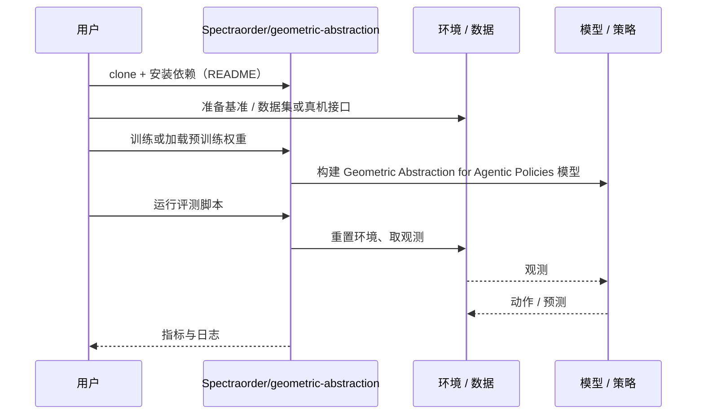

# Geometric Abstraction for Agentic Policies（arXiv:2611.05058）

**Geometric Abstraction for Agentic Policies**（*Do Agentic Policies Need to Look at Every Step? Geometric Abstraction for Reasoning and Action*，[arXiv:2611.05058](https://arxiv.org/abs/2611.05058)，[项目页](https://geometric-abstraction.github.io/)，[代码](https://github.com/Spectraorder/geometric-abstraction)）来自 [具身智能小站 2026-11-05 盘点](../../sources/blogs/wechat_embodied_station_43_papers_grasp_mesa_airoa_2026-11-05.md)，属「世界模型与控制」组。

## 一句话定义

**机械臂套环时，每一步都能把环孔与杆的偏差写成文字。**

## 英文缩写速查

| 缩写 | 英文全称 | 简要说明 |
|------|----------|----------|
| Geometric Abstraction for Agentic Policies | Do Agentic Policies Need to Look at Every Step? Geometric Abstraction for Reasoning and Action | 本文方法 / 基准的简称 |

## 为什么重要

- 把抓取进度写成模型能读的几何量。作者用标定过的深度相机更新这些几何量，让语言模型按需要再看图，并在仿真里对比逐步看图的操作策略。
- 开源结论：**已开源**（步骤 2.5，2026-11-05）。仓库可达（git ls-remote）。项目页 HTTP 200。
- 同期同组工作见 [接触丰富的手物重定向、分项泛化评测与手持夹爪示范：具身智能小站 11-05 期 43 篇阅读坐标](../overview/embodied-station-2026-11-05-43-papers-technology-map.md)。

## 核心机制

| 项 | 内容 |
|----|------|
| **arXiv** | [2611.05058](https://arxiv.org/abs/2611.05058) |
| **开源** | **已开源** |
| **要点** | 机械臂套环时，每一步都能把环孔与杆的偏差写成文字。 |
| **文内指标** | 公众号转述：作者用标定过的深度相机更新这些几何量，让语言模型按需要再看图，并在仿真里对比逐步看图的操作策略。 |

## 源码运行时序图

以下为按仓库入口（`Spectraorder/geometric-abstraction`）推断的通用运行链路；入库日仅核实仓库可达，未逐文件阅读，具体脚本名以 README 为准。

## 实验与评测

- 公众号转述：作者用标定过的深度相机更新这些几何量，让语言模型按需要再看图，并在仿真里对比逐步看图的操作策略。
- **读法：** 本页为索引级摘要，依据公众号转述的官方摘要与仓库信息整理；逐项数字与 baseline 以原文 PDF 为准。

## 与其他工作对比

- 横向索引见 [接触丰富的手物重定向、分项泛化评测与手持夹爪示范：具身智能小站 11-05 期 43 篇阅读坐标](../overview/embodied-station-2026-11-05-43-papers-technology-map.md)；同 arXiv 不重复造页。

## 结论

**把抓取进度写成模型能读的几何量：作者用标定过的深度相机更新这些几何量，让语言模型按需要再看图，并在仿真里对比逐步看图的操作策略。**

1. 开源边界：**已开源** — 仓库可达（git ls-remote）。项目页 HTTP 200。
2. 核心机制：机械臂套环时，每一步都能把环孔与杆的偏差写成文字。
3. 复现与选型前核对任务协议、硬件与基准口径，勿直接横比公众号摘录数字。

## 关联页面

- [world-action-models](../concepts/world-action-models.md)
- [generative-world-models](../methods/generative-world-models.md)
- [vla](../methods/vla.md)
- [embodied-station-2026-11-05-43-papers-technology-map](../overview/embodied-station-2026-11-05-43-papers-technology-map.md)

## 参考来源

- [geometric_abstraction_for_agentic_policies_arxiv_2611_05058.md](../../sources/papers/geometric_abstraction_for_agentic_policies_arxiv_2611_05058.md)
- [wechat_embodied_station_43_papers_grasp_mesa_airoa_2026-11-05.md](../../sources/blogs/wechat_embodied_station_43_papers_grasp_mesa_airoa_2026-11-05.md)
- [arXiv:2611.05058](https://arxiv.org/abs/2611.05058)

## 推荐继续阅读

- [arXiv PDF](https://arxiv.org/pdf/2611.05058)
- [项目页](https://geometric-abstraction.github.io/)
- [https://github.com/Spectraorder/geometric-abstraction](https://github.com/Spectraorder/geometric-abstraction)
