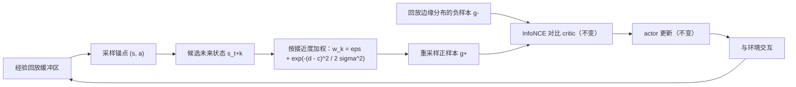

# IWR：接触的几何（从零学物体操作的对比强化学习）

**IWR**（Interaction-Weighted Resampling；论文 *Learning Object Manipulation from Scratch via Contrastive Interaction*，[arXiv:2606.11525](https://arxiv.org/abs/2606.11525)，v1 2026-06-10；[项目页](https://iwr-arxiv.github.io/) 标注 **CoRL 2026**）由 Tongle Shen、Caleb Chuck、Fan Feng、Biwei Huang（UCSD、UT Austin）提出。[Aether AI](./aether-ai.md) 官方博客在 **2026-07-16** 以 *The Geometry of Contact: Learning Object Manipulation from Scratch*（Field notes #06）发布解读。它研究的问题是：**不给示范、不给任务奖励，只给目标，机器人能否靠自己的交互经验学会操作？**

## 一句话定义

**对比强化学习（CRL）的可达性表示在接触处会「折一下」，而接触帧在均匀采样里几乎采不到；IWR 只改正样本未来状态的采样分布，在接近接触的未来上加权，让表示学好这道折痕。**

## 英文缩写速查

| 缩写 | 英文全称 | 简要说明 |
|------|----------|----------|
| IWR | Interaction-Weighted Resampling | 本文方法：按交互接近度重加权未来目标采样 |
| CRL | Contrastive Reinforcement Learning | 用对比学习估计目标可达性的目标条件 RL |
| CRTR | Contrastive Representations for Temporal Reasoning | 更强的对比 RL 基线（NeurIPS 2025） |
| GCRL | Goal-Conditioned Reinforcement Learning | 以目标状态为条件的 RL |
| InfoNCE | Info Noise-Contrastive Estimation | CRL 的训练目标 |
| FMDP | Factored Markov Decision Process | 状态分解为智能体与物体两部分的 MDP |
| HER | Hindsight Experience Replay | 事后目标重标注，基线之一 |
| HINT | Null Counterfactual Factor Interactions | 基于因子交互的 GCRL 基线（SAC+HINT） |
| SAC / PPO | Soft Actor-Critic / Proximal Policy Optimization | 无模型 RL 基线（稀疏成功奖励） |
| SGCRL | Single-Goal Contrastive RL | 论文第 6.1 节所列对比 CRL 基线（Table 1 记作 CRL） |
| UR | Universal Robots | 真机 air hockey 使用的机械臂品牌 |

## 为什么重要

- **给出 CRL 在操作上失灵的机制解释。** CRL 在运动与导航类任务上表现好，但在交互丰富的操作上吃力（摘要、第 4.1 节）。本文把原因定位到「接触改变动力学模式 → 可达性几何出现仿射折痕 → 接触处的误差被之后的被动动力学放大」。
- **修复非常小。** 不加网络、不加奖励整形、不加辅助损失，只改采样权重，而且只需要粗略的接近度信号（如夹爪-物体距离），不需要接触标签。
- **有真机证据。** 真实 air hockey 上，仿真训练、零样本迁移，20 个目标中 CRL 5/20（25%）、IWR 12/20（60%）（摘要、Table 1，自报）。作者称是第一个能击中目标的真实目标条件 air hockey 智能体（摘要）。
- **对无监督目标条件 RL 的提醒。** 论文把失灵归因于训练分布而非网络容量，并建议后续工作改进与交互相关的未来采样（附录 H.2）；这与 [BFM-Zero](./paper-bfm-zero.md) 等无监督 RL 路线相邻，但论文本身未引用 BFM-Zero（我的关联判断）。

## 核心信息

| 项 | 内容 |
|----|------|
| **机构** | 加州大学圣地亚哥分校（UCSD）、德州大学奥斯汀分校（UT Austin）；解读发布在以太智能（Aether AI）博客 |
| **作者** | Tongle Shen、Caleb Chuck、Fan Feng、Biwei Huang（后两位 equal advising） |
| **会议** | CoRL 2026（项目页标注） |
| **底座算法** | CRL（Eysenbach et al. 2022）与 CRTR；IWR 是它们的采样层修改 |
| **监督** | 只有目标设定 + 自身交互；无示范、无任务奖励 |
| **评测** | Box2D 到达 / 推动（5 个变体）、Meta-World（4 个任务）、Air Hockey（仿真、sim-to-real 迁移、真机） |
| **基线** | PPO、SAC、SAC+HER、SAC+HINT、CRL（正文称 SGCRL）、CRTR（第 6.1 节） |
| **真机** | UR5e + Robotiq 夹爪握拍，120Hz 顶置相机 blob 检测冰球，单应性转 x,y 坐标，20Hz 控制环（附录 F） |
| **开源** | 论文与项目页均未列代码（2026-10-10 核查） |

## 核心原理（方法）

### CRL 回顾：可达性地形

目标条件 RL 关心的是折扣未来占用密度：

\[\rho^\pi(g\mid s,a)=(1-\gamma)\sum_{k\ge1}\gamma^{k-1}p^\pi(s_{t+k}=g\mid s_t=s,a_t=a)\]

CRL 学状态-动作编码器 \(\phi(s,a)\) 和目标编码器 \(\psi(g)\)，用内积逼近对数可达性（减去只与目标有关的基线）：\(E^*(s,a,g)=\log\rho^\pi(g\mid s,a)-\log\bar\rho_B(g)=\phi(s,a)^\top\psi(g)\)。训练时同轨迹后续状态是正样本 \(g^+\)，负样本取自回放边缘分布，用 InfoNCE 加 LogSumExp 正则拉近推远（论文第 3 节式 1-3）。策略沿能量爬向目标，相当于沿「可达性地形」走。

### 为什么接触会破坏地形

- **运动：一步映射是线性的。** 动作小变化 → 结果小变化，\(\psi_{t+1}\approx A_0\psi_t\)，rollout 是一条光滑弧线。
- **接触：一步映射变成仿射。** 夹爪碰到物体前，动作对物体无效；碰到后一步之内物体位姿和速度进入可控范围，\(\psi_{t+1}\approx A_1\psi_t+b_t\)。偏置 \(b_t\) 是模式切换的标志，一个统一的光滑表示无法同时拟合两侧。
- **误差向后传播。** 接触之后物体又进入被动运动，接触处的局部误差 \(e\) 被被动动力学带着走：

\[\sup|\hat E_k-E_k|\propto\|A_0^k\|\,\|e\|+\tfrac12\|A_0^k\|^2\|e\|^2\]

这是命题 1（第 4.3 节式 7）。附录 A.5 实际证明的是上界，并依赖三条假设：局部仿射的模式动力学、只发生一次交互（one-reset）、终点落在正确均值的局部二次区域。作者在附录 G 用 t-SNE 展示 SGCRL 的 \(\phi(s,a)\)：Meta-World reach 轨迹平滑，Air Hockey 在交互处跳变。

### IWR：把采样密度挪到接触附近

- \(d_{t+k}\)：执行器与目标物体的位置距离 \(\|u_p-y_p\|_2\)（第 5 节）；\(c\)：接触阈值。权重在 \(d\) 接近 \(c\) 时达到峰值，覆盖接触前、中、后的窗口。
- \(\epsilon\)：保底权重，保持全局覆盖（第 5 节）。
- \(\sigma\)：控制交互窗口宽度（第 5 节）。
- 只对**正样本**未来重采样，CRL 损失、critic、actor、网络结构都不变（第 5 节）；负样本仍来自回放边缘分布。
- 作者在附录 C 的解释：这让采样到的正样本更可能跨过交互「桥」，直接暴露交互位移，而不是等它被被动动力学传播后再观察到。这是作者的机理解释，论文没有对采样分布做直接测量。

## 工程实践

| 项 | 要点（均出自论文附录 D、E、F） |
|----|------|
| 接近度信号 | 需要执行器与目标的位置，加一个宽松阈值 \(c\)（取真实接触距离的至少 1.5 倍）；不需要接触检测器（附录 D.4）。局限节承认它依赖因子化状态和启发式交互指示 |
| 超参（Table A4） | Air Hockey \(c=0.12\)、\(2\sigma^2=30\)；Meta-World \(0.09\)、\(20\)；Box2D center/goal \(3.3\)、\(100\)；Box2D hard/hard-velocity/maze \(2.0\)、\(80\)。\(\epsilon\) 的取值论文未列出 |
| 通用训练设置（Table A2） | 1000 万环境步、256 个训练环境、批大小 64、回放容量 200000、MLP(512,512)、表示维度 256、\(\gamma_f=0.99\)、Adam、学习率 \(3\times10^{-4}\)、5 个种子 |
| 真机迁移 | 先用约 2 分钟人类拍数据做拍参数辨识，冰球参数由人类颠球数据估计；域随机化拍密度、冰球阻尼、重力各 ±25%（附录 F）；仿真里加冰球观测噪声、随机遮挡、观测延迟，改用历史观测（Table A8）；见 [域随机化](../concepts/domain-randomization.md) |
| 真机评测 | 仿真训练后零样本，4×5 共 20 个固定目标；真机不做任何训练（第 6.2 节） |
| 源码运行时序图 | **不适用**：论文与项目页均未列代码仓库，无法描述运行时模块 |

## 实验与评测

成功率（Table 1；真机列为 20 个目标中的命中数；均为自报，5 个种子，**取训练中每 20 万步均值里最好的一次**，附录 D.6）：

| 任务 | PPO | SAC | SAC+HER | SAC+HINT | CRL | CRTR | **IWR** | 相对最佳对比基线 |
|------|-----|-----|---------|----------|-----|------|---------|------------------|
| Air Hockey（仿真） | 0.617 | 0.145 | 0.398 | 0.422 | 0.695 | 0.727 | **0.742** | +2.1% |
| Air Hockey（real-transfer） | 0.160 | 0.215 | 0.129 | 0.125 | 0.477 | 0.465 | **0.500** | +4.8% |
| Air Hockey（真机） | 0/20 | 0/20 | 0/20 | 0/20 | 5/20 | 2/20 | **12/20** | +140% |
| Box2D（goal） | 0.089 | 0.046 | 0.086 | 0.064 | 0.450 | 0.558 | **0.709** | +27.1% |
| Box2D（hard） | 0.060 | 0.042 | 0.064 | 0.076 | 0.317 | 0.365 | **0.565** | +54.8% |
| Box2D（hard velocity） | 0.148 | 0.149 | 0.152 | 0.139 | 0.387 | 0.377 | **0.436** | +12.7% |
| Box2D（center / maze） | 0.086 / 0.033 | 0.058 / 0.012 | 0.088 / 0.031 | 0.088 / 0.035 | 0.278 / 0.217 | 0.274 / 0.206 | **0.288 / 0.223** | +3.6% / +2.8% |
| Meta-World（pick place） | 0 | 0 | 0.004 | 0 | 0.266 | 0.305 | **0.570** | +86.9% |
| Meta-World（push） | 0 | 0 | 0.004 | 0 | 0.699 | **0.750** | 0.730 | 低于 CRTR |
| Meta-World（peg insert / sweep into） | 0 / 0 | 0 / 0.004 | 0 / 0.020 | 0 / 0.004 | 0.430 / 0.805 | 0.367 / 0.910 | **0.438 / 0.926** | +1.9% / +1.8% |

- **平均：** 相对最佳对比基线（CRL 与 CRTR 中较好者）+19.8%（Table 1）；这是各任务相对提升的平均，被 pick-place +86.9% 与 Box2D hard +54.8% 拉高，多个任务只有 +1.8% 到 +4.8%。
- **方差：** Table A12 给出种子标准差：Air Hockey 仿真 0.742±0.041 对 CRTR 0.727±0.017，Box2D maze 0.223±0.084 对 CRTR 0.206±0.024，Meta-World peg insert 0.438±0.268 对 CRL 0.430±0.101，这些提升落在误差范围内（我的判断）。
- **无模型基线：** PPO/SAC 系在 Meta-World 与真机几乎为 0；作者说奖励类方法在 Meta-World 和真机上没有成功（第 6.1 节）。
- **消融（附录 H.2，6 个任务）：** c 与 \(2\sigma^2\) 各取 0.5 倍与 1.5/2 倍多数设置优于主表所选值，如 pick-place \(2\sigma^2\) 取 0.5 倍为 0.844±0.266；作者称 IWR 对宽范围参数稳健，但 push 在主表设置（c=1.0 倍、\(2\sigma^2\)=1.0 倍）下低于 CRTR。主表所选超参并非表中最好，也说明有调参空间（我的判断）。
- **真机（第 6.2 节）：** 12/20 对 CRL 5/20、CRTR 2/20；仿真 real-transfer 设置里 IWR 仅比最佳基线高 4.8%。作者归因为 IWR 更稳定地击中冰球且力度更向上，其他方法多半只击球一次（作者自述，未做对照实验验证）。

## 结论

**IWR 说明：对比 RL 做操作时，难点集中在接触那一刻，而修复可以只在采样层完成。**

- **看接触密集的任务。** IWR 的收益在 Box2D hard / goal、Meta-World pick-place 和真机 air hockey 上最大；接近光滑的任务几乎无变化。评估时应按任务的接触程度分开看。
- **它是插件，不是新算法。** 只改正负样本的采样权重，可以叠加在 CRL、CRTR 等任何基于 InfoNCE 的目标条件 RL 上。
- **工程门槛在接近度信号。** 需要能大致估计「快接触了没有」；视觉-only 场景要先有物体与末端的位置估计。
- **真机证据有限。** 12/20 对 5/20 来自单一任务、20 个固定目标，论文未报告重复次数或置信区间；「+140%」是相对提升。
- **并非全面占优。** Meta-World push 上 IWR 低于 CRTR，几个任务的提升在 2% 左右。

## 与其他工作对比

| 对比轴 | IWR | [CRL](./paper-rcl-ref-4db46d89f6231c67051e-contrastive-learning-as-goal-conditioned-reinfor.md) / CRTR | SAC+[HER](../methods/her.md) | SAC+HINT |
|--------|-----|-----------|---------|----------|
| 奖励 | 无（目标条件） | 无（目标条件） | 稀疏目标奖励 + 重标注 | 稀疏目标奖励 |
| 未来目标采样 | 按交互接近度加权 | 沿轨迹按几何分布采样（CRTR 另有 R=8 的同轨迹重复采样） | 事后重标注（比例 0.8） | 同 HER 比例，但锚点按交互权重采样（附录 D.5） |
| 额外先验 | 因子化状态与接近度阈值 | 无 | 无 | 因子化状态与接触距离 |
| 接触任务表现（本文表） | 最好（除 push） | 次之 | 接近 0 | 接近 0 |

- 与 HINT 有作者重叠（Caleb Chuck、Fan Feng），两者都把「交互」作为目标条件 RL 的关键结构；IWR 只用软权重，不需要显式判断交互是否发生；论文称 CRTR 可视为 IWR 在 c→∞（均匀采样）时的消融（第 6.1 节）。
- 与 [BFM-Zero](./paper-bfm-zero.md) 等无监督 RL 行为基础模型相比，IWR 关注的是操作中的接触结构，而不是人形全身控制的规模化。
- 同在 Aether AI 博客的 [TC-WM](./paper-task-centric-world-models.md) 从表征角度讨论「什么状态对控制重要」，IWR 从采样角度讨论「哪些时刻对表征重要」。

## 与清单说法的核对

来源：Glen Berseth 的 CoRL 2026 阅读清单第 006/101 条（P0，RL Algorithms & Exploration）。清单自述每条摘要由 LLM 据摘要起草，排序来自作者自己的兴趣打分，不是质量评价。

清单原句：*Shows interaction-induced mode changes break contrastive RL in manipulation; interaction-weighted resampling fixes it, learning from scratch.*

| 清单说法 | 论文实际情况 |
|----------|--------------|
| 交互引起的模式变化「破坏」对比 RL | 论文是分析加经验观察：第 4 节用切换仿射模型与命题 1（上界，依赖局部仿射、单次交互等假设）论证「难以表示」，并非证明失败；CRL 在 Meta-World push、sweep-into 上仍有 0.70、0.81 的成功率（Table 1） |
| 重采样「fixes it」（修好了） | 只是改善：平均 +19.8%，多数任务提升 1.8%-4.8%且在种子方差内，Meta-World push 上低于 CRTR（0.730 对 0.750）；作者自认 IWR 只改采样，仍用单峰模型（第 7 节） |
| learning from scratch | 成立：无示范、无任务奖励，只有目标条件（摘要、引言）；但依赖因子化状态和手工接近度阈值 c（附录 D.4，局限节） |
| 清单未提的设置 | 仿真居多，真机只有一个任务：零样本 sim-to-real 的 UR5e air hockey，12/20 对 5/20，仿真里同设置只差 4.8%；Table 1 取训练中最好检查点 |

## 局限与风险

作者自述（第 7 节）：

- IWR 仍用单峰模型表示多峰操作动力学，只改采样。
- CRL 只是一种无监督 RL，表示能力有限；IWR 可用于其他无监督 RL，但论文未试。
- 假设因子化状态与启发式交互指示，需与端到端感知结合。
- CRL 样本效率代价高，难以直接上真机，真机失败来自 sim-to-real 差距。

我看到的未验证之处：

- **代码未公开**，\(\epsilon\) 取值与各环境 \(d\) 的实现细节无法核对。
- **真机规模小。** 单任务、20 个目标，没有重复次数或方差。
- **报告口径偏乐观。** Table 1 取训练曲线上最好的检查点（附录 D.6）；消融显示调参空间不小，主表超参并非最优，对基线是否同等调参论文未说明。
- **理论是局部的。** 命题 1 是上界，附录假设终点落在局部二次区域、单次交互；作者在第 6.1 节自己承认 pick-place 这类重复交互超出该简化设置，只是经验上有效。
- **机理归因未直接验证。** 「IWR 提高跨交互正样本比例」是解释，论文没有统计采样分布；真机里「更稳定地击球」的原因也只是定性描述。
- **任务范围。** 评测为平面推动、Meta-World 四任务与 air hockey；多物体、多接触、视觉输入未覆盖。

## 关联页面

- [Aether AI（以太智能）](./aether-ai.md) — 发布本文解读博客的公司
- [Contrastive Learning as Goal-Conditioned RL（CRL 原论文）](./paper-rcl-ref-4db46d89f6231c67051e-contrastive-learning-as-goal-conditioned-reinfor.md)
- [BFM-Zero](./paper-bfm-zero.md) — 无监督 RL 行为基础模型，相邻路线（论文未引用）
- [Meta-World](./paper-as-1910-10897-meta-world-a-benchmark-and-evaluation-for-multi.md) — 评测基准之一
- [TC-WM](./paper-task-centric-world-models.md) — 同在 Aether AI 博客的控制表征工作
- [强化学习](../methods/reinforcement-learning.md) · [PPO](../methods/ppo.md)
- [HER](../methods/her.md) · [SAC](../methods/sac.md)
- [接触丰富操作](../concepts/contact-rich-manipulation.md)
- [接触动力学](../concepts/contact-dynamics.md)
- [Sim2Real](../concepts/sim2real.md) · [域随机化](../concepts/domain-randomization.md)
- [BFM 分类 02：Goal-conditioned 学习](../overview/bfm-category-02-goal-conditioned-learning.md)
- [操作任务](../tasks/manipulation.md)

## 参考来源

- [Aether AI 博客：The Geometry of Contact（2026-07-16）](../../sources/blogs/aether_geometry_of_contact.md)
- [IWR 论文归档（arXiv:2606.11525，含核对范围与通读记录）](../../sources/papers/iwr_contrastive_interaction_arxiv_2606_11525.md)
- [My CoRL 2026 Reading List（Glen Berseth，2026-11-10）](https://www.fracturedplane.com/blog/2026/11/10/CoRL2026-Reading-List.html) — 清单第 006 条

## 推荐继续阅读

- [Aether AI 博客原文](https://aetherlabs.ai/articles/the-geometry-of-contact.html)
- [IWR 项目页](https://iwr-arxiv.github.io/)
- [arXiv:2606.11525](https://arxiv.org/abs/2606.11525)
- [Robot Air Hockey 测试平台（arXiv:2405.03113）](https://arxiv.org/abs/2405.03113)
