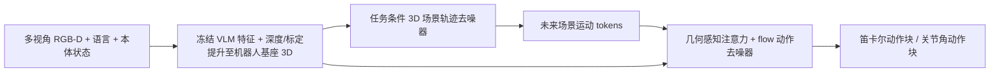

# GeomVLA：在统一三维场景、运动与动作

**GeomVLA**（*Unifying Scene, Motion, and Action in 3D*，[arXiv:2609.13812](https://arxiv.org/abs/2609.13812)，[项目页](https://ziyin-xiong.github.io/geomvla.io/)）由 **卡内基梅隆大学**（Ziyin Xiong、Nikolaos Gkanatsios、Katerina Fragkiadaki）与 **英伟达**（Moritz Reuss）提出。它把 VLA 的视觉语义提升到机器人中心的度量三维空间，显式预测任务条件的未来场景运动，并让该运动表征以几何感知方式引导动作生成。

## 一句话定义

**用机器人基座坐标系中的 3D 场景特征和未来点轨迹 token，把视觉语义、场景运动与 flow-matching 动作生成串成几何一致的策略；预测轨迹是动作条件，不是开环执行计划。**

## 英文缩写速查

| 缩写 | 英文全称 | 简要说明 |
|------|----------|----------|
| VLA | Vision-Language-Action | 将视觉、语言条件与机器人动作统一的策略 |
| VLM | Vision-Language Model | 提供预训练视觉语言语义特征的编码器 |
| RGB-D | Red-Green-Blue + Depth | 彩色图像与深度组成的多视角输入 |
| CALVIN | Composing Actions from Language and Vision | 语言条件桌面操作长程基准 |
| ALOHA | A Low-cost Open-source Hardware System for Bimanual TeleOperation | 论文采用的双臂真机平台系列 |

## 核心信息

| 项 | 内容 |
|----|------|
| **机构** | 卡内基梅隆大学；英伟达 |
| **输入** | 多视角 RGB-D、自然语言指令、机器人本体状态 |
| **共享空间** | 由深度与相机标定将 VLM 特征提升到机器人基座坐标系的 3D 场景表示 |
| **运动中间量** | 任务条件的 3D Scene Trajectory Denoiser 预测未来场景点运动并产生 motion tokens |
| **动作头** | 几何感知注意力条件化 3D flow-based action denoiser；提供笛卡尔动作与关节角变体 |
| **视觉编码器** | 冻结 Florence-2 特征，经深度/相机几何提升至 3D |
| **关键主张** | 在感知、运动中间表征与动作间维持 3D 几何一致性，比只加未来运动预测头更重要 |

## 流程总览

要点在 `lift → act` 的几何对齐及运动 token 的条件作用：模型不要求先把未来点轨迹转换为可执行路径，而是让几何一致的中间运动表征影响动作块生成。

## 实验结果与消融

| 评测 | 论文结果 | 读法 |
|------|----------|------|
| CALVIN ABC-D | 平均长度 **4.624**；论文对比 FLOWER **4.480**、X-VLA **4.430** | 报告无需额外机器人动作预训练；只在该基准与论文所列设定内解读 |
| RoboTwin2（50 tasks） | Easy **78.6%**，Hard **76.2%** | 论文报告高于其 π0.5 对照（75.9% / 75.7%） |
| CALVIN 组件消融 | 完整 **4.624**；无运动模块 **4.508**；2DGeomVLA **4.437**；图像空间运动版 **4.085** | 对比支持 3D 几何一致性作用，不能单独证明未来运动预测普遍有效 |
| 真机 ALOHA2，关节角版本 | GeomVLA-JA **59.4%**；匹配的 2D-JA **28.8%** | 8 项任务、每项 20 次评估；配置与论文设置绑定 |

**真机采集与评测配置：** ALOHA2 双臂；两台 Azure Kinect DK 负责前/后视角，一台腕部 Intel RealSense D405；右侧 ViperX300S follower，WidowX250S leader 用于遥操作。最初 3 项任务各 50 条演示，其余各 20 条。跨平台复现时须先对齐视角、标定与动作空间，不能只照搬成功率数字。

## 工程实践与开源状态

- **依赖项：** 深度质量、相机内外参及多视角到机器人基座的标定是方法输入的一部分；标定误差会污染 3D 特征与后续动作条件。
- **代码状态：** 项目页的 Code 链接指向 `ziyin-xiong/GeomVLA`，但该 GitHub 地址在 **2026-10-13 返回 404**。因此当前没有可确认公开的模型实现、权重或数据集，不应把同账号下的 `geomvla.io` 网站源码当成模型仓库。
- **源码运行时序图：** **不适用**（当前未核实存在可运行的官方模型仓库/入口）。
- **论文边界：** 作者将规模化机器人预训练、跨本体数据和显式语言推理列为未覆盖或后续方向；该方法更准确地说是几何一致的视觉运动表征来辅助动作，而非通用 3D 规划器。

## 与其他工作对比

| 工作 | 关联与区别 |
|------|------|
| [π0.5](./paper-pi05-open-world-vla.md) | 2D 图像 token + 大规模机器人预训练路线；GeomVLA 在 RoboTwin2 上报告小幅领先（78.6% vs 75.9% Easy），且不依赖额外机器人动作预训练，但需多视角深度与相机标定 |
| FLOWER / X-VLA | CALVIN ABC-D 上的论文对照（4.480 / 4.430）；同为 flow / 扩散式动作生成，差别在 GeomVLA 把特征与运动中间量放到机器人基座 3D 坐标系 |
| [DP3](./painode-209-3ddiffusionpolicydp3.md) | 同样以 3D 点云条件化扩散策略；DP3 不含语言 VLM 语义与未来场景运动 token，GeomVLA 把二者统一进几何一致的条件路径 |
| [World Action Models](../concepts/world-action-models.md) | WAM 通常预测未来视频或 latent；GeomVLA 预测的是 3D 场景点轨迹，仅作动作条件，不做像素级未来生成 |
| [机器人视觉感知栈选型闭环](../queries/robot-perception-stack-selection-loop.md) | GeomVLA 把"深度 + 标定 → 3D 特征"内嵌进策略，感知栈的标定与深度质量直接成为策略性能的上游约束 |

## 结论

**GeomVLA 的主要价值是把 VLA 从 2D 语义特征到动作的映射，改造成在机器人中心 3D 空间中由场景运动表征贯通的路径；当前证据显示这种几何一致性在所测基准和真机配置下有帮助。**

1. **优先看完整模型与 2D 消融差值**：CALVIN 4.624 vs 4.437，提示空间表征设计可能是核心收益来源。
2. **不要把“预测未来运动”单独当成贡献结论**：去运动模块为 4.508，低于完整模型但高于 2D 版本；消融组合显示坐标系与监督目标有交互。
3. **真机复现先核对相机标定与视角**：多视角 RGB-D 和机器人基座坐标变换是方法前提，不是可随意省去的外围工程。
4. **跨基准不横比成功率**：CALVIN 长程任务长度、RoboTwin2 成功率与真机任务完成率是不同指标和试验设置。
5. **复现计划应预留源码可用性风险**：项目页所链模型仓库目前 404，训练脚本、权重、数据需等待官方入口恢复或另行联系作者确认。

## 参考来源

- [论文来源归档](../../sources/papers/geomvla_arxiv_2609_13812.md)
- [项目页与开源核查](../../sources/sites/geomvla-project-page.md)

## 关联页面

- [VLA 方法总览](../methods/vla.md)
- [3D 空间视觉问答](../concepts/3d-spatial-vqa.md)
- [World Action Models](../concepts/world-action-models.md)
- [Diffusion Policy 与流式动作生成](../methods/diffusion-policy.md)
- [机器人视觉感知栈选型闭环](../queries/robot-perception-stack-selection-loop.md)
- [CALVIN](./calvin-benchmark.md) / [RoboTwin](./robotwin.md)

## 推荐继续阅读

- [SceneVerse++：互联网视频到 3D 场景监督](https://github.com/SceneVerse/SceneVerse) — 对照上游 3D 场景语义与 VQA/VLN 数据路径。
