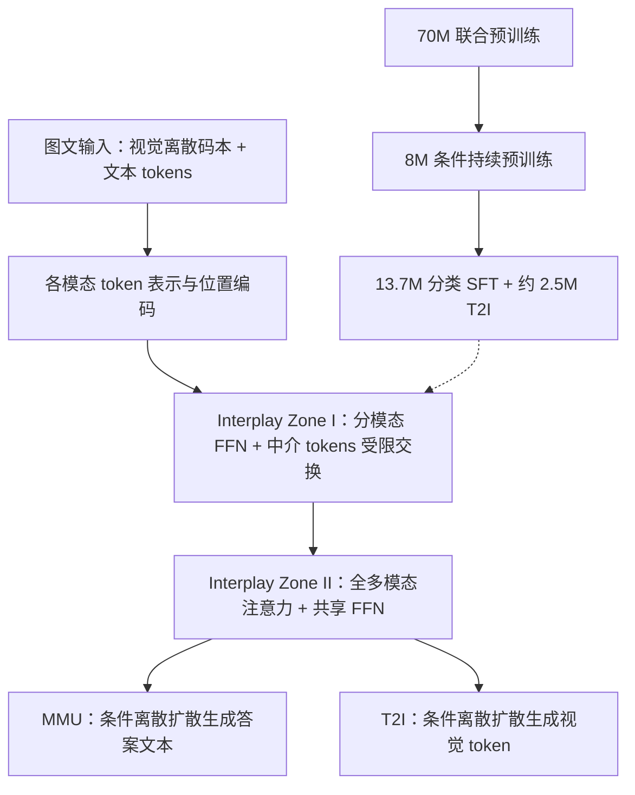
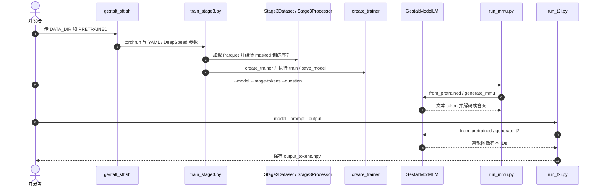

# Gestalt：Large Multimodal Interplay Model｜大规模多模态交互模型

## 一句话定义

**GeWu-Lab Gestalt**（[arXiv:2610.00576v2](https://arxiv.org/html/2610.00576)）是以**模态独有信息 → 冗余对齐 → 协同推理**为原则的视觉语言离散扩散模型；不是 [Contra Labs 设计榜 Gestalt (stealth)](gestalt-stealth-design-model.md)。

## 英文缩写速查

| 缩写 | 英文全称 | 简要说明 |
|---|---|---|
| MMU | Multimodal Understanding | 输入图像 token 与问题、生成文字 |
| T2I | Text-to-Image | 从文本生成离散图像 token |
| SFT | Supervised Fine-Tuning | 四种模态交互类型的监督微调 |
| FFN | Feed-Forward Network | Zone I 分模态、Zone II 共享的网络层 |
| VQ-VAE | Vector-Quantized Variational Autoencoder | 生成供模型使用的视觉离散码本 |
| CPT | Continual Pretraining | 条件掩码继续预训练 |

## 为什么重要

- **架构：** 前四层保留模态专属 FFN，通过中介 token 对齐，后续层才放开全多模态注意力；对比直接早融合提供可分析的另一种选择。
- **数据：** 依据单模态独有、图文冗余与协同关系分桶，不只是扩大图文对数量。
- **具身关联仅属启发：** 可以讨论机器人视觉/语言多模态信息融合，但论文未提供机器人动作头、VLA 成功率或真机闭环证据。

## 核心信息

| 维度 | 原文与官网 |
|---|---|
| 版本 | arXiv:2610.00576v2，2026-10-08 |
| 机构 | 中国人民大学高瓴人工智能学院、北京大模型与智能治理重点实验室、北京航空航天大学、北京邮电大学、上海人工智能实验室、AresoX |
| 基础模型 | LLaDA-8B-Instruct；16,384 视觉码本；32 个 learnable interplay tokens |
| 训练规模 | 70M 联合预训练、8M 条件预训练、13.7M SFT；另约 2.5M T2I |
| 开放状态 | [官网](https://gewu-lab.github.io/Gestalt/) · [代码](https://github.com/GeWu-Lab/Gestalt) · [权重](https://huggingface.co/GeWu-Lab/Gestalt)；SFT 数据仍标注 coming soon |

## 核心原理与方法

1. **Interplay Zone I：** 视觉与文本使用分别的 FFN，限制直接视觉文本注意力，跨模态信息主要通过 interplay tokens 流动。
2. **Interplay Zone II：** 视觉、文本与中介 tokens 参与完整多模态自注意力并共享 FFN。
3. **统一离散扩散：** 掩码预测训练图文离散 token；阶段化训练与四类数据（redundancy / text-unique / visual-unique / synergy）强调不同信息关系。
4. **四类 SFT 数据：** 约 2.8M / 4.2M / 4.0M / 2.7M；论文附录讨论数据构造和过滤策略。

## 流程总览

> Zone I/II 是单次前向的前后两段；预训练、持续预训练与 SFT 是不同训练阶段，不应混读。

## 源码运行时序图

已对照 [官方源码归档](../../sources/repos/gestalt-gewu-lab.md) 中 scripts/training 和 scripts/inference 入口，图仅反映已核实的调用关系，不代表本地已运行：

## 实验与评测

| 官方论文指标 | 报告结果 | 解读边界 |
|---|---:|---|
| UniGenBench English Long overall | 73.30 | 细粒度图像生成总分，但文本渲染子项为 3.80 |
| CV-Bench 2D / 3D | 78.9 / 86.1 | 视觉理解，不是机器人操作成功率 |
| MM-IMDb / SRBench | 67.07 / 53.17 | 本文设定的跨模态协同评测 |

## 与其他工作对比

相对直接全模态混合或部分统一扩散模型，Gestalt 设计显式的交换瓶颈和协同课程；比较范围限于论文报告的模型和任务。与 [Gestalt (stealth)](gestalt-stealth-design-model.md) 同名，却没有公开身份关系证据。

## 结论

**值得吸收的是“先保护模态专有信息，再逐层融合”的架构与课程设计，而不是直接当成可控机器人的 VLA。**

1. 比较早融合与受限交换的视觉语言特征质量，不只比较总参数量。
2. 数据按 redundancy、unique、synergy 分层，针对跨模态推理做消融。
3. 使用官方 MMU 时需预提取 VQ 图像 tokens。
4. T2I 脚本输出 token .npy，若要呈现图片仍需补视觉码本解码。
5. 没有机器人动作和真机闭环评测，不将其视觉分数代替动作成功率。

## 工程实践

使用官方 README 的 Quick Start 下载模型权重；SFT 训练通过 gestalt_sft.sh → torchrun train_stage3.py 读取符合 schema 的 Parquet 数据。官方训练数据尚未完整发布；目前尚未独立运行 GPU 训练或推理。机器人系统接入时需另设计 action 输出与时延、闭环测试。

## 局限与风险

- 属预印本，表格数值为作者报告值，尚未独立复现实验。
- 官方代码和权重公开不等于训练数据完整开放；图像离散化也可能损失细节。
- **禁止**把设计榜匿名 Gestalt 的 Elo 与本模型权重或论文绑定。

## 关联页面

- [统一多模态 Token](../methods/unified-multimodal-tokens.md)
- [视觉语言特征融合](../concepts/vision-language-feature-fusion.md)
- [模型架构纵深路线](../../roadmap/depth-model-architecture.md)
- [同名设计榜匿名 Gestalt](gestalt-stealth-design-model.md)

## 参考来源

- [论文 HTML v2 原文核读](../../sources/papers/gestalt_large_multimodal_interplay_2610_00576.md)
- [官方项目页](../../sources/sites/gestalt-gewu-lab.md)
- [训练、推理源码核读](../../sources/repos/gestalt-gewu-lab.md)

## 推荐继续阅读

- [论文 HTML](https://arxiv.org/html/2610.00576)
- [官方 GitHub README](https://github.com/GeWu-Lab/Gestalt)
