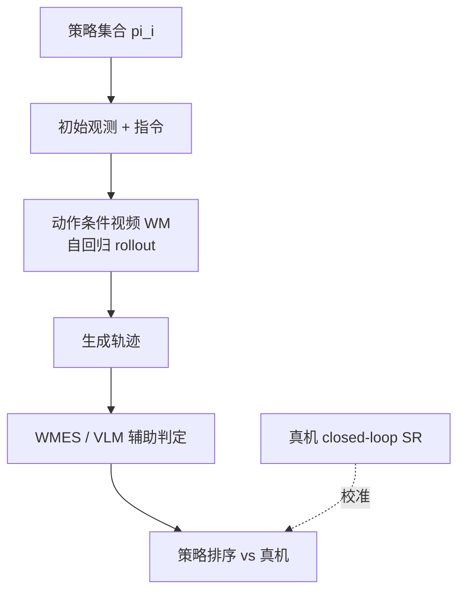
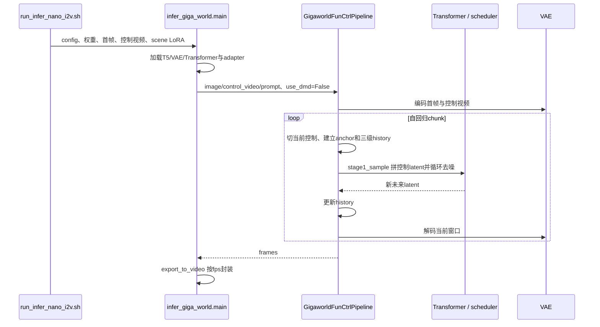

# GigaWorld-1（World Models for Robot Policy Evaluation · arXiv:2607.02642）

**GigaWorld-1**（*GigaWorld-1: A Roadmap to Build World Models for Robot Policy Evaluation*，[arXiv:2607.02642](https://arxiv.org/abs/2607.02642)，GigaAI + 清华大学等，[open-gigaai.github.io/giga-world-1/](https://open-gigaai.github.io/giga-world-1/)）系统研究 **世界模型能否当可靠策略评估器**：构建 **WMBench**（真机遥操作 + 策略 rollout **配对轨迹**），在 **7 类视频 WM × 4 种动作编码 × 324k+ 模拟 rollout** 上实证——**长时序动作忠实一致性** 比 **短时视觉逼真** 更决定 evaluator 质量；并发布 roadmap 实例 **GigaWorld-1**（六诊断均分 **+14.9%** vs Wan2.2，较最强Cosmos2.5为+11.6%）。

## 一句话定义

**WM 作评估器：差几厘米的动作若 rollout 后都「看起来抓成功了」，评估就失效—— faithful 长程 rollout 才是硬指标。**

## 英文缩写速查

| 缩写 | 英文全称 | 简要说明 |
|------|----------|----------|
| WM | World Model | **策略轨迹 surrogate 模拟器** |
| WMBench | World Model Benchmark | 8 任务族 · 2989 paired traj · episode-disjoint split |
| WMES | World Model as Evaluator Score | **Outcome + fidelity** 分层评分（0–3） |
| VLA | Vision-Language-Action | 被评估 **具身基础策略** |
| SLERP | Spherical Linear Interpolation | 长程 **prompt 平滑过渡**（GigaWorld-1） |
| OOD | Out-of-Distribution | 外观/类别/背景/ **成败** 泛化测试 |
| CVPR GC | GigaBrain Challenge 2026 | 社区 WM 提交纳入对照 |

## 为什么重要

- **真机评测瓶颈：** OpenVLA 报告 **2500 rollout ≈ 100 人时**；WM 若 **排序与真机一致** 可 **大幅降本**（策展文「策略版本评估」入口）。
- **反直觉核心结论：** **短时画面逼真 ≠ 好评估器**；challenge baseline 常 **过度预测成功**（视觉 plausible 但 **不惩罚差动作**）；须 **动作敏感 + 误差传到任务结果**。
- **324k rollout 量级 roadmap：** 数据配比（**PhysData + robot controllability**）、**显式低层 action 接口**、**分层 memory**、evaluator-oriented post-training → **GigaWorld-1** 可复现设计图。
- **与 [DreamSteer](./paper-dreamsteer-vla-deployment-steering.md) / [EmbodiedGen V2](./paper-embodiedgen-v2-sim-ready-world-engine.md) 互补：** 筛选 / **环境扩展** / **版本评估** 三条研发 expensive 链路。

## 核心原理与方法

| 组件 | 方法要点 |
|------|----------|
| **WMBench 构建** | **2989 paired traj**（teleop : policy rollout ≈ **1:1**）；**episode-disjoint** train/test；**成败平衡** |
| **WM 交互协议** | 策略输出 action → WM **自回归 rollout** → 推断 success / failure |
| **WMES 目标** | $S^{\mathrm{real}}(\pi)$ vs $S^{\mathrm{wm}}(\pi)$ **排序相关**；Score 3 = **同成败 + 高保真物理** |
| **控制变量研究** | **7 WM 家族**；**4 action 编码**；诊断 metric 取自 WorldArena 子集 |
| **数据 ~12980 h** | 互联网物理视频 + 开源 robot + egocentric + Giga 自采；**清洗 + success/action sync 标注** |
| **GigaWorld-1 实例** | Wan **1.3B/5B** 骨干；**显式 control + hierarchical memory + SLERP prompt**；**六诊断均分相对Wan2.2 +14.9%** |

### WM 策略评估闭环

### 三大核心洞察（论文摘要）

| 洞察 | 设计含义 |
|------|----------|
| **长时序 action-faithful rollout** | 评估器首要优化 **动作条件一致性**，非单帧 FVD |
| **预训练数据配比** | 平衡 **通用世界知识** 与 **机器人可控性**（PhysData 关键） |
| **架构** | **低层 action 表征 + spatial alignment + memory** 决定真机对齐 |

## 工程实践：策略评估器验证清单

- 用相同起始状态与动作序列构造真机执行和世界模型 rollout 的配对样本，分开保存动作条件、长时间演化和真实结局。
- 分别报告开环视频质量、时序动作忠实性、模型评估分数与真机成功率的相关关系，不能用 FVD 等视觉指标直接替代成功率。
- 针对接触失败和长时程误差分组做可靠性检查；真机分布外任务不得用世界模型评分直接给安全保证。
- 以上为依据已有论文介绍整理的**验证协议**，本批未运行 WMBench 或复现其报告数字。

## 源码运行时序图

对应[0ad5e2b1固定版本](../../sources/repos/giga-world-1.md)的离线Nano入口；不代表完整策略评测闭环。静态阅读，未做GPU推理。

README称控制可选，但该FunCtrl实现断言必须有control_latents；少步数与DMD蒸馏权重也不是同一条件。Python默认24fps、launcher10fps是输出视频帧率，不是模型速度。

## 实验要点

| 轴 | 报告口径（以论文为准） |
|----|------------------------|
| **Rollout 规模** | **324,000+** WM生成段，约20–30段组成一条长episode |
| **WM 家族** | **7** 类视频 world models |
| **动作编码** | **4** 种表示范式对照 |
| **WMBench** | 8 task families；test **7200s**；train **82470s** |
| **训练视频** | **>12,000 h** 异构语料 |
| **GigaWorld-1** | 六诊断均分.6834，较Wan2.2 .5948为+14.9%，非WMES |
| **Closed-loop 校准** | Gen–Real SR **更接近对角线** vs challenge models（Fig.16–17） |
| **开源** | Stage-1权重/训练推理/部分数据工具；蒸馏权重与RL待发布 |

## 结论

GigaWorld-1提供面向策略评估的动作条件长程生成设计；其六诊断均分提升不能直接解释成WMES或真机成功率改善。

1. 将成败一致性、视频保真与策略排序分开：WMES是0–3序数标签，Pearson等相关另算。
2. 主表Plus .6834相对Wan2.2 +14.9%、Cosmos2.5 +11.6%；不是较先前最强评估器WMES +14.9%。
3. 324k指生成段，20–30段拼长episode；避免虚增独立试验规模。
4. EE pose/ray map空间对齐与anchor/history支持长程，但接触失败仍可能过度乐观。
5. VLM精确一致87.80%、Spearman .7574，难例保留人工核验；网页1–3示例与正文0–3不混用。
6. 复现先用发布的Stage-1离线入口；蒸馏/RL/完整benchmark与全部12980h数据尚非完整公开。

## 与其他工作对比

| 工作 | 关系 |
|------|------|
| **[DreamSteer](./paper-dreamsteer-vla-deployment-steering.md)** | WM **在线选动作**；GigaWorld **离线评策略版本** |
| **[EmbodiedGen V2](./paper-embodiedgen-v2-sim-ready-world-engine.md)** | **3D sim 环境** 降数据成本；GigaWorld **2D WM rollout 评估** |
| **[Worldscape-MoE](./paper-worldscape-moe-heterogeneous-action.md)** | **异构控制生成 WM**；GigaWorld 偏 **evaluator-oriented 机器人 action** |
| **[DriftWorld](./paper-driftworld.md)** | **1-step drifting** 快想象 + 离线评估相关性；GigaWorld 偏 **评估协议 / WMES roadmap** |
| **[SC3-Eval](./paper-sc3-eval.md)** | **自一致训练 + 早停** 的评估配方与真机相关数字；GigaWorld 偏 **评估器研究 / WMBench** |
| **[CurrentWorld-0](./current-robotics-currentworld.md)** | 产业侧 **评测 + 人类接管后训练** 同一环境；无公开 WMES/配对轨迹协议；确认未开源 |
| **WorldArena EWM** | **生成质量 16 维**；WMBench 强调 **policy outcome alignment** |
| **经典 sim eval** | sim2real gap + **场景建模贵** |

## 常见误区或局限

- **数字解释：** Table2数据混合消融含不可靠Photometric指标，AVG也无法由展示列简单复算；不能据此单独宣称WMES改善。网页部分排行榜图注与表格不一致，以论文表并保留差异为准。
- **公开边界：** 蒸馏权重/RL/完整加速栈待发；离线控制视频续写不等于公开完整机器人策略闭环。不同硬件/采样/并行度的FPS和倍数不能混报。

- **误区：** FVD/美学高 = 好评估器；论文显示 **closed-loop 成败校准** 与 **帧质量 metric 解耦**。
- **误区：** WM 评估可 **完全替代真机**；仍须 **人类核验边界 case**；contact failure **乐观 bias** 待降。
- **局限：** WMBench **8 任务族** 未覆盖移动操作/ in-hand / 安全关键；聚焦 **video-centric WM**；VLM 自动标注 **需抽检**。

## 关联页面与评估技术路线

- [wm-action-consequence-category-04-eval-posttrain](../overview/wm-action-consequence-category-04-eval-posttrain.md) — 评估与后训练 hub
- [动作后果技术地图](../overview/robot-world-models-action-consequence-technology-map.md) — 「策略版本评估」入口
- [World Action Models](../concepts/world-action-models.md) — 被评估 WAM/VLA 语境
- [DreamSteer](./paper-dreamsteer-vla-deployment-steering.md) — WM 预演选动作
- [DriftWorld](./paper-driftworld.md) — 1-step drifting 离线评估 + 推理时搜索
- [SC3-Eval](./paper-sc3-eval.md) — 自一致视频策略评估器（真机闭环 \(r=0.929\)）
- [CurrentWorld-0](./current-robotics-currentworld.md) — 产业侧交互模拟器：评测相关性叙事 + 失败态回滚后训练
- [EmbodiedGen V2](./paper-embodiedgen-v2-sim-ready-world-engine.md) — 环境扩展
- [具身大模型评测基准选型闭环](../queries/embodied-eval-benchmark-selection-loop.md) — 本页是其「② 世界模型作策略评估器层」的代表工作（长时序动作忠实 > 短时视觉逼真），双向回链
- [WALL-SS](./paper-wall-ss.md) — next-scale AR 实现：虚实成功率 \(r=0.93\)（训练代码待发布）

## 推荐继续阅读

- [GigaWorld-1 论文（arXiv:2607.02642）](https://arxiv.org/abs/2607.02642)
- [GigaWorld-1 项目页与 WMBench](https://open-gigaai.github.io/giga-world-1/)
- [DreamSteer 论文实体](./paper-dreamsteer-vla-deployment-steering.md)
- [EmbodiedGen V2 论文实体](./paper-embodiedgen-v2-sim-ready-world-engine.md)

## 参考来源

- [论文全文复核](../../sources/papers/gigaworld_1_arxiv_2607_02642.md)
- [官方页复核](../../sources/sites/gigaworld-1.md)

- [具身智能研究室 · 世界模型动作后果专题导读（2026-07）](../../sources/blogs/wechat_embodied_ai_lab_robot_world_models_action_consequence_2026.md)
- [GigaWorld-1 论文（arXiv:2607.02642）](https://arxiv.org/abs/2607.02642)
- [GigaWorld-1 源码归档](../../sources/repos/cn_os_gigaworld_1.md)（<https://github.com/open-gigaai/giga-world-1>）
- [GigaWorld-1 源码归档](../../sources/repos/giga-world-1.md)（<https://github.com/open-gigaai/giga-world-1>）
- [国内具身智能开源全景（微信公众号）](../../sources/blogs/wechat_embodied_station_domestic_opensource_panorama_2026-09-06.md)
