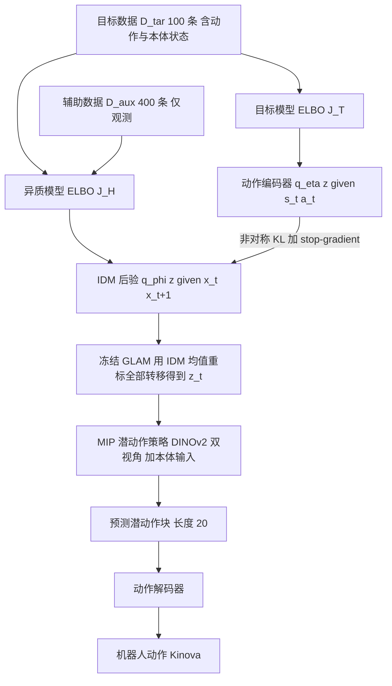

# GLAM：基于落地潜动作世界模型的异质示范模仿学习（arXiv:2606.21672）

## 一句话定义

**GLAM（Grounded Latent-Action World Model）** 是一对共享连续潜动作变量 z 的生成模型：一个在「目标机器人数据 + 无动作标签辅助数据」上训练、用逆动力学模型（IDM）从状态转移推断 z；另一个只在带动作标签的目标数据上训练、用动作编码器推断 z。两者通过非对称 KL 与共享前向动力学绑定，之后冻结，用 IDM 给所有转移重标潜动作，监督下游行为克隆（BC）策略（[arXiv:2606.21672](https://arxiv.org/abs/2606.21672)，第 1、3 节）。

## 英文缩写速查

| 缩写 | 英文全称 | 简要说明 |
|------|----------|----------|
| GLAM | Grounded Latent-Action World Model | 本文方法，一对共享潜动作空间的生成模型 |
| GLAM-O | GLAM with Object masks | 世界模型输入由 RGB 换成被操作物体的二值掩码 |
| IDM | Inverse Dynamics Model | 逆动力学模型，从相邻状态推断动作（此处为潜动作后验） |
| BC | Behavioural Cloning | 行为克隆 |
| MIP | Much ado about noising 提出的两步回归策略 | 论文所用下游策略，无需拟合分布（引自其参考文献 [3]） |
| ELBO | Evidence Lower Bound | 证据下界，两个生成模型各自的训练目标 |
| KL | Kullback-Leibler divergence | 用于先验正则与后验对齐 |
| UMI | Universal Manipulation Interface | 手持夹爪数据采集接口，本文仅在仿真中模拟一个自由浮动 UMI 夹爪 |
| LAM | Latent Action Model | 从帧间转移提取伪动作标签的模型，如 LAPA、CLAM |

## 为什么重要

- 作者的出发点（第 1 节，作者自述）：多源数据动作空间不同、常无动作标签，现有协同训练依赖手工对齐（如最优传输损失、DTW 采样、调混合比例）；GLAM 主张「产生相同环境效果的动作应有相同表示」，把跨源整合变成表示学习问题。
- 在论文的设定下，100 条目标轨迹加 400 条无标签辅助轨迹，在双臂 stack-three 上达到 72.7%，而所有基线 ≤4%（第 4.3 节）。
- 作者认为世界模型只当作「冻结的潜动作锚点」使用，只提供逐步标签，不做想象 rollout，因此几百条轨迹即可训练（第 2 节，作者自述）。

## 核心原理与流程总览

要点（第 3 节与附录 E）：

1. **异质模型（式 1、3）：** 潜状态 x_t 由图像特征与末端位姿拼成；前向模型 p(x_{t+1}|x_t,z_t) 与 IDM 在所有数据源间共享，保证潜动作「按对环境转移的影响来表示」。实现上用确定性 MSE 预测代替转移 NLL（附录 E，偏离式 3 的写法）。
2. **目标模型（式 2、4）：** 动作编码器 q_η(z|s,a) 加本体前向 p(s_{t+1}|s_t,z) 与动作解码器 p(a|z)；动作重建项只挂在动作编码器分支，使 IDM 不被目标专有控制细节污染。
3. **非对称对齐（式 5）：** KL(IDM 后验 ‖ sg[动作编码器后验])，权重 λ=1（表 3）。
4. **下游策略（式 7、8）：** 潜动作为 IDM 后验均值；DINOv2-S/14 双视角加 MIP；损失为全数据潜动作回归加仅目标数据动作回归；潜动作维度 d=8（stack-three 为 16），分块 H=20（表 3）。

## 工程实践

- **数据规模：** 每个任务 D_tar=100 条，D_aux=400 条（第 4.1 节）。真机辅助数据是「仿真里的 UMI 夹爪」脚本策略轨迹，不是真实人类视频，也不是真实 UMI 采集（附录 D）。
- **平台：** 真机 7-DoF Kinova Gen3 加平行夹爪，两台 RealSense（俯视与前视）；仿真为 MuJoCo，stack-three 用双 Kinova 臂（第 4.1 节、附录 D）。
- **基线实现：** MIP（仅 D_tar）、CLAM（仅 D_tar）、LAPA（D_tar 加 D_aux，VQ 离散码本）及对应物体掩码版本，均共用同一网络架构与下游策略，只改潜动作结构（第 4.1 节）。
- **模块规模：** 视觉编码器 4 层卷积，IDM 与动作编码器 5 层 ResMLP/256，MIP 策略 10 层 MLP/256（表 2），整体很小，不依赖大规模预训练。
- **评测：** 真机每任务 20 次，Wilson 95% 区间；仿真 3 个训练种子各 50 次试验，误差条为跨种子标准差（图 3）。
- 代码：论文称在项目页 <https://viccccciv.github.io/glam/> 提供，本次未访问，故 frontmatter 不写 `code:`。

## 与清单说法的核对

清单摘要原文：「Grounds actions in prediction with a latent-action world model so heterogeneous, partly action-free data share one action representation.」（作者自述为 LLM 据摘要起草；该条属「Learning from Human Video」分组，P0）。

| 清单说法 | 论文核对 | 结论 |
|----------|----------|------|
| 用潜动作世界模型把动作「落地」于预测 | 摘要与第 1 节明确提出「动作表示应落地于预测」，由共享前向动力学加动作编码器完成 | 吻合 |
| 异质、部分无动作标签的数据共享一个动作表示 | D_tar 有动作，D_aux 无动作也无状态（第 3 节）；共享潜动作空间由 IDM 与前向模型实现 | 吻合 |
| （分组为 Learning from Human Video） | 论文实验里的辅助数据是仿真中的 UMI 夹爪脚本轨迹（附录 D）；人类视频只在相关工作与局限中出现，局限明确说未测真实野外数据如网络视频 | 清单未写限定词，读者易误以为用了人类视频。论文并未用 |
| 未写效果 | 仅在 5 个任务（真机 3、仿真 2）、100 条目标数据加 400 条仿真 UMI 数据下验证 | 清单未提设置，依赖「异质」一词，容易高估适用范围 |

补充核对：

- 摘要称「平均 +48%」，正文给出的是「真机三任务平均 +35%，stack-two +44%，stack-three +69%」，均为 GLAM-O 对最强基线；按这些数简单平均不等于 48%，口径正文未说明。我在正文中没有找到 +48% 的来源，视为摘要口径，真实口径不明。
- 清单「异质」指目标 Kinova 与辅助 UMI 夹爪（跨形态）以及仿真与真机（跨域），但辅助数据与部署共享相机位置和桌面场景、物体与任务语义（第 5 节局限），所以异质程度有限。

## 局限

**论文自述（第 5 节）：**

1. 辅助轨迹与部署共享相机位姿与桌面场景，未测真实野外数据（网络视频）。
2. 未测形态差异大的末端（多指灵巧手）。
3. 辅助集与目标集共享物体与任务语义，未测只共享技能基元的辅助数据。
4. 潜空间只基于视觉物体运动、末端位姿与本体，不含接触力与触觉。

**我读到的未验证之处（读者判断，非作者说法）：**

- 辅助数据由脚本策略在仿真里生成，质量与分布比人类示范更干净；对真实人类或带噪数据能否同样有效，论文没有证据（推测：可能更难）。
- 跨源迁移（图 2、图 5）与关键消融（去掉非对称对齐、动作重建项挂载位置，附录 A）都只给定性描述，没有定量表。
- 真机每任务仅 20 次试验，区间较宽；图 3 中部分基线与 GLAM 的误差条在真机任务上有重叠，论文称统计检验给出「方向性显著」改进。
- 5 个任务全部是方块、瓶子等简单桌面任务；论文没有给出与 diffusion policy 等其他 BC 策略做对比。
- 「GLAM 数据效率优于普通 BC」的解释（预训练时见过 500 条）是作者的假设，没有独立验证（第 4.3 节）。
- 代码是否公开本次未核实。

## 关联页面

- [模仿学习](../methods/imitation-learning.md)
- [行为克隆](../methods/behavior-cloning.md)
- [Diffusion Policy](../methods/diffusion-policy.md)
- [Latent Imagination](../concepts/latent-imagination.md)
- [Sim2Real](../concepts/sim2real.md)
- [Kinova Gen3](../entities/kinova-gen3.md)
- [CLAM：连续潜动作模型（论文基线之一）](../entities/paper-rcl-2505-04999-clam-continuous-latent-action-models-for-robot-l.md)
- [LAPA（论文基线之一）](../entities/paper-shenlan-wm-03-lapa.md)
- [UMI-WM](../entities/paper-umi-wm.md)

## 参考来源

- [sources/papers/glam-grounded-latent-action-world-models_arxiv_2606_21672.md](../../sources/papers/glam-grounded-latent-action-world-models_arxiv_2606_21672.md)
- [arXiv:2606.21672](https://arxiv.org/abs/2606.21672)
- Glen Berseth，My CoRL 2026 Reading List（清单序号 021/101，P0）：<https://www.fracturedplane.com/blog/2026/11/10/CoRL2026-Reading-List.html>

## 继续阅读

- [arXiv PDF](https://arxiv.org/pdf/2606.21672v1)
- [项目页](https://viccccciv.github.io/glam/)
- [行为克隆](../methods/behavior-cloning.md)
- [Latent Imagination](../concepts/latent-imagination.md)
