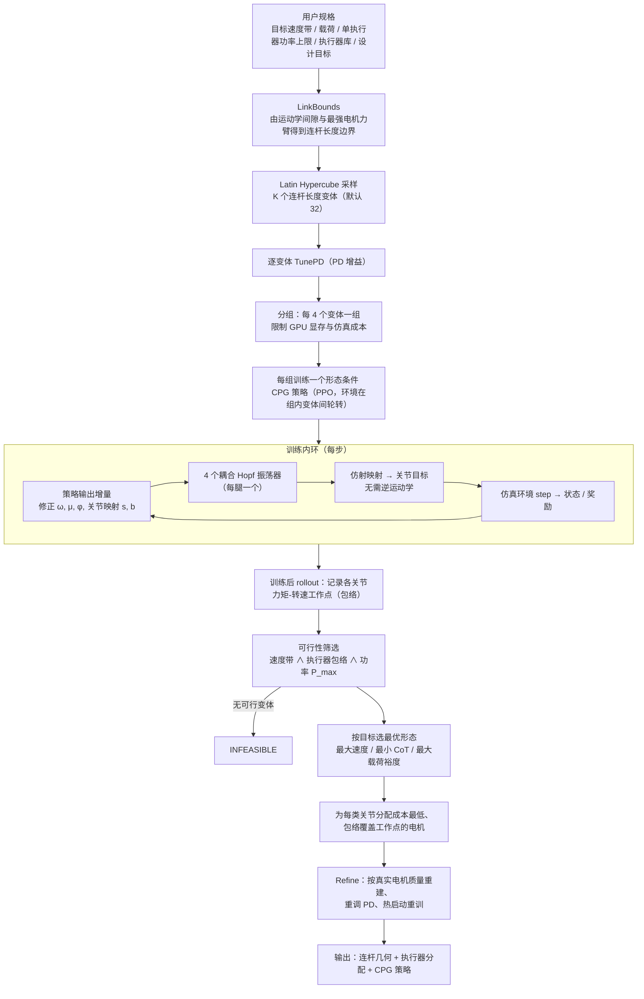

# GLAMDRING（arXiv:2609.19452）

**GLAMDRING**（*GLAMDRING: Gait Learning And Morphology co-Design via Reinforcement LearnING of CPGs*，[arXiv:2609.19452](https://arxiv.org/abs/2609.19452)）来自 [senlanke 具身运控lab 周更盘点](../../sources/blogs/wechat_senlanke_weekly_humanoid_quadruped_2026-09-14_18.md)（2026-09-14–18）。

## 一句话定义

**同时选连杆尺寸、关节执行器与 Hopf CPG 策略；跨形态 RL 推断执行器工作包络。**

## 英文缩写速查

| 缩写 | 英文全称 | 简要说明 |
|------|----------|----------|
| CPG | Central Pattern Generator | 中枢模式发生器 |
| RL | Reinforcement Learning | 强化学习 |
| Co-design | Co-design | 形态–控制联合设计 |

## 为什么重要

- 步态与形态耦合；分离设计常导致执行器/结构不匹配。

## 流程总览

图依据：论文 Fig. 1、§III-A–E 与 Algorithm 1

## 核心机制

| 项 | 内容 |
|----|------|
| **arXiv** | [2609.19452](https://arxiv.org/abs/2609.19452) |
| **开源** | **待发布**（步骤 2.5，2026-09-20） |
| **方法摘要** | Co-design linkage, actuators, Hopf CPG via RL under speed/power/load constraints. |

## 源码运行时序图

**不适用**（截至 2026-09-20 未发布可运行官方代码或待核实）。

## 实验与评测

- Morphology–gait co-design cases（以 PDF 为准）。
- 读法：先对齐任务设定、传感器与成功定义，再解读 headline 数字。

## 与其他工作对比

| 维度 | 读法 |
|------|------|
| **同周对照** | 见对应 [周更盘点](../../sources/blogs/wechat_senlanke_weekly_humanoid_quadruped_2026-09-14_18.md) 映射表，勿跨任务直接比 SR |
| **开源状态** | **待发布** — 部署前以项目页/arXiv 为准 |

## 结论

**GLAMDRING 把 CPG 策略学习嵌入四足形态协同设计闭环。**

1. 开源：**待发布**；勿凭公众号摘要臆断可复现性。
2. 指标须连同实验条件解读（仿真/真机、平台、成功阈值）。
3. 关注 arXiv 版本更新与代码发布。

## 关联页面

- [locomotion](../tasks/locomotion.md)
- [reinforcement-learning](../methods/reinforcement-learning.md)

## 参考来源

- [glamdring_arxiv_2609_19452.md](../../sources/papers/glamdring_arxiv_2609_19452.md)
- [wechat_senlanke_weekly_humanoid_quadruped_2026-09-14_18.md](../../sources/blogs/wechat_senlanke_weekly_humanoid_quadruped_2026-09-14_18.md)
- [arXiv:2609.19452](https://arxiv.org/abs/2609.19452)
- [arXiv PDF](https://arxiv.org/pdf/2609.19452)：已通读方法部分（实验与附录以略读为准）：摘要、§I 引言、§III-A–E（问题定义、CPG 控制器、形态条件学习、设计空间与可行性）与 Algorithm 1（实验章节略读）

## 推荐继续阅读

- [arXiv PDF](https://arxiv.org/pdf/2609.19452)
