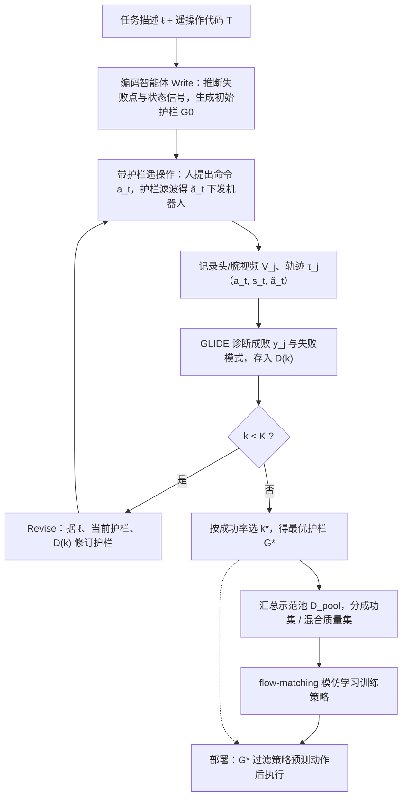

# GLIDE（arXiv:2609.24996）

**GLIDE**（*Learning Beyond What Humans Can Demonstrate*，[arXiv:2609.24996](https://arxiv.org/abs/2609.24996)，[项目页](https://guardrail-policy.github.io/)）来自 [具身智能小站 2026-10-18 盘点](../../sources/blogs/wechat_embodied_station_26_papers_embodiedswe_2026-10-18.md)，属「数据生成与示范」组。

## 一句话定义

**从任务描述和遥操作代码推断失败模式，把规则护栏插入采集与部署过程，帮助完成难以直接示范的动作。**

## 英文缩写速查

| 缩写 | 英文全称 | 简要说明 |
|------|----------|----------|
| Guardrail | Execution Guardrail | 执行护栏：采集与部署期的规则约束 |

## 为什么重要

- 有些动作人难以演示；执行护栏可约束采集与部署，弥补示范能力缺口。
- 开源结论：**项目页未列 GitHub**（步骤 2.5，2026-10-18）。项目页 HTTP 200；页面仅含 nerfies 模板作者链接，无项目代码。
- 同期同组工作见 [编程智能体造数据与 VLA 闭环评测：具身智能小站 10-18 期 26 篇阅读坐标](../overview/embodied-station-2026-10-18-26-papers-technology-map.md)。

## 流程总览

图依据：论文 §3 / Fig. 2、Alg. 1、式 (1)–(6)。

## 核心机制

| 项 | 内容 |
|----|------|
| **arXiv** | [2609.24996](https://arxiv.org/abs/2609.24996) |
| **开源** | **项目页未列 GitHub** |
| **要点** | 任务描述 + 遥操作代码 → 推断失败模式 → 规则护栏。 |
| **文内指标** | 三任务（各 10 次试验）：采集成功率 OpenTV 0/10/0% → G* 70/90/90%；混合数据+护栏策略 70/60/60%（Tab. 1–2）。 |

## 源码运行时序图

**不适用（项目页未列 GitHub）** — 项目页 HTTP 200；页面仅含 nerfies 模板作者链接，无项目代码。 不编造运行脚本；代码公开后再补。

## 实验与评测

- 采集（Tab. 1，各 10 试）：Tomato OpenTV 0% / Manual 20% / G⁽⁰⁾ 60% / G⁽¹⁾ 60% / G* 70%；Marker 10% / 60% / 70% / 60% / 90%（吞吐 0.5→3.9 次/分）；Wine 0% / 60% / 0% / 0% / 90%（0→0.9 次/分）。自我修订并非单调提升。
- 策略（Tab. 2，π0.5，各 10 试）：混合数据+护栏 70/60/60%；同策略去护栏 0/40/40%；Vanilla(OpenTV 数据)无护栏全 0%，加护栏仅 20/20/0%。
- Wine 例外：成功集训练无护栏 50% 高于加护栏 40%。

## 局限与对比

- 横向索引见 [编程智能体造数据与 VLA 闭环评测：具身智能小站 10-18 期 26 篇阅读坐标](../overview/embodied-station-2026-10-18-26-papers-technology-map.md)；同 arXiv 不重复造页。

## 结论

**护栏让“人演示不了”的任务也能采集，但策略表现不应脱离护栏单独评价。**

1. 开源边界：**项目页未列 GitHub** — 项目页 HTTP 200；页面仅含 nerfies 模板作者链接，无项目代码。
2. 核心机制：任务描述 + 遥操作代码 → 推断失败模式 → 规则护栏。
3. 复现与选型前核对任务协议、硬件与基准口径，勿直接横比公众号摘录数字。

## 关联页面

- [teleoperation](../tasks/teleoperation.md)
- [imitation-learning](../methods/imitation-learning.md)
- [manipulation](../tasks/manipulation.md)
- [embodied-station-2026-10-18-26-papers-technology-map](../overview/embodied-station-2026-10-18-26-papers-technology-map.md)

## 工程实践

以下均依据论文全文（v1，§3–4、附录 A–B）；论文未给出的细节（编码智能体具体型号、π0.5 微调超参、控制频率等）正文未找到，不在此臆测。

- **硬件：** 双臂 I2RT YAM Ultra，每臂 6 DoF + 1 DoF 夹爪；灵巧任务把右臂夹爪换成 15 DoF CRAFT 手。遥操作用 Meta Quest Pro：夹爪任务用手柄，灵巧任务用 VR 手部追踪（沿用 OpenTV 的相对头显追踪）；相机含头部与左右腕部。
- **护栏生成：** 以任务描述 ℓ + 遥操作代码 T 提示编码智能体，让其识别命令接口、可编辑动作与可用状态信号、列出可能失败并实现滤波代码；修订提示跨任务、跨轮共用，仅换数据路径。人只遥操作、可选记录成败与直觉反馈，无需手写诊断。
- **迭代规模：** 每轮采 10 条（含成功与失败），K=2，共 3 轮（G⁽⁰⁾→G⁽²⁾），按成功率选 k*；诊断用头/腕视频与轨迹，运行时护栏只用本体感知。
- **数据规模：** Tomato、Marker 复用 3 轮共 30 条（成功 19、22）；Wine 前两轮零成功，改用 G* 另采 60 条（30 成功 + 30 不完美）。成功集是混合池的子集。
- **训练与部署：** π0.5 微调（flow-matching 目标，状态+语言条件，动作目标为护栏后命令 ã_t）；部署时同一 G* 过滤预测动作（式 6）。评测各 10 次试验。
- **护栏形态：** 阶段触发的命令限制：Tomato 双夹爪共享中点耦合搬运并限高差/宽度；Marker 近距离交接阻尼、放置时作为显式受保护阶段（保持位姿、张开夹爪后才受控后撤）；Wine 瓶口对杯对齐、倾角与抓握限幅、倒酒时放大瓶旋转。
- **踩坑：** 初版护栏过度阻尼造成遥操作滞后（原始控制器速度远快于受限速度，竖直运动反复触顶），需放宽；Marker 释放阶段触发过早致倒下，需延迟并减速张开；Wine 初版两轮 0%。
- **局限：** 运行时无视觉/触觉；仅三任务、非长程；护栏单独不足（Vanilla 数据仍近 0%）。

## 参考来源

- [glide_beyond_human_demonstration_arxiv_2609_24996.md](../../sources/papers/glide_beyond_human_demonstration_arxiv_2609_24996.md)
- [wechat_embodied_station_26_papers_embodiedswe_2026-10-18.md](../../sources/blogs/wechat_embodied_station_26_papers_embodiedswe_2026-10-18.md)
- [arXiv:2609.24996](https://arxiv.org/abs/2609.24996)
- [arXiv PDF](https://arxiv.org/pdf/2609.24996)：已通读全文（不含参考文献）

## 推荐继续阅读

- [arXiv PDF](https://arxiv.org/pdf/2609.24996)
- [项目页](https://guardrail-policy.github.io/)
