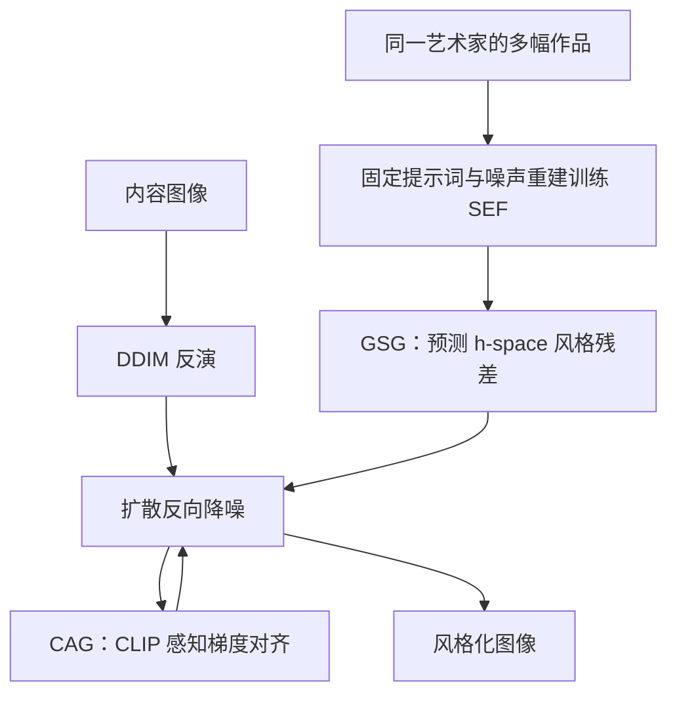

# Through Van Gogh’s Eyes：基于扩散模型的全局风格迁移

## 一句话定义

**Global Style Transfer（GST）** 从一位艺术家的多幅作品学习总体风格，再将其迁移到一张内容图像。

## 英文缩写速查

| 缩写 | 英文全称 | 简要说明 |
|------|----------|----------|
| GST | Global Style Transfer | 多对一全局风格迁移 |
| GSG | Global Style Guidance | 在扩散中间特征施加风格引导 |
| SEF | Style Extraction Function | 学习风格残差的轻量网络 |
| CAG | Content Alignment Guidance | 免训练的内容对齐引导 |
| DDIM | Denoising Diffusion Implicit Models | 用于内容图反演与采样 |
| CLIP | Contrastive Language–Image Pre-training | 提供感知特征 |

## 核心信息

| 项 | 内容 |
|----|------|
| 论文 | [arXiv:2608.11546v2](https://arxiv.org/abs/2608.11546v2)，ECCV 2026 |
| 作者 | Jeongha Lee、Yujin Kim、Ghazanfar Ali、Suhyun Kim、Jae-In Hwang |
| 机构 | 韩国科学技术研究院、韩国科学技术联合大学、韩国大学、嘉泉大学、庆熙大学 |
| 数据 | WikiArt 作品作为风格参考；VanGogh2Photo 照片作为内容图 |
| 代码 | 截至 2026-11-05，[作者页面](https://ghazanfarali.com/research/global-style-transfer/)未提供公开实现或权重 |

## 流程总览

## 核心机制

- **GSG：** 将艺术家作品统一配以固定提示词“A painting”，以噪声重建训练轻量 SEF；每个时间步输出残差，按权重加入 U-Net 瓶颈的 h-space。固定提示减少艺术家名称造成的提示差异，但模型仍使用固定文本条件。
- **CAG：** 内容图通过 DDIM inversion 映射到噪声潜变量；反向过程用 CLIP 深层特征构造感知损失，其梯度引导潜变量，兼顾语义结构与风格所需的形变。
- **消融：** 论文报告 CLIP 深层特征比浅层更适合保留整体结构；SEF 训练从 10–20 增至 200 epochs 后艺术家之间的风格区分更明显。

## 源码运行时序图

不适用：作者页面称原实现由机构持有，尚未提供公开代码与权重，因此无法核验运行入口。

## 实验与评测

论文 Table 2 的梵高实验中，GST 的 CLIP-Div 为 **0.297**（真实作品 0.335），1-Precision 为 **0.988**；原始 Stable Diffusion 分别为 0.178 和 0.257。GST 的 FID 为 **9.46**、ArtFID 为 **19.25**，Textual Inversion 分别为 7.67 和 13.68（越低越好），因此不能说 GST 在所有指标领先。1-Precision 是论文使用的间接指标，不能单独证明没有记忆训练图像。

## 结论

GST 给出了从作品集合学习艺术家级风格的路径，但不同指标之间存在权衡。

1. 目标是艺术家整体风格时，应考虑作品集合的覆盖范围，而非只选一张参考画。
2. 对齐内容时同时检查语义结构和可接受的风格形变。
3. 同时报告风格多样性、内容保留和生成质量，避免只凭单一指标判断。
4. 公开实现和权重尚不可得，复现需等待发布或自行实现。

## 局限与适用范围

- 实验是艺术图像生成，不直接证明机器人感知或策略收益。
- 论文附录指出：若作品集的题材狭窄，未见题材可能被误生成训练集里的常见内容，例如山形。
- 集合级表示取决于作品数据和基础扩散模型；不等于还原艺术家的创作意图。
- 原文 Table 2 的指标并非全面最优，比较时需保留数据集与评价口径。

## 关联页面

- [扩散模型](../concepts/diffusion-model.md)
- [自编码器](../concepts/autoencoder.md)

## 参考来源

- [论文归档与核对记录](../../sources/papers/global_style_transfer_arxiv_2608_11546.md)
- [论文原文 v2](https://arxiv.org/abs/2608.11546v2)
- [作者研究页面](https://ghazanfarali.com/research/global-style-transfer/)

## 推荐继续阅读

- [原始论文](https://arxiv.org/abs/2608.11546)
