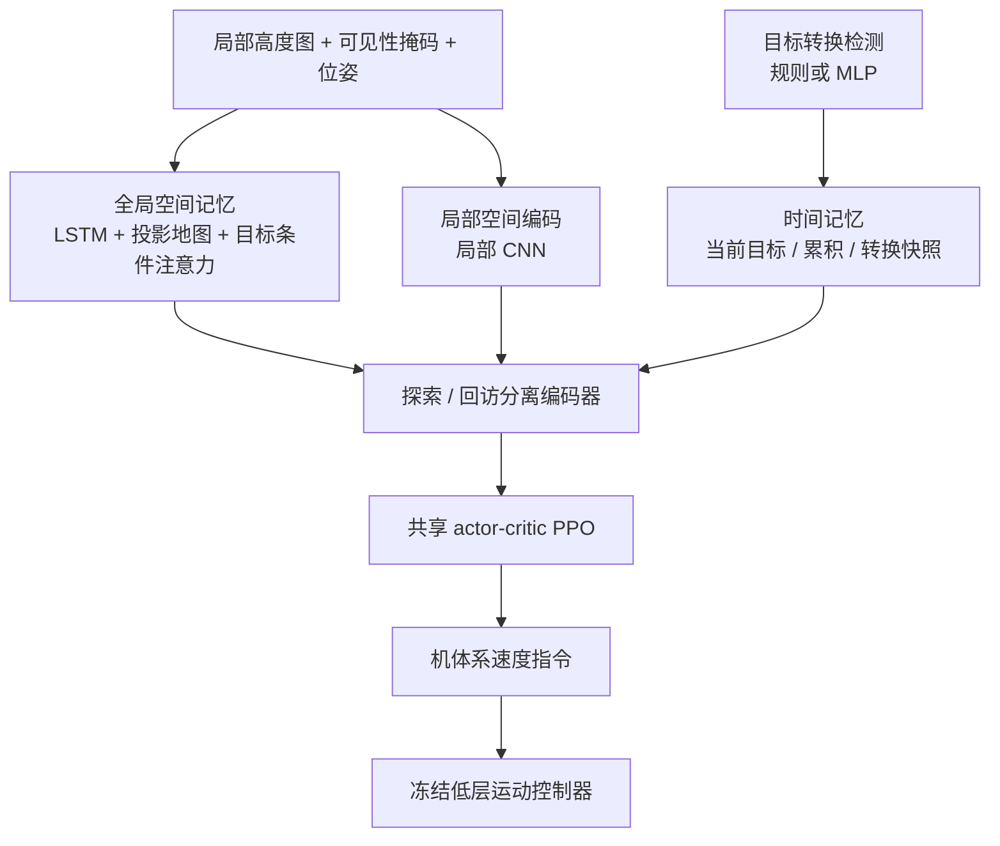
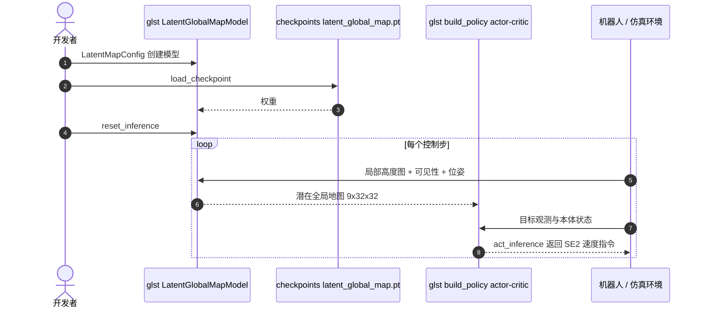

# GLST：全局-局部时空记忆分解的在线链式目标导航

**GLST 让四足机器人在目标随时被重定向或新增时，用「全局 / 局部空间 + 长 / 短期时间」四块记忆分别服务探索与回访，避免单一统一记忆在两种需求间互相拉扯。**

论文 *GLST: Global-Local Spatio-Temporal Memory Decomposition Framework for Online Chained-Goal Navigation*（[arXiv:2610.17927](https://arxiv.org/abs/2610.17927)，[代码](https://github.com/Yousef-Liang/glst)，CoRL 2026 录用）。

## 英文缩写速查

| 缩写 | 英文全称 | 简要说明 |
|------|----------|----------|
| POMDP | Partially Observable Markov Decision Process | 论文把在线链式目标导航建模为此 |
| SR / SPL | Success Rate / Success weighted by Path Length | 主指标，成功率与路径效率 |
| SRU | Spatially-enhanced Recurrent Unit | 基线之一，统一记忆的空间增强循环单元（11.8M 参数） |
| PCGrad | Projecting Conflicting Gradients | 梯度手术基线，用于对照冲突处理 |

## 为什么重要

- 目标在线变化时，既要探索新区域又要回访旧位置，统一记忆会在两种目标间冲突；该文把这一冲突显式建模并拆分。
- 参数量 5.69M，约为 SRU（11.8M）的一半，仍取得更高成功率。
- 消融指出局部空间模块最关键（去掉后 79.2 → 55.7），给选型提供了优先级。

## 核心信息

| 项 | 内容 |
|----|------|
| **机构** | Stanford University；UC Berkeley；NVIDIA，依据 arXiv HTML |
| **平台** | Isaac Lab（迷宫、立柱、坑、多层楼梯）；Boston Dynamics Spot + Jetson Thor |
| **控制结构** | 高层输出机体系速度指令，冻结低层运动控制器转关节动作 |
| **开源** | **部分开源**（2026-10-17 核查）：[Yousef-Liang/glst](https://github.com/Yousef-Liang/glst) 发布潜在全局地图与导航策略模型（BSD-3-Clause，v0.1.0）；训练与部署代码「计划后续发布」，检查点是否随附说明不一致（未核实） |

## 核心原理

### 流程总览

- 奖励：目标进度（到当前目标的最近距离）、重访惩罚（每个目标开始时清空缓冲）及碰撞、时间、动作率等项。
- 课程：更长目标路径、地形等级、随机初始朝向。训练为两目标链、4–10 m，评测为最多 5 目标、最长 20 m。
- 全局分支用高度 / 可见性 / 置信度辅助头预训练。

## 源码运行时序图

仓库只发布了模型接口，无 CLI；时序对齐 README 中 `LatentGlobalMapModel` 与 `build_policy` 的 Python 调用（未在本地运行）。

- **复现路径：** `pip install torch` → `pip install -e .`（Python 3.10+）→ 按 README 调用上述接口；策略检查点需用户自备路径 `policy.pt`。
- 训练 / 部署流水线、Isaac Lab 环境与奖励配置未发布，无法复现论文主结果。

## 与其他工作对比

| 维度 | GLST（本文） | [SRU](./paper-sru-spatially-enhanced-recurrent-memory.md) | [HUMEMBR](./paper-humembr.md) | [分层四足导航栈](../concepts/hierarchical-quadruped-navigation-stack.md) |
|------|------|------|------|------|
| 记忆形式 | 全局 / 局部空间 + 长 / 短期时间四块分解 | 在 LSTM/GRU 上加空间变换项的统一循环记忆 | 人中心长时程记忆 + LLM 工具检索 | 依具体模块而定 |
| 任务 | 在线链式目标（目标可重定向 / 新增） | 无地图长程点目标导航 | PersonEQA 与 Spot 例行条件导航 | VLN → 导航 → RL 运动 → PD 的分层系统 |
| 观测 / 记忆内容 | 局部高度图 + 可见性掩码 + 位姿 | 单目前向深度 | 多日人员例行记录（caption），身份感知 | — |
| 真机 | Spot + Jetson Thor，36 次 86.1% | B2W 零样本跨办公室 / 森林 | Spot + GraphNav 路点导航 | 课程集成范例 RoamerX + MATRiX |

- **相对 SRU：** SRU 用一个增强的循环单元承担全部记忆，GLST 认为统一记忆会在探索与回访间冲突而将其拆分；在本文设置下 GLST 以约一半参数（5.69M 对 11.8M）取得 SR 79.2% 对 64.2%。
- **相对 HUMEMBR：** 二者都在 Spot 上处理长时程记忆，但 HUMEMBR 是语义记忆 + LLM 检索，GLST 是 RL 策略内部的几何 / 时间潜在记忆。
- **相对分层四足导航栈：** GLST 同样只输出机体系速度指令并依赖冻结低层控制器，属于该栈中的导航层。
- SRU 原文的 +23.5% 与本文表中 SRU 数字来自不同任务设置，不可横比。

## 工程实践

| 项 | 建议 |
|----|------|
| 先跑通 | 用 README 片段加载潜在地图模型，核对观测布局（默认 11,438 维） |
| 感知依赖 | 依赖高度图质量；大俯仰 / 横滚会漂移，真机用机载深度构建的 elevation map |
| 真机 | Spot 内置控制器接收速度指令，Jetson Thor 机载运行 |
| 训练设置 | PPO（RSL-RL），MLP [512,256,128]，1500 次迭代；`actor_critic.py` 派生自 rsl_rl |
| 开源边界 | 已发布：模型与接口；待发布：训练与部署代码 |

## 实验与评测

- **仿真（1000 回合 × 3 次，5 目标 4–15 m）：** GLST SR 79.2 ± 0.8%、SPL 0.70；SRU 64.2%、PCGrad 55.3%、Transformer 49.1%、LSTM 48.9%。4–20 m：64.6% 对 SRU 50.3%。
- **消融（4–15 / 4–20 m）：** 去全局空间 74.0 / 54.1；去局部空间 55.7 / 49.6；去时间 60.6 / 46.2；去奖励 70.7 / 51.3。
- **地形（4–15 m）：** 迷宫 79.2%，立柱 95.9%，楼梯 80.2%，坑 89.4%。
- **Spot 真机：** 每方法 36 次，GLST 86.1%，比 SRU 高 11.1 个百分点，速度 0.61 对 0.62 m/s；含室内外、森林与超过 30 m 的多房间含死胡同与动态障碍场景。

## 结论

**GLST 的增益来自把探索与回访的记忆分开，局部空间感知是最大单项贡献；但机制主要由经验消融支撑，且训练代码尚未公开。**

1. **局部空间最关键** — 去掉后 79.2 → 55.7，大于去全局空间（74.0）。
2. **更长链更难** — 4–20 m 时 SR 降到 64.6%，差距仍在 SRU 之上。
3. **参数更少** — 5.69M 对 SRU 11.8M，不是靠堆参数取胜。
4. **真机提升较小** — Spot 上比 SRU 高 11.1 点，每方法仅 36 次。
5. **复现受限** — 仓库只含模型，训练与部署待发布。

## 局限与风险

- 作者自述：依赖高度图质量；记忆设计主要经验性，梯度冲突分析未严格评估；冻结低层使失败归因难；sim-to-real 仍有差距（椅子、桌子、悬垂物）。
- 开源：训练与部署未发布；README 对检查点的描述前后不一，需以仓库实际文件为准（未核实）。
- 未核实：PCGrad 之外的 CAGrad 结果未在主表出现。

## 关联页面

- [分层四足导航栈](../concepts/hierarchical-quadruped-navigation-stack.md) — 高层指令 + 冻结低层的结构对照
- [PPO](../methods/ppo.md) — 训练算法
- [Isaac Lab](../entities/isaac-lab.md) — 仿真训练环境
- [视觉语言导航](../tasks/vision-language-navigation.md) — 目标指定导航的相邻任务

## 参考来源

- [glst_arxiv_2610_17927.md](../../sources/papers/glst_arxiv_2610_17927.md) — 论文摘录与开源核查
- [glst.md](../../sources/repos/glst.md) — 官方仓库归档
- [arXiv:2610.17927](https://arxiv.org/abs/2610.17927)
- [Yousef-Liang/glst](https://github.com/Yousef-Liang/glst)

## 推荐继续阅读

- [GLST 论文 HTML](https://arxiv.org/html/2610.17927v1)
- [GLST 代码仓库](https://github.com/Yousef-Liang/glst)
