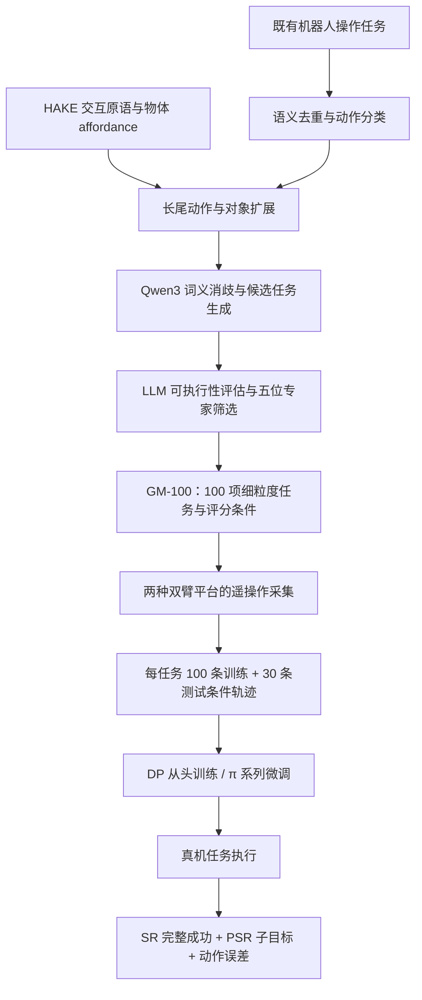

# GM-100：100 项细粒度真机操作评测 / The Great March 100

## 一句话定义

**GM-100（The Great March 100）** 是 RHOS AI 团队发布的真实双臂机器人操作基准：从人–物交互原语和物体可供性系统生成、筛选 **100 项长尾细粒度任务**，配套超过 **13,000 条**专家遥操作轨迹，用于揭示通用机器人策略在真实接触与多步骤目标上的能力差异（[原论文 arXiv:2601.11421v1](https://arxiv.org/html/2601.11421v1)）。

## 英文缩写速查

| 缩写 | 英文全称 | 简要说明 |
|------|----------|----------|
| GM-100 | The Great March 100 | 100 项细粒度真机操作任务基准 |
| HAKE | Human Activity Knowledge Engine | 借助人–物交互原语扩展长尾动作任务 |
| VLA | Vision-Language-Action | 论文比较的一类预训练视觉语言动作策略 |
| SR | Success Rate | 整体任务成功率 |
| PSR | Partial Success Rate | 子任务目标达成比例 |
| DP | Diffusion Policy | 从头训练的操作基线 |
| MSE | Mean Squared Error | 离线预测动作的均方误差 |

## 为什么重要

- **对抗任务同质化：** 既有集合往往重复 pick / hold 类高频操作；GM-100 把罕见动作、复合对象交互和接触细节显式纳入基准。
- **同时比较进度与完成：** 完整 SR 可能因最后一步失败归零；PSR 按明确定义的子目标反映完成过程，便于诊断失败环节。
- **控制真实评测变量：** 既提供初态变化训练示教，也准备匹配分布的测试条件；真机上仍需记录平台、任务 ID 与评分版本。

## 核心信息

| 项目 | 基于原文的事实 |
|------|----------------|
| 论文 | *The Great March 100: 100 Detail-oriented Tasks for Evaluating Embodied AI Agents*；2026-01-16，arXiv:2601.11421v1 |
| 机构 | 上海交通大学、上海人工智能实验室、Robbyant 等；RHOS AI 项目团队 |
| 规模 | 100 个细粒度任务；超过 13,000 条遥操作轨迹 |
| 机器人 | Agilex Cobot Magic：100 任务；Dobot Xtrainer：前 10 任务 |
| 任务演示分配 | 每个已采集任务 100 条训练轨迹 + 30 条测试条件对齐轨迹（论文 §4） |
| 实验基线 | Diffusion Policy、π₀、π₀.₅；论文另列 GR00T 为对照候选，已发表表 1 仅列前三者 |
| 指标 | SR、PSR、MSE、L1 |
| 入口 | [项目](https://www.rhos.ai/research/gm-100) · [任务](https://www.rhos.ai/research/gm-100/tasks/) · [结果](https://www.rhos.ai/research/gm-100/results/) · [GM-X](https://github.com/rhos-ai/GM-X) |

## 核心原理

### 任务生成机制

1. 从既有机器人任务集合提取任务描述，做**语义去重与分类**，定位高频 pick-and-hold 偏置。
2. 用 HAKE 等人–物交互知识的动作原语与物体 affordance 扩展任务设计范围。
3. Qwen3 完成动作词义消歧、动作相关物体枚举、动作–物体组对与候选任务描述生成。
4. 由 LLM 评价可执行性，再由**五位人类专家**进行终审；结合机器人硬件、遥操作可采集性、评分判据与物品可获得性，选出 100 项并提供人类模板视频。

### 流程总览

图是对原论文 §§3–5 的**任务设计与评估研究流程**抽象，不是声称 GM-X 仓库存在可运行的自动化实现。

## 工程实践

- **任务分布对齐：** 先固定平台、任务 ID、机器人构型与视角。Cobot Magic 覆盖 100 项，Xtrainer v1 只有前 10 项，不能把两者当成同一任务全集。
- **形态与重定向就绪度：** 数据由 Agilex Cobot Magic（100 项）与 Dobot Xtrainer（前 10 项）真机遥操作直接采集，可直接作为对应双臂平台的训练输入与策略输入；迁移至其他机器人形态时，需结合运动学、视角与夹爪配置做跨本体适配或动作重定向，不可混算跨平台分数。
- **数据格式：** 官方 [Cobot Magic LeRobot](https://huggingface.co/datasets/rhos-ai/gm100-cobotmagic-lerobot) 与 [Xtrainer HDF5](https://huggingface.co/datasets/rhos-ai/gm100-xtrainer) 分别下载；Xtrainer 的 LeRobot 版本在官方 README 标记为 Processing。
- **基线协议：** 论文附录 B：DP 采用 LeRobot、batch=512、100k steps/任务、chunk 16 执行 8 步；π₀/π₀.₅ 使用 OpenPi、batch=32、50k steps/任务、chunk 50 执行 10 步。这是论文的实验参数，**并非 GM-X 仓已交付脚本**。
- **评测报告：** 除 SR 外记录 PSR、各子任务判据、动作预测误差 MSE/L1、30 个测试条件的构成，以及「上传自报 / 已核验」区别。官网曾于 2026-04-01 更新 Cobot Magic 子任务评分定义，应固定使用的评分版本。
- **评测任务示例：** 0001 击球入门、0002 切割、0003 盖章、0005 抽屉稳定关闭、0006 山楂穿串、0008 试管转移；成功判据与接触操作由附录 A / 官方任务目录给出。

## 实验与评测

论文表 1 是 **Dobot Xtrainer 前 10 项**的平均结果（百分比），不能推成两平台全部 100 项的汇总值：

| 指标 / 模型 | DP | π₀ | π₀.₅ |
|-------------|----|----|-------|
| PSR（子目标完成） | 7.0% | 32.1% | 53.9% |
| SR（整任务完成） | 1.6% | 4.4% | 24.9% |
| 动作 MSE（表 2） | 0.0047 | 0.0033 | 0.0029 |
| 动作 L1（表 2） | 0.0328 | 0.0252 | 0.0234 |

**关键读法：** π₀.₅ 在这一组实验中同时提高 PSR 与 SR，但 SR 仍明显低于 PSR，表明完整长尾任务执行比单个子目标完成更难。动作误差与真机成功表现存在关联；**较低 MSE 不能单独证明较高真机成功率**。

## 结论

**GM-100 最有价值的是可审计的长尾任务设计与 SR/PSR 联合评测，而不是再提供一个不可跨协议对比的单分数榜单。**

1. **先看任务机制再看模型名次：** 记录任务中的动作原语、接触条件与成功判据，才能定位泛化短板。
2. **SR 与 PSR 必须同时报：** 例如 Xtrainer π₀.₅ 为 24.9% / 53.9%，只看其一会遗漏中途完成程度。
3. **平台和训练配方必须冻结：** Xtrainer 前 10 项不等于 Cobot Magic 的 100 项全量；比较不同模型时固定视角、动作窗口与测试条件。
4. **不要把开放数据误判成开源评测实现：** GM-X 仓 README 有资源入口，但当前未见可运行训练或评分脚本。
5. **自报榜单需要证据：** 对于不同本体和测试人员，保留原始 rollout、视频及核验状态，比只摘一个均值更重要。

## 与其他工作对比

| 基准 | 核心侧重 | GM-100 相对定位 |
|------|----------|------------------|
| [LIBERO](./libero-benchmark.md) | 仿真语言条件操作与任务迁移 | GM-100 为真实双臂长尾任务，SR 不可直接横比 |
| [RoboDojo](./robodojo.md) | 统一仿真 + 真机操作评测 | GM-100 更侧重任务目录生成、真机演示、细粒度子目标定义 |
| [LingBot-VLA](./lingbot-vla.md) | 基础 VLA 模型与多机器人训练 | GM-100 是可用来评测这些模型的任务集合，非同一模型本身 |

## 源码运行时序图

**不适用（官方可运行实现未开放）。** 截至 2026-11-17，官方 [GM-X](https://github.com/rhos-ai/GM-X) 默认分支只有 README、assets 与 .gitignore；项目主页提供数据和评测结果入口，但未找到仓内训练 / 推理 / 评分脚本或可核对的运行模块调用。不得据论文使用 LeRobot/OpenPi 的描述虚构官方运行时序；后续代码发布后再补图。

## 局限与风险

- **真机公平性有限：** 作者明确承认测试人员、环境、硬件状态会影响测量结果，社区自报成绩不保证与作者受控实验同等可信。
- **平台覆盖不对称：** v1 的 Xtrainer 仅采集 10 项，不能拿它对外宣称所有 100 项跨机器人覆盖。
- **版本与开放程度：** 官网仍标记 preview、可能有缺项；评分规则有更新，比较时应明确页面版本。官方仓库内容并不足以直接重现全文实验。
- **离线代理指标有限：** 动作预测误差在共享预测窗口计算，低误差不保证闭环接触任务成功；PSR 也不能代替完成任务的 SR。

## 关联页面

- [具身评测基准选型枢纽](../overview/hub-embodied-eval-benchmark.md) · [具身评测纵深路线 Stage 3](../../roadmap/depth-embodied-eval.md)
- [Manipulation 操作任务](../tasks/manipulation.md) · [VLA 方法](../methods/vla.md)
- [RoboDojo](./robodojo.md) · [LingBot-VLA 1.0](./lingbot-vla.md) · [LIBERO](./libero-benchmark.md)

## 参考来源

- [GM-100 论文 v1 通读归档](../../sources/papers/gm100_arxiv_2601_11421.md)
- [GM-100 官方项目页及评测核查](../../sources/sites/gm100-rhos-ai.md)
- [GM-X 官方仓库资源与可运行性核查](../../sources/repos/rhos-ai-gm-x.md)

## 推荐继续阅读

- [原论文全文（arXiv HTML）](https://arxiv.org/html/2601.11421v1)
- [官方任务目录与子任务判据](https://www.rhos.ai/research/gm-100/tasks/)
- [官方结果展示与数据入口](https://www.rhos.ai/research/gm-100/results/)
