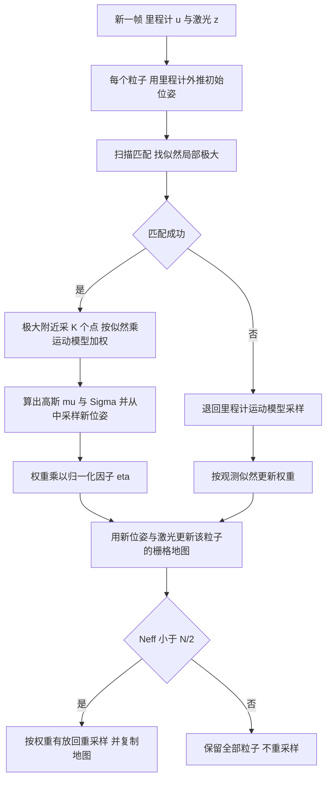

# GMapping（Rao-Blackwellized 粒子滤波栅格建图）

**GMapping** 指 Grisetti、Stachniss、Burgard 的 *Improved Techniques for Grid Mapping with Rao-Blackwellized Particle Filters*（IEEE T-RO，2007，[DOI](https://doi.org/10.1109/TRO.2006.889486)）及其 ICRA 2005 前作 *Improving Grid-based SLAM with Rao-Blackwellized Particle Filters by Adaptive Proposals and Selective Resampling*。本页依据两份作者主页预印本全文写成（核对范围见 [来源归档](../../sources/papers/gmapping_tro_2007_icra_2005.md)），并逐句核对激光雷达 SLAM 综述中对它的描述。

## 一句话定义

**在栅格地图的 RBPF（Rao-Blackwellized 粒子滤波）SLAM 里，为每个粒子用「扫描匹配 + 里程计」算一个高斯提议分布来采样新位姿，并仅在有效粒子数 Neff 低于 N/2 时才重采样；作者报告在 Intel、MIT、Freiburg 三个数据集上所需粒子数约为 Hähnel 等方法的十分之一（T-RO Table II）。**

## 英文缩写速查

| 缩写 | 英文全称 | 简要说明 |
|------|----------|----------|
| SLAM | Simultaneous Localization and Mapping | 同步定位与建图 |
| RBPF | Rao-Blackwellized Particle Filter | 轨迹用粒子滤波、地图按轨迹解析求得的滤波器；每个粒子带一张地图 |
| Neff | Effective sample size | 有效粒子数，Neff = 1 / Σ(w̃_i)^2，衡量权重离散程度（T-RO 式 20） |
| SIR | Sampling Importance Resampling | 采样、重要性加权、重采样的粒子滤波流程 |
| FastSLAM | Factored solution to SLAM | Montemerlo 等把 RBPF 用于地标地图的方法；本文提议分布的思路与其 FastSLAM-2 相近 |
| LiDAR | Light Detection and Ranging | 激光雷达；本文用的是 2D 激光测距仪（SICK LMS / PLS） |
| CARMEN | Carnegie Mellon Robot Navigation Toolkit | 论文实现中扫描匹配器 vasco 所在的工具包 |

## 为什么重要

- 它把「每个粒子带一张栅格地图」这种本来很吃粒子数的 RBPF，压到 Intel 数据集 15 个粒子、Freiburg 校园 30 个粒子、MIT Killian Court 60 至 80 个粒子（T-RO §VI-A），使单机在线运行成为可能；ICRA 版称 50 个粒子在 Pentium IV 2.8 GHz、0.5 m/s 下可实时（ICRA §V）。
- 作者在 §VII 自述这是对 Hähnel 等方法与自己前作的改进；提议分布的想法借自 FastSLAM-2，但把地标换成了原始激光与稠密栅格。
- 在 ROS 社区里它是常见的 2D 激光建图基线之一，所以综述才把它放在 2D 激光 SLAM 一节。这一点属于本页判断，论文本身不讨论 ROS（仓库 README 只说明它是 OpenSLAM 的 fork，见 [来源归档](../../sources/papers/gmapping_tro_2007_icra_2005.md)）。

## 核心机制

### 总流程

### 与以往 RBPF 的区别（T-RO §III、§IV）

| 环节 | 以往做法 | 本文做法 | 出处 |
|------|----------|----------|------|
| 提议分布 | 里程计运动模型（或 Hähnel 等的固定提议） | 每个粒子单独算：扫描匹配找极大，再采样点估计高斯 | §III-A 至 §III-C |
| 权重 | 按观测模型 p(z\|m,x) | 乘以归一化因子 η，近似 p(zt \| m, x_{t-1}, u) | 式 18、19 |
| 重采样 | 每步或固定策略 | Neff < N/2 才重采样 | §III-D |
| 更新触发 | 每帧 | 移动超过 0.5 m 或转动超过 25 度才更新 | §III-C、§VI-F |
| 观测模型 | 视实现 | 光束端点模型（beam endpoint model），用卷积后的局部栅格加速 | §IV |

### 为什么这样能少用粒子（论文解释）

激光很准时观测似然很尖，里程计运动模型很宽，用运动模型采样会让多数粒子落在低似然区，权重差异大，需要很多粒子才覆盖到高似然区（§III-A，图 1）。先用扫描匹配定位似然峰，再在峰附近采样，粒子更集中，所需数量随之下降。作者称提议分布与自适应重采样的配合是性能提升的来源（§VI-C），并用 MIT-2 曲线（关闭自适应重采样）作对照（图 7）。

## 工程实践

- **输入**：激光扫描与里程计，二者缺一不可，论文每步用里程计外推初始位姿（§III-E 步骤 1）。
- **典型设置**：30 个粒子是论文「默认参数」，能在其所用的真实数据集上建对几乎全部地图（§VI-F）；论文未给出所有场景的通用粒子数，MIT 这类嵌套回环需 60 至 80 个（§VI-A c）。
- **资源**：Intel 数据集（45 min 日志，地图约 40 m × 40 m，5 cm 分辨率）内存约 150 MB，处理时间不到 30 min（§VI-F）；表 III 给出单次更新平均耗时（提议 + 权重 + 地图更新 1910 ms，重采样 244 ms，2.8 GHz 标准 PC，2007 年硬件）。
- **代码**：`ros-perception/openslam_gmapping` 是 OpenSLAM gmapping 的 fork，README 称含少量补丁；ROS 封装见 `ros-perception/slam_gmapping`。本页未读源码，实现细节与默认参数未核实。
- **在本库中的位置**：栅格 2D 激光建图可对照 [SLAM Toolbox](./slam-toolbox.md)（Karto 后端）与 [Cartographer](./cartographer.md)；导航栈中的位置见 [导航与 SLAM 自主栈](../overview/navigation-slam-autonomy-stack.md)。

## 局限

**论文自己承认的（T-RO）：**

- 扫描匹配只报告单个极大值，多峰时可能漏峰；作者靠频繁更新与受限搜索区域把分布当单峰，极端杂乱、里程计噪声大时「至少理论上」可能过度自信，给出跟踪多峰的方案但未实现（§III-C）。
- 扫描匹配失败时退回里程计模型（观测差或重叠小；MIT 数据一次，行人遮挡玻璃走廊；Freiburg 空停车场几乎全是最大量程读数）（§III-C、§VI-E）。
- 校园环境「部分违反环境为平面的假设」（§VI-A b）；方法本身建的是 2D 栅格图。
- 每个粒子持有一张完整栅格地图，重采样要复制地图，最坏 O(N·M)；作者称借 DP-SLAM 的地图表示可降低，但不在本文范围（§V）。
- 粒子数不足会出错：MIT 数据用 60 个粒子时有时出现双层墙（§VI-A c）；图 7 表明粒子数过少时成功率下降。

**我看到的未验证之处（本页判断，非作者自述）：**

- 「精度高」只有定性证据：地图可放大到 1 cm 分辨率而无明显不一致，与由非作者盲评的拓扑正确性成功率（§VI-B）；没有对照真值的轨迹误差指标（推测：当时缺少带真值的大场景数据，论文未解释）。
- 最长场景是 1.9 km、约 45 min 的日志；更长时间运行下的漂移与粒子退化，论文没有实验，不能据此判断好坏。
- 论文对比的基线主要是 Hähnel 等（Table II）；与基于位姿图优化的方法没有实验对比，仅在 §VII 作文字讨论。
- 本页未读代码，不能断言 slam_gmapping 的实际默认参数与论文设定一致。

## 综述说法核对

对象：《激光雷达 SLAM 算法最新综述》（刘铭哲等，公众号「新机器视觉」转载，2026-11-11）对 GMapping 的描述：「在 FastSLAM 基础上……降低粒子数量……选择性重采样……室内实时性好精度高……基于滤波且无回环检测……无法在室外构建大环境地图」。

| 综述说法 | 论文中的情况 | 判断 |
|----------|--------------|------|
| 在 FastSLAM 基础上改进 | 论文称改进的是 Hähnel 等的栅格 RBPF 与作者前作，提议分布思路来自 FastSLAM-2，并非直接在 FastSLAM 上改（§VII） | 大体可说，但应写作「RBPF 栅格建图，借鉴 FastSLAM-2 的提议分布」 |
| 降低粒子数量，缓解内存爆炸 | 粒子数约少一个数量级（Table II）。内存问题只部分缓解：每粒子仍存整图，重采样复制 O(N·M)（§V） | 方向对；论文强调的是减少粒子数，没有声称解决内存问题 |
| 选择性重采样，「对粒子按权重排序，对权值低的粒子重采样」 | 判据是 Neff < N/2；触发后做按权重有放回抽样，论文没有排序步骤；目的是减少不必要的重采样（§III-D） | 机制描述不准；效果也只是「大幅降低」粒子耗散风险，不是解决 |
| 降粒子数靠选择性重采样 | 降粒子数主要靠改进提议分布；选择性重采样负责保持粒子多样性（§VI-C） | 综述把两个贡献的作用混在一起 |
| 室内实时、精度高 | 实测在线运行（Pioneer）、ICRA 版称 50 粒子可实时（§V）；精度为定性与拓扑正确性，无真值误差 | 实时性有论文依据；「精度高」应加限定 |
| 基于滤波 | 是，RBPF | 准确 |
| 无回环检测 | 无独立的回环检测模块，也无全局位姿图优化；但回环由粒子多假设隐式处理：闭环时部分粒子对不上自己的地图，权重方差增大、Neff 骤降，触发重采样（§VI-C）。Intel、Freiburg 外圈、MIT 嵌套回环都建成（§VI-A） | 字面上（无显式检测）成立，但容易被误读成「不能闭环」，这是不准确的 |
| 长时间运行累计误差大 | 论文未做长时间漂移实验，也未作此主张；论文只报告在给定粒子数下的成功率 | 论文中找不到依据；可作为推测（粒子耗散与单粒子地图开销随时间累积），应标「推测」 |
| 无法在室外构建大环境地图 | Freiburg 校园是室外数据集，约 250 m × 250 m、轨迹 1.75 km，用 30 个粒子建图（图 5，§VI-A b）；摘要写明在 large-scale indoor as well as outdoor 环境验证 | 与论文不符。可保留的限定是：仅 2D 平面假设，校园里存在不满足平面的部分，空旷处扫描匹配失效要回退里程计（§VI-A b、§VI-E） |

另外，同一节综述提到 FastSLAM「提出 RBPF」：论文把 RBPF 用于 SLAM 归功于 Murphy 与 Doucet 等，Montemerlo 等将其扩展到地标地图（§VII），可作为引用时的修正点。

## 关联页面

- [SLAM Toolbox](./slam-toolbox.md)：ROS 2 常用的 2D lifelong SLAM（Karto 后端，见该页）
- [Cartographer](./cartographer.md)：子图扫描匹配加位姿图优化的 2D/3D 激光建图（见该页）
- [LeGO-LOAM](./lego-loam.md)、[LIO-SAM](./lio-sam.md)、[FAST-LIO](./fast-lio.md)：3D 激光里程计与建图
- [激光 SLAM 与 LIO/VIO 选型](../comparisons/lidar-slam-lio-vio-selection.md)
- [状态估计](../concepts/state-estimation.md)、[激光雷达感知](../concepts/lidar-sensing.md)
- [导航与 SLAM 自主栈](../overview/navigation-slam-autonomy-stack.md)、[Navigation2](./navigation2.md)

## 参考来源

- [来源归档：GMapping T-RO 2007 与 ICRA 2005](../../sources/papers/gmapping_tro_2007_icra_2005.md)
- Grisetti, Stachniss, Burgard. Improved Techniques for Grid Mapping with Rao-Blackwellized Particle Filters. IEEE T-RO, 2007. [预印本 PDF](http://www2.informatik.uni-freiburg.de/~stachnis/pdf/grisetti07tro.pdf)，[DOI](https://doi.org/10.1109/TRO.2006.889486)
- Grisetti, Stachniss, Burgard. Improving Grid-based SLAM with Rao-Blackwellized Particle Filters by Adaptive Proposals and Selective Resampling. ICRA, 2005. [预印本 PDF](http://www2.informatik.uni-freiburg.de/~stachnis/pdf/grisetti05icra.pdf)
- 代码：[openslam_gmapping](https://github.com/ros-perception/openslam_gmapping)（仅读 README，未读源码）

## 推荐继续阅读

- 同作者团队的后续栅格 RBPF/位姿图工作，以及 Montemerlo 等的 FastSLAM-2（论文参考文献 [26]），用于对比提议分布的来源。
- 本库 [SLAM Toolbox](./slam-toolbox.md) 与 [Cartographer](./cartographer.md)，对照滤波式与图优化式 2D 建图的回环处理方式。
