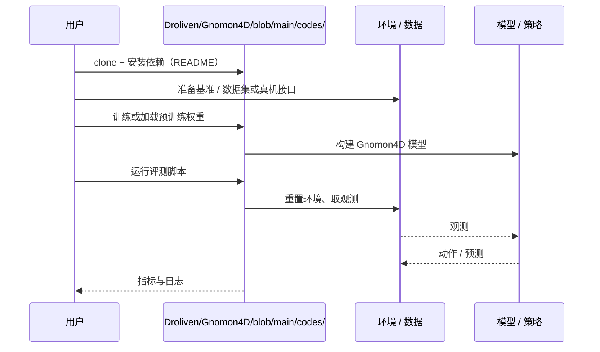

# Gnomon4D（arXiv:2611.02474）

**Gnomon4D**（*Gnomon4D: Learning Where and When to Focus for Geometric Motion-Grounded World-Action Modeling*，[arXiv:2611.02474](https://arxiv.org/abs/2611.02474)，[项目页](https://droliven.github.io/Gnomon4D/)，[代码](https://github.com/Droliven/Gnomon4D/blob/main/codes/)）来自 [具身智能小站 2026-11-04 盘点](../../sources/blogs/wechat_embodied_station_57_papers_da_reward_model_failure_2026-11-04.md)，属「世界模型与感知」组。

## 一句话定义

**联合预测视频、动作与四维几何运动场，把注意力集中到交互区域和抓放转换；借此连接无动作的人类视频预训练与机器人训练，关注几何表征的作用。**

## 英文缩写速查

| 缩写 | 英文全称 | 简要说明 |
|------|----------|----------|
| Gnomon4D | Gnomon4D: Learning Where and When to Focus for Geometric Motion-Grounded World-Action Modeling | 本文方法 / 基准的简称 |

## 为什么重要

- 用四维运动引导动作模型关注交互。
- 开源结论：**已开源**（步骤 2.5，2026-11-04）。仓库可达（git ls-remote）。项目页 HTTP 200。
- 同期同组工作见 [VLM 奖励评估、动作动力学与开放权重机器人智能体：具身智能小站 11-04 期 57 篇阅读坐标](../overview/embodied-station-2026-11-04-57-papers-technology-map.md)。

## 核心机制

| 项 | 内容 |
|----|------|
| **arXiv** | [2611.02474](https://arxiv.org/abs/2611.02474) |
| **开源** | **已开源** |
| **要点** | 联合预测视频、动作与四维几何运动场，把注意力集中到交互区域和抓放转换；借此连接无动作的人类视频预训练与机器人训练，关注几何表征的作用。 |
| **文内指标** | 公众号未给具体数字，本页不引用。 |

## 源码运行时序图

以下为按仓库入口（`Droliven/Gnomon4D/blob/main/codes/`）推断的通用运行链路；入库日仅核实仓库可达，未逐文件阅读，具体脚本名以 README 为准。

## 实验与评测

- 公众号未给具体数字，本页不引用。
- **读法：** 本页为索引级摘要，依据公众号转述的官方摘要与仓库信息整理；逐项数字与 baseline 以原文 PDF 为准。

## 与其他工作对比

- 横向索引见 [VLM 奖励评估、动作动力学与开放权重机器人智能体：具身智能小站 11-04 期 57 篇阅读坐标](../overview/embodied-station-2026-11-04-57-papers-technology-map.md)；同 arXiv 不重复造页。

## 结论

**用四维运动引导动作模型关注交互：联合预测视频、动作与四维几何运动场，把注意力集中到交互区域和抓放转换；借此连接无动作的人类视频预训练与机器人训练，关注几何表征的作用。**

1. 开源边界：**已开源** — 仓库可达（git ls-remote）。项目页 HTTP 200。
2. 核心机制：联合预测视频、动作与四维几何运动场，把注意力集中到交互区域和抓放转换；借此连接无动作的人类视频预训练与机器人训练，关注几何表征的作用。
3. 复现与选型前核对任务协议、硬件与基准口径，勿直接横比公众号摘录数字。

## 关联页面

- [world-action-models](../concepts/world-action-models.md)
- [generative-world-models](../methods/generative-world-models.md)
- [vla](../methods/vla.md)
- [embodied-station-2026-11-04-57-papers-technology-map](../overview/embodied-station-2026-11-04-57-papers-technology-map.md)
- [机器人视觉感知栈选型闭环（知识链）](../queries/robot-perception-stack-selection-loop.md)

## 参考来源

- [gnomon4d_arxiv_2611_02474.md](../../sources/papers/gnomon4d_arxiv_2611_02474.md)
- [wechat_embodied_station_57_papers_da_reward_model_failure_2026-11-04.md](../../sources/blogs/wechat_embodied_station_57_papers_da_reward_model_failure_2026-11-04.md)
- [arXiv:2611.02474](https://arxiv.org/abs/2611.02474)

## 推荐继续阅读

- [arXiv PDF](https://arxiv.org/pdf/2611.02474)
- [项目页](https://droliven.github.io/Gnomon4D/)
- [https://github.com/Droliven/Gnomon4D/blob/main/codes/](https://github.com/Droliven/Gnomon4D/blob/main/codes/)
