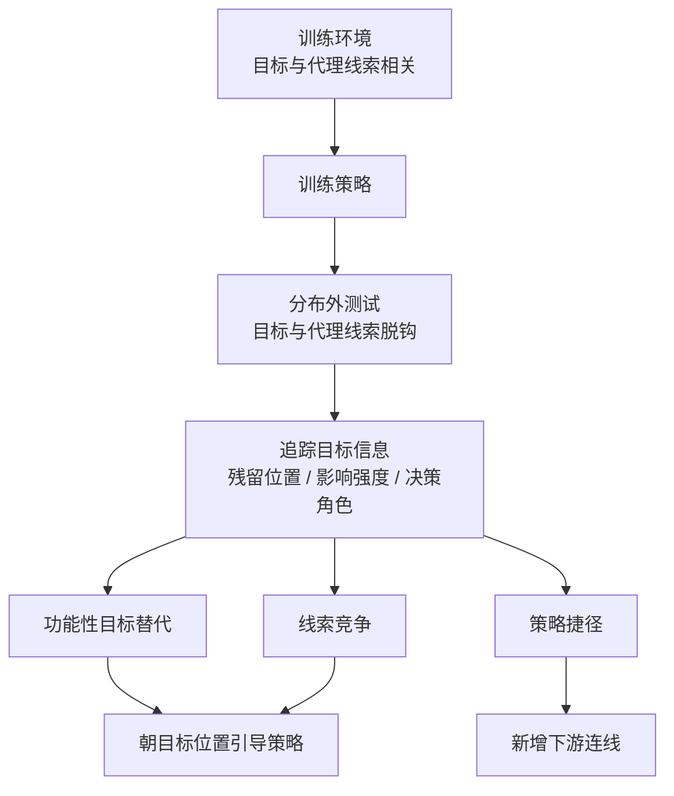

# 目标泛化失效的策略对齐：三类失效与恢复层次

**一句话定义：** 研究智能体在分布外能力仍在、但追求的目标发生错配（目标泛化失效）时，失效究竟出在目标如何被表示、如何影响策略、还是如何参与动作选择，并据此决定恢复措施。

## 英文缩写速查

| 缩写 | 英文全称 | 简要说明 |
|------|----------|----------|
| OOD | Out-of-Distribution | 训练分布之外的测试情形，目标泛化失效通常出现在这类场景 |
| GMG | Goal Misgeneralization | 能力在分布外仍可用，但智能体追求的目标与训练时不一致 |
| Procgen | Procedurally Generated Benchmark | 程序化生成的游戏环境基准，本文用其中三个环境做实验 |
| RL | Reinforcement Learning | 文中策略通过强化学习训练，目标信息经由奖励与观测进入策略 |

## 为什么重要

- 只看分布外任务成功率，会把"能力还在、目标错了"与"能力缺失"混为一谈，导致修复方向错误。
- 三类失效需要不同干预：目标已进入决策时调整策略朝向即可，目标只停留在策略层时需要新增下游连线，目标惰性时两者都无效。
- 对机器人学习而言，这提醒评测时应检查目标是否真正驱动了动作，而不仅是任务结果是否达成。

## 核心信息

| 项目 | 内容 |
|------|------|
| 论文 | What Happens to the Goal? Distinct Failures of Policy Alignment in Goal Misgeneralization |
| arXiv | 2610.19731（v1，2026-10-14） |
| 作者 | Julia Barth、Armin Sommer、Kunvar Thaman、Jannik Schilling |
| 机构 | 未核实（arXiv 摘要页未列出） |
| 数据 / 平台 | 三个 Procgen 环境 + 五个机器人任务（摘要所述） |
| 开源 status | 已列出代码链接 `Julbarth/what-happens-to-the-goal`，**仓库内容未核实**（2026-10-15 入库时无法读取；项目页未核实） |
| 来源 | [sources/papers/goal_misgeneralization_arxiv_2610_19731.md](../../sources/papers/goal_misgeneralization_arxiv_2610_19731.md) |

## 核心原理

论文把目标泛化失效拆成三类策略-目标错配，并用三个诊断量区分它们：目标信息残留在模型何处、它对策略的影响强度、它在动作选择中的角色。

- **功能性目标替代：** 行为跟随替代目标，目标信息已进入决策，但指向错误对象。
- **策略捷径：** 行为跟随习得的动作策略，目标信息存在于策略表示中但未进入决策。
- **线索竞争：** 真实目标与代理目标同时影响决策，两者争夺控制权。

## 工程实践

- **诊断步骤：** 先在分布外环境测量目标可达率；再沿网络检查目标信息是否到达决策层，判定属于哪一类失效。
- **干预选择：** 目标已到决策层，引导策略朝向目标位置（摘要中可达率由 16.0% 升至 95.3%）；目标只到策略层，仅新增下游连线有效（捷径环境中由 31.6% 升至 84.3%）；目标惰性时两种干预均无效，需回到数据或奖励设计。
- **复现入口：** 文章与 arXiv 页给出代码仓库 `Julbarth/what-happens-to-the-goal`。截至 2026-10-15，本库无法读取该仓库，训练与评测入口**未核实**。
- **源码运行时序图：** **不适用**（仓库内容未能核实，无法对齐运行入口）。

## 实验与评测

- **环境：** 三个 Procgen 环境与五个机器人任务（摘要所述，具体任务清单未核实）。
- **指标：** 目标可达率（intended-goal reach）；干预前后对比。
- **摘要数字（WebFetch 摘要转述，未逐字核对原文）：** 决策层干预 16.0% → 95.3%；策略层新增连线 31.6% → 84.3%（捷径环境）。
- 完整消融与统计检验需要阅读原文 PDF，本页未逐项核实。

## 结论

**一句话总判：目标泛化失效不是单一问题，恢复方法必须先定位失效发生在哪一层。**

1. **先定位层次再干预** — 同一个分布外失败，可能对应替代、捷径或竞争，修复手段不同。
2. **决策层目标最容易救** — 目标已进入决策时，朝目标引导策略带来的提升最大（摘要数字 16.0% → 95.3%）。
3. **策略层目标需要新连线** — 只在策略表示中残留的目标，必须通过下游连接才能参与动作选择。
4. **目标惰性无法靠推理时干预修复** — 两种干预都失效，说明需要从训练数据或奖励设计入手。
5. **评测应检查目标是否驱动动作** — 任务成功率可能掩盖错误目标，需要目标可达率等细粒度指标。

## 与其他工作对比

- 与常见的分布外泛化分析相比（见 [OOD 泛化](../concepts/out-of-distribution-generalization.md)），本文把"失效"细化为目标在网络中的位置问题，而不是只看输入分布偏移。
- 与奖励设计类工作（见 [奖励设计](../concepts/reward-design.md)）相比，本文关注的是策略已习得的目标表示如何被使用，而不是重新设计奖励。
- 与基于模仿学习的策略（见 [模仿学习](../methods/imitation-learning.md)）的对比未在摘要中给出，本页不作断言。

## 局限与风险

- **证据范围：** 摘要显示实验覆盖游戏与机器人任务，但具体机器人平台、成功率基线与统计显著性未核实。
- **复现风险：** 代码仓库在入库时无法读取，结论的可复现性未核实。
- **分类边界：** 三类失效的界定依赖文中的诊断方法；在其他架构（如大规模 VLA）中是否同样清晰，未在摘要中验证。
- **误读风险：** 不要把"可达率提升"直接理解为任务成功率提升，两者在摘要中是不同指标。

## 关联页面

- [OOD 泛化](../concepts/out-of-distribution-generalization.md) — 分布外失败的通用框架
- [奖励设计](../concepts/reward-design.md) — 目标信号来源与错配风险
- [强化学习](../methods/reinforcement-learning.md) — 文中策略的主要训练范式
- [模仿学习](../methods/imitation-learning.md) — 目标信息也可能通过示范进入策略

## 参考来源

- [What Happens to the Goal? 来源归档](../../sources/papers/goal_misgeneralization_arxiv_2610_19731.md)
- 微信「具身站 31 篇论文」摘要：[sources/raw/wechat_embodied_station_robot_31_papers_2026-10-15.md](../../sources/raw/wechat_embodied_station_robot_31_papers_2026-10-15.md)

## 推荐继续阅读

- [arXiv:2610.19731 — What Happens to the Goal?](https://arxiv.org/abs/2610.19731)
- [代码仓库 Julbarth/what-happens-to-the-goal（文章列出，内容未核实）](https://github.com/Julbarth/what-happens-to-the-goal)
