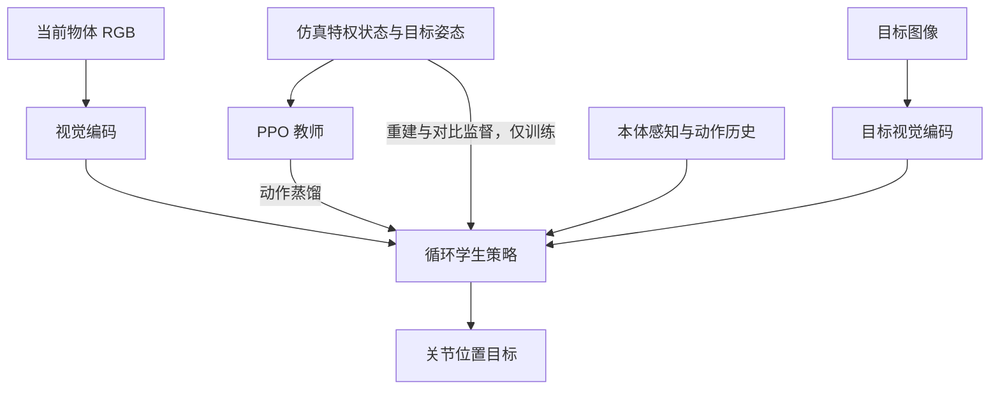

# GoalDex: Learning Image-Goal-Conditioned Policies for Dexterous In-Hand Manipulation / 基于图像目标的灵巧手内操作策略

## 一句话定义

GoalDex 将当前单目 RGB、目标图像与本体感知输入循环策略，直接输出关节目标；训练时由特权状态教师蒸馏并辅以状态重建与连续对比对齐。

## 英文缩写速查

| 缩写 | 英文全称 | 简要说明 |
|------|----------|----------|
| RGB | Red Green Blue | 彩色视觉输入 |
| RL | Reinforcement Learning | 强化学习 |
| PPO | Proximal Policy Optimization | 教师策略优化算法 |
| Sim2Real | Simulation to Reality | 仿真到真机迁移 |

## 核心信息

| 项 | 内容 |
|----|------|
| 机构 | 苏黎世联邦理工学院（ETH Zurich）；NVIDIA |
| 论文 | [arXiv:2611.02171 v1](https://arxiv.org/pdf/2611.02171)，已核对正文、实验及附录 |
| 会议 | CoRL 2026 |
| 官方项目 | [goaldex](https://rffr.leggedrobotics.com/works/goaldex/) |

## 流程总览

## 核心机制

- 教师使用真实物体状态、物理参数、目标相对旋转及物体类别，经 PPO 训练；部署学生不输入这些特权量。
- 学生将当前帧和目标帧分别编码，与关节状态及动作历史融合，GRU 汇聚时序信息；辅助头重建隐藏状态，连续对比损失使视觉相似度匹配旋转距离。成功预测头估计相机坐标系相对旋转，不是独立物体姿态跟踪器。
- 语言演示由视觉语言模型从候选目标图中选图，低层策略跟踪该图。训练依靠物体掩码，不能理解为直接处理原始完整场景。

## 源码运行时序图

**不适用**：2026-11-03 核对项目页，Code 标记 soon，未提供可运行官方实现。

## 实验与评测

- 单一策略在五个已训练物体的对应实物上零样本迁移，每物体 20 个随机目标，成功 80/100；同一协议下最强所测姿态基线为 27/100。成功、超时、掉落及完成预测失败按论文表 5 的协议统计。
- 仿真图像目标策略连续成功数 77.30 ± 3.25；无视觉记忆为 47.83 ± 9.07，口径见论文表 2。25 物体扩展实验需要增加并行环境改善效果。
- Allegro 16 自由度，策略 30 Hz、关节 PD 300 Hz；真机分割使用微调 SAM2。

## 结论

图像目标可成为语义选择与手内控制的接口，但硬件结果依赖已训练物体与分割。

- 训练时仍需仿真特权状态及旋转监督。
- 成功预测失败是真机实验最常见失败类型。
- 比较基线须保持相同目标和判定协议。

## 局限与工程实践

论文说明尚不能泛化到完全未见物体类别；目标视图生成依赖物体几何；真机为掌心向上且需要物体掩码。五物体实验不足以证明开放世界泛化。学生训练约 30 小时，五物体使用两张 H100。

## 关联页面

- [ViserDex](./paper-viserdex.md)
- [机器人操作](../tasks/manipulation.md)
- [Sim2Real](../concepts/sim2real.md)

## 参考来源

- [论文归档](../../sources/papers/goaldex.md)
- [项目页归档](../../sources/sites/goaldex.md)
