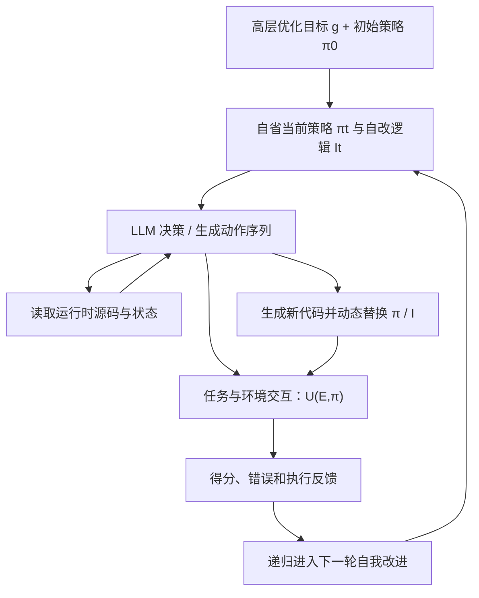
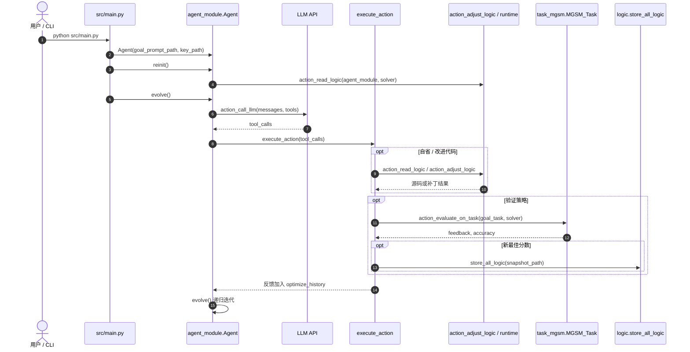

# Gödel Agent: A Self-Referential Agent Framework for Recursive Self-Improvement / Gödel Agent：用于递归自我改进的自指智能体框架

## 一句话定义

**Gödel Agent** 是一个可在 Python 运行时**读取并修改自身任务策略与优化逻辑**的 LLM 智能体，依靠任务反馈持续递归改进，而不把元优化流程限定为不可变的人工模板。

## 英文缩写速查

| 缩写 | 英文全称 | 简要说明 |
|---|---|---|
| LLM | Large Language Model | 决定自省、修改、执行与评测动作 |
| RSI | Recursive Self-Improvement | 改任务策略，也能改后续“如何改进”的过程 |
| CoT | Chain of Thought | 论文四类任务实验默认初始策略 |
| MGSM | Multilingual Grade School Math | 多语种数学推理基准与公开代码默认评价任务 |
| DROP | Discrete Reasoning Over Paragraphs | 阅读理解与离散推理数据集 |
| MMLU | Massive Multitask Language Understanding | 多学科知识评测 |
| GPQA | Graduate-Level Google-Proof Q&A | 高难科学问答评测 |

## 为什么重要

- **升级优化对象：** 相比只调 prompt、固定 workflow 或固定元学习器，Gödel Agent 让优化器自身成为可编辑代码；属于 [RSI](../concepts/recursive-self-improvement.md) 中的 **agent/harness 层自改**，并不等于自行训练新一代基础模型。
- **自指不是意识：** 论文 self-awareness 特指 `inspect`/读取源码及运行时状态；不是哲学意义的意识。
- **工程启示：** 对研究自动化可借鉴“明确目标 → 改可执行策略 → 验证效果 → 保存变更”的循环，但机器人真机环境需要额外验证器与安全边界。

## 核心信息

| 字段 | 核实内容 |
|---|---|
| 英文题目 | Gödel Agent: A Self-Referential Agent Framework for Recursive Self-Improvement（arXiv 摘要页） |
| 中文题目 | Gödel Agent：用于递归自我改进的自指智能体框架 |
| 作者 | Xunjian Yin、Xinyi Wang、Liangming Pan、Li Lin、Xiaojun Wan、William Yang Wang |
| 机构 | 北京大学（Peking University）；加州大学圣塔芭芭拉分校（UCSB）；亚利桑那大学（University of Arizona） |
| 论文 | [arXiv:2410.04444v4](https://arxiv.org/abs/2410.04444v4)（2025-05-31）；[ACL 2025](https://aclanthology.org/2025.acl-long.1354/) |
| 代码 | [Arvid-pku/Godel_Agent](https://github.com/Arvid-pku/Godel_Agent)，MIT，已开源；**未在本次入库运行** |
| 标题细节 | arXiv 摘要页为 `Recursive Self-Improvement`，v4 PDF / ACL 论文正文为 `Recursively Self-Improvement`，保留各自正式写法 |

## 核心原理

形式化地，任务策略 `π_t` 与自改算法 `I_t` 一起迭代：`(π_{t+1}, I_{t+1}) = I_t(π_t, I_t, r_t, g)`，其中 `r_t=U(E,π_t)` 是环境反馈，`g` 是目标。

1. **自省：** 读取模块函数、类、参数、运行态与已有 solver 代码。
2. **提出修改：** LLM 根据目标、当前策略、历史错误与分数选择工具并生成新的 Python 函数/类逻辑。
3. **运行时打补丁：** 通过 `exec(compile(...))`、`setattr` 等直接替换运行中的函数或方法。
4. **评测与递归：** 任务评价函数返回反馈；后续 `evolve()` 递归读取新状态并继续尝试。
5. **附加机制：** 先思考后操作、错误反馈/恢复、Python/Bash 执行、其他 LLM 调用（有助效率但带来权限与预算风险）。

### 流程总览（据论文算法 1）

## 源码运行时序图

**源码依据：** [官方 `src/main.py`、`src/agent_module.py`、`src/logic.py`](../../sources/repos/godel-agent.md)，快照 `bbb508796be31c7140cdfc7106efd830a1324242`；下图描述 README 默认 **MGSM** 路径（不是所有论文基准的唯一运行路径）。

**核对提醒：** 当前 `Agent.__init__` 指向 `task_mgsm.MGSM_Task()`，`evolve()` 调用模型 `o3-2025-04-16`，初始 solver 调用 `gpt-4o-mini-2024-07-18`；它们不同于论文附录的 GPT-4o 优化 / GPT-3.5 评测设置。

## 工程实践

| 任务 | 操作 / 检查 |
|---|---|
| 官方入口 | `pip install -r requirements.txt` → 配置 `src/key.env` → `python src/main.py` |
| 调整任务 | 在 `src/agent_module.py` 中替换 `goal_task`、`solver` 和 `action_evaluate_on_task`；代码含 `task_drop.py`、`task_mgsm.py`、`task_mmlu.py`、`task_gpqa.py` |
| 调试自改 | 监测补丁前后任务得分、报错栈、`optimize_history`、API 花费、运行深度与保存的逻辑快照 |
| 安全复现 | 在隔离、限权、可回滚环境运行动态 `exec` / Python / Bash；限制凭证与网络访问，预先规定预算与退出阈值 |
| 机器人迁移 | 可用作离线实验代码/策略搜索的研究思路；**未提供 ROS、Sim2Real 或真机安全验证** |

## 实验与评测

论文 v4 Table 1 中，四基准比较如下：

| 基准 | Meta Agent Search | Gödel-base（公平约束） | Gödel-free（无限制） |
|---|---:|---:|---:|
| DROP F1 | 79.4 | 80.9 | 90.5 |
| MGSM Accuracy % | 53.4 | 64.2 | 90.6 |
| MMLU Accuracy % | 69.6 | 70.9 | 87.9 |
| GPQA Accuracy % | 34.6 | 34.9 | 55.7 |

- **协议：** 每任务 6 次独立改进、每次至多 30 轮。论文附录 B：优化器 GPT-4o-2024-05-13，受评策略/对照 GPT-3.5-turbo-0125。
- **消融：** MGSM 取消思考降至 50.8，取消错误处理降至 49.4；说明先规划和错误恢复对该设置有帮助。
- **鲁棒性：** 100 次 MGSM 试验中 4% 意外终止、92% 过程短暂退化、14% 最终未超初始策略，不能把“递归”误读为单调性能提升。
- **自由设定的注意事项：** 作者明确部分跃升因其自发请求 GPT-4o 等更强模型；该列与 Gödel-base 不属于严格同预算、同模型效果归因。
- **成本与例证：** 附录称 30 步流程约 $15（Meta Agent Search 约 $300，原论文条件/价格）；Game of 24 中出现从 LLM 到搜索算法的改写示例。
- **复现状态：** 本次仅核对论文和代码，**没有执行付费实验，也没有验证表格数字可重现**。

## 结论

**Gödel Agent 的价值在“优化器可以改写优化器”，不是“已经实现无界自我变强”：它展示了开放代码空间的自指改进，也暴露出错误恢复、同资源对照和安全沙箱的重要性。**

1. **主要贡献：** 优化对象从 `solver` 扩展到执行自改的 agent 代码。
2. **算法判据：** 有可复测的 `U(E,π)` 才能判断改进，不能只看生成代码更复杂。
3. **对照判据：** 引用“90.6% MGSM”时必须注明 Gödel-free 与更强模型参与。
4. **工程前提：** 源码可运行但需要 API 配置、任务数据、预算和沙箱。
5. **风险：** 非单调演化、意外终止、递归与任意代码执行，需限权/留日志。
6. **迁移边界：** 未证明可直接替代机器人 RL、Sim2Real 或真机控制评测。

## 与其他工作对比

| 工作 | 优化对象 / 关键区别 |
|---|---|
| 固定 CoT / Reflexion 类 agent | 固定的人设提示与反思步骤；Gödel Agent 可改执行逻辑 |
| Meta Agent Search | 元搜索流程由人定义；Gödel Agent 的元搜索流程自身可改 |
| [Harness²](./paper-harness2.md) | 结构化 harness 文件与证据轨迹；Gödel Agent 更接近运行时代码自指 |
| [MetaRSI-v1](./paper-metarsi-v1.md) | 从 RSI 组合算子抽象角度梳理，Gödel Agent 是早期运行时机制实例 |
| [Awesome RSI](./awesome-rsi.md) | 将 Gödel Agent 归入 harness-code 自改资源索引 |

## 局限与风险

- **能力与验证：** 四个任务基准均是语言/问答/数学评测，未包含机器人运动、硬实时或真机控制；不保证跨环境泛化。
- **自改安全：** 可以执行未预先审计的 Python/Bash 及动态补丁；论文伦理声明要求沙箱与有界修改。仓库默认 prompt 列明广泛修改权限。
- **鲁棒性：** 自改可能破坏递归逻辑、退化或停止；100 次 MGSM 测试中有实际终止和失败案例。
- **理论地位：** 作者未证明当前实现可以搜索到全局最优；系统复杂化后是否还能理解自己尚不清楚。
- **复现差异：** 代码快照使用的默认模型与论文不同，运行默认命令不能直接得到论文表中结果。

## 关联页面

- [递归自改进（RSI）](../concepts/recursive-self-improvement.md) — 明确 agent code 改进与完全模型级 RSI 的边界
- [Awesome RSI](./awesome-rsi.md) — harness-code 自改文献入口
- [MetaRSI-v1](./paper-metarsi-v1.md) — 多层 RSI 算子比较
- [Harness²](./paper-harness2.md) — harness 证据驱动改进与评测
- [AI Auto-Research](../concepts/ai-auto-research.md) — 研究代码探索与人工验证责任

## 参考来源

- [论文原文归档](../../sources/papers/godel_agent_arxiv_2410_04444v4.md) — 论文 v4、实验与附录
- [官方源码归档](../../sources/repos/godel-agent.md) — 运行入口、自改实现与复现限制
- [arXiv v4](https://arxiv.org/abs/2410.04444v4)；[ACL 2025 会议版](https://aclanthology.org/2025.acl-long.1354/)

## 推荐继续阅读

- [论文 v4 HTML（含附录）](https://arxiv.org/html/2410.04444v4)
- [GitHub 原始代码](https://github.com/Arvid-pku/Godel_Agent)
- [ACL Anthology](https://aclanthology.org/2025.acl-long.1354/)
