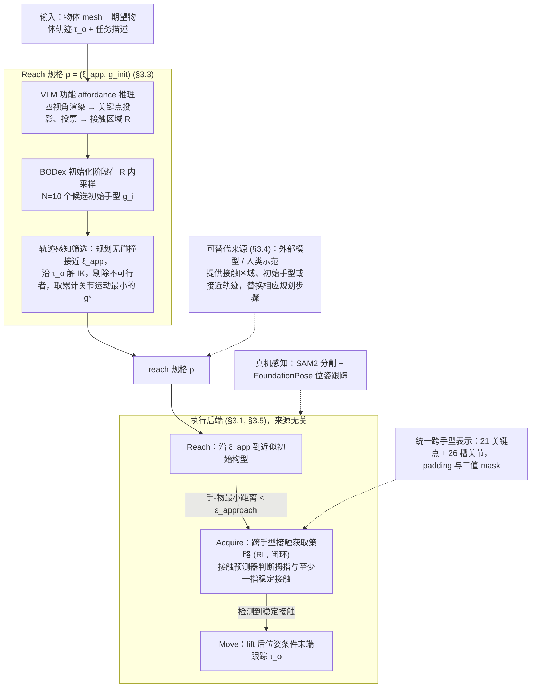

# GOTT（arXiv:2610.03861）

**GOTT**（*GOTT: Object-centric Dexterous Manipulation with a Reusable Cross-Embodiment Primitive*，[arXiv:2610.03861](https://arxiv.org/abs/2610.03861)，[项目页](https://dex-gott.github.io/)）来自 [具身智能小站 2026-10-13 盘点](../../sources/blogs/wechat_embodied_station_34_papers_mulligan_2026-10-13.md)，属「灵巧操作」组。

## 一句话定义

**把操作拆成靠近、建立接触与移动，用共享闭环原语连接物体轨迹和灵巧手；仿真、真机及未见手型实验。**

## 英文缩写速查

| 缩写 | 英文全称 | 简要说明 |
|------|----------|----------|
| GOTT | Grasp-Object-Then-Transport | 论文原语缩写（推测） |
| Dex | Dexterous Hand | 灵巧手 |
| Cross-emb. | Cross-Embodiment | 跨本体 |

## 为什么重要

- 稳定接触应成为跨手型复用的底层能力。
- 开源结论：**待发布**（步骤 2.5，2026-10-14）。项目页含「coming soon」字样，入库日未列 GitHub。
- 同期同组工作见 [失败导向采集与可组合世界动作模型：具身智能小站 10-13 期 34 篇阅读坐标](../overview/embodied-station-2026-10-13-34-papers-technology-map.md)。

## 流程总览

图依据：论文 §3.1–3.5 / Fig.2–4

## 核心机制

| 项 | 内容 |
|----|------|
| **arXiv** | [2610.03861](https://arxiv.org/abs/2610.03861) |
| **开源** | **待发布** |
| **要点** | 仍需可行的靠近规格。 |
| **文内指标** | 以原文为准。 |

## 源码运行时序图

**不适用（待发布）** — 项目页含「coming soon」字样，入库日未列 GitHub。 不编造运行脚本；代码公开后再补。

## 实验与评测

- 以原文为准。
- **读法：** 本页为索引级摘要，依据公众号转述的官方摘要与仓库信息整理；逐项数字与 baseline 以原文 PDF 为准。

## 与其他工作对比

- 横向索引见 [失败导向采集与可组合世界动作模型：具身智能小站 10-13 期 34 篇阅读坐标](../overview/embodied-station-2026-10-13-34-papers-technology-map.md)；同 arXiv 不重复造页。

## 结论

**物体中心 + 接触原语是跨手型灵巧操作的可复用层。**

1. 开源边界：**待发布** — 项目页含「coming soon」字样，入库日未列 GitHub。
2. 核心机制：仍需可行的靠近规格。
3. 复现与选型前核对任务协议、硬件与基准口径，勿直接横比公众号摘录数字。

## 关联页面

- [dexterous-kinematics](../concepts/dexterous-kinematics.md)
- [manipulation](../tasks/manipulation.md)
- [contact-rich-manipulation](../concepts/contact-rich-manipulation.md)
- [embodied-station-2026-10-13-34-papers-technology-map](../overview/embodied-station-2026-10-13-34-papers-technology-map.md)

## 参考来源

- [gott_cross_embodiment_contact_primitive_arxiv_2610_03861.md](../../sources/papers/gott_cross_embodiment_contact_primitive_arxiv_2610_03861.md)
- [wechat_embodied_station_34_papers_mulligan_2026-10-13.md](../../sources/blogs/wechat_embodied_station_34_papers_mulligan_2026-10-13.md)
- [arXiv:2610.03861](https://arxiv.org/abs/2610.03861)
- [arXiv PDF](https://arxiv.org/pdf/2610.03861)：已通读方法部分（实验与附录以略读为准）：§1 引言、§3 方法（§3.1–3.5）

## 推荐继续阅读

- [arXiv PDF](https://arxiv.org/pdf/2610.03861)
- [项目页](https://dex-gott.github.io/)
