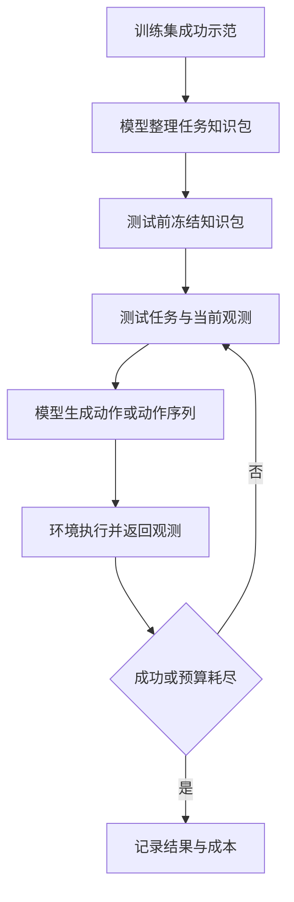
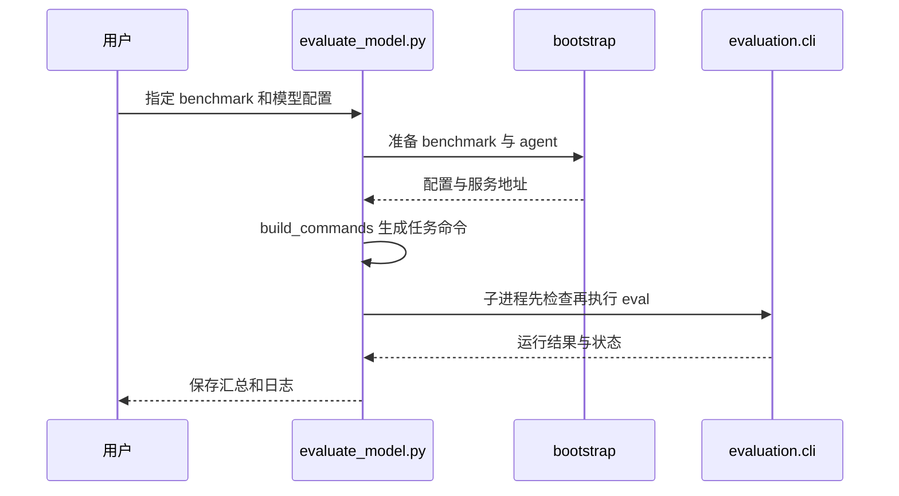

# Has GPT-6-Astra Achieved Embodied Intelligence? / GPT-6-Astra 实现具身智能了吗？

## 一句话定义

这份研究报告比较通用模型在仿真评测、控制框架和真机上的表现，考察基准能力到实际部署之间的差距。

## 英文缩写速查

| 缩写 | 英文全称 | 简要说明 |
|---|---|---|
| ICL | In-context Learning | 通过上下文使用示范，不更新模型权重 |
| VLA | Vision-Language-Action | 视觉、语言与动作策略 |
| EEF | End Effector | 机器人末端执行器 |

## 核心信息

| 项目 | 内容 |
|---|---|
| 机构 | 商汤日日新（SenseNova）及联合研究团队 |
| 报告 | [arXiv:2610.22471v2](https://arxiv.org/abs/2610.22471v2)，2026-10-19 |
| 项目与代码 | [项目页](https://www.sensenova.ai/has-gpt-6-astra-achieved-embodied-intelligence)；[SenseNova-RoboRSI](https://github.com/OpenSenseNova/SenseNova-RoboRSI) |
| 阅读状态 | **草稿**：已核对报告正文的方法、消融和 G1 真机附录；尚未逐项通读全部基准附录与其余真机结果。 |

## 流程总览

模型权重固定，测试回合间不传递经验；扩展预算延续同一回合，不重置环境。RoboLab 无训练集，因此无任务级 ICL；BEHAVIOR 只使用标准预算。

## 实验与评测

- 12 个仿真设置：允许使用训练示范构建知识包，且多数基准允许最多 10 倍官方动作步数。报告中的扩展预算结果不能直接与标准预算基线作等条件排名。
- SIMPLE 的四项共同任务，标准预算下零样本 70.8%，ICL 为 90.8%；收益依赖示范对测试任务的覆盖。
- RoboDojo 消融：VLA 开环 5.83%；闭环每次审查四个动作 25.83%、2.796M tokens；ICL 加闭环 VLA 为 54.17%、19.335M tokens。该消融采用类别成功率的非加权平均，勿与其他统计口径混用。
- G1 真机分别执行抓放和行走：成功 2/3 与 3/3；抓放成功耗时约 74 和 88 分钟。行走由厂商底层控制器执行，样本量仅三次，证明可行性而非可靠性。
- 报告指出任务迁移、费用与时延、物理成功验证、不可逆失败恢复和长任务进度保持仍是主要问题。

## 与其他工作对比

| 维度 | 本页 | [GPT 6 Astra 具身策略评测](./paper-gpt-6-astra-embodied-policy.md) | [Uni-Robot-Agent](./paper-uni-robot-agent.md) |
|------|------|------|------|
| 核心问题 | 通用模型在仿真、控制框架与真机上的能力和实用差距 | GPT 6 Astra 直接当策略，及与 π0.5 混合闭环的分工 | 统一 harness 能否让开放权重模型完成机器人使用任务 |
| 动作如何产生 | 模型生成动作或动作序列，可用冻结的 ICL 知识包 | Direct 输出双臂 EEF；混合架构由 GPT 审核或修正 π0.5 候选 | Agent 调用共享感知、动作工具，经环境适配器执行 |
| 主要评测 | 12 个仿真设置，多数允许最多 10 倍官方步数；G1 真机抓放与行走 | RoboDojo 十任务（主）+ RoboLab 子集 | RoboDojo 42 任务 252 episodes；真机 19 任务计分 |
| 必须一起记录的条件 | 示范来源、动作预算、token 与耗时 | 混合 / Direct 架构、GPT 修正步占比 | 模型与 harness 组合、深度与相机标定是否提供 |
| 开源 | 部分评测集成、ICL 包与 27B Preview 权重；RoboDojo 等待发布 | MIT 评测与报告代码，不分发模型权重 | 公开仓库；真机集成标为待发布 |

- **怎么选**：想知道示范与扩展预算能把分数推多高、实际成本几何看本页；想比较“通用模型直接控制”与“VLA + 通用模型审核”看具身策略评测；想复用工具化 harness 测开放权重模型看 Uni-Robot-Agent。
- **读法**：三页都涉及 RoboDojo，但任务子集、预算与观测条件不同，成功率不能直接横比。

## 源码运行时序图

以下仅覆盖官方仓库 `scripts/evaluation/evaluate_model.py` 的评测编排入口（核对版本 `407a0041f8273500fc654b5ee5683d2d1b14cd5c`），并非论文所有实验的实现。

官方已公开部分评测集成、ICL 包和 27B Preview 权重；README 将 RoboDojo、SIMPLE 等列为待发布。RoboRSI 的独立技术报告仍待发布。尚未运行仿真或核实全部运行模块。

## 结论

**仿真高分展示了能力上界，实际部署仍受示范、成本、时延和物理约束限制。**

1. 比较时同时记录示范来源、动作预算和成功判据。
2. 控制接口与反馈频率需要和模型推理能力及成本一起评估。
3. 真机结果应结合任务、人工先验、成功次数与实际耗时理解。

## 待完成

- 逐项核对报告全部评测附录与其余真机实验，复核版本和统计口径。
- 深入核查评测运行时的 agent、模型与环境接口，再扩展源码时序图；验证可复现性。

## 关联页面

- [仿真评测基础设施](../concepts/simulation-evaluation-infrastructure.md)
- [视觉语言动作模型](../methods/vla.md)
- [操作任务](../tasks/manipulation.md)
- [具身评测基准选型](../queries/embodied-eval-benchmark-selection-loop.md)

## 参考来源

- [论文来源归档](../../sources/papers/gpt_6_astra_embodied_intelligence_arxiv_2610_22471.md)
- [官方项目页归档](../../sources/sites/gpt-6-astra-embodied-intelligence.md)
- [官方仓库归档](../../sources/repos/gpt_6_astra_embodied_intelligence.md)
- [报告 PDF](https://www.sensenova.ai/gpt-6/assets/docs/has_gpt-6_achieved_embodied_intelligence.pdf)

## 推荐继续阅读

- [报告正文与附录](https://arxiv.org/html/2610.22471v2)
