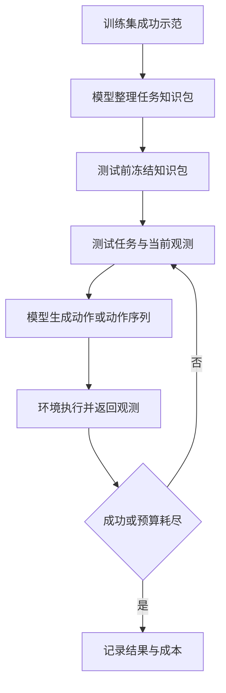
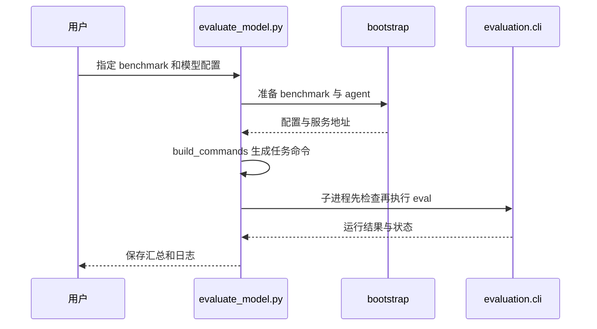

# Has GPT-6-Astra Achieved Embodied Intelligence? / GPT-6-Astra 实现具身智能了吗？

## 一句话定义

这份研究报告比较通用模型在仿真评测、控制框架和真机上的表现，考察基准能力到实际部署之间的差距。

## 英文缩写速查

| 缩写 | 英文全称 | 简要说明 |
|---|---|---|
| ICL | In-context Learning | 把训练示范整理成冻结的知识包放进上下文，不更新模型权重 |
| VLA | Vision-Language-Action | 视觉、语言与动作策略；报告中作为 System 1 的 π0.5 即属此类 |
| EEF | End Effector | 机器人末端执行器；报告比较绝对 EEF 目标、方向性运动指令与关节角控制 |
| VLN | Vision-and-Language Navigation | 视觉语言导航；报告中的 VLN-CE R2R / RxR 与 LHPR-VLN 属此类 |
| WBC | Whole-Body Control | 全身控制器；真机 SIMPLE 实验中由既有 WBC 或 AMO 控制器执行 GPT 发出的关节与速度目标 |
| SR | Success Rate | 成功率；本页以 episode 为单位，按标准或累计扩展预算统计 |

## 为什么重要

通用模型是否能在机器人操作和导航上替代为单一任务、单一本体训练的专用策略，是具身智能的核心问题。这份报告给出的答案是：在允许上下文示范与更长执行步数的条件下，通用模型在多数仿真基准上接近饱和；但耗时、示范成本、物理验证与不可逆失败恢复仍然是实用部署的阻碍。

对评测设计者，报告还指出一个结构性问题：多数具身基准为「采集示范 → 拟合策略 → 在同任务留出回合上评测」而设计，通用智能体在这些基准上测到的，部分是它如何利用基准所提供的资源，而非它是否具备可部署的能力。

## 核心信息

| 项目 | 内容 |
|---|---|
| 机构 | 商汤日日新（SenseNova）及联合研究团队 |
| 报告 | [arXiv:2610.22471v2](https://arxiv.org/abs/2610.22471v2)，2026-10-19 |
| 项目与代码 | [项目页](https://www.sensenova.ai/has-gpt-6-astra-achieved-embodied-intelligence)；[SenseNova-RoboRSI](https://github.com/OpenSenseNova/SenseNova-RoboRSI) |
| 阅读状态 | **已通读**：arXiv v2 正文全部章节（§1 至 §6）与 Fig./Table 说明；已读 App. A（agent 组件消融）、App. B（动作表示与分块）、App. E 中 G1 真机附录与 Table 2 说明。未逐条核对 App. C–D 的逐任务表及 App. E 其余真机平台的逐任务数字，本页不引用这些未核对的数字。 |

## 流程总览

模型权重固定，测试回合间不传递经验；扩展预算延续同一回合，不重置环境。RoboLab 无训练集，因此无任务级 ICL；BEHAVIOR 只使用标准预算。

## 核心原理

1. **输入。** 训练集中的成功示范（按各基准的观测与动作表示提供）；测试时的任务指令、机器人状态与当前 RGB 观测。
2. **知识包 K。** 测试前，模型自行检查训练数据，决定保留哪些内容，写成 K。报告将 K 归纳为六类成分：任务指导（目标、阶段、策略）、运动参考（示范轨迹、抓取位姿、阶段锚点）、视觉参考（示范帧与接触区域裁剪）、可执行 helper（正/逆运动学、检索与动作生成的 Python 程序）、完成检查与恢复（完成判据、失败症状与纠正动作）、元数据与来源（机器人规格、接口约定、来源与校验记录）。K 冻结后只读，每个测试 episode 在新会话中读取它，测试期间不更新 K，也不在 episode 之间传递信息。
3. **执行循环。** 每个决策点，模型依据当前观测输出下一步动作或动作序列；环境执行后返回新观测。交互历史保留在同一 episode 内，使模型可以诊断失败并尝试恢复。
4. **预算。** 标准预算（1×）为基准规定的步数，例如 LIBERO-Long++ 为 600 或 800 步。扩展预算以累计倍数 $k\times B$（$k\in\{2,\dots,10\}$）报告，同一 episode 继续执行、不重置。$\mathrm{SR}(k)$ 表示在累计预算 $k\times B$ 内成功的 episode 比例。
5. **Harness。** 两种协作模式：开环（GPT 给子目标，VLA 直接执行关节动作序列）与闭环（VLA 提出动作，经正运动学转为 EEF 候选运动，GPT 接受、修改或拒绝；审查长度 $L$ 指每次 GPT 调用审查的 VLA 动作数）。动作接口比较绝对 EEF 目标、方向性运动指令与关节角，并比较固定与自适应分块。
6. **真机变体。** 零样本、无示范、无由数据蒸馏的知识包，只提供人工写的结构化上下文（工具模式、关节限位、相机位置、安全约束、抓取点等）。预算由步数改为墙钟时间，标准为 60 分钟（个别平台例外）。
7. **成本口径。** 报告约 98% 的 token 为缓存输入，并以 1M tokens ≈ 1 美元作为粗略成本估计。

## 实验与评测

- 12 个仿真设置：允许使用训练示范构建知识包，且多数基准允许最多 10 倍官方动作步数（BEHAVIOR 仅用标准预算）。报告中的扩展预算结果不能直接与标准预算基线作等条件排名。
- 标准预算下，LIBERO-Long++ 的 SR 从 1× 的 97.5% 升至 10× 的 100.0%；LIBERO-Ultra-Long 从 82.2% 升至 98.9%。LIBERO-PRO 的 1× 结果为 786/800 episode（98.25%）。
- SIMPLE 的四项共同任务，标准预算下零样本 70.8%，ICL 为 90.8%；收益依赖示范对测试任务的覆盖。
- RoboDojo 上扩展预算使成功率约为 1× 的三倍（报告原文 roughly triples）；Bench2Dex 成功率超过翻倍。LHPR-VLN 的扩展收益有限，报告认为长时程导航的子目标追踪不能只靠增加交互解决。
- RoboDojo 消融：VLA 独立执行 6.91%，VLA 开环协作 5.83%；闭环每次审查一个动作（L=1）为 23.61%、7.664M tokens；闭环每次审查四个动作（L=4）为 25.83%、2.796M tokens；ICL 加闭环 VLA 为 54.17%、19.335M tokens。该消融采用类别成功率的非加权平均，勿与其他统计口径混用。
- 动作接口（RoboDojo）：基线 EEF 目标 15.56%；方向性运动指令 18.06%；关节角控制 9.72%；固定分块 L=4 为 11.39%；自适应分块为 20.00%。
- G1 真机分别执行抓放和行走：成功 2/3 与 3/3；抓放两次成功的耗时约 74 分钟与 88 分钟。行走由厂商底层控制器执行，样本量仅三次，证明可行性而非可靠性。
- 成本：LIBERO-Long++ 每 episode 约 1M tokens、近 1 小时；LIBERO-Ultra-Long 约 9M tokens、近 2 小时；RoboDojo 扩展预算下单 episode 平均超过 3 小时。
- 报告指出任务迁移、费用与时延、物理成功验证、不可逆失败恢复和长任务进度保持仍是主要问题。

## 与其他工作对比

| 维度 | 本页 | [GPT 6 Astra 具身策略评测](./paper-gpt-6-astra-embodied-policy.md) | [Uni-Robot-Agent](./paper-uni-robot-agent.md) |
|------|------|------|------|
| 核心问题 | 通用模型在仿真、控制框架与真机上的能力和实用差距 | GPT 6 Astra 直接当策略，及与 π0.5 混合闭环的分工 | 统一 harness 能否让开放权重模型完成机器人使用任务 |
| 动作如何产生 | 模型生成动作或动作序列，可用冻结的 ICL 知识包 | Direct 输出双臂 EEF；混合架构由 GPT 审核或修正 π0.5 候选 | Agent 调用共享感知、动作工具，经环境适配器执行 |
| 主要评测 | 12 个仿真设置，多数允许最多 10 倍官方步数；G1 真机抓放与行走 | RoboDojo 十任务（主）+ RoboLab 子集 | RoboDojo 42 任务 252 episodes；真机 19 任务计分 |
| 必须一起记录的条件 | 示范来源、动作预算、token 与耗时 | 混合 / Direct 架构、GPT 修正步占比 | 模型与 harness 组合、深度与相机标定是否提供 |
| 开源 | 部分评测集成、ICL 包与 27B Preview 权重；RoboDojo 等待发布 | MIT 评测与报告代码，不分发模型权重 | 公开仓库；真机集成标为待发布 |

- **怎么选**：想知道示范与扩展预算能把分数推多高、实际成本几何看本页；想比较“通用模型直接控制”与“VLA + 通用模型审核”看具身策略评测；想复用工具化 harness 测开放权重模型看 Uni-Robot-Agent。
- **读法**：三页都涉及 RoboDojo，但任务子集、预算与观测条件不同，成功率不能直接横比。

## 源码运行时序图

以下仅覆盖官方仓库 `scripts/evaluation/evaluate_model.py` 的评测编排入口（核对版本 `407a0041f8273500fc654b5ee5683d2d1b14cd5c`），并非论文所有实验的实现。

官方已公开部分评测集成、ICL 包和 27B Preview 权重；README 将 RoboDojo、SIMPLE 等列为待发布。RoboRSI 的独立技术报告仍待发布。尚未运行仿真或核实全部运行模块。

## 工程实践

| 方面 | 做法 | 依据 |
|---|---|---|
| 评测口径 | 同时记录示范来源、1× 与累计 10× 结果、token 与墙钟时间；两种预算分开报告，不混排 | 报告 §2.1、Fig. 1、Fig. 5 |
| ICL 知识包 | 构建时排除测试 episode 与评测方私有信息；测试前冻结并只读；episode 之间不写回 | 报告 §2.1 协议 |
| 闭环审查频率 | 每个动作都审查成本最高；审查 L=4 将 RoboDojo token 从 7.664M 降至 2.796M，SR 反而从 23.61% 升至 25.83% | 报告 §3.1、Fig. 7 |
| 动作接口 | 优先语义更接近推理的 EEF 或方向性指令，把精确运动交给底层控制器；直接关节角控制在该消融中最差（9.72%） | 报告 §3.2 |
| 自适应分块 | 自适应分块 SR 20.00%，高于固定 L=4 的 11.39%；token 为 1.146M，高于固定分块的 0.435M，低于基线的 2.560M | 报告 §3.2 |
| 真机上下文 | 人工写入抓取原语是关键：Tianji 手在无预定义抓取原语时 0/3，写入后 3/3；Galaxea R1 Pro 由模型在无运动的熟悉阶段自写机器人档案 | 报告 §4.3 |
| 相机视角 | 将相机视角纳入动作空间：双臂 Piper 用自由臂调整视角后插花成功，单臂 Franka 3 因看不到瓶口失败 | 报告 §4.2 Finding 2 |
| 安全与热管理 | 模型自设的温度阈值只是一层保护（Wuji 手达 62 ℃ 时中断）；需要外部的限位、过温与负载监控 | 报告 §4.3 |
| 结果判定 | 真机物理成功由人依据终态判定，而不采信模型自述完成；记录每回合模型调用、工具调用与相机帧 | 报告 §4.1、App. E |
| 调用接口 | G1 实验通过 OpenAI Responses API 调用模型（reasoning effort max），相关调用记录存档 | 报告 App. E（G1） |
| 开源状态 | 据官方 README（2026-11-03 入库核查）：runtime、多项基准集成、ICL 包与 27B Preview 权重已发布；RoboDojo、SIMPLE 等集成与 RoboRSI 独立技术报告待发布。本次通读未重新核对该 README（未核实）。 | [官方仓库归档](../../sources/repos/gpt_6_astra_embodied_intelligence.md) |

复现时注意：报告的主要结果依赖 GPT-6-Astra 的 API 版本，是否开放权重未在报告正文中说明（未核实）；SOTA 对比的截止日期为 2026-10-12（图 1 注）。

## 局限与风险

- **迁移有限。** ICL 包由同基准训练数据构建，覆盖之外收益减弱。RoboDojo 的 Open 组（无任务示范，依赖其他组构建的包）是该基准中成功率最低的组；RoboLab 无训练集，绝对成功率仍中等。
- **成本与时延。** 扩展预算主要增加成本；报告指出推理延迟不计入动作步预算，因此扩展预算的结果不反映实时部署。
- **物理成功验证。** 模型能察觉「尚未完成」，却常无法指出哪一条物理条件未满足，导致修正无法收敛；它也会把视觉上的重叠（如杯耳与挂钩）当作接触或完成的证据。
- **不可逆失败与前置依赖。** 洒液、掉落等动作无法撤销；长时程任务中，已完成的子目标可能被后续动作破坏（如 BEHAVIOR 中手持的罐子倾倒）。
- **真机样本与安全。** 真机结果每项仅 1 至数次试验，统计不稳；报告记录了碰撞保护停机、关节过温中断等硬件层问题，模型无法自行从这些故障中恢复。G1 抓放 3 次中成功 2 次。
- **基准判定本身的风险。** 现有基准的固定检查有时与指令冲突（报告举 Bench2Dex 的例子：检查项要求未在指令中说明的瓶子直立），智能体也可能利用弱检查通过任务。报告提出的三项原则（人类需求任务、无域内示范、世界时钟）是原型主张，尚未在完整基准上验证，家庭原型的失败案例也只有五个定性例子。
- **可比性。** 扩展预算与标准预算、有无 ICL、是否有 VLA 参与的结果不能直接相互排名；与其他工作对比时需对齐全部条件。
- **误读风险。** 不应把「仿真高分 + 真机少量成功」读作实用具身智能已经到来；报告自己的结论是：通用模型已接近基准能力上界，但尚未达到实用具身智能。

## 结论

**仿真高分说明通用模型在示范和长预算条件下能力很强，但离可靠、低成本、可实时的物理部署仍有距离。**

1. 比较或复现时同时记录示范来源、动作预算（1× 与累计 10×）、token 与墙钟时间，不要只比较最终成功率。
2. 控制接口应暴露与模型推理匹配的语义动作，精确运动交给底层控制器；闭环审查的频率需要和 token 成本一起评估。
3. 真机结果应结合任务类型、人工提供的上下文、试验次数与实际耗时理解；可行性示范不等于可靠性证明。

## 待完成

- 可选：逐条核对 App. C–D 的逐任务表与 App. E 其余真机平台的结果，并据此补充逐任务数字。
- 复核官方 README 的开源状态与版本（入库后可能变化），并确认模型访问方式（未核实）。
- 深入核查评测运行时的 agent、模型与环境接口，再扩展源码时序图；验证可复现性。

## 关联页面

- [仿真评测基础设施](../concepts/simulation-evaluation-infrastructure.md)
- [视觉语言动作模型](../methods/vla.md)
- [操作任务](../tasks/manipulation.md)
- [具身评测基准选型](../queries/embodied-eval-benchmark-selection-loop.md)
- [机器人上下文学习](../concepts/robot-in-context-learning.md)
- [仿真与真机评测差距](../concepts/sim-vs-real-eval-gap.md)

## 参考来源

- [论文来源归档](../../sources/papers/gpt_6_astra_embodied_intelligence_arxiv_2610_22471.md)
- [官方项目页归档](../../sources/sites/gpt-6-astra-embodied-intelligence.md)
- [官方仓库归档](../../sources/repos/gpt_6_astra_embodied_intelligence.md)
- [报告 PDF](https://www.sensenova.ai/gpt-6/assets/docs/has_gpt-6_achieved_embodied_intelligence.pdf)

## 推荐继续阅读

- [报告正文与附录（arXiv HTML v2）](https://arxiv.org/html/2610.22471v2)
- [项目页](https://www.sensenova.ai/has-gpt-6-astra-achieved-embodied-intelligence)
- [SenseNova-RoboRSI 官方仓库](https://github.com/OpenSenseNova/SenseNova-RoboRSI)
