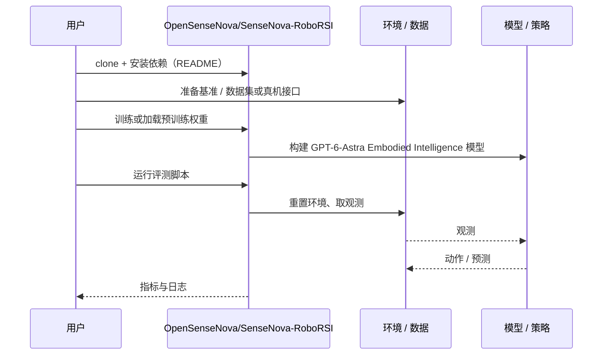

# GPT-6-Astra Embodied Intelligence（arXiv:2610.22471）

**GPT-6-Astra Embodied Intelligence**（*Has GPT-6-Astra Achieved Embodied Intelligence?*，[arXiv:2610.22471](https://arxiv.org/abs/2610.22471)，[项目页](https://www.sensenova.ai/has-gpt-6-astra-achieved-embodied-intelligence)，[代码](https://github.com/OpenSenseNova/SenseNova-RoboRSI)）来自 [具身智能小站 2026-11-01 盘点](../../sources/blogs/wechat_embodied_station_56_papers_libero_dynamic_latency_eval_2026-11-01.md)，属「评测与基准」组。

## 一句话定义

**报告在上下文示范和扩展步数下测通用模型，并比较控制框架与真机表现；提示基准能力需连同耗时、示范成本及失败恢复衡量，不能直接等同实用具身智能。**

## 英文缩写速查

| 缩写 | 英文全称 | 简要说明 |
|------|----------|----------|
| GPT-6-Astra Embodied Intelligence | Has GPT-6-Astra Achieved Embodied Intelligence? | 本文方法 / 基准的简称 |

## 为什么重要

- 具身基准高分，离实际部署还有多远。
- 开源结论：**已开源**（步骤 2.5，2026-11-01）。仓库可达（git ls-remote）。项目页 HTTP 200。
- 同期同组工作见 [动态评测、技能编译与环境潜变量适配：具身智能小站 11-01 期 56 篇阅读坐标](../overview/embodied-station-2026-11-01-56-papers-technology-map.md)。

## 核心机制

| 项 | 内容 |
|----|------|
| **arXiv** | [2610.22471](https://arxiv.org/abs/2610.22471) |
| **开源** | **已开源** |
| **要点** | 报告在上下文示范和扩展步数下测通用模型，并比较控制框架与真机表现；提示基准能力需连同耗时、示范成本及失败恢复衡量，不能直接等同实用具身智能。 |
| **文内指标** | 公众号未给具体数字，本页不引用。 |

## 源码运行时序图

以下为按仓库入口（`OpenSenseNova/SenseNova-RoboRSI`）推断的通用运行链路；入库日仅核实仓库可达，未逐文件阅读，具体脚本名以 README 为准。

## 实验与评测

- 公众号未给具体数字，本页不引用。
- **读法：** 本页为索引级摘要，依据公众号转述的官方摘要与仓库信息整理；逐项数字与 baseline 以原文 PDF 为准。

## 与其他工作对比

- 横向索引见 [动态评测、技能编译与环境潜变量适配：具身智能小站 11-01 期 56 篇阅读坐标](../overview/embodied-station-2026-11-01-56-papers-technology-map.md)；同 arXiv 不重复造页。

## 结论

**具身基准高分，离实际部署还有多远：报告在上下文示范和扩展步数下测通用模型，并比较控制框架与真机表现；提示基准能力需连同耗时、示范成本及失败恢复衡量，不能直接等同实用具身智能。**

1. 开源边界：**已开源** — 仓库可达（git ls-remote）。项目页 HTTP 200。
2. 核心机制：报告在上下文示范和扩展步数下测通用模型，并比较控制框架与真机表现；提示基准能力需连同耗时、示范成本及失败恢复衡量，不能直接等同实用具身智能。
3. 复现与选型前核对任务协议、硬件与基准口径，勿直接横比公众号摘录数字。

## 关联页面

- [simulation-evaluation-infrastructure](../concepts/simulation-evaluation-infrastructure.md)
- [vla](../methods/vla.md)
- [manipulation](../tasks/manipulation.md)
- [embodied-station-2026-11-01-56-papers-technology-map](../overview/embodied-station-2026-11-01-56-papers-technology-map.md)

## 参考来源

- [gpt_6_astra_embodied_intelligence_arxiv_2610_22471.md](../../sources/papers/gpt_6_astra_embodied_intelligence_arxiv_2610_22471.md)
- [wechat_embodied_station_56_papers_libero_dynamic_latency_eval_2026-11-01.md](../../sources/blogs/wechat_embodied_station_56_papers_libero_dynamic_latency_eval_2026-11-01.md)
- [arXiv:2610.22471](https://arxiv.org/abs/2610.22471)

## 推荐继续阅读

- [arXiv PDF](https://arxiv.org/pdf/2610.22471)
- [项目页](https://www.sensenova.ai/has-gpt-6-astra-achieved-embodied-intelligence)
- [https://github.com/OpenSenseNova/SenseNova-RoboRSI](https://github.com/OpenSenseNova/SenseNova-RoboRSI)
