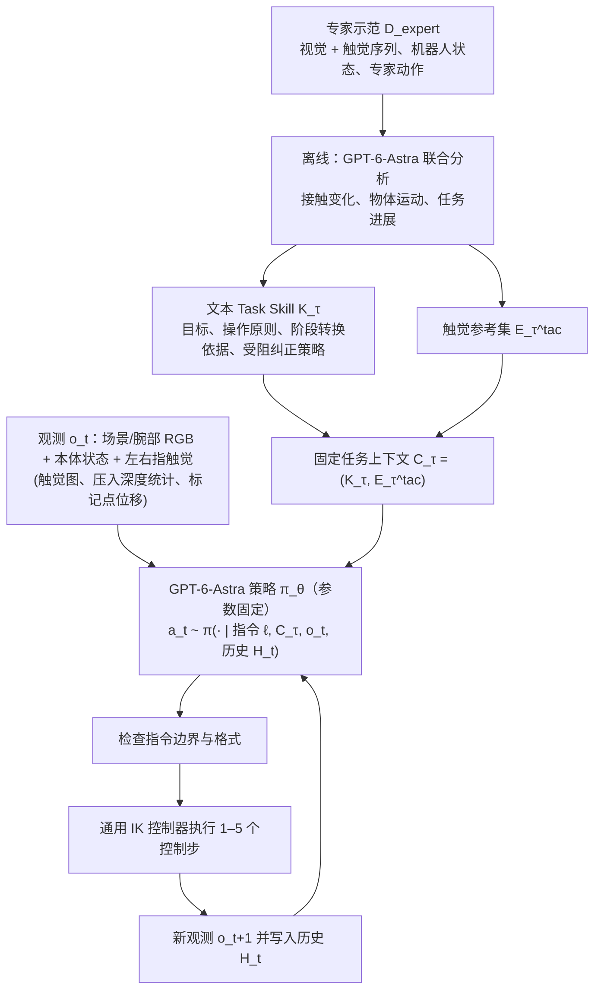

# GPT-6 Astra Tactile Correction（arXiv:2610.28457）

**GPT-6 Astra Tactile Correction**（*GPT-6-Astra Understands Touch and Outperform Vision–Tactile–Language–Action Models*，[arXiv:2610.28457](https://arxiv.org/abs/2610.28457)，[项目页](https://gpt-as-tactile-policy.github.io/)）来自 [具身智能小站 2026-10-31 盘点](../../sources/blogs/wechat_embodied_station_50_papers_scenerig_photo_to_sim_2026-10-31.md)，属「触觉与精细操作」组。

## 一句话定义

**将专家示范整理成任务指导与触觉参照，再由冻结多模态模型闭环出动作；在五项UniVTAC仿真任务比较策略，效果依赖示范和观测接口。**

## 英文缩写速查

| 缩写 | 英文全称 | 简要说明 |
|------|----------|----------|
| GPT-6 Astra Tactile Correction | GPT-6-Astra Understands Touch and Outperform Vision–Tactile–Language–Action Models | 本文方法 / 基准的简称 |

## 为什么重要

- 用示范经验指导触觉纠错。
- 开源结论：**待发布**（步骤 2.5，2026-10-31）。项目页 HTTP 200，Code 标 Coming soon（curl 扫描）。
- 同期同组工作见 [单图重建仿真、VLA 适配评测与跨形态世界模型：具身智能小站 10-31 期 50 篇阅读坐标](../overview/embodied-station-2026-10-31-50-papers-technology-map.md)。

## 流程总览

图依据：论文 §3.1 / §3.2 / §3.3 / §3.4 与 Fig. 1A。

## 核心机制

| 项 | 内容 |
|----|------|
| **arXiv** | [2610.28457](https://arxiv.org/abs/2610.28457) |
| **开源** | **待发布** |
| **要点** | 将专家示范整理成任务指导与触觉参照，再由冻结多模态模型闭环出动作；在五项UniVTAC仿真任务比较策略，效果依赖示范和观测接口。 |
| **文内指标** | 公众号未给具体数字，本页不引用。 |

## 源码运行时序图

**不适用（待发布）** — 项目页 HTTP 200，Code 标 Coming soon（curl 扫描）。 不编造运行脚本；代码公开后再补。

## 实验与评测

- 公众号未给具体数字，本页不引用。
- **读法：** 本页为索引级摘要，依据公众号转述的官方摘要与仓库信息整理；逐项数字与 baseline 以原文 PDF 为准。

## 与其他工作对比

- 横向索引见 [单图重建仿真、VLA 适配评测与跨形态世界模型：具身智能小站 10-31 期 50 篇阅读坐标](../overview/embodied-station-2026-10-31-50-papers-technology-map.md)；同 arXiv 不重复造页。

## 结论

**用示范经验指导触觉纠错：将专家示范整理成任务指导与触觉参照，再由冻结多模态模型闭环出动作；在五项UniVTAC仿真任务比较策略，效果依赖示范和观测接口。**

1. 开源边界：**待发布** — 项目页 HTTP 200，Code 标 Coming soon（curl 扫描）。
2. 核心机制：将专家示范整理成任务指导与触觉参照，再由冻结多模态模型闭环出动作；在五项UniVTAC仿真任务比较策略，效果依赖示范和观测接口。
3. 复现与选型前核对任务协议、硬件与基准口径，勿直接横比公众号摘录数字。

## 关联页面

- [tactile-sensing](../concepts/tactile-sensing.md)
- [contact-rich-manipulation](../concepts/contact-rich-manipulation.md)
- [manipulation](../tasks/manipulation.md)
- [embodied-station-2026-10-31-50-papers-technology-map](../overview/embodied-station-2026-10-31-50-papers-technology-map.md)

## 参考来源

- [gpt_6_astra_tactile_correction_arxiv_2610_28457.md](../../sources/papers/gpt_6_astra_tactile_correction_arxiv_2610_28457.md)
- [wechat_embodied_station_50_papers_scenerig_photo_to_sim_2026-10-31.md](../../sources/blogs/wechat_embodied_station_50_papers_scenerig_photo_to_sim_2026-10-31.md)
- [arXiv:2610.28457](https://arxiv.org/abs/2610.28457)
- [arXiv PDF](https://arxiv.org/pdf/2610.28457)：已通读方法部分（实验与附录以略读为准）：§3 方法（3.1–3.4）、§4 实验（含 Insert Hole 定性分析）

## 推荐继续阅读

- [arXiv PDF](https://arxiv.org/pdf/2610.28457)
- [项目页](https://gpt-as-tactile-policy.github.io/)
