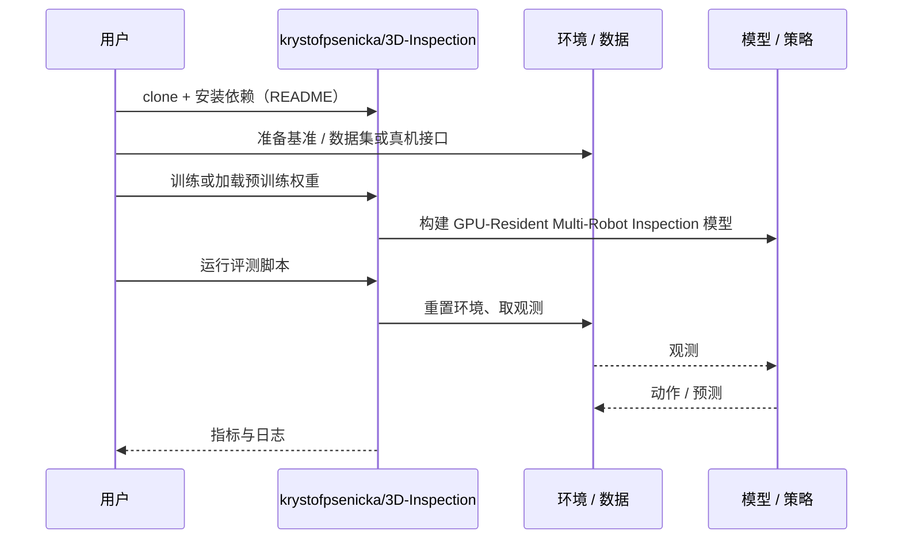

# GPU-Resident Multi-Robot Inspection（arXiv:2610.26106）

**GPU-Resident Multi-Robot Inspection**（*A GPU-Resident Pipeline for Multi-Robot 3D Inspection with Limited Perception*，[arXiv:2610.26106](https://arxiv.org/abs/2610.26106)，[代码](https://github.com/krystofpsenicka/3D-Inspection)）来自 [具身智能小站 2026-10-31 盘点](../../sources/blogs/wechat_embodied_station_50_papers_scenerig_photo_to_sim_2026-10-31.md)，属「导航、感知与多机器人」组。

## 一句话定义

**将视点生成、可见性、集合覆盖、车辆路径与时空避碰串成GPU流水线；多网格实验核查覆盖和轨迹平滑后的碰撞，尚不是水下现场部署验证。**

## 英文缩写速查

| 缩写 | 英文全称 | 简要说明 |
|------|----------|----------|
| GPU-Resident Multi-Robot Inspection | A GPU-Resident Pipeline for Multi-Robot 3D Inspection with Limited Perception | 本文方法 / 基准的简称 |
| 3D | 3D | 三维 |

## 为什么重要

- 多机器人巡检，联合规划覆盖与避碰。
- 开源结论：**已开源**（步骤 2.5，2026-10-31）。仓库可达（git ls-remote）。
- 同期同组工作见 [单图重建仿真、VLA 适配评测与跨形态世界模型：具身智能小站 10-31 期 50 篇阅读坐标](../overview/embodied-station-2026-10-31-50-papers-technology-map.md)。

## 核心机制

| 项 | 内容 |
|----|------|
| **arXiv** | [2610.26106](https://arxiv.org/abs/2610.26106) |
| **开源** | **已开源** |
| **要点** | 将视点生成、可见性、集合覆盖、车辆路径与时空避碰串成GPU流水线；多网格实验核查覆盖和轨迹平滑后的碰撞，尚不是水下现场部署验证。 |
| **文内指标** | 公众号未给具体数字，本页不引用。 |

## 源码运行时序图

以下为按仓库入口（`krystofpsenicka/3D-Inspection`）推断的通用运行链路；入库日仅核实仓库可达，未逐文件阅读，具体脚本名以 README 为准。

## 实验与评测

- 公众号未给具体数字，本页不引用。
- **读法：** 本页为索引级摘要，依据公众号转述的官方摘要与仓库信息整理；逐项数字与 baseline 以原文 PDF 为准。

## 与其他工作对比

- 横向索引见 [单图重建仿真、VLA 适配评测与跨形态世界模型：具身智能小站 10-31 期 50 篇阅读坐标](../overview/embodied-station-2026-10-31-50-papers-technology-map.md)；同 arXiv 不重复造页。

## 结论

**多机器人巡检，联合规划覆盖与避碰：将视点生成、可见性、集合覆盖、车辆路径与时空避碰串成GPU流水线；多网格实验核查覆盖和轨迹平滑后的碰撞，尚不是水下现场部署验证。**

1. 开源边界：**已开源** — 仓库可达（git ls-remote）。
2. 核心机制：将视点生成、可见性、集合覆盖、车辆路径与时空避碰串成GPU流水线；多网格实验核查覆盖和轨迹平滑后的碰撞，尚不是水下现场部署验证。
3. 复现与选型前核对任务协议、硬件与基准口径，勿直接横比公众号摘录数字。

## 关联页面

- [vision-language-navigation](../tasks/vision-language-navigation.md)
- [locomotion](../tasks/locomotion.md)
- [sim2real](../concepts/sim2real.md)
- [embodied-station-2026-10-31-50-papers-technology-map](../overview/embodied-station-2026-10-31-50-papers-technology-map.md)

## 参考来源

- [gpu_resident_multi_robot_inspection_arxiv_2610_26106.md](../../sources/papers/gpu_resident_multi_robot_inspection_arxiv_2610_26106.md)
- [wechat_embodied_station_50_papers_scenerig_photo_to_sim_2026-10-31.md](../../sources/blogs/wechat_embodied_station_50_papers_scenerig_photo_to_sim_2026-10-31.md)
- [arXiv:2610.26106](https://arxiv.org/abs/2610.26106)

## 推荐继续阅读

- [arXiv PDF](https://arxiv.org/pdf/2610.26106)
- [https://github.com/krystofpsenicka/3D-Inspection](https://github.com/krystofpsenicka/3D-Inspection)
