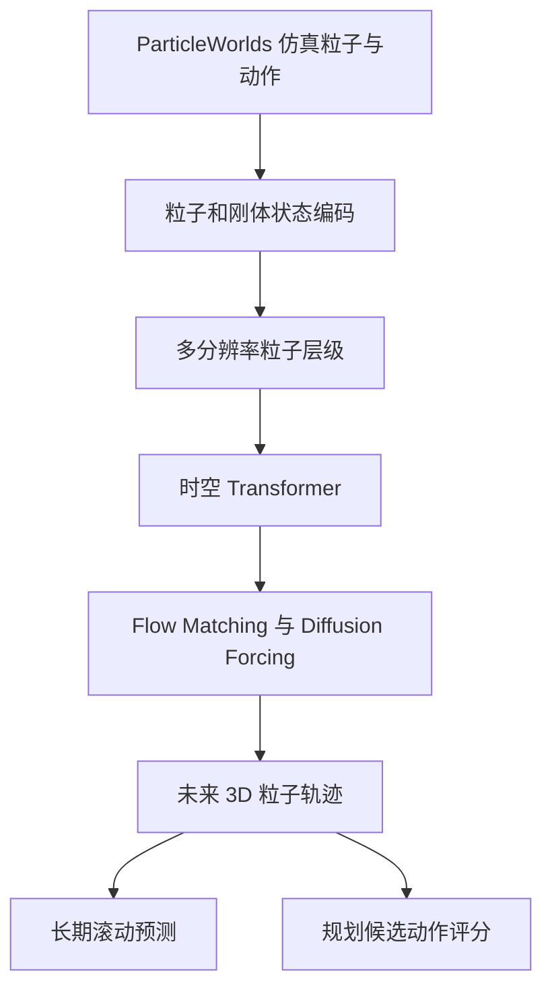

# GPWM：把世界建成 3D 粒子运动模型

## 一句话定义

利用多分辨率 3D 粒子与 Flow Matching / Diffusion Forcing 统一建模多种物理动力学；ParticleWorlds 约 2550 万帧。

## 英文缩写速查

| 缩写 | 英文全称 | 简要说明 |
|---|---|---|
| GPWM | Generalist Particle World Model | 通用粒子世界模型 |
| 3D | Three-Dimensional | 三维几何粒子位置 |
| FM | Flow Matching | 条件动力学生成目标 |
| CEM | Cross-Entropy Method | 基于采样的规划优化 |

## 为什么重要

- 单一刚体或软体任务的动力学预测器难以覆盖碰撞、布料、颗粒及相互作用不同的物理规则。
- 3D 粒子表示提供不依赖某一固定网格的几何接口，可探索从预测到规划的统一学习。

## 核心原理（方法）

1. **状态：** 对刚体、软体、颗粒、布料等仿真场景用粒子状态及对象/刚体结构表达运动，并以动作或施加的操作条件化。
2. **架构：** 多尺度粒子层级及分解式时空 Transformer 建模局部和远程空间关系；相对三维几何提供归纳偏置。
3. **训练/生成：** 在 ParticleWorlds 的多域模拟序列上以 Flow Matching + Diffusion Forcing 训练，滚动生成未来粒子运动；论文另探索生成交互先验支持规划。

## 项目流程图

## 工程实践

- 比较任务性能应分别统计刚体/非刚体/颗粒的误差，注意序列长度、条件帧数与长期累积漂移。
- 接入真实机器人的第一步是验证 RGB-D/多视角重建能否稳定产生带身份的 3D 粒子状态；论文的理想模拟输入不可直接看作现实可用观测。
- 官方项目主页当日仍写 Code coming soon；暂不能依靠完整官方源码复现。

## 实验与评测

- 论文报告 ParticleWorlds 约 25.5M 帧，六域预测误差对所列基线平均下降约 31%；基线和指标依各任务协议而定。
- 作者展示长时程预测和基于预测的规划任务；非真实机器人的闭环控制性能或运动安全认证。

## 与其他工作对比

- 传统专用动力学模型往往针对单一材质/场景调优；GPWM 尝试统一粒子表示，存在跨领域训练和计算代价。
- 与 VFlash 的视觉计划图元不同，GPWM 的输出首先是时间演化的粒子物理状态而非动作策略。

## 结论

**利用多分辨率 3D 粒子与 Flow Matching / Diffusion Forcing 统一建模多种物理动力学；ParticleWorlds 约 2550 万帧。**

1. 将 25.5M 帧理解为仿真数据规模而非真实采集。
2. 31% 是跨论文评测设定汇总的误差改善，不意味着每域相同增幅。
3. 在机器人上线前必须补粒子感知接口、物理约束及实时规划评估。

## 局限与风险

- 依赖场景粒子状态/关联质量；视觉感知错误会传递到长期预测。
- 长时间滚动预测可能漂移，生成规划也需要算力与约束校验。
- 结果来自规定仿真分布，无法直接证明现实世界跨材质准确率。

## 源码运行时序图

不适用：截至 2026-11-09 未找到该项目可核实的官方可运行源码入口；方法数据流依照论文原文绘制，不能据此虚构源码调用时序。

## 关联页面

- [world-action-models ](../concepts/world-action-models.md)
- [manipulation ](../tasks/manipulation.md)
- [paper-vflash ](./paper-vflash.md)

## 参考来源

- [原始论文资料核验归档](../../sources/papers/gpwm_arxiv_2611_08338.md)
- [官方项目页开放状态归档](../../sources/sites/gpwm.md)
- [arXiv HTML v1](https://arxiv.org/html/2611.08338v1)

## 推荐继续阅读

- [官方项目主页](https://robertren1122.github.io/gpwm/)

