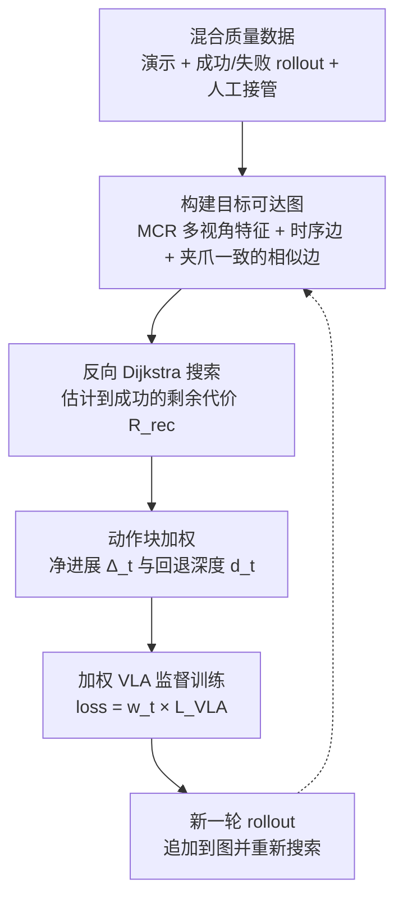

# GR-BC：用目标可达图给混合质量数据里的动作块加权

**GR-BC** 是一种离线迭代的 VLA 后训练方法：在混合质量的演示、成功与失败 rollout 以及人工接管片段上构建任务条件的目标可达图，用反向图搜索得到的剩余步数衡量每个动作块的进展贡献，再以此给加权行为克隆（SFT）的样本加权，不训练奖励模型、价值网络或进展预测器。

## 英文缩写速查

| 缩写 | 英文全称 | 简要说明 |
|------|----------|----------|
| GR-BC | Graph-Reweighted Behavior Cloning | 本文方法：用图上的进展势能给动作块加权的行为克隆 |
| GRP | Graph-Retrieved Progress | 目标可达图反向搜索得到的剩余步数进展估计，是本文的非参数化进展信号 |
| VLA | Vision-Language-Action | 视觉-语言-动作模型，本文后训练的对象（主实验 backbone 为 X-VLA） |
| SFT | Supervised Fine-Tuning | 监督微调；GR-BC 在其逐样本损失上乘以权重 w_t |
| BC | Behavior Cloning | 行为克隆，把数据中的动作当作监督目标 |
| MCR | Manipulation-Centric Representation | 冻结的操作中心视觉编码器，用于构造多视角节点特征 |
| AWR | Advantage-Weighted Regression | 基于动作级优势加权的对比基线 |

## 为什么重要

- **数据利用：** 长时域精细操作的人在回路数据里，失败尝试与干预恢复往往含有有用片段，标准 SFT 会把它们当作正样本克隆；GR-BC 尝试只保留推动任务前进的动作块。
- **无需额外模型：** 进展估计来自数据集内的图搜索，不依赖大量进展标签、子任务边界、轨迹偏好比较或 VLM 打分，适合工程上快速迭代。
- **与数据飞轮衔接：** 新 rollout 追加进图后重跑搜索即可刷新权重，计算瓶颈从神经网络重训转为图查询。

## 核心信息

| 项 | 内容 |
|----|------|
| **机构** | 中国电信人工智能研究院（TeleAI，第一单位）；合作单位包括浙江大学（CAD&CG 国家重点实验室）、华南理工大学、中国科学技术大学、上海科技大学、清华大学，以及 Gamma Robotics |
| **平台 / 任务** | 四项真机精细操作（项目页示例：Assembly Model、Graphics Card、Screw Tightening、Memory Stick） |
| **主干模型** | X-VLA（多轮离线后训练）；单任务兼容性研究另测 π0.5 与 SmolVLA |
| **数据** | 演示 + 成功/失败 rollout + 人工接管；不需要进展标签或轨迹比较 |
| **开源** | **待发布**：2026-10-15 项目页 Code 为 coming soon，未列仓库 |

## 核心原理

### 三步走

1. **目标可达图（§4.1）：** 对每条轨迹子采样帧并保留终止与成功状态作为节点；节点用三路视角的 MCR 特征表示。时序边的代价为帧数；跨轨迹相似边要求多视角互为近邻、夹爪状态一致，且归一化距离不超过阈值。
2. **剩余步数（§4.2）：** 把所有成功终止节点连向虚拟汇点，在反向图上做 Dijkstra 得到每个节点到成功的最小代价 R_rec；帧之间用线性插值得到稠密估计。
3. **加权 SFT（§4.3）：** 归一化得到进展 p(s) ∈ [0,1]；对动作块计算净进展 Δ_t = p(s_{t+N}) − p(s_t) 与回退深度 d_t；只有 d_t 不超过阈值且 Δ_t 超过阈值时给正权重（clip 到 [w_min, w_max]），其余权重为 0。

## 工程实践

| 项 | 建议 |
|------|------|
| 图构建 | 把失败 rollout 与人工接管一起放进图中；夹爪状态作为硬过滤。Assembly Model 消融中，去掉夹爪约束时错误连边占 15.8%，完整方法为 0.0% |
| 关键超参 | 子采样步长 k、相似边阈值 α_edge、回看视野 N、权重上下界与进展阈值。论文附录 A 给出各任务配置，本页未逐项核对 |
| 调试指标 | 失败节点可达率（完整方法 98.3%）、零权重比例（25.0%）、预/正常段权重比（0.42），以及错误连边数 |
| 迭代节奏 | 每轮把新 rollout 追加到图并重跑搜索，再训练一轮 VLA；论文以 X-VLA 为主要 backbone 做了多轮离线迭代 |
| 源码运行时序图 | **不适用**（官方代码尚未发布，项目页仅列 coming soon，无法对齐运行入口） |

## 实验与评测

- **进展估计（Table 1）：** GRP 的 Δ_SF 为 0.97、ρ_dev 为 0.92，成功与失败轨迹分类均为 30/30。对比 SARM（0.24 / 0.48，失败分类 14/30）、Robo-Dopamine（0.29 / 0.59）、RoboMeter（0.159 / 0.69）与 ReWiND（0.003 / 0）。
- **策略改进（Fig. 6）：** 以 X-VLA 为主干，统一从同一 BC 检查点热启动，与 DAgger、AWR、RA-BC 对比；GR-BC 在四个任务上最终成功率最高，并且随离线轮次的提升更稳定。逐任务数值位于图中，文本未核实。
- **摘要数字：** 四个任务、三种 backbone 上，GR-BC 相比单轮 SFT 有提升，离线若干轮后达到 91% 成功率。
- **图构建消融（Table 2）：** 仅时序边时失败节点无法到达成功汇点（可达率 0.0%）；去掉夹爪约束后可达率 97.8% 但错误连边 15.8%；完整方法可达率 98.3% 且无错误连边。
- **backbone 兼容（附录 C.2）：** 在 Graphics Card 任务上，X-VLA、SmolVLA、π0.5 三种 backbone 均优于 DAgger 式基线。

## 结论

**GR-BC 的核心收益来自“按动作块的进展后果加权”，而不是更复杂的奖励模型；但它的上限由目标可达图的质量决定。**

1. **进展信号无需学习：** 图上的剩余步数足以区分成功与失败轨迹，并在局部回退段上给出负向信号，无需进展标签或 VLM 判断。
2. **失败数据要“切段”用：** 收益主要来自失败 rollout 与人工接管里能到达成功的片段；整条失败轨迹一概丢弃或一概克隆都是错的。
3. **跨轨迹连边必须加约束：** 夹爪一致性与多视角一致性显著减少错误捷径；去掉夹爪约束会让可达率虽升高但引入大量错误连边。
4. **迭代成本转移到图查询：** 每轮只需重跑搜索，不必重训奖励模型，适合人在回路的数据扩充。
5. **适用边界仍窄：** 论文给出的证据集中在四个真机精细操作任务，超出数据支撑范围的状态泛化未被验证。

## 与其他工作对比

| 对照 | 差异读法 |
|------|----------|
| 标准 SFT / [DAgger](../methods/dagger.md) | 对所有动作块同权，会把失败与恢复中的错误动作也克隆进去；GR-BC 按进展后果降权 |
| [AWR](../methods/awr.md) | 依赖动作级优势估计，论文称对价值估计误差敏感；GR-BC 不估计动作价值 |
| 进展模型（SARM、Robo-Dopamine、RoboMeter、ReWiND） | 需要学习的进展函数、标签或 VLM 判断；GR-BC 用图搜索代替，论文在 Table 1 比较了这些接口 |
| [行为克隆](../methods/behavior-cloning.md) | GR-BC 保持原始监督损失，只改变样本权重，与 VLA 结构无关 |

## 局限与风险

- **依赖图的可达性质量：** 视觉邻居错误会产生捷径，过严的边过滤又会漏掉有效的恢复桥接；门控与多视角检查只能减少而不能证明物理可达。
- **最短路径不等于最安全：** 当前边代价未包含力或碰撞风险，较短路径可能伴随更激进的接触。
- **分布外状态：** 对采集数据支持集之外的状态泛化能力有限。
- **复现风险：** 官方代码与权重尚未发布，目前只能依据论文与项目页复现；逐任务数字需以原文图表为准。

## 关联页面

- [VLA](../methods/vla.md) — 本文后训练的对象类型
- [Behavior Cloning](../methods/behavior-cloning.md) — 加权 BC 的基础目标
- [AWR](../methods/awr.md) — 动作优势加权的对照基线
- [DAgger](../methods/dagger.md) — 人在回路聚合数据的对照基线
- [Progress Reward Modeling](../concepts/progress-reward-modeling.md) — 本文试图绕开的进展模型路线
- [数据飞轮（最小闭环）](../concepts/embodied-data-flywheel-minimal-closed-loop.md) — 新 rollout 进入训练的迭代闭环
- [Manipulation](../tasks/manipulation.md) — 任务范畴

## 参考来源

- [gr_bc_arxiv_2610_20504.md](../../sources/papers/gr_bc_arxiv_2610_20504.md) — 论文摘录与开源核查（2026-10-15）
- [wechat_embodied_station_robot_31_papers_2026-10-15.md](../../sources/raw/wechat_embodied_station_robot_31_papers_2026-10-15.md) — 文章摘要中的一句话说明与链接
- [arXiv:2610.20504](https://arxiv.org/abs/2610.20504) — 原文（提交日期 2026-10-14）

## 推荐继续阅读

- [GR-BC 项目页](https://gr-bc.github.io/) — 视频与实验页面（代码待发布）
- [arXiv HTML 版](https://arxiv.org/html/2610.20504) — 方法与附录全文
