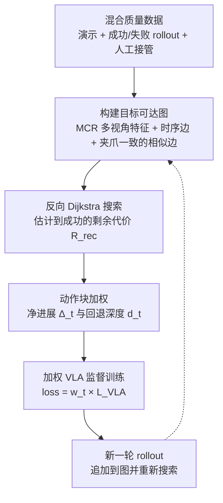
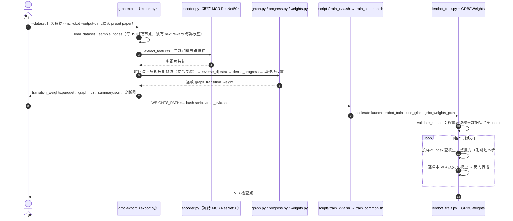

# GR-BC：用目标可达图给混合质量数据里的动作块加权

## 一句话定义

**GR-BC** 是一种离线迭代的 VLA 后训练方法：在混合质量的演示、成功与失败 rollout 以及人工接管片段上构建任务条件的目标可达图，用反向图搜索得到的剩余步数衡量每个动作块的进展贡献，再以此给加权行为克隆（SFT）的样本加权，不训练奖励模型、价值网络或进展预测器。

## 英文缩写速查

| 缩写 | 英文全称 | 简要说明 |
|------|----------|----------|
| GR-BC | Graph-Reweighted Behavior Cloning | 本文方法：用图上的进展势能给动作块加权的行为克隆 |
| GRP | Graph-Retrieved Progress | 目标可达图反向搜索得到的剩余步数进展估计，是本文的非参数化进展信号 |
| VLA | Vision-Language-Action | 视觉-语言-动作模型，本文后训练的对象（主实验 backbone 为 X-VLA） |
| SFT | Supervised Fine-Tuning | 监督微调；GR-BC 在其逐样本损失上乘以权重 w_t |
| BC | Behavior Cloning | 行为克隆，把数据中的动作当作监督目标 |
| MCR | Manipulation-Centric Representation | 冻结的操作中心视觉编码器，用于构造多视角节点特征 |
| AWR | Advantage-Weighted Regression | 基于动作级优势加权的对比基线 |
| RA-BC | Reward-Aligned Behavior Cloning | 按 SARM 式学习的进展模型给样本加权的对比基线 |

## 为什么重要

- **数据利用：** 长时域精细操作的人在回路数据里，失败尝试与干预恢复往往含有有用片段，标准 SFT 会把它们当作正样本克隆；GR-BC 尝试只保留推动任务前进的动作块。
- **无需额外模型：** 进展估计来自数据集内的图搜索，不依赖大量进展标签、子任务边界、轨迹偏好比较或 VLM 打分，适合工程上快速迭代。
- **与数据飞轮衔接：** 新 rollout 追加进图后重跑搜索即可刷新权重，计算瓶颈从神经网络重训转为图查询。

## 核心信息

| 项 | 内容 |
|----|------|
| **机构** | 浙江大学（CAD&CG 国家重点实验室，署名编号 1）、中国电信人工智能研究院（TeleAI，编号 2，9 位作者中 8 位署此单位）、华南理工大学、中国科学技术大学、上海科技大学、清华大学、Gamma Robotics；通讯作者沈春华（浙大）与白辰甲（TeleAI / Gamma Robotics） |
| **会议** | CoRL 2026 |
| **平台 / 任务** | 7 自由度 Flexiv Rizon 4s + Robotiq 2F-85 夹爪，每任务三路 RGB，SpaceMouse 共享控制，30 Hz、8 维动作；四项真机精细操作：Assembly Model、Graphics Card、Screw Tightening、Memory Stick |
| **主干模型** | X-VLA（四任务多轮离线后训练）；π0.5 与 SmolVLA 只在 Graphics Card 单任务上做兼容性研究 |
| **数据** | 演示 + 成功/失败 rollout + 人工接管；每任务演示 100–215 条、成功与失败 rollout 合计 185–390 条（附录表 7）；不需要进展标签或轨迹比较 |
| **开源** | **部分开源**：[官方仓库](https://github.com/Gamma-Robot/GR-BC)于 2026-10-16 发布图权重导出、三种 backbone 的加权 SFT 与可视化工具（Apache-2.0）；数据集、策略权重与真机采集 / 部署流程未发布 |

## 核心原理

### 三步走

1. **目标可达图（§4.1）：** 对每条轨迹子采样帧并保留终止与成功状态作为节点；节点用三路视角的 MCR 特征表示。时序边的代价为帧数；跨轨迹相似边要求多视角互为近邻、夹爪状态一致，且归一化距离不超过阈值；相似边只用于估计势能，不当作可执行转移（附录 A.3）。
2. **剩余步数（§4.2）：** 把所有成功终止节点连向虚拟汇点（失败终止节点不连），在反向图上做 Dijkstra 得到每个节点到成功的最小代价 R_rec；到不了汇点的节点权重为 0；帧之间用线性插值得到稠密估计。
3. **加权 SFT（§4.3）：** 归一化得到进展 p(s) ∈ [0,1]；对动作块计算净进展 Δ_t = p(s_{t+N}) − p(s_t) 与回退深度 d_t；只有 d_t 不超过阈值且 Δ_t 超过阈值时给正权重（clip 到 [w_min, w_max]），其余权重为 0。

### 失败轨迹如何反哺精细操作：从回合标签到动作块信用分配

这项方法**不把失败 rollout 直接改标为成功**：整个回合的成功/失败标签仍用于构造图的成功汇点，而训练阶段只给**实际执行过的动作块**分配进展权重。失败回合上的状态若能通过多视角一致、夹爪同态的跨轨迹相似边连回成功路线，就可能找到到目标的有限剩余代价；真正决定“该不该模仿”的仍是该动作块自身的前后果（论文 §4.1–4.3）。

| 数据片段（概念性判定，不是额外实验数据） | 图搜索与动作块判断 | 训练结果 |
|---|---|---|
| 失败回合中的有效对位/重新接触 | 能连回成功轨迹，净进展 `Δ_t > δ_min` 且窗口回退 `d_t ≤ η` | `w_t > 0`，模仿该恢复动作 |
| 失败回合中不断试错、越调越偏 | 净进展不足，或动作中途出现过大回退 | `w_t = 0`，不让它贡献 SFT 梯度 |
| 成功回合里的明显过冲或犹豫 | 即使最终成功，该局部块的进展仍不达标 | `w_t = 0`，成功回合也会被局部“去噪” |
| 与任何成功终点都不连通的片段 | `R_rec = ∞`，没有由已观测数据支持的回到成功路径 | `w_t = 0`，不能把未知路径冒充正监督 |

**重要区分：** `w_t = 0` 只屏蔽这个起点动作块的训练梯度，**不删掉对应图节点**；后续轨迹仍可能借助该节点或跨轨迹边接入可恢复路径。人工接管时间戳用于记录数据来源和诊断，不是“接管后全算好动作”的硬编码规则。图内相似边用于**估计势能**，不表示控制器能够瞬移或沿相似边执行动作（附录 A.3）。

官方代码 `weights.py` 将每帧判定细分为 `chunk_reject_reason`：`accepted_residual_gain`（有效进展）、`delta_not_above_min_delta_progress`（进展不足）、`window_dip_below_start`（中途回退超限）。这些字段与 `chunk_delta_progress`、`chunk_progress_dip`、`graph_transition_weight` 一起输出到 `transition_weights.parquet`，可用来验证被过滤的是真正的错误动作还是必要的接触修正（详见[源码归档](../../sources/repos/gr-bc-official-code.md)）。

**工程边界：** `n_action_step` 是用于判断动作后果的步数，`chunk` 是训练动作块长度；源码要求 `n_action_step ≤ chunk`，尾部不足时截断视窗。部署评估应额外观察接触力、碰撞及闭环恢复，因为论文的图代价不编码这些风险。

## 源码运行时序图

官方仓库把方法拆成两步离线流程：先用 `grbc-export` 从 LeRobot v3.0 数据集导出逐帧权重，再用 `scripts/train_*.sh` 做加权 SFT。下图按 `export.py`、`train_common.sh` 与 `lerobot_train.py` 的实际调用画出；真机采集与部署不在发布范围内。

复现路径是「准备带真实成功标签的 LeRobot v3.0 数据 → `grbc-export` → `train_smolvla.sh` / `train_xvla.sh` / `train_pi05.sh`」，再用 `grbc-visualize` / `grbc-evaluate` 检查进展曲线与最短路径；π0.5 需单独环境，`USE_GRBC=false` 可退回均匀 SFT 作对照。

## 工程实践

| 项 | 建议 |
|------|------|
| 图构建 | 把失败 rollout 与人工接管一起放进图中；夹爪状态作为硬过滤。Assembly Model 消融中，去掉夹爪约束时错误连边占 15.8%，完整方法为 0.0% |
| 关键超参 | 论文默认（附录表 8，四任务相同）：k = 15 帧、互近邻 K = 20、α_edge = 1.0、N = 30 帧、δ_min = 0.002、η = 0.03、β_w = 0.5、γ = 20、权重夹在 [0.5, 1.5]、R_max 取第 95 百分位；官方 `--preset paper` 即此组。推荐范围见附录表 12（如 α_edge 0.8–1.2、N 20–40） |
| 调试指标 | 失败节点可达率（完整方法 98.3%）、零权重比例（25.0%）、预/正常段权重比（0.42），以及错误连边数；官方 `grbc-evaluate` 输出可达率、拒收帧比例与逐回合回退 |
| 视觉编码器 | 附录 D.2 对比 MCR、R3M、V-JEPA2.1：R3M 回退更少、编码更快，MCR 图最保守（相似边最少、总变差最低），作者选 MCR |
| 迭代节奏 | 每轮把新 rollout 追加到图并重跑搜索，再训练一轮 VLA；X-VLA 主实验各任务做 2–4 轮，每轮约 80–120 条 rollout |
| 官方代码 | `grbc-export` 导出权重，`scripts/train_{smolvla,xvla,pi05}.sh` 做加权 SFT（见上节时序图）；官方只对 SmolVLA 做过冒烟训练，X-VLA 与 π0.5 文档注明需另行验证 |

## 实验与评测

- **进展估计（Table 1）：** GRP 的 Δ_SF 为 0.97、ρ_dev 为 0.92，成功与失败轨迹分类均为 30/30。对比 SARM（0.24 / 0.48，失败分类 14/30）、Robo-Dopamine（0.29 / 0.59）、RoboMeter（0.159 / 0.69）与 ReWiND（0.003 / 0）。附录 B.1 写明：对 GRP 这是**图内诊断**（评估轨迹在图中，其成功标签参与定义汇点），不代表留出泛化。
- **留出评估（附录 B.3，仅 Screw Tightening）：** 只用 100 条成功演示建图，把 18 条成功、17 条失败 rollout 逐条插入评分；终点进展 0.879 vs 0.000，成功漏判 2/18，失败误判 0/17。
- **策略改进（Fig. 6）：** 以 X-VLA 为主干，统一从同一 BC 检查点热启动，与 DAgger、AWR、RA-BC 对比；GR-BC 在四个任务上最终成功率最高，并且随离线轮次的提升更稳定。末轮成功率 GR-BC / 最强基线：Assembly Model 0.98 / 0.88（DAgger），Graphics Card 0.93 / 0.72（RA-BC），Screw Tightening 0.89 / 0.56（DAgger），Memory Stick 0.83 / 0.57（RA-BC）。
- **摘要数字：** 摘要称在四个任务、三种 backbone 上 GR-BC 优于单轮 SFT，离线若干轮后达到 91% 成功率。图 6 中 GR-BC 四任务末轮均值约 0.91，推测即此数；三种 backbone 的对比只在 Graphics Card 单任务上做。
- **图构建消融（Table 2）：** 仅时序边时失败节点无法到达成功汇点（可达率 0.0%）；去掉夹爪约束后可达率 97.8% 但错误连边 15.8%；完整方法可达率 98.3% 且无错误连边。
- **backbone 兼容（附录 C.2，Table 11）：** Graphics Card 上三轮后 GR-BC / DAgger 式：X-VLA 92% / 63%，π0.5 93% / 55%，SmolVLA 35% / 14%。三种 backbone 都优于基线，但 SmolVLA 的绝对成功率仍低。

## 结论

**GR-BC 的核心收益来自“按动作块的进展后果加权”，而不是更复杂的奖励模型；但它的上限由目标可达图的质量决定。**

1. **进展信号无需学习：** 在图内评测中，图上的剩余步数能区分成功与失败轨迹，并在局部回退段上给出负向信号，无需进展标签或 VLM 判断；留出评估只在一个任务上做过。
2. **失败数据要“切段”用：** 收益主要来自失败 rollout 与人工接管里能到达成功的片段；整条失败轨迹一概丢弃或一概克隆都是错的。
3. **跨轨迹连边必须加约束：** 夹爪一致性与多视角一致性显著减少错误捷径；去掉夹爪约束会让可达率虽升高但引入大量错误连边。
4. **迭代成本转移到图查询：** 每轮只需重跑搜索，不必重训奖励模型，适合人在回路的数据扩充。
5. **适用边界仍窄：** 论文给出的证据集中在四个真机精细操作任务，超出数据支撑范围的状态泛化未被验证。

## 与其他工作对比

| 对照 | 差异读法 |
|------|----------|
| 标准 SFT / [DAgger](../methods/dagger.md) | 对所有动作块同权，会把失败与恢复中的错误动作也克隆进去；GR-BC 按进展后果降权 |
| [AWR](../methods/awr.md) | 依赖动作级优势估计，论文称对价值估计误差敏感；GR-BC 不估计动作价值 |
| 进展模型（SARM、Robo-Dopamine、RoboMeter、ReWiND） | 需要学习的进展函数、标签或 VLM 判断；GR-BC 用图搜索代替，论文在 Table 1 比较了这些接口 |
| [行为克隆](../methods/behavior-cloning.md) | GR-BC 保持原始监督损失，只改变样本权重，与 VLA 结构无关 |

## 与清单说法的核对

Glen Berseth 的 CoRL 2026 阅读清单（P2，Imitation Learning & Data Quality 组，由 LLM 据摘要起草）对本文的一句话是：「按动作块在目标可达图上减少多少剩余步数来加权，用于精确 VLA 后训练」。逐项对照论文：

| 清单说法 | 论文核对 | 结论 |
|----------|----------|------|
| 按动作块加权 | §4.3：对每个动作块（N = 30 帧）算净进展 Δ_t 与回退深度 d_t，给加权 SFT 的样本权重 w_t；不满足条件的块权重为 0 | 吻合 |
| 减少多少剩余步数 | §4.2：权重基于 p(s) = 1 − R̂_rec/R_max 的差分，R_rec 是反向 Dijkstra 得到的到成功汇点的最小代价（帧数） | 吻合，但权重是归一化进展差并经 tanh 与阈值处理，不是剩余步数的原始值 |
| 目标可达图 | §4.1：任务条件图，节点是子采样状态加终止状态，含时序边与夹爪一致的跨轨迹相似边 | 吻合 |
| 用于 VLA 后训练 | §5：主实验为 X-VLA 的多轮离线后训练，π0.5 与 SmolVLA 只在 Graphics Card 单任务上做兼容性研究（附录 C.2） | 吻合 |
| 精确（precise）操作 | 题目与 §5 的四项真机精细操作（装配、显卡插槽、螺丝、内存条） | 吻合，且均为真机，不是仿真 |

清单没有提到、但读论文时有用的限定：（1）输入是混合质量数据，含失败 rollout 与人工接管片段，即题目中 Human Interventions 的含义；（2）不训练奖励模型或价值网络；（3）表 1 的进展估计对比是图内诊断，不是留出泛化（附录 B.1）；（4）摘要的 91% 推测为图 6 四任务末轮均值，论文未明说。清单摘要本身没有出现论文里查不到的结果。

## 局限与风险

- **依赖图的可达性质量：** 视觉邻居错误会产生捷径，过严的边过滤又会漏掉有效的恢复桥接；门控与多视角检查只能减少而不能证明物理可达。
- **最短路径不等于最安全：** 当前边代价未包含力或碰撞风险，较短路径可能伴随更激进的接触。
- **分布外状态：** 对采集数据支持集之外的状态泛化能力有限。
- **评测口径：** 表 1 的成功/失败分类为图内诊断，留出插入评估仅覆盖 Screw Tightening；多 backbone 结论只来自 Graphics Card 单任务。
- **复现风险（部分开源）：** 官方仓库已发布权重导出、加权 SFT 与诊断工具，但四个任务的数据集、训练后的策略权重以及真机采集 / 部署流程未发布，无法直接复现论文的真机成功率；官方验证只覆盖单元测试与 SmolVLA 短程冒烟训练。在线 RL 版本（RLT 结合 GR-BC）仍在 README 待办中。

## 关联页面

- [VLA](../methods/vla.md) — 本文后训练的对象类型
- [Behavior Cloning](../methods/behavior-cloning.md) — 加权 BC 的基础目标
- [AWR](../methods/awr.md) — 动作优势加权的对照基线
- [DAgger](../methods/dagger.md) — 人在回路聚合数据的对照基线
- [Progress Reward Modeling](../concepts/progress-reward-modeling.md) — 本文试图绕开的进展模型路线
- [数据飞轮（最小闭环）](../concepts/embodied-data-flywheel-minimal-closed-loop.md) — 新 rollout 进入训练的迭代闭环
- [Manipulation](../tasks/manipulation.md) — 任务范畴

## 参考来源

- [gr_bc_arxiv_2610_20504.md](../../sources/papers/gr_bc_arxiv_2610_20504.md) — 论文全文核对（v1 正文与附录 A–E）与开源复核（2026-11-06）
- [gamma-robotics.md](../../sources/sites/gamma-robotics.md) — Gamma-Robot GitHub 组织与 GR-BC 仓库核查
- [gr-bc-official-code.md](../../sources/repos/gr-bc-official-code.md) — 2026-11-12 对实际 CLI / 进展加权 / 训练损失实现与验证边界的复核
- [wechat_embodied_station_robot_31_papers_2026-10-15.md](../../sources/raw/wechat_embodied_station_robot_31_papers_2026-10-15.md) — 文章摘要中的一句话说明与链接
- [arXiv:2610.20504](https://arxiv.org/abs/2610.20504) — 原文（v1，提交日期 2026-10-14）
- [Gamma-Robot/GR-BC](https://github.com/Gamma-Robot/GR-BC) — 官方代码（2026-10-16 发布，Apache-2.0）

## 推荐继续阅读

- [GR-BC 项目页](https://gr-bc.github.io/) — 视频与实验页面
- [GR-BC 官方仓库](https://github.com/Gamma-Robot/GR-BC) — 权重导出、加权 SFT 与诊断工具；`docs/METHOD.md` 与 `docs/EVALUATION.md` 说明参数与评估口径
- [arXiv HTML 版](https://arxiv.org/html/2610.20504) — 方法与附录全文
