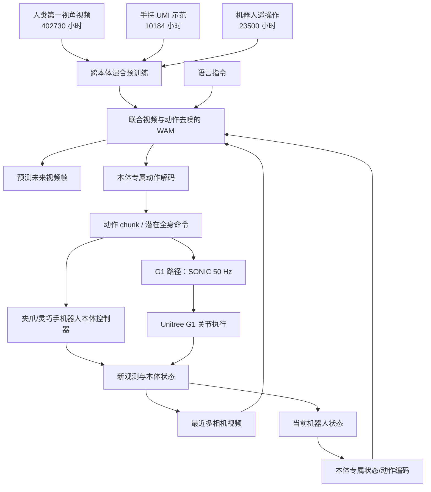

# GR00T 2：跨本体世界动作基础模型 / Scaling Robot Foundation Models for Generalization, Dexterity, and Adaptation

> **核验状态（2026-11-10）：** 已通读 [NVIDIA GEAR 官方项目页](https://research.nvidia.com/labs/gear/gr00t-2/)可抓取的文字，且核对了白皮书目录与 §2 可见段落；**白皮书 PDF 正文及附录未完整读取**。以下结果均为 NVIDIA 自报，未独立复现。项目页写明 **Code Available in December**；当前**没有 GR00T 2 的官方运行源码**，不能把旧版 Isaac-GR00T 当作 GR00T 2 的源码。

## 一句话定义

**GR00T 2 是 NVIDIA 的 World-Action Model（WAM）：给定视频历史、语言与机器人状态，在共享模型内同时生成未来视频和未来动作块，并用本体专属头支持平行夹爪机械臂、灵巧手与 Unitree G1 人形机器人。**

## 英文缩写速查

| 缩写 | 英文全称 | 简要说明 |
|---|---|---|
| WAM | World-Action Model | 联合建模物理场景演化与机器人动作 |
| DiT | Diffusion Transformer | 用于视频和动作联合去噪的 Transformer |
| VAE | Variational Autoencoder | 压缩视频帧的潜空间表征 |
| UMI | Universal Manipulation Interface | 人手持夹爪采集示范的设备/数据路径 |
| X-Adapt | Cross-Adaptability | 跨人类视频、采集器与机器人本体迁移技能 |
| S2 | System 2 | 负责规划、核验和调用 WAM 的推理代理 |
| CaP | Code as Policy | 代理用于补救/恢复等操作的代码策略工具 |
| SONIC | GEAR-SONIC | G1 全身潜在命令的低层控制接口 |
| LoRA | Low-Rank Adaptation | 少样本快速适配所用参数高效微调 |

## 为什么重要

- **与纯动作策略不同：** 在生成行动时同时预测动作引起的场景变化，使学习目标可以吸收只有视觉演化的人类视频。
- **跨本体迁移：** 以人为主的数据、高频手持 UMI 数据与真机遥操作数据共同预训练；目标任务可以没有该本体上的任务示范，但仍可能依赖本体无关的 play/teleop 数据。
- **高层规划与执行分离：** 推理代理决定任务、步骤和恢复；WAM 完成接触丰富的操作；G1 路径再由 SONIC 完成 50 Hz 全身控制。

## 流程总览

以下是依据项目页输入/输出与数据流绘制的**模型级**流程图，并非尚未公开的源码调用图。

注：图中 SONIC 是 G1 路径的执行接口，非所有本体通用的控制器；预测的视频是模型生成的未来画面，不是环境真值。

## 核心原理

| 环节 | NVIDIA 披露的机制 | 注意的口径 |
|---|---|---|
| 观测 | 0.8 s 的视频历史、最多 4 路相机、5 fps、224×320，叠加语言与本体状态 | 以上细节来自白皮书 §2 可读片段，后续章节待核 |
| 视觉 | 冻结的视频 VAE 压缩历史与未来帧；共享 DiT 同时处理视频 token 和动作 token | PDF §2 可读片段描述 Wan 2.1 VAE、Cosmos-Predict2.5 与 Cosmos-Reason1 条件化 |
| 动作 | 本体专属 MLP 将状态与带噪动作映射到 Transformer，再解码动作 chunk | 跨本体不是所有机器人共用同一个电机输出空间 |
| 训练 | 视频潜变量与动作联合使用 flow-matching 损失；多本体/多来源数据预训练 | 完整损失权重、训练设置和消融表未通读 |
| 在线闭环 | 预测未来视频与动作 chunk → 机器人执行 → 新观测 → 下一次预测 | 预测未来不是证明已拥有精确、完整物理模型 |

### 三条跨本体 X-Adapt 路径

1. **人类 → 双灵巧手机器人：** 化学实验由人类第一视角示范；Dexter 的任务无关 play 数据用于表征其自身动作能力。滤纸装入与润湿任务等由机器人完成，其中项目页给出单项 65% 示例。
2. **手持 UMI → YAM 机械臂：** 仅以 UMI 演示目标任务，YAM 本身仅有任务无关遥操作数据；玩具翻斗卡车完整装配成功率 60%（长时程可达约 4 分钟）。
3. **DexUMI → 灵巧手：** 使用与手指自由度对应的可穿戴装置示范，迁移到双手机器人完成早餐、点火等动作（网页有演示，未把定性演示误写成统一成功率）。

### Agentic 与 Turbo

- **Agentic WAM API：** 推理代理观察、分解子任务、调用 WAM 与 CaP 恢复。它并非 WAM 单独端到端完成整套推理；例如玩具装配在引入代理后达 98/100、97/100、97/100。
- **Visual steering：** 规划器在机器人相机图像上给出抓取与释放位置的标记，改善“抓哪一个/放哪里”的歧义；位置标记不编码最终朝向和路径。
- **GR00T 2 Turbo + SONIC：** Turbo 用更紧凑视频表示和较小的联合模型，机载 Jetson Thor 单次预测中位延迟约 124 ms，规划 1.6 秒潜在全身动作 chunk；SONIC 以 50 Hz 执行。推理时延和底层控制频率不可混淆。

## 实验与评测（均为官方自报）

| 任务/条件 | 官方结果 | 约束/解读 |
|---|---|---|
| 50 个目标机器人未示范的任务，零样本 | 平均成功率 **40%** | 另有「40/50 个任务至少成功一次」是另一指标 |
| 同 50 个任务，5-shot LoRA | **95%** 平均成功率 | 每任务 5 次示范，不足 3 min 数据；RTX 5090 单卡微调约 30 min |
| 双 22-DoF Sharpa 灵巧手 | GB300 内存模块装配 **85%**、玩具卡车 **65%** | 为任务后训练结果，不能当作基座零样本 |
| 真机接触丰富任务的 RL | SFT **40–76%** → RL **88–96%** | 3 项任务，GRPO 自模仿路径 |
| YAM 三项连续玩具组装，S2+WAM | **98/100、97/100、97/100** | 含代理核验与失败恢复，并非裸策略 |
| YAM 短时 what-and-where 指令 | 纯任务指令 **40%** → 视觉标记 **92%** | 两个设置之间还涉及分步骤指令 |
| G1 端侧 Turbo + SONIC | 爆米花 **48/48**；清桌 **93%** | 特定真实环境与实验配置 |
| 72 个 Dexter 任务人类数据缩放 | 真机任务进展 **50% → 70%** | 使用人类视频比例从 0 到 100%，不是任务成功率 |
| YAM 25 任务、14 策略的仿真/真实相关 | Pearson **0.92**、Spearman **0.89** | 衡量跨策略评测趋势，不担保单次 sim2real 成功 |

## 结论

**GR00T 2 的新意在于把“未来世界将如何变化”与“机器人接下来如何行动”放进一个跨本体联合生成模型；它的实用价值仍须按目标本体、数据预算和实机控制链验证。**

- 评估基座时严格区分 **zero-shot / few-shot / 后训练 RL / agentic recovery**。
- 不把 5 Hz 相机输入、124 ms 推理、1.6 s chunk 与 SONIC 50 Hz 误认为同一控制频率。
- 新本体适配应先查本体状态/动作头、任务无关数据和 low-level controller 的接口，不能仅复制旧 GR00T N1.7 配置。
- 真机任务中另行检查夹爪接触、稳定性、失步恢复与推理资源；网页给出的成功率不能直接保证新的实验室任务。
- 待官方 2026 年 12 月放出代码后才能核对可运行入口、许可证、权重与实际性能。

## 工程实践

目前只能规划验证，不提供虚构的 GR00T 2 安装命令。

| 检查点 | 实施建议 |
|---|---|
| 数据接口 | 明确相机数量/频率、机器人状态维度、动作 chunk、相对/绝对动作语义与时间同步 |
| 部署分层 | 区分代理规划层、WAM 预测层、本体动作头、SONIC（仅 G1 等全身路径） |
| 评测 | 分别记录 zero-shot、5-shot、SFT、RL、S2 恢复的成功率和失败类型 |
| 实时性 | 分别监控观测延迟、动作 chunk 生成延迟、执行器控制频率与动作过期风险 |
| 复现条件 | 等待 GR00T 2 的代码/权重发布，获取许可后对照官方模型与测评脚本 |

## 源码运行时序图

**不适用（2026-11-10）**：项目主页写明代码 **2026 年 12 月才提供**，目前无可核对的 GR00T 2 训练/推理/部署入口。可参考 [Isaac-GR00T 的 N1.7](./isaac-gr00t.md) 作为**不同版本**工程背景，但不可据此画 GR00T 2 的源码时序图。

## 局限与风险

- **未完成论文通读：** 网页资料和 PDF §2 可见片段不足以复核白皮书全部方法、超参、图表及附录；本页保留 `draft`，原文归档明确标 `通读：未完成`。
- **无当前 GR00T 2 官方代码：** 官方写明 `Code Available in December`；尚无法复查实现、许可证、权重或部署脚本。
- **作者自测：** 结果依赖机器人、任务、示范数据和恢复代理；跨设置直接比较成功率无效。
- **视觉标记边界：** 项目页明确指出长任务在 Dexter 上仍难完成，且标记缺少终态朝向和抓放间运动信息。
- **控制安全：** 预测未来视频不能替代实机力控、碰撞安全检查、接触模型与在线异常处理。

## 关联页面

- [GR00T N1.7：VLM + flow-matching action head](./paper-gr00t-n1-7.md)
- [GR00T N1.5](./paper-gr00t-n1-5.md)
- [GR00T N1](./paper-hrl-stack-34-gr00t_n1.md)
- [Isaac-GR00T 工程平台（现有版本）](./isaac-gr00t.md)
- [GR00T-WholeBodyControl](./gr00t-wholebodycontrol.md)
- [SONIC 运动跟踪](../methods/sonic-motion-tracking.md)
- [VLA 方法](../methods/vla.md)
- [全身移动操作任务](../tasks/loco-manipulation.md)

## 参考来源

- [NVIDIA 官方项目页归档](../../sources/sites/gr00t-2-gear.md)：主页文字核实完成
- [GR00T 2 官方白皮书归档](../../sources/papers/gr00t2_whitepaper_2026.md)：PDF 全文 **未通读**
- [NVIDIA GEAR 原始项目页](https://research.nvidia.com/labs/gear/gr00t-2/)
- [NVIDIA GR00T 2 官方白皮书 PDF](https://research.nvidia.com/labs/gear/gr00t-2/assets/gr00t2_whitepaper.pdf)

## 推荐继续阅读

- [GR00T 2: Scaling Robot Foundation Models（NVIDIA 白皮书）](https://research.nvidia.com/labs/gear/gr00t-2/assets/gr00t2_whitepaper.pdf)
- [Human-1M-100K（官方数据集）](https://huggingface.co/datasets/nvidia/PhysicalAI-Human-1M-100K)
