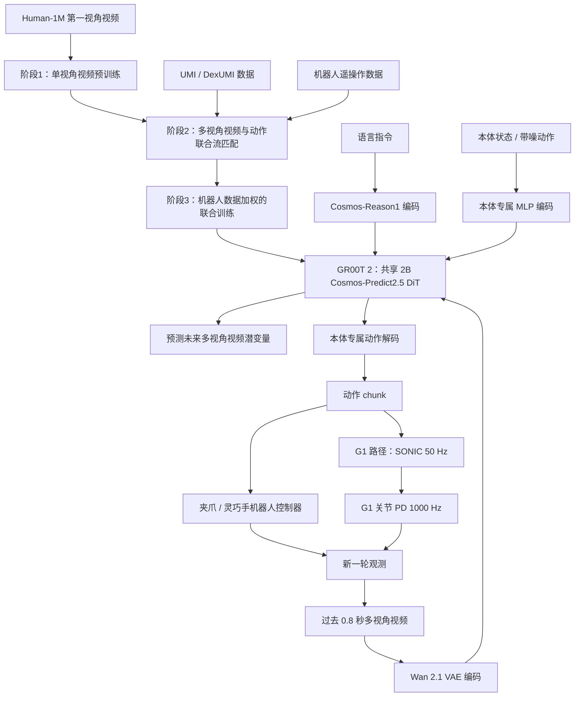

# GR00T 2：跨本体世界动作基础模型 / Scaling Robot Foundation Models for Generalization, Dexterity, and Adaptation

> **核验状态（2026-11-10）：** 已直接阅读 [NVIDIA 官方 GR00T 2 白皮书](https://research.nvidia.com/labs/gear/gr00t-2/assets/gr00t2_whitepaper.pdf) **135 页提取文本**：正文 §1–§5、附录 A–K、相关表格和图注，以及 [GEAR 项目页](https://research.nvidia.com/labs/gear/gr00t-2/)；论文结果为 NVIDIA 作者自报，未独立复现，原图/视频未逐帧核验，公式抽取存在少量字体乱码。**GR00T 2 源码仍未发布**（项目页写 Code Available in December），不能用 N1.7 的旧版代码冒充新模型实现。

## 一句话定义

**GR00T 2 是 NVIDIA 的 World-Action Model（WAM）：给定视频历史、语言与机器人状态，在共享模型内同时生成未来视频和未来动作块，并用本体专属头支持平行夹爪机械臂、灵巧手与 Unitree G1 人形机器人。**

## 英文缩写速查

| 缩写 | 英文全称 | 简要说明 |
|---|---|---|
| WAM | World-Action Model | 联合建模物理场景演化与机器人动作 |
| DiT | Diffusion Transformer | 用于视频和动作联合去噪的 Transformer |
| VAE | Variational Autoencoder | 压缩视频帧的潜空间表征 |
| UMI | Universal Manipulation Interface | 人手持夹爪采集示范的设备/数据路径 |
| X-Adapt | Cross-Adaptability | 跨人类视频、采集器与机器人本体迁移技能 |
| S2 | System 2 | 负责规划、核验和调用 WAM 的推理代理 |
| CaP | Code as Policy | 代理用于补救/恢复等操作的代码策略工具 |
| SONIC | GEAR-SONIC | G1 全身潜在命令的低层控制接口 |
| LoRA | Low-Rank Adaptation | 少样本快速适配所用参数高效微调 |

## 为什么重要

- **与纯动作策略不同：** 在生成行动时同时预测动作引起的场景变化，使学习目标可以吸收只有视觉演化的人类视频。
- **跨本体迁移：** 以人为主的数据、高频手持 UMI 数据与真机遥操作数据共同预训练；目标任务可以没有该本体上的任务示范，但仍可能依赖本体无关的 play/teleop 数据。
- **高层规划与执行分离：** 推理代理决定任务、步骤和恢复；WAM 完成接触丰富的操作；G1 路径再由 SONIC 完成 50 Hz 全身控制。

## 流程总览

依据白皮书 §2、§4.1、§3.5 和附录 H.1 绘制的**原文机制/系统图**，不是未公开源码的函数调用图。论文明确区分共享的 2B Transformer 与本体专属编码/解码层，并区分 G1 的三个运行频率。

注：GR00T 2 Turbo 是**同为 2B 的 DiT**，用 Wan 2.2 VAE 的更高空间压缩减视频 token；在 G1 上 S1 约 1 Hz 预测 1.6 s/80 latent tokens，S0 SONIC 以 50 Hz 解码，PD 以 1000 Hz 执行。预测视频不是环境真值，闭环依赖执行后的新观测。

## 核心原理

| 环节 | NVIDIA 披露的机制 | 注意的口径 |
|---|---|---|
| 观测 | 0.8 s 视频历史、最多四路相机、5 fps、224×320，叠加语言与本体状态 | 论文 §2，部署见 §K.5 |
| 视觉 | **2B Cosmos-Predict2.5 DiT**；冻结 Wan 2.1 视频 VAE 与 Cosmos-Reason1 语言编码器，视觉 token 跨相机/时间注意 | Turbo 仍是 2B 参数，改用 Wan 2.2 VAE，压缩后 token 约为四分之一（§2） |
| 动作 | 本体专属 MLP 将状态与带噪动作映射到 Transformer，再解码动作 chunk | 跨本体不是所有机器人共用同一个电机输出空间 |
| 训练 | 视频潜变量与动作分别以 flow matching 学习；先单视角视频、再多视角视频+动作、最后提高机器人样本权重 | 动作 loss 仅施加在存在有效动作监督的数据上（§4.1） |
| 在线闭环 | 预测未来视频与动作 chunk → 机器人执行 → 新观测 → 下一次预测 | 预测未来不是证明已拥有精确、完整物理模型 |

### 训练、数据和少样本适配（§4.1 / §4.2 / A.3）

- **监督分工：** 402,730 h Human-1M 视频用于视觉世界变化的广覆盖；10,184 h UMI-10K（942k 片段、2897 任务）提供机器人兼容的手持示范；23,500 h（1.16M 片段）YAM / Sharpa / Wuji / G1 / DROID 遥操作数据提供可执行动作监督，G1 在此仅 275 h。采集数据经 Flora 做动作边界、命令标注和结果/奖励标签。
- **Dexter-50 LoRA：** rank 32，向共享 Transformer 的线性层加适配器，冻结文本编码器、VAE、本体状态/动作头和基础权重；每集切 100 个训练窗并按冻结模型 loss 优先采样困难阶段；一张 RTX 5090 约 30 分钟。**重要筛选偏差：50 项仅保留 5-shot 达至少 80% 成功率的任务，不能把“95%”外推到任意未知任务**。
- **跨本体非零数据条件：** 普通 human→Sharpa 和 UMI→YAM 都依赖目标本体的**任务无关 play/teleop** 来刻画本体动力学、相机和动作语义；DexUMI 与 XHAND 一对一匹配时才可仅用外骨骼数据。视频想象只能帮助跨外观，不会自动消除几何视角和控制语义差异。

### 三条跨本体 X-Adapt 路径

1. **人类 → 双灵巧手机器人：** 化学实验由人类第一视角示范；Dexter 的任务无关 play 数据用于表征其自身动作能力。滤纸装入与润湿任务等由机器人完成，其中项目页给出单项 65% 示例。
2. **手持 UMI → YAM 机械臂：** 仅以 UMI 演示目标任务，YAM 本身仅有任务无关遥操作数据；玩具翻斗卡车完整装配成功率 60%（长时程可达约 4 分钟）。
3. **DexUMI → 灵巧手：** 使用与手指自由度对应的可穿戴装置示范，迁移到双手机器人完成早餐、点火等动作（网页有演示，未把定性演示误写成统一成功率）。

### 本体迁移的实现边界（§B / §E）

- Human→Sharpa：人体头/腕视角、Manus 手套和 PICO 腕部 6D 追踪，经几何 IK 映射到 22-DoF Sharpa 手、与 Tianji + Sharpa 无关任务 play 数据以 1:1 共训练，4 项化学/投掷任务分别为 65%、30%、10%、50%（每项 20 次）。
- UMI→YAM：必须对齐鱼眼腕相机与 YAM pinhole 视角，且对齐末端位姿与夹爪宽度的 action semantics；若不做视角 warping，两项复杂装配从 60%/50% 降为 **0%/0%**（Tab.17）；传送带 86% 指 **50 件中的正确分类比例**。
- DexUMI→XHAND：可用触指力标签转 joint torque 并调节虚拟位置目标和刚度，但 **WAM 只预测力，不接收触觉作为模型输入**（§5）；换成 22-DoF Sharpa 手需要重定向关节动作，不能直接照搬 XHAND 力标签。
- 另外有单条人类视频→3D 接触重建→仿真 CHORD/PPO 专家→1500 条合成轨迹→微调 DiT 的 Human→Sim→Real 分支（§B.5），不能和无需仿真的直接 X-Adapt 混为一谈。

### Agentic 与 Turbo

- **Agentic WAM API：** 推理代理观察、分解子任务、调用 WAM 与 CaP 恢复。它并非 WAM 单独端到端完成整套推理；例如玩具装配在引入代理后达 98/100、97/100、97/100。
- **Visual steering：** 规划器在机器人相机图像上给出抓取与释放位置的标记，改善“抓哪一个/放哪里”的歧义；位置标记不编码最终朝向和路径。
- **GR00T 2 Turbo + SONIC（§H / Fig.9）：** Turbo **仍是 2B DiT**，Jetson AGX Thor 上 S1 约 **1 Hz**、单次预测中位 **123.97ms**，生成 1.6 秒 / 80 个全身运动潜 token；独立 Jetson Orin NX 上 SONIC（S0）以 **50 Hz** 输出 joint position target，机器人关节 PD 以 **1000 Hz** 执行。夹爪宽度不经 SONIC 解码，直接送相应本体执行链。

## 实验与评测（均为官方自报）

| 任务/条件 | 官方结果 | 约束/解读 |
|---|---|---|
| 50 个目标机器人未示范的任务，零样本 | 平均成功率 **40%** | 另有「40/50 个任务至少成功一次」是另一指标 |
| 同一经过筛选的 Dexter-50，1-shot / 5-shot | **71% / 95%** 平均成功率 | **50 项按“5-shot≥80%”选入**；不可推广成任意新任务 95%；每任务五条示范不足 3 min，RTX 5090 单卡微调约 30 min（A.3） |
| 7 项 Dexter 后训练任务 | 平均 **68.6%**（Turbo **34.3%**）；GB300 模组 **85%**、卡车 **65%** | 不等同于零样本；两版共享 2B DiT，Turbo 减少视频 token 带来速度/灵巧细节权衡（Tab.1b） |
| 4 项真机接触任务的 RL + self-imitation | SFT **40–76%** → **88%、98%、94%、96%** | **4 项**：固定管配合、手指定位、线缆插入、充电头插入；每项每配置 50 次（Fig.5 / F.4） |
| YAM 三项连续玩具组装，S2+WAM | **98/100、97/100、97/100** | 含代理核验与失败恢复，并非裸策略 |
| YAM 短时 what-and-where 指令 | 纯任务指令 **40%** → 视觉标记 **92%** | 两个设置之间还涉及分步骤指令 |
| G1 端侧 Turbo + SONIC | 爆米花 **48/48**、清桌 **28/30**、地面拾取 **25/30**、洒漏清洁 **14/30** | 4 类任务平均 **80.8%**；机载 S1 1 Hz、S0 50 Hz、PD 1000 Hz（Tab.25） |
| 72 项 Dexter 的人类数据规模消融 | 真机成功率 **18%→41%**，进度 **50%→70%** | 0/1/10/100% 数据点成功率 18/27/28/41%；0% 对比含额外预训练阶段混杂、每个数据规模仅单次训练（Fig.10 / C.1.5） |
| YAM 25 任务、14 策略的仿真/真实相关 | 成功率 Pearson **0.92**；进度、Elo 各 **0.93** | 衡量该任务集上 checkpoint 排序趋势，不担保单次 sim2real 或碰撞接触准确性（§J.2） |

### 需要区分的评测分母与控制变量

- **长任务 YAM 六任务（Tab.1a）：** GR00T 2 成功率 71.7%、Turbo 65%，其他方法多数在低个位数到 12.5%；Toy Truck Assembly 的 GR00T 2 **65%** 用的是修订的更容易初始布局，在原始布局仅 **7/20=35%**。
- **X-Adapt（Tab.4）：** YAM 两项长任务成功率 60% / 50%；“传送带 86%”是分类/抛入正确的**物品比例**而非“86% 任务 episode 成功”。
- **Agentic（§G）：** 乱序倾倒装配零件的压力测试，在相同代理策略下 SFT→DAgger→DAgger+Agent 提升；这个起始配置**不同于** Tab.1a 的摆齐布局。视觉标记能显著改善物体/目标定位，但位置标记无目标物体 6D 姿态、接触路径或双臂协同描述；人工代理平均推理 turn 7.5s，YAM trash sorting 中机器人等待约 38% 时间。
- **真机 RL 与世界模型 RL 不同：** 直接 GRPO、自模仿/残差 SAC 的结果（Fig.5）与在另一个 DreamDojo 神经模拟器中训练后的 RoboLab **51.32%→70.88%** 属不同数据和评测口径。
- **RoboDojo（Tab.19 vs Tab.31）：** **35.52%** 来自正式 3-layout-bank 测试；**35.2% SFT / 75.8% SFT+RL+Agent** 来自只测 layout bank 0 的 agentic 对照，不能把二者直接当同一测试集合。
- **G1 仿真数据（Tab.26）：** OOD 条件 real-only 成功率两模型 6.7%；加 sim 后 N1.7 为 40.0%、Turbo 为 63.3%，但每格仅 30 次，论文报告两者差距 Fisher exact 双侧 **p≈0.12**，不能断言比较已显著。
- **GearArena：** YAM V2 用 6035 次盲测 pairwise match（35% tie），按任务 bootstrap 估 Elo；GR00T 2 相比 π0.5 为 +236 Elo、相比 N1.7 为 +95 Elo；不同 suite 不能比较 Elo 绝对值。

## 与其他工作对比

| 工作 | 架构路线 | 与 GR00T 2 的区别（数字为白皮书自报） |
|------|----------|--------------------------------------|
| [GR00T N1.7](./paper-gr00t-n1-7.md) | VLM 骨干 + flow-matching DiT 动作头，只生成动作 | GR00T 2 改为视频/动作联合生成的 WAM；GearArena 上 +95 Elo；G1 仿真 OOD 加 sim 后 N1.7 40.0% vs Turbo 63.3%（p≈0.12，未显著） |
| [π0.5](./paper-pi05-open-world-vla.md) | VLA 动作策略 | GearArena YAM V2 上 GR00T 2 相对 +236 Elo（同 suite 内比较） |
| [ODEAction](./paper-odeaction.md) | ODE 动作递推替代动作块 | 只改动作生成头，不预测未来视觉；GR00T 2 用联合视频预测吸收无动作标签的人类视频 |

## 结论

**GR00T 2 的新意在于把“未来世界将如何变化”与“机器人接下来如何行动”放进一个跨本体联合生成模型；它的实用价值仍须按目标本体、数据预算和实机控制链验证。**

- 评估基座时严格区分 **zero-shot / few-shot / 后训练 RL / agentic recovery**。
- 不把 5 Hz 相机输入、124 ms 推理、1.6 s chunk 与 SONIC 50 Hz 误认为同一控制频率。
- 新本体适配应先查本体状态/动作头、任务无关数据和 low-level controller 的接口，不能仅复制旧 GR00T N1.7 配置。
- 真机任务中另行检查夹爪接触、稳定性、失步恢复与推理资源；网页给出的成功率不能直接保证新的实验室任务。
- 待官方 2026 年 12 月放出代码后才能核对可运行入口、许可证、权重与实际性能。

## 工程实践

**论文已通读，但 GR00T 2 官方代码在 2026-11-10 尚未开放**；因此下面给的是依据 §I / K 和论文示例可执行的**验收清单**，不杜撰官方安装命令。

| 检查点 | 实施建议 |
|---|---|
| 数据接口 | 明确相机数量/频率、机器人状态维度、动作 chunk、相对/绝对动作语义与时间同步 |
| 部署分层 | 区分代理规划层、WAM 预测层、本体动作头、SONIC（仅 G1 等全身路径） |
| 评测 | 分别记录 zero-shot、5-shot、SFT、RL、S2 恢复的成功率和失败类型 |
| 实时性 | 分别监控观测延迟、动作 chunk 生成延迟、执行器控制频率与动作过期风险 |
| 复现条件 | 等待 2026 年 12 月官方代码/权重许可与入口，固定版本后检查训练脚本、S1/S0 通信和 benchmark harness |

- **同一基座版本要注意：** Turbo 虽使用更强的视频压缩，但不能视为“更小参数模型”；在灵巧手长任务上 68.6%→34.3% 的精度损失与端侧显著加速必须共同评估。
- **可信部署：** 论文 §I.2 的 noisy-prefix RTC 通过约 5k 额外微调处理异步接续，320ms 仿真延迟时在八项 RoboDojo 任务的成功率 15.0%→21.42%，p95 chunk jerk 减少 87.2%；请区别 **仿真延迟** 与真实链路延迟。

## 源码运行时序图

**不适用（2026-11-10）**：项目主页写明代码 **2026 年 12 月才提供**，目前无可核对的 GR00T 2 训练/推理/部署入口。可参考 [Isaac-GR00T 的 N1.7](./isaac-gr00t.md) 作为**不同版本**工程背景，但不可据此画 GR00T 2 的源码时序图。

## 局限与风险

- **原始数据和图表核对边界：** 白皮书 135 页的可提取正文、附录 A–K、统计表与图注已阅读；PDF 图中曲线坐标/演示视频未逐帧逐点核查，数学公式纯文本提取含少量乱码，实验数据仍属作者报告，未作独立复现实验。
- **无当前 GR00T 2 官方代码：** 官方写明 `Code Available in December`；尚无法复查实现、许可证、权重或部署脚本。
- **样本与选择偏差：** Dexter-50 任务是事先依据 5-shot 成功率门槛筛出的；短程/长程、零样本/任务后训练、原始/较易初始场景、agentic/纯模型以及 3-bank/1-bank 的指标不可混算。
- **作者明确的未解决问题（§5）：** 0.8 秒历史不够长记忆；当前 WAM **没有触觉输入**（DexUMI 触力可作为输出标签）；视觉 grasp/release marker 不覆盖 6D 姿态、力控或双臂同步动作。长任务核验、恢复成本和相机几何分布迁移仍是限制。
- **控制/实时安全：** 124 ms 是模型预测延迟，不是 observation-to-applied-action 延迟；异步 action chunk 需要防过期/抖动机制（§I.1 / K.5）；预测未来视频不能替代安全控制、碰撞检查与实机接触验证。

## 关联页面

- [ODEAction：无动作块的连续演化头](paper-odeaction.md) — 对照联合视频/动作预测与递归动作生成。
- [Steel：异构机器人/任务仿真求解器](steel-newton-solver.md) — 跨本体数据与仿真吞吐的不同层。
- [ToolDex：工具使用演示数据集](paper-tooldex.md) — 对照人类视频示范和工具接触标注。

- [GR00T N1.7：VLM + flow-matching action head](./paper-gr00t-n1-7.md)
- [GR00T N1.5](./paper-gr00t-n1-5.md)
- [GR00T N1](./paper-hrl-stack-34-gr00t_n1.md)
- [Isaac-GR00T 工程平台（现有版本）](./isaac-gr00t.md)
- [GR00T-WholeBodyControl](./gr00t-wholebodycontrol.md)
- [SONIC 运动跟踪](../methods/sonic-motion-tracking.md)
- [VLA 方法](../methods/vla.md)
- [全身移动操作任务](../tasks/loco-manipulation.md)

## 参考来源

- [NVIDIA 官方项目页归档](../../sources/sites/gr00t-2-gear.md)：主页文字核实完成
- [GR00T 2 官方白皮书归档](../../sources/papers/gr00t2_whitepaper_2026.md)：正文 §1–§5、附录 A–K 已阅读，记录表格/统计口径与源码未公开的边界
- [NVIDIA GEAR 原始项目页](https://research.nvidia.com/labs/gear/gr00t-2/)
- [NVIDIA GR00T 2 官方白皮书 PDF](https://research.nvidia.com/labs/gear/gr00t-2/assets/gr00t2_whitepaper.pdf)

## 推荐继续阅读

- [GR00T 2: Scaling Robot Foundation Models（NVIDIA 白皮书）](https://research.nvidia.com/labs/gear/gr00t-2/assets/gr00t2_whitepaper.pdf)
- [Human-1M-100K（官方数据集）](https://huggingface.co/datasets/nvidia/PhysicalAI-Human-1M-100K)
