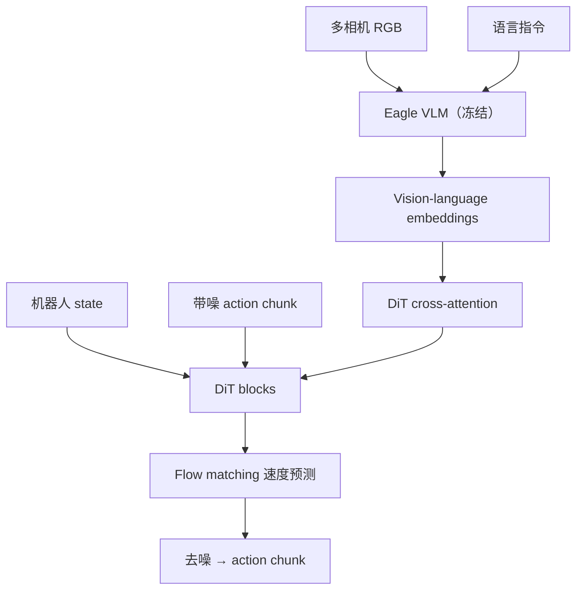
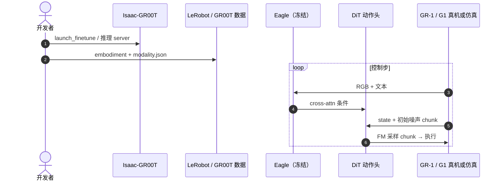

# GR00T N1.5：通用人形 VLA 的改进版

**GR00T N1.5**（*An Improved Open Foundation Model for Generalist Humanoid Robots*，[NVIDIA GEAR 项目页](https://research.nvidia.com/labs/gear/gr00t-n1_5/)，[Isaac-GR00T](https://github.com/NVIDIA/Isaac-GR00T)，[HF GR00T-N1.5-3B](https://huggingface.co/nvidia/GR00T-N1.5-3B)）是 [GR00T N1](./paper-hrl-stack-34-gr00t_n1.md) 的升级版。**截至 2026-09-28 无独立 arXiv 编号**；机制与评测以 GEAR 网页与 Isaac-GR00T 仓库为准。

## 一句话定义

**在 N1 的「VLM + DiT flow-matching action chunk」上，冻结更强 grounding 的 Eagle VLM、简化 adapter，并加 FLARE 未来表征对齐，使人形策略更跟语言、更吃人类视频。**

## 英文缩写速查

| 缩写 | 英文全称 | 简要说明 |
|------|----------|----------|
| VLA | Vision-Language-Action | 视觉–语言–动作策略 |
| VLM | Vision-Language Model | Eagle 系列多模态骨干（N1.5 预训练/微调均冻结） |
| DiT | Diffusion Transformer | 处理 state + 带噪 action 的 Transformer 动作头 |
| FM | Flow Matching | 连续流匹配速度场训练（相对 DDPM 少步采样） |
| FLARE | Future LAtent Representation Alignment | 对齐未来 latent 而非生成像素；助人类视频学习 |
| OXE | Open X-Embodiment | N1.5 预训练混合数据之一 |

## 为什么重要

- **阅读链终点之一：** [扩散 → DiT → Flow → GR00T 纵深路线](../../roadmap/depth-robotics-diffusion-dit-flow.md) 在 [π₀](./paper-pi0.md) 与 [GR00T N1](./paper-hrl-stack-34-gr00t_n1.md) 之后，N1.5 展示 **工业级人形 VLA 迭代**：cross-attention DiT + FM + 数据/损失扩展。
- **工程主线：** 平台实现与微调见 [Isaac GR00T](./isaac-gr00t.md)（仓库后续 GA 以 N1.7 为主，N1.5 权重仍作对照基线）。

## 核心信息

| 项 | 内容 |
|----|------|
| **机构** | NVIDIA GEAR |
| **发布** | 2025-06（GEAR 网页） |
| **架构** | **Eagle VLM**（冻结）→ vision-language embedding → **DiT cross-attention** → **state + noisy actions** → **flow matching 速度预测** → **action chunk** |
| **相对 N1** | VLM **全程冻结**；vision→LLM adapter **简化 + LayerNorm**；预训练加 **FLARE**（系数 0.2） |
| **训练** | 250K steps · 1K H100 · global batch 16384 · AdamW + cosine（warmup 0.05，沿用 N1）；FLARE 损失系数 0.2（预训练与后训练均用）；混合 GR-1 内部数据、OpenXE、仿真 GR-1（DexMG）、DreamGen 神经轨迹、AgiBot-Beta |
| **VLM** | 基于 **Eagle 2.5** 更新，加强 grounding / 物理理解；2.1B 参数 |
| **开源** | **已开源** — Isaac-GR00T + HF **GR00T-N1.5-3B** |

## 核心原理

0. **VLM grounding（项目页 Table）：** GR00T N1.5 VLM（2.1B）在 GR-1 内部 grounding 数据集上 IoU **40.4**（Qwen2.5-VL 3B 为 35.5），RefCOCOg-val IoU **89.6**（Qwen2.5-VL 3B 为 85.2）。
1. **System 2 / System 1 分工**（延续 N1）：VLM 产出语义–视觉 embedding；**System 1 DiT** 在高频控制率下生成 chunk（N1 白皮书为 120Hz 叙事，部署以 Isaac 栈为准）。
2. **Cross-attention 条件：** DiT token 对 VLM embedding 做 cross-attention，再对 **本体 state** 与 **带噪动作序列** 做 flow matching 去噪/速度回归。
3. **FLARE：** 不生成未来帧，而是让模型表征与未来 **target latent** 对齐，使 **人类 ego 视频** 可进入 post-train（项目页：新物体 0-shot 15% → FLARE 后 55%）。
4. **DreamGen：** 神经轨迹扩 verb 覆盖；N1.5 在 12 个新 verb 上 **38.3%** vs N1 **13.1%**（仍非完全 zero-shot verb）。

### 流程总览

## 工程实践

| 项 | 来源给出的信息 |
|----|----------------|
| 输入 | 模型卡：可变数量的 224×224 uint8 RGB 视图（拼接各视图 token 后接语言 token）、一维本体状态向量、文本指令；输出连续动作向量，维度随 embodiment 而定 |
| 编码器 | 模型卡称图像经预训练 SigLIP2，文本经预训练 T5（与项目页「Eagle VLM」表述并存，二者如何对应未在来源中说明）；本体状态 / 动作用按 embodiment ID 索引的 MLP，变长状态先 padding 到可配置最大长度 |
| 动作头 | DiT，扩散步条件为 AdaLN；自注意力处理本体 + 动作，交叉注意力读 VLM 特征；训练时动作在干净向量与高斯噪声间随机插值，推理从噪声迭代去噪 |
| 与 N1 的连接 | 模型卡：VLM→DiT 的 MLP 连接器已为改善仿真基准而修改，并与 flow matching + 世界建模（FLARE）目标联合训练 |
| 微调建议 | 项目页：VLM 全程冻结，只后训练其余部分；已有 SO-100/101 微调社区教程（模型卡「Resources」） |
| 许可 | 模型卡写明「non-commercial use」（NVIDIA 非商业许可）；N1.7 README 则写明代码 Apache 2.0、权重 NVIDIA Open Model License（见 [Isaac GR00T](./isaac-gr00t.md)）；两版许可不同 |
| 硬件 | 模型卡列：Ampere / Blackwell / Jetson / Hopper / Lovelace，Linux，PyTorch |

## 源码运行时序图

## 与其他工作对比

| 维度 | GR00T N1.5 | [GR00T N1](./paper-hrl-stack-34-gr00t_n1.md) | [π₀](./paper-pi0.md) |
|------|------------|---------------------------------------------|----------------------|
| 动作头 | DiT + **flow matching** | 同族 DiT + FM | **Action Expert** + FM |
| VLM | Eagle 2.5 系 **全程冻结** + FLARE | Eagle-2：论文中语言部分冻结、其余可训（中间第 12 层特征） | PaliGemma 类 VLM |
| 人形数据 | DreamGen + 人类视频 | 数据金字塔 | 多本体机器人数据 |
| 开源 | Isaac-GR00T + HF 3B | N1-2B + 同仓 | openpi |

### 项目页其余实验

- **新物体泛化（10 个预训练未见物体，pick-and-place）：** 0-shot N1 **0%**、N1.5 **15.0%**；用含新物体的人类 ego 视频做 FLARE 后训练 → **55.0%**。
- **DreamGen 新动词：** 12 个只来自神经轨迹的新动词，N1.5 **38.3%** vs N1 **13.1%**；项目页强调这不是严格 zero-shot（预训练混入了对应 DreamGen 轨迹）。
- **Sim GR-1 数据受限后训练：** 0-shot 39.6 → 43.9，30 demos/任务 43.2 → 47.4。
- **Unitree G1 后训练（1K 遥操作）：** 见下表末行；对 5 个未见物体的变体 N1.5 达 **84.2%**。
- 以上均为项目页汇总值，页面未给置信区间、试验次数或逐任务表。

## 评测要点（GEAR 网页，相对 N1）

| 基准 / 设置 | GR00T N1 | GR00T N1.5 |
|-------------|----------|------------|
| Language Table（scratch） | 52.8% | 93.2% |
| Sim GR-1 Language（scratch） | 36.4% | 54.4% |
| RoboCasa 30 demos/task | 17.4 | 47.5 |
| 真机 GR-1 语言跟随率 | 46.6% | 93.3% |
| 真机 GR-1 总成功率 | 43.3% | 83.0% |
| G1 1K demos 水果任务 | 44.0% | 98.8% |

## 结论

**GR00T N1.5 把「VLM + Flow-Matching DiT + chunk」推到可感知的人形语言跟随与少样本 post-train，关键是冻结 grounding 更好的 Eagle、FLARE 与 DreamGen 数据。**

- 学完 [π₀](./paper-pi0.md) 的 **Action Expert + FM** 后，用 N1 → N1.5 看 **人形开源栈** 如何把同一范式产品化。
- 与 [Dita](./paper-dita-scaling-diffusion-transformer-vla.md) 对照：Dita 是 **学术通才 VLA + DDPM chunk**；GR00T 是 **人形 foundation + FM DiT 头**。
- 微调与部署勿只读论文页，应跟 [Isaac GR00T](./isaac-gr00t.md) 的 LeRobot 管线与 embodiment tag。
- N1.5 权重适合作为 **语言跟随 / 少样本** 基线；后续 GA 功能以仓库 **N1.7** 分支为准。

## 局限与风险

- **评测证据薄：** 来源只有项目页汇总表，没有论文级消融（例如 FLARE 与冻结 VLM 各自的贡献未单独拆分），也没有试验次数与方差；上表的「提升来源」归因是 NVIDIA 的叙述（项目页：「We attribute these improvements to…」）。
- **无独立 arXiv**，引用需链 GEAR 页 + 仓库 commit/标签。
- FLARE / DreamGen 依赖 **NVIDIA 内部或 gated 数据混合**，完全复现预训练不现实；工程侧以 **post-train** 为主。
- Flow matching 仍要 **action chunk 异步执行** 才控延迟（与 VLA 部署通用问题相同）。

## 关联页面

- [paper-hrl-stack-34-gr00t_n1](./paper-hrl-stack-34-gr00t_n1.md)
- [isaac-gr00t](./isaac-gr00t.md)
- [depth-robotics-diffusion-dit-flow](../../roadmap/depth-robotics-diffusion-dit-flow.md)

## 参考来源

- **原文通读：** [gr00t-n1-5-gear.md](../../sources/sites/gr00t-n1-5-gear.md) — GEAR 项目页 + HF 模型卡（2026-11-07）
- [gr00t_n1_arxiv_2503_14734.md](../../sources/papers/gr00t_n1_arxiv_2503_14734.md)
- [isaac_gr00t.md](../../sources/repos/isaac_gr00t.md)

## 推荐继续阅读

- [GR00T N1.5 项目页](https://research.nvidia.com/labs/gear/gr00t-n1_5/)
- [HF nvidia/GR00T-N1.5-3B](https://huggingface.co/nvidia/GR00T-N1.5-3B)
