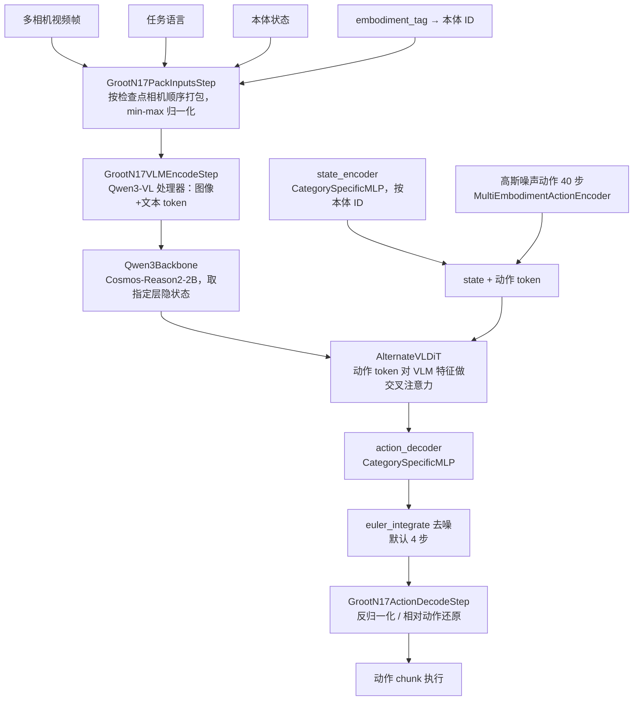
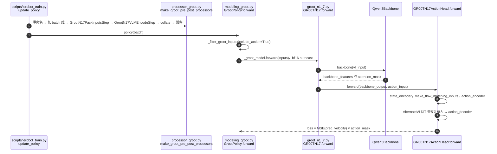
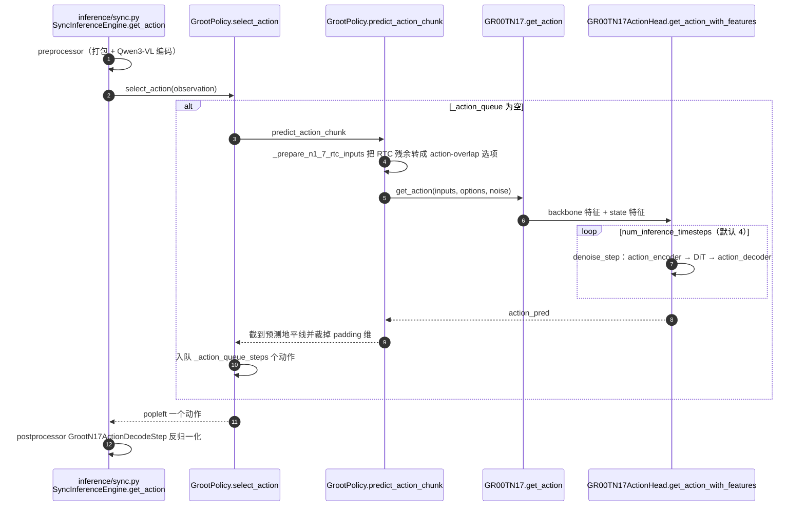

# GR00T N1.7：多本体 flow-matching 人形 VLA

**GR00T N1.7** 是 NVIDIA Isaac GR00T 系列当前的开放权重版本（[`nvidia/GR00T-N1.7-3B`](https://huggingface.co/nvidia/GR00T-N1.7-3B)，[Isaac-GR00T](https://github.com/NVIDIA/Isaac-GR00T)）。**重要：未找到 N1.7 专属的论文或技术报告**（2026-11-05 查模型卡、Isaac-GR00T README、LeRobot 文档并做 web 搜索）；官方模型卡明确写「N1.X 架构的详细描述见 GR00T N1 白皮书 arXiv:2503.14734」。因此：

- 本库 arXiv:2503.14734 的 canonical 节点是 [GR00T N1](./paper-hrl-stack-34-gr00t_n1.md)，本页**不带 arxiv 字段**，是 N1.7 版本/实现节点（与 [GR00T N1.5](./paper-gr00t-n1-5.md) 同为「无独立 arXiv」的版本页）。
- 平台与工作流见 [Isaac-GR00T](./isaac-gr00t.md)，本页聚焦模型本体与 LeRobot 的 `groot` 实现。
- 凡是 N1.7 相对 N1 的变化，只能引用模型卡/README/LeRobot 源码，不能当作论文结论。

## 一句话定义

**GR00T N1.7 = Cosmos-Reason2-2B（Qwen3-VL 架构）视觉语言骨干 + 按本体编号分支的 MLP 与 DiT 流匹配动作头，一次生成 40 步动作 chunk，跨本体后训练。**

## 英文缩写速查

| 缩写 | 英文全称 | 简要说明 |
|------|----------|----------|
| VLA | Vision-Language-Action | 视觉–语言–动作模型 |
| DiT | Diffusion Transformer | 动作头的主干，用 AdaLN 注入扩散/流时间步 |
| AdaLN | Adaptive Layer Normalization | 以时间步为条件调制层归一化 |
| VLM | Vision-Language Model | 此处为 Cosmos-Reason2-2B（Qwen3-VL 架构） |
| RTC | Real-Time Chunking | 实时分块；LeRobot 把其残余动作转成 N1.7 原生 action-overlap 选项 |

## 为什么重要

- LeRobot 清单中唯一的 NVIDIA 人形基础模型，且 LeRobot 已**只支持 N1.7**（N1.5 被移除，旧检查点要求固定 `lerobot==0.5.1`，见 `docs/source/groot.mdx`）。
- 模型卡提供 SimplerEnv Bridge / Fractal、DROID、LIBERO 四个后训练检查点，可直接评测或微调。
- 与 [π0](./paper-pi0.md) 同属「VLM + 流匹配动作专家」路线，差别在于按本体 ID 切换的投影层与 DiT 交叉注意力动作头。

## 流程总览

图依据：LeRobot `policies/groot/groot_n1_7.py`（`GR00TN17ActionHead.forward/get_action_with_features`、`Qwen3Backbone`）与 `processor_groot.py`；模型卡的网络描述中「SigLip2 + T5」与此源码骨干不符，见下文问题清单。

## 核心方法

以下只含模型卡与源码里读到的事实：

- **规模与骨干：** 模型卡称 3B 参数；骨干 `nvidia/Cosmos-Reason2-2B`，LeRobot 以 `Qwen3VLForConditionalGeneration` 加载，并 `pop` 掉 `select_layer` 之后的层（`Qwen3Backbone.__init__`）。
- **动作头：** 流匹配；`action_horizon=40`、`max_state_dim=max_action_dim=132`、`max_num_embodiments=32`、`num_inference_timesteps=4`、`use_alternate_vl_dit=True`（`GR00T_N1_7_DEFAULTS`）；状态编码、动作编码、动作解码都是按本体 ID 取参数的 `CategorySpecificMLP` / `MultiEmbodimentActionEncoder`。
- **训练目标：** `GR00TN17ActionHead.forward` 中对速度做 MSE，并乘 `action_mask`，除以掩码和；训练时可对状态特征做 `state_dropout_prob` 的整体置零。
- **推理：** 噪声从 `sample_noise` 或外部传入；若带 RTC 选项，会把前一 chunk 的残余写入前缀并用 ramp 缩放速度；随后 `euler_integrate`。
- **没有论文级评测数字：** 本页不转述未读到的 N1.7 成功率。LeRobot 文档只说在 LIBERO 上「strong performance」，其结果表在读到的文档段中为空。

## 源码运行时序图

依据 LeRobot 固定提交 `9e5ee98…` 的 `src/lerobot/policies/groot/`（已读 `modeling_groot.py`、`groot_n1_7.py`、`configuration_groot.py`，`processor_groot.py` 的构造函数与相关步骤，`action_head/cross_attention_dit.py` 仅看了类清单）。

### 训练（`lerobot-train --policy.type=groot`）

### 推理（`lerobot-rollout` 同步引擎）

注意：`GrootPolicy.select_action` 在 `use_relative_actions=True` 时直接抛 `NotImplementedError`，相对动作策略必须走 `predict_action_chunk` 或 RTC/分块 rollout 路径。

官方原仓 Isaac-GR00T 的运行入口（`launch_finetune.py`、`run_gr00t_server.py` + `PolicyClient`）见 [Isaac-GR00T](./isaac-gr00t.md)；本次未克隆原仓，不画其内部调用链。

## LeRobot 实现要点

- **入口与权重：** `policy.type=groot`、`--policy.base_model_path=nvidia/GR00T-N1.7-3B`；`pip install "lerobot[groot]"`；面向 NVIDIA GPU。LIBERO 检查点 `nvidia/GR00T-N1.7-LIBERO`（README 列出）。
- **与官方一致性：** `policies/groot/README.md` 称有对照原 `gr00t` 包的 parity 测试：相同输入与种子下原始模型输出需一致，预处理产出的 `input_ids/pixel_values/state/embodiment_id` 需一致。测试文件在本次未运行。
- **关键配置（`configuration_groot.py`）：** `chunk_size=n_action_steps=40`、`embodiment_tag="new_embodiment"`（SO-101 等新本体用）、`tune_llm=False`、`tune_visual=False`、`tune_projector=True`、`tune_diffusion_model=True`、`optimizer_lr=1e-4`、`use_bf16`。文档示例微调用 `chunk_size=16`、`use_relative_actions=true` 并排除 `gripper`，注意与默认 40 不同。
- **相对动作：** N1.7 检查点自带相对动作统计则走原生解码；否则退回通用 `RelativeActionsProcessorStep` 并打警告，称相对增量会用绝对动作统计归一化，与官方不完全一致。
- **限制：** N1.5 不再支持；骨干依赖支持 Qwen3-VL 的 `transformers`；`select_action` 不支持相对动作；动作头用 `diffusers`。

## 发现的不一致

- 模型卡「网络架构」段写视觉用 SigLip2、文本用 T5，而同卡骨干行与 LeRobot 源码均为 Cosmos-Reason2-2B / Qwen3-VL；前者疑为沿用旧版文字。模型卡中 Cosmos-Reason2-2B 的超链接实际指向 8B 页面。
- [Isaac-GR00T 页](./isaac-gr00t.md) 称 N1.7 动作头 `action_horizon` 40、状态/动作维 132，与 LeRobot 默认值一致。
- 模型卡「SimplerEnv Fractal」的后训练数据链接与 Bridge 相同（指向 bridge_orig_lerobot），疑为复制错误。

## 结论

**把 N1.7 当作「有开放权重和 LeRobot 适配、但没有独立论文」的工程版本来用：引用架构问 N1 白皮书，引用行为问模型卡和源码。**

- 评测数字须自己跑，LeRobot 文档未给结果表
- 新机器人用 `embodiment_tag=new_embodiment`，并核对动作维与 `chunk_size`
- 相对动作要靠检查点原生统计，否则归一化口径不同
- 想要全身人形（locomotion+manipulation）请看 [GR00T-WholeBodyControl](./gr00t-wholebodycontrol.md)

## 关联页面

- [Isaac-GR00T](./isaac-gr00t.md)
- [GR00T N1](./paper-hrl-stack-34-gr00t_n1.md)
- [GR00T N1.5](./paper-gr00t-n1-5.md)
- [GR00T-WholeBodyControl](./gr00t-wholebodycontrol.md)
- [lerobot](./lerobot.md)
- [π0](./paper-pi0.md)
- [vla](../methods/vla.md)
- [flow-matching-embodied-policy](../concepts/flow-matching-embodied-policy.md)

## 参考来源

- [gr00t-n1-7-hf-model-card.md](../../sources/sites/gr00t-n1-7-hf-model-card.md)
- [isaac_gr00t.md](../../sources/repos/isaac_gr00t.md)
- [lerobot 仓库归档](../../sources/repos/lerobot.md)：固定提交 `9e5ee98…` 的 `policies/groot/` 与 `docs/source/groot.mdx`
- [gr00t_n1_arxiv_2503_14734.md](../../sources/papers/gr00t_n1_arxiv_2503_14734.md)
- [HF 模型卡](https://huggingface.co/nvidia/GR00T-N1.7-3B)
