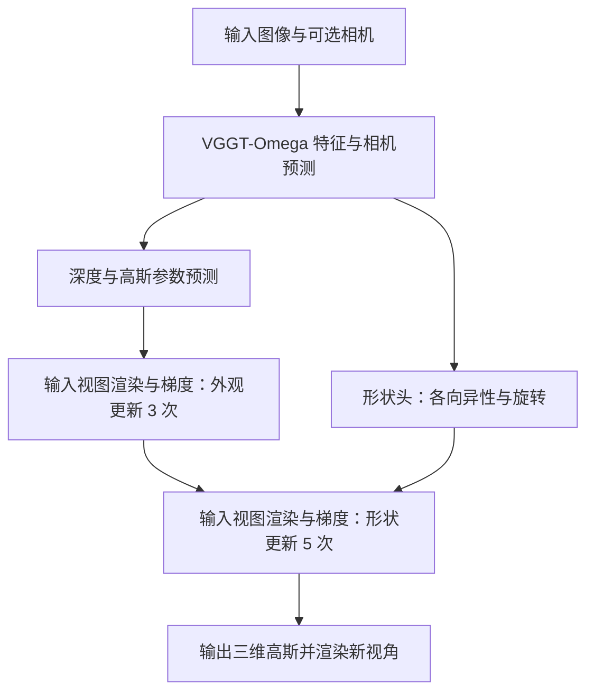
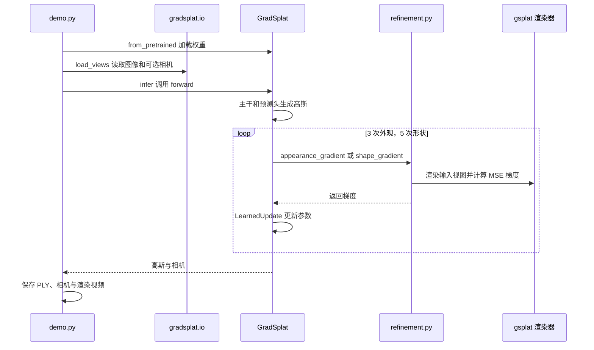

# GradSplat: Gradients Inside the Forward Pass for Feed-Forward 3D Gaussian Splatting（在前向传播中利用梯度的前馈三维高斯溅射）

## 一句话定义

GradSplat 从多视图预测 3D 高斯，并在同一前向过程中根据输入视图的渲染误差做固定次数的学习梯度更新。

## 英文缩写速查

| 缩写 | 英文全称 | 简要说明 |
|---|---|---|
| 3DGS | 3D Gaussian Splatting | 用三维高斯表示和渲染场景 |
| PSNR | Peak Signal-to-Noise Ratio | 图像重建质量指标，越高越好 |
| SSIM | Structural Similarity Index Measure | 结构相似度指标，越高越好 |
| LPIPS | Learned Perceptual Image Patch Similarity | 感知距离指标，越低越好 |

## 核心信息

| 项 | 内容 |
|---|---|
| 机构 | 南达科他州立大学、阿尔托大学、康考迪亚大学、Mila、芬兰 ELLIS 研究所 |
| 论文 | [arXiv v1](https://arxiv.org/abs/2610.38951)，2026-10-28 |
| 作者 | Jingong Chen、Linlian Jiang、Guangyuan Li、Xinxin Zuo、Yang Wang、Chulwoo Pack、Kyle Gao、Kwanghee Won；Jiang 和 Li 为共同贡献，Won 为通讯作者 |
| 输入与输出 | 多视图图像，可选相机；每输入像素一个高斯 |

## 流程总览

训练展开各步骤并用目标视图监督各次结果；推理细化只使用输入视图。

## 核心机制

- **动机：** 在论文的 8 场景探针中，对初始高斯只优化尺度和旋转已接近优化所有参数的效果，形状是该实验中的主要差距来源。
- **形状校正：** 对数尺度校正经零和投影改变轴比例，另加旋转增量；未触及尺度上限时保持体积。
- **可学习细化：** 每步将高斯渲染回输入视图，计算像素均方误差对原始参数的梯度；结合特征、历史更新、二阶矩与循环状态产生下一步。先更新不透明度和颜色，再更新尺度比例与旋转。梯度输入停止反传，训练不需光栅器二阶导数。

## 源码运行时序图

依据 `demo.py`、`gradsplat/model.py` 和 `gradsplat/refinement.py`。即使外层为 `no_grad`，细化内部仍启用梯度计算。

## 实验与评测

论文在 RealEstate10K 训练；主结果使用六输入视图、224 × 224、已知输入相机和八个目标视图。narrow（7,128 场景）和 wide（1,600 场景）PSNR 分别为 **33.683 dB** 和 **26.755 dB**；SSIM 分别为 0.9593 和 0.8993。wide 的 LPIPS 为 0.1301，YoNoSplat 的 0.1295 更低。6–42 输入视图使用相同的 6,444 个场景比较。

RealEstate10K 权重零样本迁移至 DL3DV 的 139 个场景，PSNR 为 24.787 dB；ScanNet++ 验证集为 21.609 dB。两视图设置中 ReSplat 的 PSNR 在 RealEstate10K、ACID 和 DTU 三个测试集均高于 GradSplat。

## 与其他工作对比

- **有位姿前馈 3DGS**：pixelSplat、MVSplat、TranSplat、DepthSplat、VolSplat 主要在高斯中心的放置方式（采样分布、平面扫描代价体、单目深度先验）或解码与视图聚合上不同，都是单次前向预测、推理时不修正误差（§2.1）。表 1 六视图 narrow 协议中 DepthSplat、VolSplat 为 GradSplat 之后的次优（PSNR 31.418、31.243）；wide 协议中三种代价体方法落后于 YoNoSplat 与 ReSplat（§4.2）。MVSplat、DepthSplat、VolSplat 使用 VolSplat 发布的权重，输入视图增加时 PSNR 下降（§4.2、表 1）。
- **无位姿方法**：NoPoSplat、AnySplat、YoNoSplat 在无输入位姿下预测高斯（§2.1）；GradSplat 沿用 AnySplat 协议，在两个六视图协议的所有指标上优于 AnySplat，但低于保留真值内参与目标相机的 YoNoSplat†（narrow PSNR 26.914 对 27.816）；输入视图数从 12 起 GradSplat 的 PSNR 反超（§4.3、表 1）。三者获得的相机信息不同，结果不能当作同条件比较。
- **ReSplat（最接近的工作）**：同样用输入视图渲染误差更新前馈模型的高斯，但采用无梯度的循环网络；GradSplat 改为在前向中走学习的梯度步，并先更新不透明度和颜色、再更新形状（§2.2）。表 1 中 ReSplat 使用两视图权重；两视图协议（附录 A、表 A2）下 ReSplat 在 RealEstate10K、ACID、DTU 上 PSNR 均更高。
- **其他细化路线**：NeRFLiX、GANeRF、Difix3D+ 修复渲染图，ReconFusion、CAT3D、ZeroNVS 借助生成先验，均作用于渲染或生成图像而非直接更新表示；DeepView、G3R、QuickSplat 学习基于渲染梯度的更新，但对象分别是多平面图像、大规模驾驶与无人机场景、室内表面重建（§2.2）。
- **骨干与表示**：GradSplat 的几何骨干采用 [VGGT](./paper-vggt-visual-geometry-grounded-transformer.md) 式帧内/全局交替注意力，并以 VGGT-Omega 权重初始化（§3.1），输出 [3DGS](./paper-rcl-2308-04079-3d-gaussian-splatting-for-real-time-radiance-fie.md) 高斯；与逐场景优化的 3DGS 不同，推理只做固定次数的更新（§2.1、§3.3）。

## 结论

固定次数的输入视图梯度细化可提升论文测试条件下的新视角重建质量。

1. 优先对齐相机、视角数和图像分辨率再比较结果。
2. 稀疏两视图表现较弱，不应把六视图优势外推至所有输入条件。
3. 已知相机结果优于本方法的无位姿结果；论文的无位姿比较各方法获得的信息并不完全一致。
4. 本文评估重建与渲染，不能直接推断机器人操作或物理仿真效果。

## 局限与工程实践

- wide 协议有 293 个目标帧重复输入帧，论文沿用原始索引；无位姿比例常数 4.04 由 60 个评估场景的真值相机统计得到。
- 训练 178,000 步共 50.5 小时，前三阶段使用 16 张 GH200，末阶段使用 4 张；这不等于推理需求。
- 官方已发布推理、评测、演示及权重，未见训练入口；README 要求 CUDA GPU、首次下载约 4.9 GB 权重，复现前核对第三方许可及显存。
- 定性展示选择了差异明显的场景；少视图、相机误差与跨域表现应单独评测。

## 关联页面

- [SplatSim：高斯渲染与视觉 Sim2Real](./paper-splatsim-gaussian-splatting-sim2real.md)
- [具身感知六种空间表征](../concepts/embodied-perception-six-spatial-representations.md)

## 参考来源

- [论文归档及原文 v1](../../sources/papers/gradsplat_2610_38951.md)
- [项目页归档](../../sources/sites/gradsplat.md)
- [官方代码归档](../../sources/repos/gradsplat.md)

## 推荐继续阅读

- [论文全文及附录](https://arxiv.org/html/2610.38951v1)
- [官方代码和演示](https://github.com/Jingong-Chen/GradSplat)
