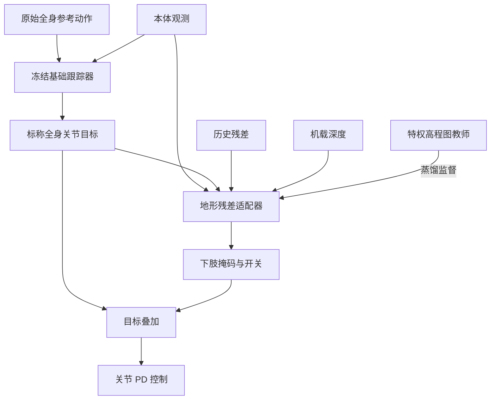

# GRAFT：面向基础跟踪器的几何感知残差适配

**GRAFT** 将冻结的全身动作跟踪器与地形感知的下肢残差策略组合，在保持参考动作接口的同时调整地形上的执行目标。本文依据 [arXiv v1 全文](https://arxiv.org/html/2610.36507v1)及[项目页](https://graft-humanoid.github.io/)整理。

## 英文缩写速查

| 缩写 | 英文全称 | 简要说明 |
|---|---|---|
| BFM | Behavior Foundation Model | 行为基础模型 |
| PPO | Proximal Policy Optimization | 教师适配器训练算法 |
| VLA | Vision-Language-Action | 视觉语言动作模型 |
| PD | Proportional-Derivative | 关节比例微分控制 |

## 流程总览

## 核心机制

冻结跟踪器根据原始参考和本体观测输出关节位置目标；残差策略读取本体观测、基础动作、上一残差及局部地形，**不直接读取参考动作**。下肢掩码限制直接修正的关节，人工设置的门控可关闭修正。上肢目标虽未直接修改，腿部变化仍会通过动力学影响上身。

训练先用特权高程图及 PPO 得到教师，再以平方误差监督使用渲染深度图的学生；部署时输入替换为机载深度。奖励包括前进与稳定任务、摆动全过程离地间隙、承重足底边缘和悬空惩罚，以及平地残差抑制。四种基础模型分别训练适配器，需匹配关节顺序、动作单位和默认姿态，不是同一套权重即插即用。

## 实验与评测

- Isaac Lab 中 G1 模型以 4096 并行环境、50 Hz 训练 20k 次迭代；MuJoCo 固定困难地形每格评估 10 次，成功指到达终点且不跌倒并保持。
- 四种冻结基础模型 SONIC、Humanoid-GPT、HoloMotion、ScaleBFM 的四类障碍合计成功次数分别由 3/40、3/40、8/40、2/40 变为 39/40、34/40、39/40、20/40；ScaleBFM 下楼一格从 1/10 降至 0/10。
- SONIC 的特权动作残差为 39/40，深度蒸馏学生为 38/40，直接深度训练为 22/40。这是论文所设仿真与训练条件下的比较。
- G1 真机使用机载深度与未修改参考，展示 0.30 m 平台、0.10 m 和 0.17 m 台阶及推车场景；真机未给出对应的量化成功率。中途关闭与重新启用残差的验证是在仿真平地进行。

## 源码运行时序图

不适用：截至 2026-11-02，项目页的 HTML 提供论文和演示入口，未发现 GRAFT 可运行算法代码或权重入口；网站代码不能作为算法实现。后续如公开实现，应核对实际入口后补图。

## 结论

冻结基础动作先验与下肢地形残差的组合，在本文设置下展现了跨基础模型的地形适配能力。

1. 实际接入需对齐动作单位、关节顺序及默认姿态，并为每个基础模型训练适配器。
2. 特权教师到深度学生的蒸馏优于文中直接深度训练，但仿真结果不等同真机成功率。
3. 论文评测使用录制参考，实时遥操作与 VLA 的系统性跟踪评估被列为未来工作；项目页另展示遥操作演示。
4. 源码及权重开放状态未确认，不能据此声称可复现。

## 关联页面

- [SONIC](./nvidia-sonic.md)
- [运动控制](../tasks/locomotion.md)
- [强化学习](../methods/reinforcement-learning.md)
- [Sim2Real](../concepts/sim2real.md)

## 参考来源

- [论文 v1 归档](../../sources/papers/graft_arxiv_2610_36507.md)
- [官方项目页归档](../../sources/sites/graft-humanoid.md)
