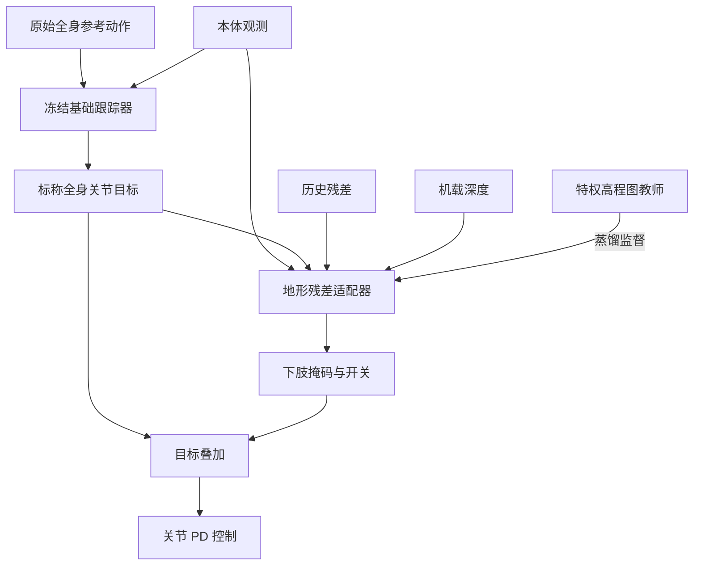

# GRAFT：面向基础跟踪器的几何感知残差适配

**GRAFT** 将冻结的全身动作跟踪器与地形感知的下肢残差策略组合，在保持参考动作接口的同时调整地形上的执行目标。本文依据 [arXiv v1 全文](https://arxiv.org/html/2610.36507v1)及[项目页](https://graft-humanoid.github.io/)整理。

## 英文缩写速查

| 缩写 | 英文全称 | 简要说明 |
|---|---|---|
| BFM | Behavior Foundation Model | 行为基础模型 |
| PPO | Proximal Policy Optimization | 教师适配器训练算法 |
| VLA | Vision-Language-Action | 视觉语言动作模型 |
| PD | Proportional-Derivative | 关节比例微分控制 |

## 为什么重要

行为基础模型（BFM）的训练语料几乎都是平地、空场景，环境既不进入策略观测也不进入奖励。因此策略能复现参考动作的空中姿态，却不会主动调整落脚位置、摆动离地高度和接触时机；论文以“看着人爬楼梯时，策略复现了空中动作但并未真正爬上台阶”为例说明这一点。

既有做法多通过重训或微调整个跟踪器并引入感知，数据标注与计算成本高，并使普通跟踪与感知通路耦合。GRAFT 的动机是：在不修改冻结跟踪器、保留上游参考接口的前提下，只补上地形执行这一部分能力。

## 流程总览

## 核心原理

输入为原始参考与本体观测，输出为各关节位置目标。冻结跟踪器根据原始参考和本体观测输出关节位置目标；残差策略读取本体观测、基础动作、上一残差及局部地形，**不直接读取参考动作**。下肢掩码限制直接修正的关节，人工设置的门控可关闭修正。上肢目标虽未直接修改，腿部变化仍会通过动力学影响上身。

训练先用特权高程图及 PPO 得到教师，再以平方误差监督使用渲染深度图的学生；部署时输入替换为机载深度。奖励包括前进与稳定任务、摆动全过程离地间隙、承重足底边缘和悬空惩罚，以及平地残差抑制。四种基础模型分别训练适配器，需匹配关节顺序、动作单位和默认姿态，不是同一套权重即插即用。

执行目标的合成方式（论文式 (1)）：

$$\Delta a_t = m \odot f_\phi(o^{\text{res}}_t), \qquad a_t = a^0_t + \Delta a_t$$

其中 $a^0_t$ 为冻结 BFM 输出的名义关节目标，$m$ 为下肢掩码，$f_\phi$ 为唯一可训练的适配器，其输出已按每关节固定尺度缩放。门控关闭或残差置零时 $\Delta a_t = 0$，执行目标即为 $a^0_t$。

训练奖励（论文式 (2)）为基础任务奖励与正则项之和，再加三项地形惩罚：

$$r_t = r_{\text{task},t} + r_{\text{reg},t} + \lambda_{clr}\, r_{clr,t} + \lambda_{fp}\, r_{fp,t} + \lambda_{flat}\, r_{flat,t}$$

三项地形惩罚均为非正值：摆动段内对地形表面的欠抬高累计后在触地时计入（$r_{clr}$，使足部提前抬起越过台阶）；承重足底触及边缘或悬空部分则受罚（$r_{fp}$）；在平地上依据局部高程方差与高度差对残差幅值施加抑制（$r_{flat}$，仅训练期使用，部署时不依赖）。

## 实验与评测

- Isaac Lab 中 G1 模型以 4096 并行环境、50 Hz 训练 20k 次迭代；MuJoCo 固定困难地形每格评估 10 次，成功指到达终点且不跌倒并保持。
- 四种冻结基础模型 SONIC、Humanoid-GPT、HoloMotion、ScaleBFM 的四类障碍合计成功次数分别由 3/40、3/40、8/40、2/40 变为 39/40、34/40、39/40、20/40；ScaleBFM 下楼一格从 1/10 降至 0/10。
- SONIC 的特权动作残差为 39/40，深度蒸馏学生为 38/40，直接深度训练为 22/40。这是论文所设仿真与训练条件下的比较。
- G1 真机使用机载深度与未修改参考，展示 0.30 m 平台、0.10 m 和 0.17 m 台阶及推车场景；真机未给出对应的量化成功率。中途关闭与重新启用残差的验证是在仿真平地进行。

## 源码运行时序图

不适用：截至 2026-11-06 复查，项目页（<https://graft-humanoid.github.io/>）只提供 arXiv 论文链接、论文 PDF 与演示入口，未列出 GitHub、Hugging Face 或权重链接；网站源码本身不是算法实现。后续如公开实现，应核对实际入口后补图。

## 结论

**GRAFT 的核心取舍是：用冻结的全身先验承担大部分运动生成，只用一个小型下肢残差学习地形相关的落脚与抬腿修正，在本文仿真与真机设置下有效。**

1. 实际接入需对齐动作单位、关节顺序及默认姿态，并为每个基础模型单独训练适配器，不能直接复用权重。
2. 特权教师到深度学生的蒸馏（38/40）明显优于文中直接深度训练（22/40），但仿真成功率不等同真机成功率。
3. 论文评测使用录制参考，实时遥操作与 VLA 的系统性跟踪评估被列为未来工作；项目页另展示遥操作演示。
4. 项目页未列出代码或权重链接（2026-11-06 核查），因此不能据此声称可复现。

## 与其他工作对比

| 方法 | 部署指令为全身参考 | 部署时读外部感知 | 基础模型参数不变 | 部署时可关闭残差 | 同一流程用于多个基础模型 |
|---|---|---|---|---|---|
| **GRAFT（本页）** | ✓ | ✓ | ✓ | ✓ | ✓ |
| [Perceptive BFM](./paper-perceptive-bfm.md) | ✓ | ✓ | × | × | × |
| [GRAIL](./paper-grail.md)（地形分支） | ✓ | ✓ | × | × | × |
| [GigaBrain-WBC](./paper-gigabrain-wbc-0-5.md) | ✓ | × | – | – | – |
| [ResMimic](./paper-resmimic.md) / MOSAIC | ✓ | × | ✓ | ✓ | × |

表格按论文表 I 的能力对比整理，“–”表示该列不适用于完整策略。

- **与地形感知 BFM：** 论文认为 GRAIL、Perceptive BFM 把地形能力和基础模型权重放在同一组参数中，感知退化的代价会超出越障本身；GigaBrain-WBC 部署时不读外部感知。GRAFT 冻结跟踪器，只在下肢执行目标上叠加残差。
- **与冻结策略的残差适配：** ResMimic 按物体与接触状态修正，MOSAIC 用残差弥合接口差距；GRAFT 改为以局部地形几何为条件、只写下肢，并在一次连续仿真中验证中途关闭再启用残差。
- **注入位置的对照实验（论文表 II，同一冻结 SONIC、困难地形四类各 10 次）：** 论文报告动作残差 39/40、深度学生 38/40；代表微调路线的 LoRA（解码器）为 35/40，但平地残差为 0.6929 ± 0.7173，高于动作残差的 0.0520 ± 0.0019；扰动潜在指令的 motion-token 残差为 0/40，从零 RL 为 1/40。

## 工程实践

| 环节 | 做法（依据论文） | 注意事项 |
|---|---|---|
| 接口对齐 | 适配器只写下肢关节，上肢目标保持基础模型输出 | 移植到新基础模型前需核对关节顺序、动作单位与默认姿态，否则会直接写错下肢目标 |
| 训练设置 | Isaac Lab，4096 并行环境，50 Hz，20k 次迭代，程序化地形与难度课程，含常见动力学与观测噪声随机化 | 论文以 SONIC 训练集参考驱动评测，参考未针对地形修改 |
| 蒸馏 | 特权高程图教师（PPO）→ 渲染深度学生，平方误差监督；部署时以机载深度替换渲染深度 | 残差输出形式保持不变，部署时无需再依赖平地抑制项 |
| 部署门控 | 门控关闭时执行目标等于基础模型输出，论文实测可在仿真中中途关闭并重新启用 | 门控为人工设定而非学习得到 |
| 监控指标 | 平地残差 L2 范数（SONIC 为 0.0520 ± 0.0019）；障碍段与平地段残差对比；腰部误差（平地 1.18°，障碍 3.17°） | 上述指标来自论文仿真，用于判断平地是否被过度修正 |
| 真机 | G1，机载深度，未修改参考；展示 0.30 m 平台、0.10 m 与 0.17 m 台阶及推车场景 | 论文未给出真机量化成功率，不宜按仿真数字估计真机表现 |

## 局限与风险

- **评测输入受限：** 论文使用录制参考，未评测实时遥操作和 VLA 指令下的系统性跟踪；论文指出上肢动作需要与落脚协同调整时，这一场景尚未验证。
- **上肢仅被动受影响：** 上肢目标不被直接修改，腿部修正通过动力学间接影响上身。论文测得手臂误差在适配器开闭两种情况下相近，但测试条件有限。
- **样本量小：** 地形评测每格仅 10 次，表 II 与表 III 的成功率分辨率为 0.1；需避免据此做细粒度排序。
- **仿真与真机差距：** 真机仅有定性展示，推车场景在程序化地形分布之外。
- **深度学生失败模式不同：** 论文报告学生在下楼梯上为 8/10，动作残差教师为 10/10，二者失败分布不同。
- **基础模型依赖强：** 同一流程在四种基础模型上都有提升，但效果不均匀；ScaleBFM 下楼梯从 1/10 降至 0/10，其提升主要来自间隙与平台。
- **门控需人工切换：** 论文中的门控由人设定，未研究自动判断何时启用残差。
- **误区：** 不应把“仿真 39/40”理解为真机成功率，也不应认为多个基础模型共用同一套适配器权重。

## 关联页面

- [SONIC](./nvidia-sonic.md)
- [运动控制](../tasks/locomotion.md)
- [强化学习](../methods/reinforcement-learning.md)
- [Sim2Real](../concepts/sim2real.md)

## 参考来源

- [论文 v1 归档](../../sources/papers/graft_arxiv_2610_36507.md)
- [官方项目页归档](../../sources/sites/graft-humanoid.md)

## 推荐继续阅读

- [GRAFT 论文 arXiv v1 全文（HTML）](https://arxiv.org/html/2610.36507v1)：方法、实验与附表的原文。
- [GRAFT 项目页](https://graft-humanoid.github.io/)：仿真与真机视频、遥操作演示。
- [Perceptive BFM（arXiv:2606.08059）](https://arxiv.org/abs/2606.08059)：论文中最接近的对照路线，即把地形分支与基础模型一起微调。
