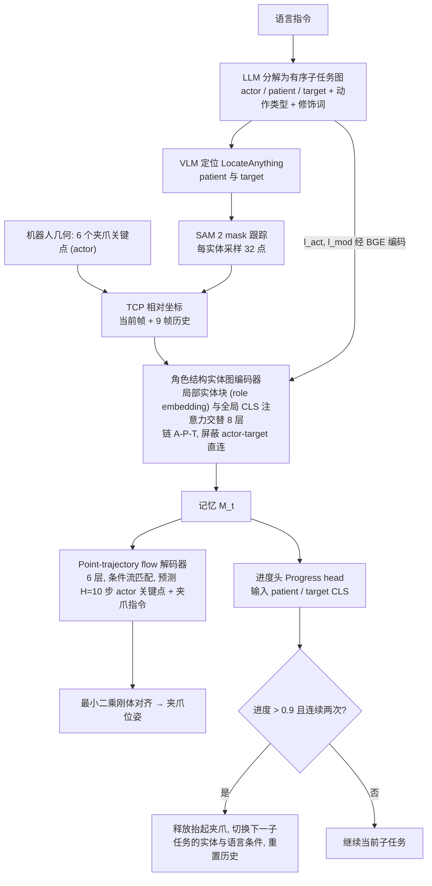

# GraphPoint（arXiv:2609.18358）

**GraphPoint**（*GraphPoint: Semantic Entity Graphs and Point Trajectories for Compositional Robot Manipulation*，[arXiv:2609.18358](https://arxiv.org/abs/2609.18358)）来自 [senlanke 具身运控lab 周更盘点](../../sources/blogs/wechat_senlanke_weekly_manipulation_2026-09-14_18.md)（2026-09-14–18）。

## 一句话定义

**CoMani Benchmark 测组合泛化；Semantic Entity Graph + gripper point trajectory + progress 预测驱动 subtask transition。**

## 英文缩写速查

| 缩写 | 英文全称 | 简要说明 |
|------|----------|----------|
| VLA | Vision-Language-Action | 视觉–语言–动作 |
| SR | Success Rate | 成功率 |
| HOI | Human-Object Interaction | 人–物交互 |

## 为什么重要

- 组合泛化需显式语义–几何接口，而非端到端低层动作。

## 流程总览

图依据：论文 §III-B–F / Fig.2。

## 核心机制

| 项 | 内容 |
|----|------|
| **arXiv** | [2609.18358](https://arxiv.org/abs/2609.18358) |
| **开源** | **待发布**（步骤 2.5，2026-09-20） |
| **方法摘要** | Entity graph → point trajectories → robot geometry actions; progress for subtask transitions. |

## 源码运行时序图

**不适用**（截至 2026-09-20 未发布可运行官方代码或待核实）。

## 实验与评测

- CoMani compositional generalization benchmark（以 PDF 为准）。
- 读法：先对齐任务设定、传感器与成功定义，再解读 headline 数字。

## 与其他工作对比

| 维度 | 读法 |
|------|------|
| **同周对照** | 见对应 [周更盘点](../../sources/blogs/wechat_senlanke_weekly_manipulation_2026-09-14_18.md) 映射表，勿跨任务直接比 SR |
| **开源状态** | **待发布** — 部署前以项目页/arXiv 为准 |

## 结论

**GraphPoint 用实体图与点轨迹桥接语言组合泛化与几何控制。**

1. 开源：**待发布**；勿凭公众号摘要臆断可复现性。
2. 指标须连同实验条件解读（仿真/真机、平台、成功阈值）。
3. 关注 arXiv 版本更新与代码发布。

## 关联页面

- [manipulation](../tasks/manipulation.md)
- [vla](../methods/vla.md)
- [behavior-tree-vla-orchestration](../concepts/behavior-tree-vla-orchestration.md)

## 参考来源

- [graphpoint_arxiv_2609_18358.md](../../sources/papers/graphpoint_arxiv_2609_18358.md)
- [wechat_senlanke_weekly_manipulation_2026-09-14_18.md](../../sources/blogs/wechat_senlanke_weekly_manipulation_2026-09-14_18.md)
- [arXiv:2609.18358](https://arxiv.org/abs/2609.18358)
- arXiv PDF：<https://arxiv.org/pdf/2609.18358>（已通读全文：方法 §III、CoMani §IV、实验 §V）

## 推荐继续阅读

- [arXiv PDF](https://arxiv.org/pdf/2609.18358)
