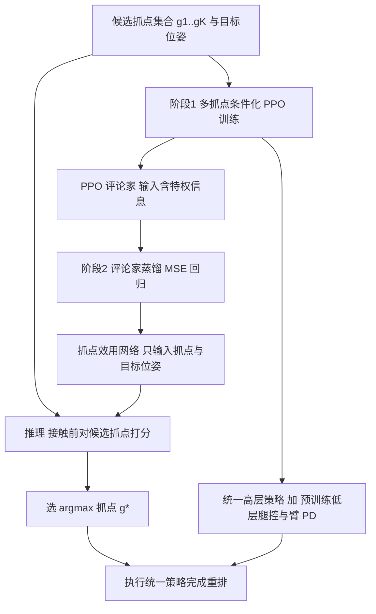

# Grasp-TAGS（arXiv:2611.09864）

**Grasp-TAGS**（*Task-Aware Grasp Selection via Critic Distillation for Prehensile Loco-Manipulation*，[arXiv:2611.09864](https://arxiv.org/abs/2611.09864)，Xun Tu、Minghao Zou、Karthik Desingh，明尼苏达大学双城分校计算机科学与工程系，v1 于 2026-11-06 提交）研究搬椅子、推车、提桶这类大物体重排：抓点不该只看抓得稳不稳，还要看它对最终搬运目标是否有利。

## 一句话定义

先用 PPO 训练一个以初始抓点和目标位姿为条件的统一搬运策略，再把训练好的评论家蒸馏成一个只看「候选抓点 + 目标位姿」的小网络，在接触物体之前给候选抓点按下游效用排序并选最优（第 I、IV 节）。

## 英文缩写速查

| 缩写 | 英文全称 | 简要说明 |
|------|----------|----------|
| TAGS | Task-Aware Grasp Selection | 任务感知的抓点选择，论文方法名 |
| PPO | Proximal Policy Optimization | 近端策略优化，训练高层策略与评论家 |
| SE(2) | Special Euclidean group in 2D | 平面位姿 (x, y, θ)，即目标位姿的表示 |
| SE(3) | Special Euclidean group in 3D | 三维位姿，候选抓点在物体局部系下的表示 |
| IK | Inverse Kinematics | 逆运动学，用于把人工选的抓点换成臂关节角 |
| PD | Proportional-Derivative control | 比例微分控制，直接执行 6 维臂命令 |
| MPC | Model Predictive Control | 模型预测控制，论文所述的模型法对照 |
| RSL-RL | RSL reinforcement learning library | 论文用来实现 PPO 的训练库 |

## 为什么重要

- 许多学习式重排工作默认初始抓点固定或预先给定（第 I、II-A 节）；论文的观察是，同一物体上同样稳定的不同抓点，会让后续推拉的可控性和结果差很多（Fig. 1、Fig. 2），并且最优抓点会随目标位姿变化（项目页的椅子侧移对比）。
- 方法思路很省事：评论家本来就在训练里学出「从这个初始状态出发能拿到多少回报」，把它拿来当抓点打分，不需要再收集抓取标注（第 IV-D 节）。
- 评论家依赖质量、速度等特权信息，接触前拿不到；论文改用只含抓点和目标的学生网络，避免先抓一次估物理量、抓错再放手重抓（第 IV-D 节）。

## 核心原理与方法栈

| 环节 | 做法（出处） |
|------|--------------|
| 问题设定 | 目标 SE(2) 位姿，K 个预设抓点，选 g* = argmax U(g_i, p_goal)（式 1-3，第 III 节） |
| 低层控制 | 预训练腿式运动策略跟踪底盘速度，6 维臂命令走 PD；机器人为 18 个关节（12 腿加 6 臂）（式 4-5，第 IV-A 节） |
| 高层策略 | PPO（RSL-RL 实现），输出 (v_x, v_y, ω_z, Δq_arm 1:6) 共 9 维；训练时低层冻结（第 IV-A 节） |
| 抓点条件化 | 每个回合随机取一个预设抓点；臂关节角隐式编码抓点；目标 x、y 在 [-1, 1]，θ 在 [-π/2, π/2]；Isaac Lab，4096 并行环境，8000 迭代（第 IV-B 节） |
| 奖励 | 任务完成 10、关键点匹配 8、存活 5、目标方向速度 1，另有平滑、朝向、关节正则、接触等惩罚项（Table I） |
| 蒸馏 | 训练后从 N 个子环境采初始状态，学生 V_grasp(g, p_goal) 对评论家值做 MSE 回归（式 8-10，第 IV-D 节） |
| 推理 | 对候选抓点取学生网络输出最大者，再用同一个统一策略执行（式 11） |

## 工程实践

- **环境与规模：** Isaac Lab，4096 个并行环境；评估也在 4096 个并行子环境上做，固定 750 步（第 V 节）。
- **物体与抓点：** Fab 平台的 8 个合成物体（3 椅、2 车、3 桶），抓点是人工选定并用 IK 求解，椅子 3 个、车 3 个、桶 2 个（第 V 节，Fig. 4）。每个物体单独训练一个抓点条件化策略，不跨物体共享（第 V 节）。
- **评估口径：** 成功 = 平面位置误差小于 0.1 m 且关键点角误差小于 10 度；关键点用包围盒八个角点并用 Kabsch-Umeyama 对齐估计角度（第 V 节）。
- **基线：** PPO_i（每个抓点单训一个策略）、PPO_g+Random（统一策略加随机抓点）、完整 Grasp-TAGS（第 V 节）。
- **复现状态：** 论文与项目页均未列代码仓库，入库日（2026-11-10）未核实到公开代码，`code:` 字段因此留空。

## 实验结果（作者报告，仿真）

| 指标（8 个物体平均，第 VI 节） | 最强单抓点 PPO_i | PPO_g+Random | Grasp-TAGS |
|------|------|------|------|
| 成功率 | 79.87% | 74.07% | 89.84% |
| 平面位置误差 | 2.12 cm | 4.70 cm | 2.60 cm |
| 角误差 | 0.259 rad | - | 0.125 rad |
| 关键点角误差 | 14.82 度 | - | 7.18 度 |

- 逐物体成功率（Table III）：Chair-1 93.65、Chair-2 84.72、Chair-3 89.62、Cart-1 95.51、Cart-2 86.89、Bucket-1 92.58、Bucket-2 91.87、Bucket-3 83.89（%）。
- 八个物体上成功率均最高：比各物体最强 PPO_i 高 3.69 到 15.45 个百分点，比 PPO_g+Random 高 9.64 到 24.44 个百分点（第 VI-A 节）。
- 角误差与关键点角误差在八个物体上都是最低；平面位置误差仅在 Chair-1、Cart-1、Bucket-2 上最低，Cart-2 上比最强 PPO_i 高 3.16 cm（第 VI-A 节）。

## 与其他工作对比

| 对照 | 抓点怎么定 | 与 Grasp-TAGS 的区别 |
|------|-----------|----------------------|
| [抓取位姿估计](../methods/grasp-pose-estimation.md) 路线 | 从 RGBD / 点云预测稳定可行的抓取候选 | 只评抓得稳不稳；Grasp-TAGS 在给定候选中按「对该目标位姿的下游搬运效用」排序，不生成新抓点 |
| PPO_i（每抓点单训） | 抓点固定，每个抓点一个专用策略 | 8 物体平均成功率 79.87%（取最强抓点）vs 89.84%；但平面位置误差更低（2.12 vs 2.60 cm） |
| PPO_g+Random | 统一策略 + 随机抓点 | 74.07%；说明统一策略本身更难，增益来自评论家蒸馏的选择模块 |
| [特权训练](../concepts/privileged-training.md) 式师生蒸馏 | 学生模仿特权教师的动作 | 本文蒸馏的是评论家值而非策略，学生只输入抓点与目标位姿，用于接触前打分 |

## 结论

**大物体重排中，抓点选择应该看对具体目标的下游效用而不只是抓取稳定性；把 PPO 评论家蒸馏成接触前可用的打分网络，是一种不需要额外抓取标注的做法。**

1. 仿真中 8 个物体平均成功率 89.84%，八个物体上都高于最强单抓点策略与随机抓点基线。
2. 角误差与关键点角误差约减半（0.259→0.125 rad，14.82→7.18 度），平面位置误差则略高于最强单抓点策略。
3. 候选抓点由人工给定（每物体 2–3 个），且每个物体单独训练，未验证未见物体或抓点泛化。
4. 仅仿真、无代码、无多种子统计，真机（SPOT）留作未来工作。

## 局限

**论文自己承认的：**

- 只在仿真里评估，真机部署（SPOT 平台）与更多家用物体留作未来工作（第 VII 节）。
- 候选抓点由人工预先给定，数量只有 2 到 3 个（第 V 节）；方法是在给定候选里排序，不生成新抓点。
- 统一策略比专用策略更难：PPO_g+Random 常不如单抓点 PPO_i，需要靠选择模块补回来（第 VI-A 节第 4 点）。

**本页作者看到的未验证之处（判断，非论文结论）：**

- 评估物体与训练物体相同，每个物体各训一个策略，没有未见物体或未见抓点的泛化实验；也未说明评估目标位姿与蒸馏采样的初始状态是否分开。
- 没有报告学生网络对评论家值的拟合误差或排序准确率，也没有「对每个候选抓点都跑一遍、取最好」的上界对照，所以 89.84% 离选择上限还有多远不清楚。
- 平面位置误差平均反而高于最强单抓点策略（2.60 对 2.12 cm），收益主要体现在成功率与朝向误差；成功率的阈值（0.1 m、10 度）下位置误差不是瓶颈，这一点是推测。
- 论文未提多随机种子或置信区间；表中为单次评估数值，差距较小的物体（如最强基线领先 3.69 个百分点）是否稳健未知。
- 正文称 Chair-1 单抓点成功率下限为 69.02%，与 Table III 的 70.09% 不一致（见来源归档）。
- 这是单篇 arXiv v1 预印本，作者自述的提升尚无独立复现。

## 关联页面

- [Loco-Manipulation（任务页）](../tasks/loco-manipulation.md)
- [PPO（方法页）](../methods/ppo.md)
- [层级强化学习](../methods/hierarchical-reinforcement-learning.md)
- [特权训练（privileged training）](../concepts/privileged-training.md)
- [奖励设计](../concepts/reward-design.md)
- [抓取位姿估计](../methods/grasp-pose-estimation.md)
- [Isaac Lab](./isaac-lab.md)
- [RSL-RL](./rsl-rl.md)

## 参考来源

- [grasp-tags_arxiv_2611_09864.md](../../sources/papers/grasp-tags_arxiv_2611_09864.md)（论文通读归档，含核对范围）
- [arXiv:2611.09864](https://arxiv.org/abs/2611.09864)
- [项目页](https://rpm-lab-umn.github.io/Grasp-TAGS-web-page/)

## 继续阅读

- [arXiv PDF（v1）](https://arxiv.org/pdf/2611.09864v1)
- [PPO（方法页）](../methods/ppo.md)
- [Loco-Manipulation（任务页）](../tasks/loco-manipulation.md)
