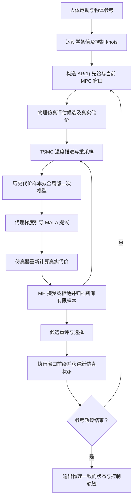
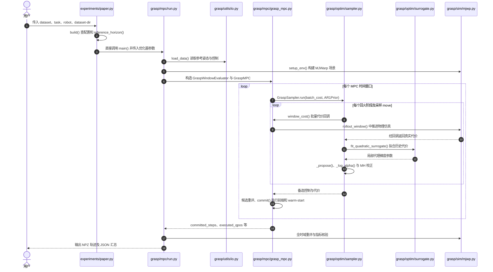

# GRASP：梯度引导采样的接触丰富物理运动重定向

**论文：** [GRASP: Gradient-Guided Sampling for Contact-Rich Physics-Based Motion Retargeting](https://arxiv.org/html/2611.05754)（arXiv:2611.05754v1，2026-11-03）  
**作者：** Yang Liu、Tong Wang（共同一作）、Yiming Bao、Heng Yang；哈佛大学工程与应用科学学院。  
**项目与实现：** [官方项目页](https://computationalrobotics.seas.harvard.edu/GRASP/) · [官方源码](https://github.com/ComputationalRobotics/GRASP_code)。

## 一句话定义

**GRASP**（Gradient Recovery from Archived Samples for Proposals）把人的运动参考转成满足接触动力学的机器人控制：它从已有物理仿真轨迹及真实代价恢复局部梯度来引导随机采样，而无需对仿真器求导。

## 英文缩写速查

| 缩写 | 英文全称 | 简要说明 |
|---|---|---|
| GRASP | Gradient Recovery from Archived Samples for Proposals | 从历史仿真样本恢复提议方向 |
| TSMC | Tempered Sequential Monte Carlo | 逐级提高逆温度的粒子采样 |
| MALA | Metropolis-Adjusted Langevin Algorithm | 梯度引导提议与 MH 接受校正 |
| MPC | Model Predictive Control | 滚动窗口优化并执行部分控制 |
| ESS | Effective Sample Size | 判断粒子权重退化程度 |
| PPO | Proximal Policy Optimization | 用重定向参考轨迹训练跟踪策略 |

## 为什么重要

运动学重定向只保证几何姿势相似，手指未必真正抓牢物体，人形的支撑接触也可能无法完成动作。GRASP 在 MuJoCo Warp 物理环境中优化控制，使接触与对象跟踪同时满足动力学约束；生成的参考轨迹既可用于开环回放，也可作为下游策略学习目标。

## 核心机制

1. **问题建模**：给定关节、基座及物体参考状态，最小化全时域状态跟踪误差；机器人控制为位置目标，仿真 rollout 自动满足动力学。控制修正用时间 knots 参数化，配合 AR(1) 高斯先验保持平滑。
2. **GRASP-TO**：TSMC 在粒子群上依次进行 ESS 自适应温度推进、重采样和 MCMC rejuvenation。用所有已评估控制–真实代价对（包含被拒绝的提议）拟合低频 DCT 坐标中的局部二次代价模型。
3. **梯度引导与严格校正**：代理模型只决定 MALA 提议方向；接受概率使用原始物理仿真代价、先验以及正反提议密度的 Metropolis–Hastings 比率。固定代理模型与提议设置时保留目标分布；有限样本代理质量仍影响效率。
4. **GRASP-MPC**：将长示范拆分为相互重叠的滚动窗口。新窗口使用实际执行到达的状态、移位后的未执行计划和已有粒子库；选取候选重评后，只提交控制前缀再继续规划。

## 流程总览

依据论文第 3–5 节、算法 1–2：

## 源码运行时序图

按 [官方 GRASP_code](https://github.com/ComputationalRobotics/GRASP_code) 的实际入口和核心函数核对，**不是只根据 README 猜测**：

其中入口文件的 `build()` **直接导入并调用** `grasp.mpc.run.main()`，不是启动独立子进程。实际 rollout 接口经 `grasp.sim.rollout.make_rollout_fn` 组装，窗口代价由 `GraspWindowEvaluator.window_cost` 提供；`GraspSampler` 中归档了 MH 接受和拒绝的有效提议。静态核对了上述执行路径；**未对整仓全部文件做安全审计，也未跑 GPU 复现实验**。

## 实验与评测

| 数据与条件 | 作者报告结果 | 正确读法 |
|---|---|---|
| OakInk2，Sharpa 双手，1,352 条，**1,024 粒子** | **1,254/1,352 = 92.8%**（表 1） | 与表 1 基线并列；指标指仿真整段物体轨迹 |
| OakInk2，Sharpa 双手，**2,000 粒子** | **94.16% ≈ 94.2%**（附录表 9、表 2及项目页） | 与 92.8% 的粒子预算不同，并非相同设置下结果冲突 |
| OakInk2，2,000 粒子，跨机器手 | Sharpa **94.2%**、Wuji **92.4%**、XHand **95.0%** | 三种机器手的同预算比较，非真机通过率 |
| HOT3D，5,400 条轨迹 | **81.54% ADD-AUC**（表 3） | 与 SPIDER 的右手子集 40.74% 并非同一全量评估集合 |
| 转笔 PPO，9 段示范 | 最后 500 次迭代奖励 **45.9 vs 21.7** | GRASP 参考更易跟踪，但轴角误差 **4.3° vs 3.9°** 略差 |

OakInk2 成功要求整条轨迹的物体平均平移误差 **小于 0.1 m**、平均旋转误差 **小于 0.5 rad**，提前终止按失败计。论文附录粒子消融中，跟踪误差的共同有效样本为 1,305 条，但成功率仍以 1,352 条计算。G1 的 LAFAN1、AMASS、OMOMO 全身跟踪及人形 PPO 结果见论文第 7 节、表 4、图 9。

**真机边界：** 灵巧手演示为开环轨迹播放；人形演示为训练后的策略闭环执行（爬行、搬箱与推箱），不能将仿真 92.8% 或 94.2% 直接当作真实机器人成功率。

## 工程实践

- **复现条件**：官方 README 要求 Python 3.12、CUDA 兼容 NVIDIA GPU、MuJoCo Warp；数据集和物体网格须按 [官方数据准备说明](https://github.com/ComputationalRobotics/GRASP_code/blob/main/docs/data.md) 单独准备。GRASP-MPC 与 MJWarp 并用时设置 `JAX_PLATFORMS=cpu`。
- **官方入口**：`python experiments/paper.py oakink2 --task oakbi_443_take_outside --robot sharpa_bimanual --dataset-dir data/oakink2 -- --output-dir runs/sharpa_443`；可先加 `--print` 检查配置生成，不需要启动仿真。
- **参数边界**：附录表 5 的灵巧手 0.005 s 仿真步长、0.2 s knot 间隔、最多 15 knots、提交前缀 2 knots；表 1 为 1,024 粒子，跨机器手比较为 2,000 粒子。人形表 6 用 1,000 粒子及 1/60 s 仿真步长，不能照搬灵巧手参数。
- **产物与验证**：`grasp.mpc.run` 写入 NPZ 控制/状态轨迹和 JSON 跟踪指标；执行结果会从初始状态做全时域重评。源码阅读不等于获得作者实验的可复现结果。

## 局限与风险

1. 粒子数直接影响成功率及耗时，附录表 9 的 2,000 粒子组中位 MPC 运行时间约 **57.49 分钟**（A100 80GB、论文特定配置），不宜称为实时在线控制。
2. 仿真结果依赖参考姿态、物体几何、接触参数及场景准备；作者也将有限样本代理梯度的可靠性和动力学/几何误差下的鲁棒性列为后续问题。
3. 部分基线评估样本集、任务类型不完全相同；跨论文指标需优先对齐粒子预算、数据集子集、误差定义和真实/仿真部署形式。
4. 官方代码已公开但演示数据需另行准备；本次验证覆盖论文全文与核心静态调用链，**尚无本地 GPU 实验复现或真实机器人复测证据**。

## 与其他工作对比

- 相比纯运动学重定向，GRASP 用真实接触仿真成本优化可执行控制；相比依赖可微分仿真器的梯度规划，它把历史 rollout 拟合为提议梯度，并用 MH 校正控制采样偏差。
- 与 [接触丰富的手物重定向、分项泛化评测与手持夹爪示范：具身智能小站 11-05 期 43 篇阅读坐标](../overview/embodied-station-2026-11-05-43-papers-technology-map.md) 复用同一项目实体，不重复建页。

## 结论

**GRASP 的价值在于可复用物理仿真评估来恢复优化方向，并生成更适合策略跟踪的参考；其仿真成功率不能当作真机成功率。**

1. 对照 **92.8% 与 94.2%** 时先检查粒子数：分别对应 1,024 与 2,000 粒子，而非论文与官网互相矛盾。
2. 评估算法收益同时检查轨迹成功率、误差和 MPC 耗时，避免仅凭高成功率推断可实时运行。
3. 训练 PPO 时可以用物理精化参考改善可学习性，但需保留对角度/物体姿态等指标的独立检查。
4. 真机部署前仍需额外验证接触模型误差、硬件约束与策略鲁棒性。

## 关联页面

- [模仿学习](../methods/imitation-learning.md)
- [灵巧手运动学](../concepts/dexterous-kinematics.md)
- [操作任务](../tasks/manipulation.md)
- [运动重定向](../concepts/motion-retargeting.md)
- [接触丰富操作](../concepts/contact-rich-manipulation.md)

## 参考来源

- [论文来源归档](../../sources/papers/grasp_arxiv_2611_05754.md)
- [官方代码归档](../../sources/repos/grasp.md)
- [官方项目页归档](../../sources/sites/grasp.md)
- [arXiv 论文全文（含附录，v1）](https://arxiv.org/html/2611.05754)

## 推荐继续阅读

- [官方 Harvard GRASP 项目页](https://computationalrobotics.seas.harvard.edu/GRASP/)
- [GRASP 官方源码与运行说明](https://github.com/ComputationalRobotics/GRASP_code)
- [arXiv PDF](https://arxiv.org/pdf/2611.05754)
