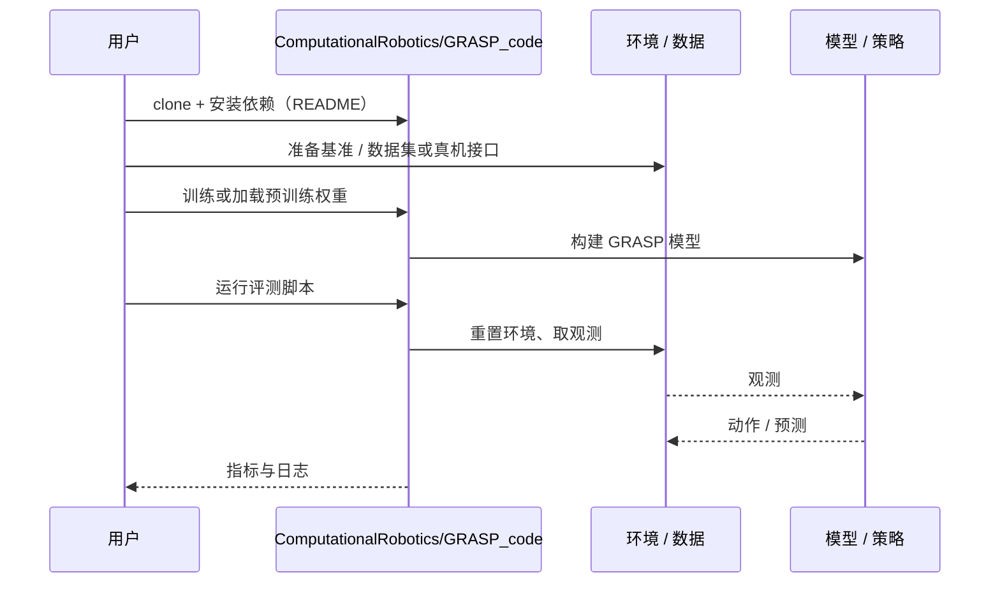

# GRASP（arXiv:2611.05754）

**GRASP**（*GRASP: Gradient-Guided Sampling for Contact-Rich Physics-Based Motion Retargeting*，[arXiv:2611.05754](https://arxiv.org/abs/2611.05754)，[项目页](https://computationalrobotics.seas.harvard.edu/GRASP/)，[代码](https://github.com/ComputationalRobotics/GRASP_code)）来自 [具身智能小站 2026-11-05 盘点](../../sources/blogs/wechat_embodied_station_43_papers_grasp_mesa_airoa_2026-11-05.md)，属「灵巧操作与示范学习」组。

## 一句话定义

**人的手指能扣住提手，换一双指长和关节都不同的机器手，同样的手势却可能让容器滑落。**

## 英文缩写速查

| 缩写 | 英文全称 | 简要说明 |
|------|----------|----------|
| GRASP | GRASP: Gradient-Guided Sampling for Contact-Rich Physics-Based Motion Retargeting | 本文方法 / 基准的简称 |

## 为什么重要

- 换一双机器手，怎样复现提罐和倾倒？。GRASP 在物理仿真里同时跟踪手与物体，利用试过的控制轨迹来调整手指的落点和握持姿势，让机器手也能提起容器、稳稳倾倒。
- 开源结论：**已开源**（步骤 2.5，2026-11-05）。仓库可达（git ls-remote）。项目页 HTTP 200。
- 同期同组工作见 [接触丰富的手物重定向、分项泛化评测与手持夹爪示范：具身智能小站 11-05 期 43 篇阅读坐标](../overview/embodied-station-2026-11-05-43-papers-technology-map.md)。

## 核心机制

| 项 | 内容 |
|----|------|
| **arXiv** | [2611.05754](https://arxiv.org/abs/2611.05754) |
| **开源** | **已开源** |
| **要点** | 人的手指能扣住提手，换一双指长和关节都不同的机器手，同样的手势却可能让容器滑落。 |
| **文内指标** | 公众号转述：真机灵巧手展示了开环提拿和倾倒，整批成功率来自仿真。 |

## 源码运行时序图

以下为按仓库入口（`ComputationalRobotics/GRASP_code`）推断的通用运行链路；入库日仅核实仓库可达，未逐文件阅读，具体脚本名以 README 为准。

## 实验与评测

- 公众号转述：真机灵巧手展示了开环提拿和倾倒，整批成功率来自仿真。
- **读法：** 本页为索引级摘要，依据公众号转述的官方摘要与仓库信息整理；逐项数字与 baseline 以原文 PDF 为准。

## 与其他工作对比

- 横向索引见 [接触丰富的手物重定向、分项泛化评测与手持夹爪示范：具身智能小站 11-05 期 43 篇阅读坐标](../overview/embodied-station-2026-11-05-43-papers-technology-map.md)；同 arXiv 不重复造页。

## 结论

**换一双机器手，怎样复现提罐和倾倒？：真机灵巧手展示了开环提拿和倾倒，整批成功率来自仿真。**

1. 开源边界：**已开源** — 仓库可达（git ls-remote）。项目页 HTTP 200。
2. 核心机制：人的手指能扣住提手，换一双指长和关节都不同的机器手，同样的手势却可能让容器滑落。
3. 复现与选型前核对任务协议、硬件与基准口径，勿直接横比公众号摘录数字。

## 关联页面

- [imitation-learning](../methods/imitation-learning.md)
- [dexterous-kinematics](../concepts/dexterous-kinematics.md)
- [manipulation](../tasks/manipulation.md)
- [motion-retargeting](../concepts/motion-retargeting.md)
- [contact-rich-manipulation](../concepts/contact-rich-manipulation.md)
- [embodied-station-2026-11-05-43-papers-technology-map](../overview/embodied-station-2026-11-05-43-papers-technology-map.md)

## 参考来源

- [grasp_arxiv_2611_05754.md](../../sources/papers/grasp_arxiv_2611_05754.md)
- [wechat_embodied_station_43_papers_grasp_mesa_airoa_2026-11-05.md](../../sources/blogs/wechat_embodied_station_43_papers_grasp_mesa_airoa_2026-11-05.md)
- [arXiv:2611.05754](https://arxiv.org/abs/2611.05754)

## 推荐继续阅读

- [arXiv PDF](https://arxiv.org/pdf/2611.05754)
- [项目页](https://computationalrobotics.seas.harvard.edu/GRASP/)
- [https://github.com/ComputationalRobotics/GRASP_code](https://github.com/ComputationalRobotics/GRASP_code)
