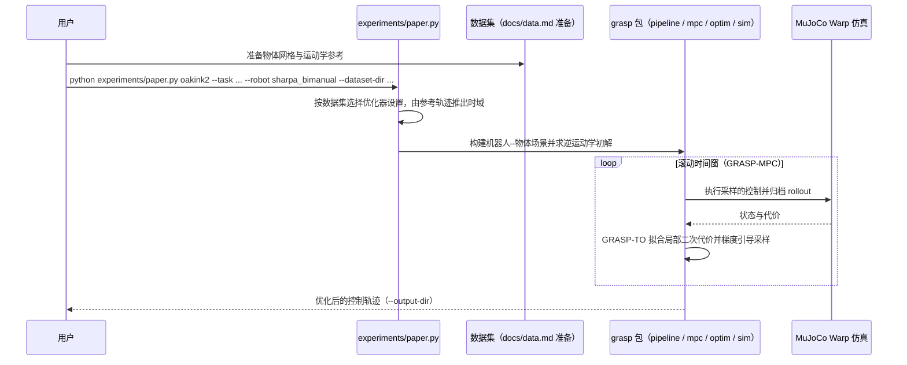

# GRASP（arXiv:2611.05754）

**GRASP**（*GRASP: Gradient-Guided Sampling for Contact-Rich Physics-Based Motion Retargeting*，[arXiv:2611.05754](https://arxiv.org/abs/2611.05754)，[项目页](https://computationalrobotics.seas.harvard.edu/GRASP/)，[代码](https://github.com/ComputationalRobotics/GRASP_code)）来自 [具身智能小站 2026-11-05 盘点](../../sources/blogs/wechat_embodied_station_43_papers_grasp_mesa_airoa_2026-11-05.md)，属「灵巧操作与示范学习」组。

## 一句话定义

**GRASP** 把人的手物示范在接触动力学下转成机器人控制：从已跑过的仿真轨迹里恢复局部梯度来引导采样，不需要可微仿真器（官方 README）。

## 英文缩写速查

| 缩写 | 英文全称 | 简要说明 |
|------|----------|----------|
| GRASP | GRASP: Gradient-Guided Sampling for Contact-Rich Physics-Based Motion Retargeting | 本文方法 / 基准的简称 |

## 为什么重要

- 换一双机器人手，怎样复现提罐和倾倒？人手能扣住提手，换一双指长和关节都不同的机器手，同样的手势可能让容器滑落（公众号引子）。GRASP 在物理仿真里同时跟踪手与物体，利用试过的控制轨迹来调整手指的落点和握持姿势，让机器手也能提起容器、稳稳倾倒。
- 开源结论：**已开源**（步骤 2.5，2026-11-05）。仓库可达（git ls-remote）。项目页 HTTP 200。
- 同期同组工作见 [接触丰富的手物重定向、分项泛化评测与手持夹爪示范：具身智能小站 11-05 期 43 篇阅读坐标](../overview/embodied-station-2026-11-05-43-papers-technology-map.md)。

## 核心机制

| 项 | 内容 |
|----|------|
| **arXiv** | [2611.05754](https://arxiv.org/abs/2611.05754) |
| **开源** | **已开源** |
| **要点** | GRASP-TO 用已归档样本拟合局部二次代价、在回火序贯蒙特卡洛里用带 Metropolis–Hastings 校正的提议采样；GRASP-MPC 在滚动窗口里复用该优化器，把上一段的计划与样本接到下一个时间窗（官方 README）。同一状态跟踪目标覆盖灵巧手与人形动作，不依赖任务专用接触奖励。 |
| **文内指标** | 公众号转述（口径未回论文核对）：成功需整条轨迹物体平均位置误差低于 10 cm、平均旋转误差低于 0.5 rad；双手仿真 1,254/1,352 条通过（92.8%），同表最强基线 Do-as-I-Do 为 81.0%；真机灵巧手只展示开环提拿与倾倒，整批成功率来自仿真；优化后的轨迹还用于训练转笔策略。 |

## 源码运行时序图

按官方 README 的运行入口画（浅克隆读了 README 与目录结构，**未逐文件阅读源码**；`grasp/` 下有 `pipeline`、`mpc`、`optim`、`objective`、`sim` 等子包，具体调用关系以源码为准）。

## 实验与评测

- 公众号转述（口径未回论文核对）：成功需整条轨迹物体平均位置误差低于 10 cm、平均旋转误差低于 0.5 rad；双手仿真 1,254/1,352 条通过（92.8%），同表最强基线 Do-as-I-Do 为 81.0%；真机灵巧手只展示开环提拿与倾倒，整批成功率来自仿真；优化后的轨迹还用于训练转笔策略。
- **官方仓库（浅克隆读 README，MIT 许可）：** 需要 Python 3.12 与支持 CUDA 的 NVIDIA GPU（MuJoCo Warp）；`experiments/paper.py` 按数据集选择优化器设置并由参考轨迹推出时域；README 的示例是 `oakink2` 数据集的 Sharpa 双手任务 `oakbi_443_take_outside`（0.4 秒、50 Hz 参考、2,000 粒子）；支持的数据集 / 机器人包括 oakink2（`sharpa_bimanual`、`xhand`、`wuji_topo`）、hot3d（`sharpa`）、amass / lafan 与 omomo（`unitree_g1`）。演示数据需另行准备（`docs/data.md`）。
- **读法：** 本页为索引级摘要，依据公众号转述的官方摘要与仓库信息整理；逐项数字与 baseline 以原文 PDF 为准。

## 与其他工作对比

- 横向索引见 [接触丰富的手物重定向、分项泛化评测与手持夹爪示范：具身智能小站 11-05 期 43 篇阅读坐标](../overview/embodied-station-2026-11-05-43-papers-technology-map.md)；同 arXiv 不重复造页。

## 结论

**换一双机器手，怎样复现提罐和倾倒？：GRASP 用梯度引导采样在物理仿真里同时跟踪手与物体；双手仿真通过率 92.8%（公众号转述），真机只展示开环提拿与倾倒。**

1. 开源边界：**已开源** — 仓库可达（git ls-remote）。项目页 HTTP 200。
2. 核心机制：GRASP-TO 用已归档样本拟合局部二次代价、在回火序贯蒙特卡洛里用带 Metropolis–Hastings 校正的提议采样；GRASP-MPC 在滚动窗口里复用该优化器，把上一段的计划与样本接到下一个时间窗（官方 README）。同一状态跟踪目标覆盖灵巧手与人形动作，不依赖任务专用接触奖励。
3. 复现与选型前核对任务协议、硬件与基准口径，勿直接横比公众号摘录数字。

## 关联页面

- [imitation-learning](../methods/imitation-learning.md)
- [dexterous-kinematics](../concepts/dexterous-kinematics.md)
- [manipulation](../tasks/manipulation.md)
- [motion-retargeting](../concepts/motion-retargeting.md)
- [contact-rich-manipulation](../concepts/contact-rich-manipulation.md)
- [embodied-station-2026-11-05-43-papers-technology-map](../overview/embodied-station-2026-11-05-43-papers-technology-map.md)

## 参考来源

- [grasp_arxiv_2611_05754.md](../../sources/papers/grasp_arxiv_2611_05754.md)
- [wechat_embodied_station_43_papers_grasp_mesa_airoa_2026-11-05.md](../../sources/blogs/wechat_embodied_station_43_papers_grasp_mesa_airoa_2026-11-05.md)
- [arXiv:2611.05754](https://arxiv.org/abs/2611.05754)

## 推荐继续阅读

- [arXiv PDF](https://arxiv.org/pdf/2611.05754)
- [项目页](https://computationalrobotics.seas.harvard.edu/GRASP/)
- [https://github.com/ComputationalRobotics/GRASP_code](https://github.com/ComputationalRobotics/GRASP_code)
