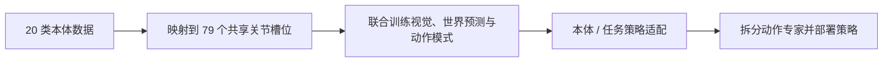
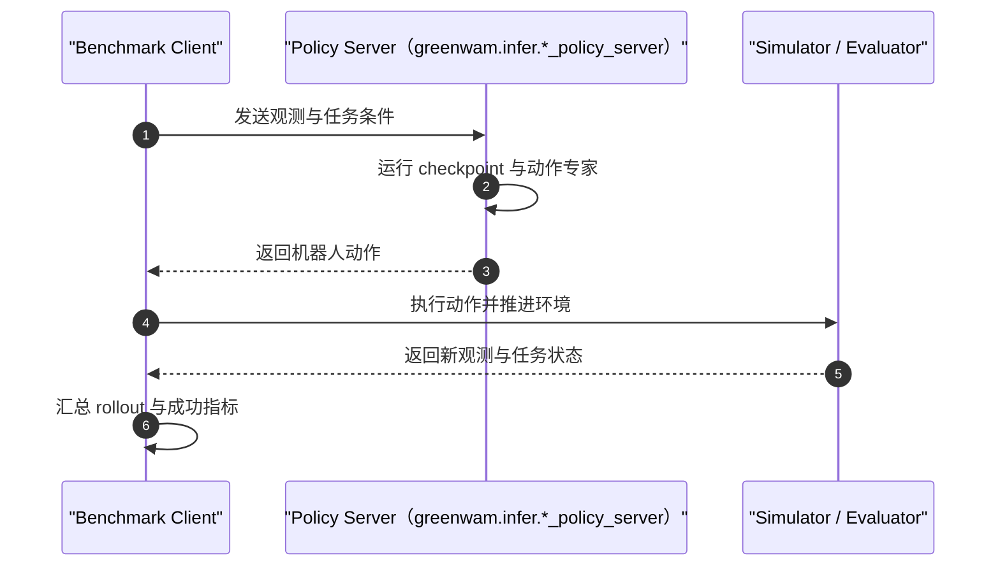

# GreenWAM: A World Foundation Model for Robotics

## 一句话定义

GreenWAM 是一个把动作条件世界预测与机器人策略生成放在同一模型中、并以共享解剖关节空间覆盖 20 类机器人本体的 world-action foundation model。

## 英文缩写速查

| 缩写 | 英文全称 | 简要说明 |
|------|----------|----------|
| WAM | World Action Model | GreenWAM 以共享模型联合世界预测与动作策略；论文中 world-action 模式指同时生成未来视频与状态偏移 |
| VLA | Vision-Language-Action | 论文中与 GreenWAM 对照的策略模型类别（如 π0.5、X-VLA） |
| EEF | End-Effector | 末端执行器位姿；在共享槽位中与关节视图并列，CALVIN 的单臂 Franka 经由 EEF 槽位接入 |
| EWMScore | （论文未展开全称） | WorldArena 1.0 track 1 的综合分数：15 项指标均值，其中动态度、光流、运动平滑三项按真实视频封顶 |
| PSNR | Peak Signal-to-Noise Ratio | 论文用它比较预测视频与记录视频的逐帧误差，如 Section 7.1 的世界模型与策略对比 |

## 为什么重要

机器人记录动作时通常使用各自的关节顺序、自由度和语义，本体之间的数据很难直接共训。GreenWAM 的重点不是单纯增加一个新策略，而是尝试把多类机器人的关节动作翻译到共同的解剖槽位中，让不同本体的数据和世界预测训练共享同一模型，同时保留策略端的实时路径。

这项工作也提供了一个可检查的设计问题：世界模型和策略是否必须是两个独立模型？GreenWAM 的实验报告支持二者共享骨干、在适配时拆分动作专家的可行性，但跨本体和真机效果仍应按具体评测范围理解。

## 核心原理

- **输入。** 任务指令（经冻结的 reasoner 编码）、多相机拼接画布（头部相机占约上方三分之二，左右腕相机在下方一行），以及本体在 $t=0$ 时的原生关节状态 $q_0$（Section 3.1、3.4）。
- **机制。** 每种本体的 codec 按 Equation (1) 把原生通道选入 79 个解剖槽位，并处理符号与零点；所有本体共用一个输入投影，因此新本体需要 codec，而不需要新的动作参数。训练采用修正流（rectified flow）：干净目标 $x_0$ 与噪声 $\epsilon$ 按 $x_\sigma=(1-\sigma)x_0+\sigma\epsilon$ 混合，生成器预测速度 $v=\epsilon-x_0$，视频与状态共享同一噪声水平 $\sigma$（Equation (3)）。
- **状态表示。** 腿、躯干、头与臂的关节默认以块起点状态为参照表示为偏移 $\delta_k = q_k - d_\ell \odot q_0$，夹爪与手指保持绝对值（Equation (2)）；$d_\ell$ 为布局掩码，与用于屏蔽损失的有效性掩码 $m_{\ell j}$ 不同。
- **输出。** 世界模型模式输出未来视频帧与状态偏移；策略适配时，动作 token 迁移到从生成器复制而来的动作专家，两者在每一层做联合注意力（Equation (8)），专家与生成器的 FFN 各自独立。

## 方法栈

### 共享解剖动作空间

仓库 README 将 20 类机器人映射到 79 个共享关节槽位：本体的原生关节先按解剖角色映射到槽位，再用这一表示参与联合训练。它意在统一异构动作向量的语义；落地时仍需正确配置每个机器人到共享槽位的映射和动作统计。

论文给出的槽位划分为：腿 12、躯干 / 基座 / 头 23（基座位姿 7、基座速度 6、躯干 7、头 3）、臂 18、手 26，合计 79。每个布局的 codec 只填入有据可查的对应关系（URDF、厂商文档或具名通道），无法确认的通道留空并被掩码排除，因此"维度相同"不等于"语义相同"。投影器本身不做正逆运动学。

### 联合世界与策略训练

GreenWAM 在同一模型中训练视觉、动作条件世界模型和 world-action 模式。论文中的七种模式（Table 2）包括：文本到视频 20%、图像到视频 10%、带历史的图像到视频 10%、前向动力学 15%、带历史的前向动力学 20%、逆动力学 10%、世界–动作（WAM）15%。面向策略适配时，论文报告将动作专家从生成器中拆出；README 说明动作专家与生成器逐层共享 attention，论文 Equation (8) 给出同一结构。保留世界模型训练模式参与策略适配，有助于维持场景变化下的鲁棒性。

### 流程总览

## 源码运行时序图

仓库按 benchmark 提供独立策略服务端与客户端：RoboTwin 2.0、CALVIN、LIBERO 分别通过 `greenwam.infer.robotwin_policy_server`、`calvin_policy_server`、`libero_policy_server` 启动，WorldArena 使用 `benchmarks/worldarena/rollout.sh` 单独的 rollout / scoring 路径。复现实验需依据各自 guide 配置环境、checkpoint 和 evaluator。

## 实验与评测

官方仓库 README 报告的 checkpoint 结果如下。它们来自不同 benchmark，不能横向当作同一指标比较。

| 基准 | 角色 | README 报告值 |
|------|------|---------------|
| RoboTwin 2.0（50 tasks） | 策略 | mean 67.54；clean 86.98；randomized 48.10 |
| LIBERO / LIBERO-plus | 策略 | LIBERO 97.4；zero-shot LIBERO-plus 86.8 |
| CALVIN ABC→D | 策略 | average chain length 4.64 |
| WorldArena 1.0 track 1 | 世界模型 | EWMScore 63.31 |

arXiv 摘要还报告 GreenWAM 在 WorldArena 1.0 的轨迹、深度与 3D 准确度对比中居前；在真机人形适配实验中，比所比较的 π₀.₅ 与 Cosmos 3 Edge 策略更常成功。后一项是论文报告，公开 README 列出的四个 checkpoint 则面向表中基准。

论文正文补充的数字（均为论文报告）：

- **世界模型。** 在 WorldArena 1.0 的 1 000 个测试 episode 上，经 motion cap 的 EWMScore 为 63.31，高于 Motubrain（63.16）与 FlowWAM-FiveAges（62.99，论文标注为上界）；轨迹准确度 56.0、深度准确度 98.2、3D 准确度 93.4（Table 11）。
- **策略。** LIBERO-plus 零样本 86.8，高于 π0.5（85.7）与 Cosmos Policy（82.2）（Table 14）；RoboDojo 排行榜得分 16.12，成功率 10.49%（Table 13）。
- **真机人形（Green humanoid，一个打包任务，每策略 14 个场景、70 条指令）。** GreenWAM 教师模型 ID 95.6%、OOD 84.0%；Cosmos 3 Edge 策略 88.9% / 80.0%；π0.5 84.4% / 76.0%；一步蒸馏学生 91.1% / 80.0%（Figure 17）。
- **受控对比（Figure 18）。** 以 Cosmos 3 Edge 为基线：机器人专化使 RoboTwin 平均成功率提高 5.4%；动作专家（相对单塔）提高 3.3%；保留前向动力学与图像到视频模式使随机化场景提高 8.0%（清洁场景无显著变化）。

## 与其他工作对比

- **对比纯世界模型：** GreenWAM 把动作专家与世界生成骨干联系起来，目标是让同一个模型既预测动作后世界，也产出可执行策略。
- **对比纯 VLA 策略：** 它在策略适配时保留世界模型模式，以提高对场景变化的鲁棒性；这会带来额外的模型和评测栈复杂度。
- **对比 Cosmos 3 Edge（其父模型）：** Cosmos 3 Edge 用于每个本体域的独立输入/输出投影，动作为末端位姿增量加夹爪开合（Figure 2）；GreenWAM 改用 79 槽位与一个共享投影，并用关节与笛卡尔状态重训机器人阶段。
- **对比 GE-Sim 2.0：** GE-Sim 2.0 把末端位姿投影为相机图像上的动作图，需要每帧精确标定；GreenWAM 直接输入测得的关节与笛卡尔状态；论文指出动作图难以表达手指关节，且对带移动头部与腕部相机的人形需要每个视角精确标定。
- **对比 UnifoLM-WMA：** 二者都联合世界预测与动作生成；GreenWAM 强调 20 类本体共用关节语义。UnifoLM-WMA 的官方部署重点（如 Unitree 机器人上的决策与交互仿真模式）未在本次核对中验证（未核实）。

## 结论

**GreenWAM 的关键贡献是把跨本体动作对齐与 world-action 训练放在同一可评估模型中；当前公开证据仍以作者报告的基准和真机实验为主。**

1. 对多机器人数据，先审计每个原生关节到共享槽位的映射（包括符号、零点与掩码），再讨论共享训练收益。
2. 论文的受控对比显示，机器人专化同时改善世界预测与策略成功率（Section 7.1），因此两类指标都值得报告。
3. 读 leaderboard 时分开看任务、随机化设置和评测协议；不要把各基准分数直接互比，WorldArena 分数也是论文按运动封顶重算的结果。
4. 若要部署，确认公开 checkpoint 是否覆盖目标机器人；四个仓库 checkpoint 不自动包含任意本体权重。
5. 将真机人形结果视为报告证据，并在自己的机器人上补做时延、安全和失败恢复验证；论文的真机只覆盖一台人形与一个打包任务。

## 工程实践

| 项目 | 论文或仓库给出的设定 |
|------|----------------------|
| 训练（机器人阶段） | 64 张 H100，全局 batch 256，AdamW（$\beta=(0.9,0.99)$，weight decay 0.05），学习率 $2.83\times10^{-5}$（新投影与模态嵌入 ×5），500 步预热后线性衰减，共 36 500 步（Table 5） |
| 冻结部分 | reasoner 与视频 VAE 冻结；生成器、动作投影与模态嵌入参与训练 |
| 世界模型推理 | 35 步采样、CFG 6、shift 5（Section 5.1）；WorldArena 动作变体为 35 步且不加 guidance（C.5） |
| WAM 预测窗口 | 约 1.07 s；只有成功演示进入 WAM 模式（Section B.2） |
| RoboTwin 策略推理 | 每次预测 16 步，8 步去噪、无 guidance，执行完整预测后重规划（B.5） |
| CALVIN / 真机推理 | CALVIN 预测 20 步、4 步 UniPC、执行前 10 步；真机 GreenWAM 每次调用输出 16 个动作（π0.5 为 50） |
| 延迟（RTX 4090，中位数） | 优化后教师 134.6 ms；一步蒸馏学生 35.4 ms（28.3 Hz），相对未优化版 12.32×（Table 10） |
| 动作专家成本 | 专家与生成器同形，训练步时间增加约 8%（Section 6.1） |
| 调试检查 | ① 动作跟随：对同一首帧把记录位移乘以 0 / 0.5 / 1 / 1.5，生成运动应随之增长（Figure 8）；② 核对 codec 的符号、零点与有效掩码；③ 归一化统计只用训练切分并按布局计算；④ 用正运动学核对布局与末端轨迹的对应（论文中 RoboTwin 复用的 Worker 布局，正运动学重现记录夹爪路径的误差为 5.2 与 7.1 mm） |
| 开源状态（步骤 2.5） | **部分开源。** 项目页链接论文、代码与 Hugging Face 权重。官方仓库（许可证 OpenMDW-1.1，据 README）发布四个基准 checkpoint（RoboTwin 2.0、LIBERO / LIBERO-plus、CALVIN、WorldArena）、策略服务端、基准客户端与 WorldArena 评测代码，并有可运行入口。README 未声明发布训练代码；未核实仓库全部目录。权重依赖 Wan2.2 VAE 与固定 revision 的 Cosmos 3 Edge 文本 tokenizer，各基准仿真器需单独安装。 |

## 局限与风险

- 项目页公开代码与四个基准 checkpoint，但运行仍需要基准各自的仿真器、数据或资产；环境没有因仓库开源而自动齐全。
- 20 类本体映射的有效性取决于关节语义、动作统计和控制接口的正确性，槽位统一本身不保证零样本迁移。
- 论文摘要中的真机人形对比不能替代目标硬件部署验证；README 公开 checkpoint 的范围也不等同于真机任务包。
- 表中分数采用不同基准与指标，建议以各 guide 的评测协议复验。
- 论文自陈：策略对任务几何仍敏感，例如 RoboTwin 的桌面高度与 LIBERO-plus 的初始构型；论文使用的增强只改变观测，不增加新的动作示范（Section 8）。
- 长 rollout 从模型自身生成的帧继续，预测误差逐块累积（Section 8）。
- 训练语料的 20 个族全部是双臂平台；单臂 Franka 的 CALVIN 与 LIBERO 结果都经各自基准的后训练得到，不代表任意新本体可零样本使用。
- RoboTwin 的部分排行榜条目预训练中含随机化场景，论文仅以标注区分，不能与只用干净示范的结果直接等同（Section 6.3.1）。
- WorldArena 分数为论文按运动封顶重算的结果，不等于官方排行榜分数（Section 5.2、C.1）。

## 关联页面

- [世界–动作模型](../concepts/world-action-models.md)
- [生成式世界模型](../methods/generative-world-models.md)
- [NVIDIA Cosmos](./nvidia-cosmos.md)
- [UnifoLM-WMA](./unifolm-world-model-action.md)

## 参考来源

- [GreenWAM 论文来源](../../sources/papers/greenwam_arxiv_2610_18774.md)
- [GreenWAM 项目页归档](../../sources/sites/greenwam-project.md)
- [GreenWAM 官方代码归档](../../sources/repos/greenwam.md)

## 推荐继续阅读

- [GreenWAM 官方项目页](https://greenvla.github.io/GreenWAM/)
- [GreenWAM 官方 GitHub](https://github.com/greenvla/GreenWAM)
- [GreenWAM Hugging Face 权重](https://huggingface.co/SberRoboticsCenter/GreenWAM)
- [Cosmos 3: Omnimodal world models for physical AI（arXiv:2606.02800）](https://arxiv.org/abs/2606.02800)，GreenWAM 的初始化模型来源
- [WorldArena: A unified benchmark for evaluating perception and functional utility of embodied world models（arXiv:2602.08971）](https://arxiv.org/abs/2602.08971)，论文世界模型评测所用基准
