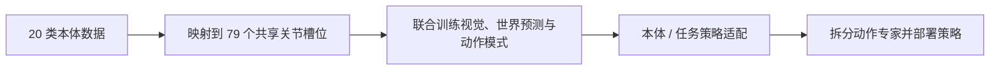
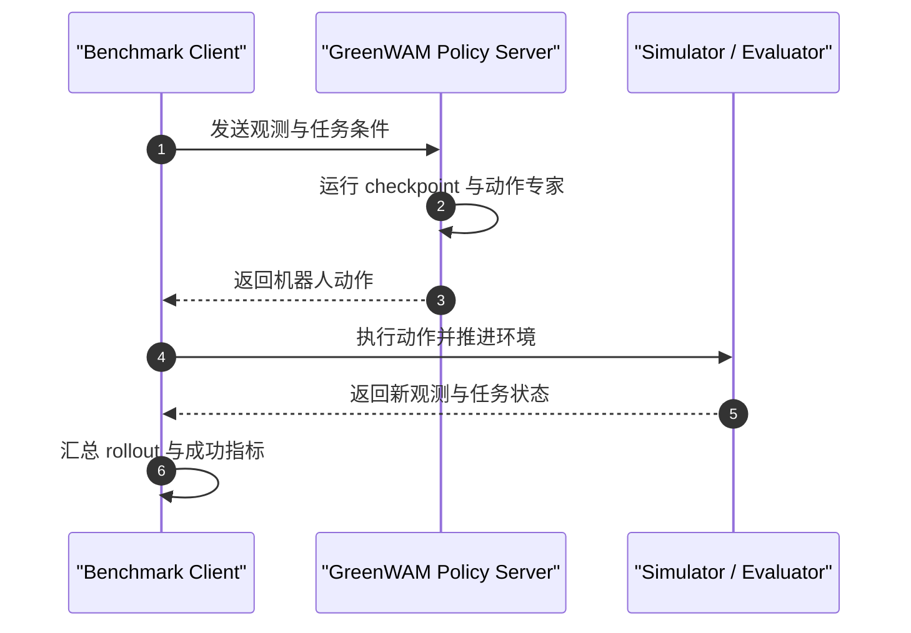

# GreenWAM: A World Foundation Model for Robotics

## 一句话定义

GreenWAM 是一个把动作条件世界预测与机器人策略生成放在同一模型中、并以共享解剖关节空间覆盖 20 类机器人本体的 world-action foundation model。

## 英文缩写速查

| 缩写 | 英文全称 | 简要说明 |
|------|----------|----------|
| WAM | World Action Model | GreenWAM 以共享模型联合世界预测与动作策略 |
| WFM | World Foundation Model | 论文对跨本体世界模型基础底座的称呼 |
| VLA | Vision-Language-Action | 与 GreenWAM 对照的策略模型类别 |
| EWM | Embodied World Model | WorldArena 1.0 报告使用的世界模型评测维度 |

## 为什么重要

机器人记录动作时通常使用各自的关节顺序、自由度和语义，本体之间的数据很难直接共训。GreenWAM 的重点不是单纯增加一个新策略，而是尝试把多类机器人的关节动作翻译到共同的解剖槽位中，让不同本体的数据和世界预测训练共享同一模型，同时保留策略端的实时路径。

这项工作也提供了一个可检查的设计问题：世界模型和策略是否必须是两个独立模型？GreenWAM 的实验报告支持二者共享骨干、在适配时拆分动作专家的可行性，但跨本体和真机效果仍应按具体评测范围理解。

## 方法栈

### 共享解剖动作空间

仓库 README 将 20 类机器人映射到 79 个共享关节槽位：本体的原生关节先按解剖角色映射到槽位，再用这一表示参与联合训练。它意在统一异构动作向量的语义；落地时仍需正确配置每个机器人到共享槽位的映射和动作统计。

### 联合世界与策略训练

GreenWAM 在同一模型中训练视觉、动作条件世界模型和 world-action 模式。面向策略适配时，论文报告将动作专家从生成器中拆出；README 说明动作专家与生成器逐层共享 attention。保留世界模型训练模式参与策略适配，有助于维持场景变化下的鲁棒性。

### 流程总览

## 源码运行时序图

仓库按 benchmark 提供独立策略服务端与客户端；复现实验需依据各自 guide 配置环境、checkpoint 和 evaluator。WorldArena 使用单独的 rollout / scoring 路径。

## 实验与评测

官方仓库 README 报告的 checkpoint 结果如下。它们来自不同 benchmark，不能横向当作同一指标比较。

| 基准 | 角色 | README 报告值 |
|------|------|---------------|
| RoboTwin 2.0（50 tasks） | 策略 | mean 67.54；clean 86.98；randomized 48.10 |
| LIBERO / LIBERO-plus | 策略 | LIBERO 97.4；zero-shot LIBERO-plus 86.8 |
| CALVIN ABC→D | 策略 | average chain length 4.64 |
| WorldArena 1.0 track 1 | 世界模型 | EWMScore 63.31 |

arXiv 摘要还报告 GreenWAM 在 WorldArena 1.0 的轨迹、深度与 3D 准确度对比中居前；在真机人形适配实验中，比所比较的 π₀.₅ 与 Cosmos 3 Edge 策略更常成功。后一项是论文报告，公开 README 列出的四个 checkpoint 则面向表中基准。

## 与其他工作对比

- **对比纯世界模型：** GreenWAM 把动作专家与世界生成骨干联系起来，目标是让同一个模型既预测动作后世界，也产出可执行策略。
- **对比纯 VLA 策略：** 它在策略适配时保留世界模型模式，以提高对场景变化的鲁棒性；这会带来额外的模型和评测栈复杂度。
- **对比 UnifoLM-WMA：** 二者都联合世界预测与动作生成；GreenWAM 强调 20 类本体共用关节语义，UnifoLM-WMA 的官方部署重点则包括 Unitree 机器人上的决策与交互仿真模式。

## 结论

**GreenWAM 的关键贡献是把跨本体动作对齐与 world-action 训练放在同一可评估模型中；当前公开证据仍以作者报告的基准和真机实验为主。**

1. 对多机器人数据，先审计每个原生关节到共享槽位的映射，再讨论共享训练收益。
2. 读 leaderboard 时分开看任务、随机化设置和评测协议；不要把各基准分数直接互比。
3. 若要部署，确认公开 checkpoint 是否覆盖目标机器人；四个仓库 checkpoint 不自动包含任意本体权重。
4. 复现时将 Wan2.2 VAE、Cosmos 3 Edge tokenizer、CUDA 版本和 benchmark 环境固定到 README 要求。
5. 将真机人形结果视为报告证据，并在自己的机器人上补做时延、安全和失败恢复验证。

## 局限与风险

- 项目页公开代码与四个基准 checkpoint，但运行仍需要基准各自的仿真器、数据或资产；环境没有因仓库开源而自动齐全。
- 20 类本体映射的有效性取决于关节语义、动作统计和控制接口的正确性，槽位统一本身不保证零样本迁移。
- 论文摘要中的真机人形对比不能替代目标硬件部署验证；README 公开 checkpoint 的范围也不等同于真机任务包。
- 表中分数采用不同基准与指标，建议以各 guide 的评测协议复验。

## 关联页面

- [世界–动作模型](../concepts/world-action-models.md)
- [生成式世界模型](../methods/generative-world-models.md)
- [NVIDIA Cosmos](./nvidia-cosmos.md)
- [UnifoLM-WMA](./unifolm-world-model-action.md)

## 参考来源

- [GreenWAM 论文来源](../../sources/papers/greenwam_arxiv_2610_18774.md)
- [GreenWAM 项目页归档](../../sources/sites/greenwam-project.md)
- [GreenWAM 官方代码归档](../../sources/repos/greenwam.md)

## 推荐继续阅读

- [GreenWAM 官方项目页](https://greenvla.github.io/GreenWAM/)
- [GreenWAM 官方 GitHub](https://github.com/greenvla/GreenWAM)
- [GreenWAM Hugging Face 权重](https://huggingface.co/SberRoboticsCenter/GreenWAM)
