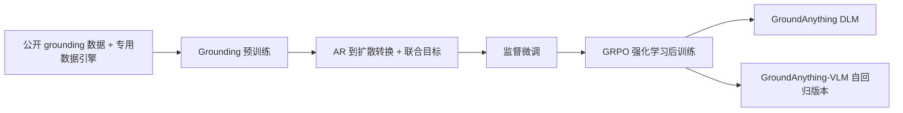
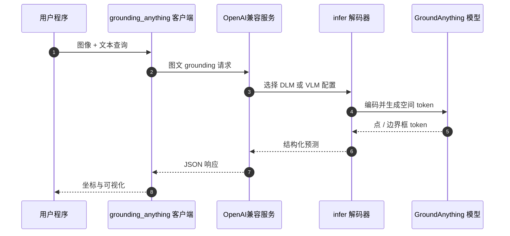

# GroundAnything：以并行解码实现精确视觉 Grounding

## 一句话定义

GroundAnything 是一个 4B 视觉 grounding 基础模型，通过双向扩散的分块去噪并行生成空间预测，并提供自回归 GroundAnything-VLM 作为另一条推理路径。

## 英文缩写速查

| 缩写 | 英文全称 | 简要说明 |
|------|----------|----------|
| DLM | Diffusion Language Model | GroundAnything 主模型采用扩散式空间 token 解码。 |
| VLM | Vision-Language Model | GroundAnything-VLM 是另行发布的自回归 checkpoint。 |
| AR | Autoregressive | 按 token 因果顺序生成的对照解码方式。 |
| GRPO | Group Relative Policy Optimization | 论文用于强化学习后训练的方法。 |
| MTP | Multi-Token Prediction | 论文用于比较快速草稿生成的自回归基线。 |

## 为什么重要

传统自回归 grounding 把位置等空间输出逐 token 串行生成，增加了延迟；而对象、位置和空间关系受图像与文本共同约束，并不必然要求特定的左到右输出顺序。GroundAnything 探索用双向扩散并行提出多个空间 token，再迭代精炼，为低延迟视觉定位提供了不同于单纯缩短自回归链的路线。

## 方法栈与流程总览

GroundAnything 为 4B 参数模型。训练先结合公开数据集与专用数据引擎进行 grounding 预训练，再将自回归模型转换为扩散模型并使用联合训练目标，之后进行监督微调和 GRPO 强化学习后训练。模型输入为图像与查询，空间预测以 token 形式输出；主要版本用分块去噪并行解码，GroundAnything-VLM 则保留自回归生成。

GroundAnything 的熵引导解码按 token 熵控制何时提交预测，若没有位置达到阈值则推进最低熵位置。自推测模式先用扩散分支批量草拟，再由因果分支验证最长连续一致前缀。该验证保留转换模型因果分支的输出，不应与单独训练的 GroundAnything-VLM 混为同一个模型行为。

## 实验与评测

论文在 30 个 grounding benchmark 上评估不同模型与解码策略。摘要给出的代表性结果如下：

| 变体 / 对比 | 论文报告 | 读法 |
|------|------|------|
| GroundAnything-VLM | 72.42% 总体得分；作者报告为同规模模型中的新总体最佳 | 汇总指标，需结合各 benchmark 协议解读 |
| GPT-6 Astra | 71.35% 总体得分 | 摘要中的外部比较基线 |
| GroundAnything 熵引导解码 | 平均 61.75% | 与其报告的快速 DLM 比较口径对应 |
| LocateAnything MTP | 平均 53.32% | 论文测试的快速自回归草稿基线 |
| 自推测解码 | 相对自回归对应版本 4.51× 加速，COCO F1mIoU 下降 0.74 个百分点 | 论文特定解码和测量设置，不是硬件无关承诺 |

这些聚合数字不能直接替代逐任务结果。比较时需要核对论文中的任务、计分规则、硬件和服务配置；尤其不能把不同模型或不同推理策略下的均值当作同一个运行点。

## 结论

**一句话总判：** GroundAnything 的关键贡献是将视觉 grounding 的空间 token 预测转为可并行细化的扩散解码，并通过自回归版本和自推测策略展示速度—精度选择。

1. **辨明模型版本。** GroundAnything 是扩散模型；GroundAnything-VLM 是独立自回归 checkpoint，部署和比较时应明确写出版本。
2. **把加速指标绑定测量条件。** 4.51× 加速与 0.74 个百分点 COCO F1mIoU 变化来自论文的自推测实验，不能直接外推到不同硬件或并发负载。
3. **把 grounding 当作感知输出。** 点、框等空间 token 可供下游系统使用，但该项目不是直接输出机器人动作的策略。
4. **完整复现需要配套栈。** DLM 推理依赖项目定制 SGLang 路径；只安装通用 serving 包或只下载权重不等同于完成其指定部署。

## 源码运行时序图

仓库提供单图预测、HTTP 客户端与批量 JSONL 标注入口。DLM 使用项目提供的 SGLang 引擎，VLM 另有自回归 serving 配置；运行环境与显卡需按仓库指南确认。

## 工程实践

| 项 | 已核验信息 | 落地时注意 |
|------|------------|------------|
| 输入 / 输出 | 单张图像与文本指令；结构化点或边界框坐标 | 使用配套 tokenizer、processor 与 chat template，检查空间 token 解码 |
| DLM 服务 | `run.py` 启动项目的定制 SGLang 服务，支持熵引导与自推测解码 | 不要假设通用 SGLang 安装包含模型所需补丁 |
| VLM 服务 | 自回归 GroundAnything-VLM 可用 SGLang，也有 vLLM Transformers backend 路径 | vLLM 路线仅针对 VLM；端到端加速器验证状态应按 README 更新确认 |
| 评测 | 官方仓库提供论文 30 项 benchmark 评测代码和配置 | 默认示例是 smoke test；完整复现需准备数据与路径 |
| 训练 | 提供分阶段训练工作流 | 训练数据缓存、manifest 与目标加速器环境需自行准备 |
| 开源状态 | 项目页明确链接代码与两个 HF checkpoint，仓库含推理、训练和评测代码 | 已开源；运行支持与模型许可范围以仓库和模型卡为准 |

## 局限与风险

- benchmark 总分是聚合结果，不能说明每类指代、OCR、GUI 或文档任务上的相对优势。
- 扩散解码引入阈值、块大小和迭代策略等选择；不同设置对应不同吞吐与精度，部署时应在目标任务上实测。
- 公开模型产生视觉定位结果，不包含机器人动作规划、运动学约束或安全控制闭环。
- 官方 README 所列服务环境和加速器有明确范围；不能从论文的加速数字推断它已适配边缘机器人计算平台。
- DLM 服务、VLM 服务与 Hugging Face 权重是不同发布形态，需按各自文档准备依赖和配置。

## 与其他工作对比

| 维度 | GroundAnything | GroundingPI |
|------|------|------|
| 论文身份 | arXiv:2609.39600 | arXiv:2609.39601 |
| 关注重点 | 并行扩散解码与 grounding 推理速度 | 视觉基元与专门 grounding 预训练迁移 |
| 发布模型 | 扩散 DLM 与自回归 VLM 两类 checkpoint | 视觉 grounding 基础模型与下游骨干评估 |
| 共同点 | 以 4B 级视觉语言模型提供空间定位能力 | 同左 |
| 动作边界 | grounding 感知组件，不是动作策略 | grounding 感知骨干，不是直接动作策略 |

两项工作来自相同作者团队且方向相邻，但论文、项目主页、仓库和权重入口各自独立；应保留为两个实体并按实际系统目标比较。

## 关联页面

- [GroundingPI：基于视觉基元的物理智能 Grounding 基础模型](./paper-groundingpi.md)
- [视觉基础模型发展趋势](../concepts/visual-foundation-model-trends.md)
- [Vision-Language-Action](../methods/vla.md)

## 参考来源

- [论文原文归档](../../sources/papers/groundanything_arxiv_2609_39600.md)
- [官方项目页核查](../../sources/sites/groundanything-project.md)
- [官方仓库复现入口](../../sources/repos/groundanything.md)
- [arXiv:2609.39600](https://arxiv.org/abs/2609.39600)
- [Hugging Face 论文页](https://huggingface.co/papers/2609.39600)

## 推荐继续阅读

- [GroundAnything 项目主页](https://groundingpi.github.io/groundanything/)
- [官方 GitHub 仓库与部署指南](https://github.com/groundingpi/GroundAnything)
- [GroundAnything DLM 权重](https://huggingface.co/GroundingPI/GroundAnything)
- [GroundAnything-VLM 自回归权重](https://huggingface.co/GroundingPI/GroundAnything-VLM)
- [Hugging Face 论文页](https://huggingface.co/papers/2609.39600)
