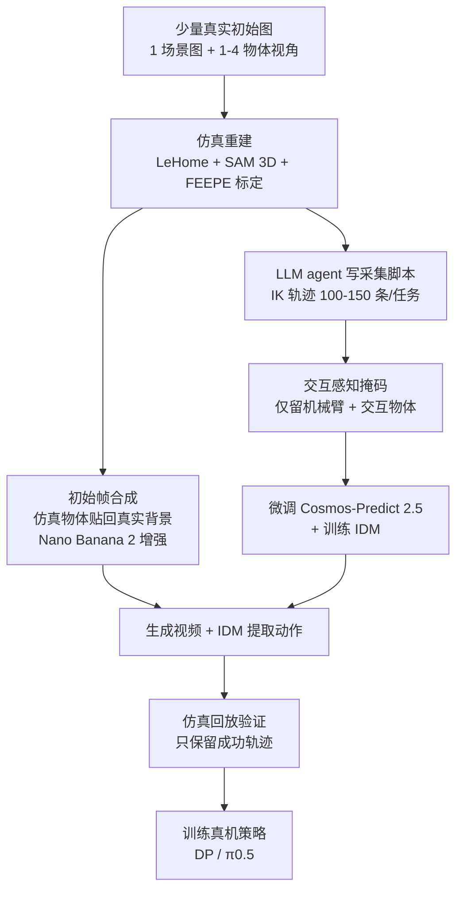

# Grounded-Dreamer：带物理验证的世界模型合成示范

**Grounded-Dreamer**（[arXiv:2610.13164](https://arxiv.org/abs/2610.13164)，[项目页](https://fffstrong.github.io/Grounded-Dreamer/)）由北京大学、光轮智能（Lightwheel）与香港科技大学（广州）的作者提出：从少量真实任务初始图像重建仿真场景，采集物理可行轨迹去微调视频世界模型与逆动力学模型（IDM），生成逼真机器人视频及动作，再在仿真中回放验证，**只保留能完成任务的合成轨迹**来训练真机策略。

## 一句话定义

**用“仿真中物理可行的轨迹”约束视频世界模型，再用“仿真回放是否完成任务”过滤其输出，把世界模型变成无需遥操作的带标签数据源。**

## 英文缩写速查

| 缩写 | 英文全称 | 简要说明 |
|------|----------|----------|
| GD | Grounded-Dreamer | 本文方法；表中 “GD data” 指验证后的合成数据 |
| WM | World Model | 此处为微调后的 Cosmos-Predict 2.5 视频世界模型 |
| IDM | Inverse Dynamics Model | 从生成视频反推动作（SigLIP2-Large + 流匹配头） |
| DP | Diffusion Policy | 下游策略之一 |
| OOD | Out-of-Distribution | 论文第二组评测，场景变化后的泛化 |
| IK | Inverse Kinematics | 仿真轨迹采集所用末端控制 |

## 为什么重要

- **数据来源问题：** 遥操作昂贵、仿真视觉失真、人类视频缺少机器人动作标签；该工作用世界模型补视觉真实度，用仿真回放补物理可信度。
- **验证环节明确：** 世界模型的生成视频不直接当数据，而要过一次仿真回放，减少“看起来对、物理上做不到”的轨迹。
- **启发：** 合成数据的价值体现在与真实数据共训及 OOD 泛化上，而不是替代真实示范。

## 核心信息

| 项 | 内容 |
|----|------|
| **机构** | 北京大学（PKU）；光轮智能（Lightwheel）；香港科技大学（广州）（HKUST-GZ） |
| **世界模型** | Cosmos-Predict 2.5（2B Video2World），8 张 A800 微调 |
| **机器人** | Franka Emika + Panda 夹爪，RealSense D405；7 个任务 |
| **开源** | 待发布：项目页写 “Coming soon”（截至 2026-10-12） |

## 方法栈 / 流程总览

## 方法

**输入 / 输出：** 输入少量真实初始状态图像；输出经验证的“视频 + 动作”轨迹，供策略训练。

1. **仿真重建：** LeHome 仿真器，相机外参用 FEEPE 标定，内参直接取真实相机；SAM 3D 重建刚体网格并缩放到真实尺寸，铰接物体拆件后由 agent 按连接规则和关节规格组装。
2. **轨迹采集：** LLM agent 依参考模板、任务描述和 Isaac Sim 物体元数据写脚本，IK 末端控制，每任务 100–150 条。
3. **交互感知掩码：** 仿真帧里只保留机械臂和交互物体，用于微调 Cosmos 与 IDM。
4. **世界模型与 IDM：** Cosmos-Predict 2.5 微调（lr 4.315e-5，1,400–2,000 迭代，全局 batch 32，93 帧，Put in Drawer 用 125 帧）；IDM 为 SigLIP2-Large + 流匹配动作头（5,000–10,000 步，batch 512，lr 1e-4）。
5. **初始帧合成：** 随机化物体位姿，把渲染物体合成到真实背景，Nano Banana 2 用参考照片使其逼真并变化光照、桌布。
6. **验证：** 合成动作在物理仿真回放，按成败标 Optimal / Sub-optimal，仅留成功轨迹。

## 实验与评测

Franka 七个任务（Pick / Button / Close Drawer / Pick&Place / Sweep Trash / Slice Sausage / Put in Drawer），成功率 %：

| 设置 | 逐任务（按上述顺序） | 7 任务平均 |
|------|---------------------|------------|
| Real-only（DP） | 50 / 60 / 60 / 50 / 50 / 70 / 35 | 53.6 |
| GD 数据（DP） | 45 / 50 / 45 / 35 / 45 / 55 / 25 | 42.9 |
| Co-training（DP） | 55 / 65 / 50 / 45 / 55 / 60 / 40 | 52.9 |
| Real-only（π0.5） | 65 / 75 / 65 / 60 / 60 / 75 / 45 | 63.6 |
| GD 数据（π0.5） | 55 / 75 / 55 / 50 / 60 / 60 / 30 | 55.0 |
| Co-training（π0.5） | 70 / 80 / 65 / 55 / 75 / 70 / 45 | 65.7 |
| Sim-only（DP / π0.5） | 10/10/0/5/5/0/0；10/15/15/5/10/5/0 | 4.3 / 8.6 |

（平均为据逐任务表自行计算；Low-data Real 文中给出 DP 8.6%、π0.5 14.3%；RIGVid 基线 25/20/5/5/0/0/0。）

- **OOD：** Real-only（DP）10/5/5/0/5/5/0 → 验证世界模型数据（DP）40/50/35/30/40/45/15，平均 4.3 → 36.4；π0.5 从 25/20/10/20/20/15/5 到 45/60/55/40/60/50/30，平均 16.4 → 48.6。正文称 Real-only DP 为 7.1%，与表算平均不一致，本页只用表内数字。
- **关键消融：** 无交互感知掩码时 DP 在各任务仅 0–5%，π0.5 0–10%；验证数据占比下降则性能下降（Table 4 行标含义有歧义）。
- **规模：** Close Drawer / Put in Drawer 上合成轨迹增至约 150 条趋平。
- 评测次数：主对比每项 20 次，规模曲线 30 次。

## 源码运行时序图

不适用：截至 2026-10-12 项目页写 “Coming soon”，未发布代码仓库；论文流程依赖 LeHome、SAM 3D、Cosmos-Predict 2.5 等外部组件，无法对齐真实目录与脚本。

## 工程实践

- **开源核查（2026-10-12）：** 项目页无 GitHub / HuggingFace 链接，代码标注为 “Coming soon”，因此仅能依据论文复述流程，无法复现。
- **算力：** Cosmos 微调单卡约 74 GB 显存（8 张 A800 + 上下文并行）；IDM 每条轨迹约 0.5 s、4 GB 显存。
- **数据管线读点：** 约 65% 的合成初始帧可用，生成阶段平均任务成功约 45%；回放过滤本身通过率论文未单列。
- **使用建议：** 把合成数据与少量真实数据共训，并把 OOD 作为主要收益指标。

## 结论

**物理回放验证让世界模型合成数据变得可用，但它更像真实数据的补充，而不是替代品。**

1. 仅用验证后合成数据训练的策略，在 7 任务上平均低于 Real-only（DP 42.9 对 53.6，π0.5 55.0 对 63.6），但远高于 Sim-only 和低数据真实。
2. 与真实数据共训与 Real-only 相近：DP 52.9 对 53.6（略低），π0.5 65.7 对 63.6（略高），表内差距不大。
3. OOD 是主要收益：表内平均 DP 4.3 → 36.4，π0.5 16.4 → 48.6。
4. 交互感知掩码是必备设计，去掉后几乎全部失败。
5. 回放验证有价值，混入次优轨迹会拉低成功率。
6. 流程依赖多个外部模型且代码未发布，当前只能当作设计参考。

## 局限与风险

- 作者自述：约 65% 合成初始帧可用；规模受算力限制；参考图仍需人工采集。
- 代码、数据、模型均未发布；Table 4 标注含义不明，论文正文与表有一处数字不一致。
- 仅 Franka 单一平台、7 个桌面任务。

## 与其他工作对比

- **Cosmos 系列：** 基础世界模型见 [NVIDIA Cosmos](./nvidia-cosmos.md)；Grounded-Dreamer 用其 Predict 2.5 作可微调骨干，并加仿真验证。
- **纯仿真数据：** Sim-only 几乎全败，说明仿真到真实的视觉差距仍大，见 [Sim2Real](../concepts/sim2real.md)。
- **RIGVid：** 基线 7 个任务中只有 3 项非零。
- 世界模型背景见 [生成式世界模型](../methods/generative-world-models.md)；数据闭环视角见 [数据飞轮](../concepts/data-flywheel.md)。

## 关联页面

- [34 篇空间落地技术地图（汇总页）](../overview/embodied-station-34-papers-spatial-grounding-technology-map.md)
- [操作任务](../tasks/manipulation.md)
- [Sim2Real](../concepts/sim2real.md)
- [数据飞轮](../concepts/data-flywheel.md)
- [生成式世界模型](../methods/generative-world-models.md)

## 参考来源

- [具身智能小站 34 篇盘点（2026-10-12）](../../sources/blogs/wechat_embodied_station_34_papers_spatial_grounding_2026-10-12.md)
- [Grounded-Dreamer 论文来源归档](../../sources/papers/grounded_dreamer_arxiv_2610_13164.md)
- [Grounded-Dreamer 项目页核查](../../sources/sites/grounded-dreamer-github-io.md)

## 推荐继续阅读

- [Grounded-Dreamer arXiv 原文](https://arxiv.org/abs/2610.13164)
- [Grounded-Dreamer 项目页](https://fffstrong.github.io/Grounded-Dreamer/)
- [NVIDIA Cosmos 项目](https://github.com/nvidia-cosmos)
