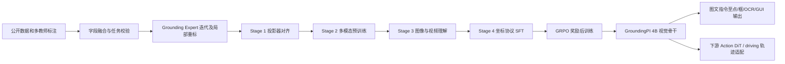
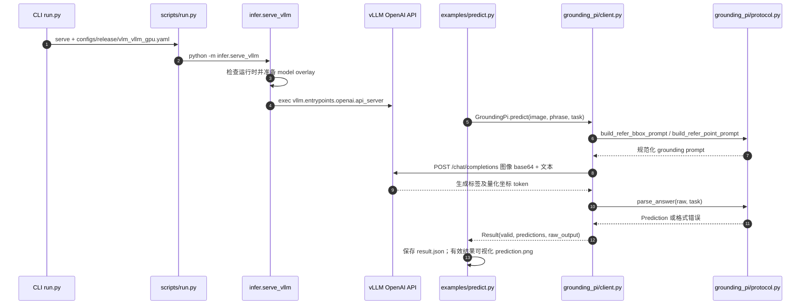

# GroundingPI：基于视觉基元的物理智能 Grounding 基础模型

## 一句话定义

GroundingPI 是一个 4B 视觉 grounding 基础模型，以共享词表中的离散坐标 token 表示点和边界框，并将专门的感知能力迁移到机器人操作与自动驾驶视觉任务。

## 英文缩写速查

| 缩写 | 英文全称 | 简要说明 |
|------|----------|----------|
| VLA | Vision-Language-Action | GroundingPI 被研究为 VLA 视觉骨干的候选来源。 |
| WAM | World-Action Model | 论文讨论的另一类具身模型，其感知也依赖视觉骨干。 |
| VLM | Vision-Language Model | GroundingPI 的视觉与语言建模接口。 |
| GRPO | Group Relative Policy Optimization | 论文用于强化学习后训练的优化方法。 |
| OOD | Out-of-Distribution | 论文用于评估分布外场景迁移的设置。 |

## 为什么重要

机器人策略不仅要识别目标类别，还要在拥挤场景或小目标条件下定位任务相关对象、操作点与空间范围。GroundingPI 将 grounding 作为可专门训练的感知能力，并验证该视觉表示对机器人操作和自动驾驶下游任务的价值，构成“先增强感知、再接动作策略”的研究路线。

## 核心信息

| 字段 | 内容 |
|------|------|
| 英文题目 | GroundingPI: A Grounding Foundation Model towards Physical Intelligence with Visual Primitives |
| 作者 / 机构 | Qize Yu 等；小鹏汽车、北京大学、香港大学、加州大学伯克利分校、普林斯顿大学、新加坡国立大学、清华大学、香港科技大学（广州） |
| 原文版本 | [arXiv:2609.39601v1（2026-09-30）](https://arxiv.org/html/2609.39601v1) |
| 源码 / 权重 | [官方 GitHub](https://github.com/groundingpi/GroundingPI)；[Hugging Face](https://huggingface.co/GroundingPI/GroundingPI) |

## 方法栈与流程总览

GroundingPI 将点与框序列化为共享词表中的量化坐标 token。论文摘要把训练概括为多模态和空间预训练、监督微调、GRPO 强化学习后训练；官方模型实现使用 MoonViT-V2（Kimi K3）视觉编码器、可学习多模态投影器与 Qwen3-4B 语言骨干。

GAM 协议把坐标量化到 0–999 的整数网格：点输出为 `(x, y)`，边界框输出为 `(x1, y1, x2, y2)`，缺失目标可表示为 `None`。部署时应使用配套 tokenizer、processor 和 chat template，以保持空间 token 边界与坐标解析一致。

## 实验与评测

论文摘要报告与 44 个基线在 34 个 grounding benchmark 上进行比较，覆盖 11 类感知能力；GroundingPI 平均得分为 73.68%，高于论文中更大规模的 GPT-6 Astra 基线（71.54%）。下游实验的主要结果如下：

| 任务 / 基准 | 论文报告 |
|------|------|
| RoboTwin 2.0 | 四种 OOD 设置均超过论文比较的主流视觉骨干；相对最强骨干最高提升 24.8%。 |
| RoboCasa-GR1 | 使用 50% demonstrations 训练的设置超过部分使用 75% demonstrations 的视觉骨干基线。 |
| nuScenes | 作为视觉骨干时，平均开环 L2 误差为 0.296 m。 |

这些数字沿用论文摘要的报告口径；复现或比较时应回到原文表格核对任务划分、指标定义和对应 baseline。

## 训练细节与数据引擎（论文 §3 / 附录 §7）

- **结构：** MoonViT-V2 视觉编码器，经多模态 projector 对接 Qwen3-4B 全注意力解码器；每个量化坐标 `<0>`–`<999>` 是原子 token。实体标签用 `<|object_ref_start|>` / `<|object_ref_end|>` 包围，点与框都使用 box delimiter 包围几何负载。
- **数据：** 多教师的字段级标注融合 → 几何和覆盖率的任务特定校验 → 训练统一标注 expert → 用局部裁剪、互补教师迭代不确定标签。有效实例记录可以派生检测、指代、点定位、文字 OCR 和视觉样例提示等监督。
- **训练三期 / 四个监督阶段：** Pretrain 1 含 Stage 1（仅 projector）、Stage 2（联合多模态）、Stage 3（通用视觉/视频）；Pretrain 2/SFT 对齐坐标 token（Stage 4）；最后采用 GRPO（每个 prompt 8 个 response），视觉 encoder/projector 在 RL 期间冻结。
- **GRPO 奖励：** grounding 奖励组合覆盖率和精定位/格式（0.7/0.3），OCR 奖励同时看文本与 box 一致性；clip 0.2，KL 系数 0.02。论文训练规模是监督阶段 128 GPU、RL 256 GPU，公开训练配置不等于论文大规模训练直接可复现。

## Action 接入与实验口径（论文 §4–5 / 附录 §8–9）

- **动作端隔离对照：** 各 backbone 抽取 8 个深度的隐藏态，各重采样为 64 个、宽 1024 的 condition tokens；跨注意力注入同一 Action DiT（8 cross + 8 self，action horizon 16，推理 4 Euler 步）。控制 action 数据、40,000 更新步数与专家结构，比较的是**视觉 backbone 迁移**，不是 GroundingPI 单独完成动作。
- **RoboTwin 2.0：** Full 使用 Clean+Randomized；Clean2Random 仅在 Clean 示范训练，再到 Randomized 场景测试，主要检验环境扰动鲁棒性。
- **RoboCasa-GR1：** 头部相机的灵巧手操作；OOD 分为 unseen appearance、unseen combinations、unseen object types，偏向实体外观/对象/容器组合泛化。
- **nuScenes：** 前视图像加最多七条自车历史状态，解码航迹并测开环 L2，不应等同闭环规划安全性。
- **分组计分：** 73.68% 是 11 类感知能力的分组均分；GroundingPI 自身指标作者称 5 个种子、每个 2 次，部分本地 baseline 是 3 次，引用的外部成绩可能有协议差异。

| 原文核查项 | GroundingPI 与对照 | 解读 |
|------|------|------|
| Dense200 bbox F1mIoU | 74.53 vs Astra 65.04 | 密集 box 定位有优势 |
| RoboTwin Full / Clean2Random | 66.20% / 17.60% SR；后者 Rex-Omni 14.10% | Full 与 OOD 不能混算 |
| RoboCasa-GR1 100% 示范 ID | 37.75% vs RynnBrain 39.00% | Full ID **不是** GroundingPI 第一 |
| RoboCasa-GR1 50% vs RynnBrain 75% 示范 | 28.75% vs 27.75% SR | 只说明下游动作示范效率，非总训练数据成本 |
| nuScenes | 0.296 m open-loop L2；Qwen3-VL-4B 0.301 m | 提升幅度有限，不代表真车闭环 |
| 训练规模消融 | Grounding Avg 61.69→73.68；OOD SR 26.59→33.38 | ID SR 最终 38.75→37.75，并非所有指标单调 |
| 移除 OCR 组 | RoboCasa ID/OOD 分别少 5.33/3.63 pp | 这是条件性组消融，不能证实 OCR 单独的因果贡献 |
| 坐标表示 | quantized Avg 73.68 vs textual 71.21 | 文本坐标相对生成速度约 0.25× |
| COCO / Dense200 tokens/box | GroundingPI 7.6 / 5.1 | 仅是 token 序列化，不是匹配硬件的真实延迟比 |

## 结论

**一句话总判：** GroundingPI 的核心价值是把点与框 grounding 做成可迁移的感知基础能力，现有证据支持其作为视觉骨干，而不是一个独立的机器人动作策略。

1. **先看 grounding 指标与均分口径。** 73.68% 是 34 项 benchmark 的平均结果，不等价于单一机器人任务成功率。
2. **按下游任务读迁移增益。** RoboTwin 2.0、RoboCasa-GR1 与 nuScenes 结果各自采用不同协议，不能跨任务横向比较。
3. **拆分感知和控制。** 实际动作仍由下游策略产生；不要把视觉 checkpoint 直接当作机器人可执行策略。
4. **把 OCR 与多级感知协同当作后续消融线索，而非已被证实的单一因果机制。** 公开论文未隔离 OCR-only 效应。
5. **核查权重许可。** 原始代码声明 Apache 2.0，但组合模型含 Kimi K3 派生材料及其他第三方组件。

## 源码运行时序图

以下路径已逐文件对照官方 `run.py`、`scripts/run.py`、`infer/serve_vllm.py`、`examples/predict.py`、`grounding_pi/client.py`、`grounding_pi/protocol.py`；**不是**未经核查的通用流程。

推理复现入口是下载 Hugging Face checkpoint、按仓库指南启动服务，再使用客户端或 `examples/predict.py` 发起图文请求。该图描述仓库提供的 grounding 推理接口，不代表下游机器人控制执行闭环。

## 工程实践

| 环节 | 已核验信息 | 复现时的注意点 |
|------|------------|----------------|
| 模型输入输出 | 单张图像 + 文本任务指令；点、框使用 0–999 坐标网格 | 坐标解析需使用模型 tokenizer、processor 与 chat template |
| 推理 | vLLM Transformers backend 为默认服务，另有 Transformers 参考服务 | README 目标环境为 Linux x86_64 / Python 3.12，并要求预置兼容 Torch 和 vLLM 0.18.x 的加速器运行时 |
| 评测 | 官方仓库包含 34 benchmark 的评估入口 | 完整评测需要另行准备数据、路径配置和运行环境 |
| 训练 | 提供模型训练代码与配置 | 数据缓存、manifest 和兼容训练运行时需自行准备；仓库默认训练配方指向对应 PPU 环境 |
| 下游策略 | 提供 StarVLA / OpenWAM 的骨干比较与策略工作流 | 需独立配置策略模型和 checkpoint；公开 grounding 权重不是直接动作策略 |
| 开源状态 | 项目页链接到代码；仓库及 Hugging Face 均可访问 | Apache 2.0 只覆盖项目自有贡献；Kimi K3 与第三方组件条件仍适用 |

## 局限与风险

- **论文 §11 明确的弱项：** 极小目标严格定位、COCO 高 IoU 边界、TotalText OCR、FSC147 visual prompting，以及高难度 GUI grounding；不能以 34 项汇总得分覆盖弱点。
- **证据界限：** downstream backbone 对照虽匹配 action 训练，但不同 foundation 仍有规模/架构/预训练差异；OCR 催化机制和双系统 System-1/2 分工仍是待验证假说。
- **算力与延迟：** 作者给出的 token/box 节省不是匹配硬件的吞吐 benchmark；目前未报告 GroundingPI 与物理控制器结合的完整 observation-to-action 实时闭环时延。

- 摘要的聚合成绩不能替代逐 benchmark 的指标、统计方差和失败案例；具体比较需要核对论文及补充材料。
- 视觉 grounding 的下游增益依赖所接策略、数据、仿真器和评测协议，不直接保证目标机器人上的真实控制收益。
- 官方仓库提供的动作策略集成属于骨干比较/训练工作流；直接部署仍需独立策略训练、运行时适配和安全验证。
- 模型包中含上游 Kimi K3 及其他第三方组件，权重许可与代码许可证应分别审阅。

## 与其他工作对比

| 维度 | GroundingPI | 一般 VLA / WAM |
|------|-------------|----------------|
| 主要输出 | 视觉 grounding 的点、框及相关空间 token | 通常进一步输出机器人动作或动作序列 |
| 优化重点 | 密集、精确、可迁移的感知能力 | 任务执行与感知—动作联合建模 |
| 组合方式 | 作为视觉骨干接入下游策略 | 可在系统内联合处理感知与动作 |
| 工程边界 | 单独 checkpoint 不直接闭环控制 | 需依赖相应机器人接口与控制栈 |

## 关联页面

- [GroundAnything：以并行解码实现精确视觉 Grounding](./paper-groundanything.md) — 同一作者团队的并行扩散 grounding 工作，论文与仓库均独立。
- [Manipulation](../tasks/manipulation.md)
- [Vision-Language-Action](../methods/vla.md)
- [【9.28–10.2 前沿论文动态】Manipulation](../overview/frontier-manipulation-2026-09-28-10-02.md)

## 参考来源

- [论文原文归档](../../sources/papers/groundingpi_arxiv_2609_39601.md)
- [官方项目页核查](../../sources/sites/groundingpi-github-io.md)
- [官方仓库复现入口](../../sources/repos/groundingpi.md)
- [arXiv:2609.39601](https://arxiv.org/abs/2609.39601)
- [Hugging Face 论文页](https://huggingface.co/papers/2609.39601)

## 推荐继续阅读

- [GroundingPI 项目主页](https://groundingpi.github.io/)
- [GitHub 代码与复现指南](https://github.com/groundingpi/GroundingPI)
- [Hugging Face 权重](https://huggingface.co/GroundingPI/GroundingPI)
- [Hugging Face 论文页](https://huggingface.co/papers/2609.39601)
