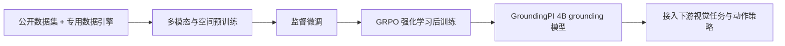
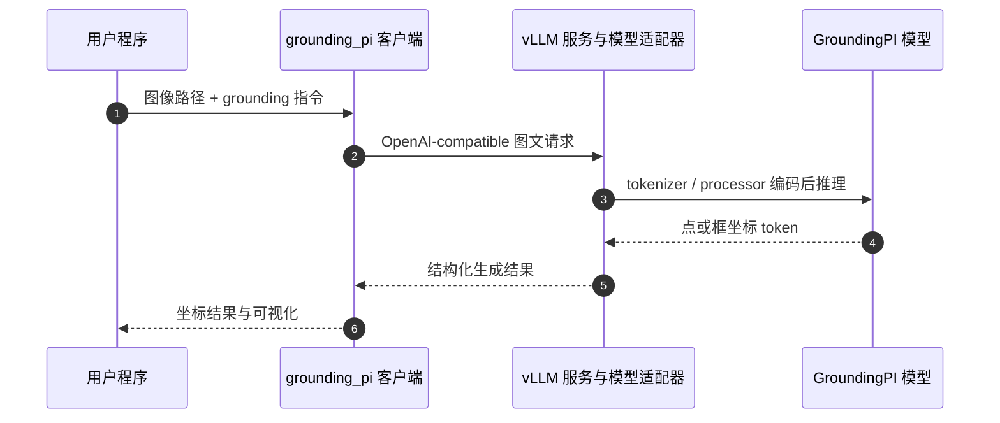

# GroundingPI：基于视觉基元的物理智能 Grounding 基础模型

## 一句话定义

GroundingPI 是一个 4B 视觉 grounding 基础模型，以共享词表中的离散坐标 token 表示点和边界框，并将专门的感知能力迁移到机器人操作与自动驾驶视觉任务。

## 英文缩写速查

| 缩写 | 英文全称 | 简要说明 |
|------|----------|----------|
| VLA | Vision-Language-Action | GroundingPI 被研究为 VLA 视觉骨干的候选来源。 |
| WAM | World-Action Model | 论文讨论的另一类具身模型，其感知也依赖视觉骨干。 |
| VLM | Vision-Language Model | GroundingPI 的视觉与语言建模接口。 |
| GRPO | Group Relative Policy Optimization | 论文用于强化学习后训练的优化方法。 |
| OOD | Out-of-Distribution | 论文用于评估分布外场景迁移的设置。 |

## 为什么重要

机器人策略不仅要识别目标类别，还要在拥挤场景或小目标条件下定位任务相关对象、操作点与空间范围。GroundingPI 将 grounding 作为可专门训练的感知能力，并验证该视觉表示对机器人操作和自动驾驶下游任务的价值，构成“先增强感知、再接动作策略”的研究路线。

## 方法栈与流程总览

GroundingPI 将点与框序列化为共享词表中的量化坐标 token。论文摘要把训练概括为多模态和空间预训练、监督微调、GRPO 强化学习后训练；官方模型实现使用 MoonViT-V2（Kimi K3）视觉编码器、可学习多模态投影器与 Qwen3-4B 语言骨干。

GAM 协议把坐标量化到 0–999 的整数网格：点输出为 `(x, y)`，边界框输出为 `(x1, y1, x2, y2)`，缺失目标可表示为 `None`。部署时应使用配套 tokenizer、processor 和 chat template，以保持空间 token 边界与坐标解析一致。

## 实验与评测

论文摘要报告与 44 个基线在 34 个 grounding benchmark 上进行比较，覆盖 11 类感知能力；GroundingPI 平均得分为 73.68%，高于论文中更大规模的 GPT-6 Astra 基线（71.54%）。下游实验的主要结果如下：

| 任务 / 基准 | 论文报告 |
|------|------|
| RoboTwin 2.0 | 四种 OOD 设置均超过论文比较的主流视觉骨干；相对最强骨干最高提升 24.8%。 |
| RoboCasa-GR1 | 使用 50% demonstrations 训练的设置超过部分使用 75% demonstrations 的视觉骨干基线。 |
| nuScenes | 作为视觉骨干时，平均开环 L2 误差为 0.296 m。 |

这些数字沿用论文摘要的报告口径；复现或比较时应回到原文表格核对任务划分、指标定义和对应 baseline。

## 结论

**一句话总判：** GroundingPI 的核心价值是把点与框 grounding 做成可迁移的感知基础能力，现有证据支持其作为视觉骨干，而不是一个独立的机器人动作策略。

1. **先看 grounding 指标。** 73.68% 是 34 项 benchmark 的平均结果，不等价于单一机器人任务成功率。
2. **按下游任务读迁移增益。** RoboTwin 2.0、RoboCasa-GR1 与 nuScenes 结果各自采用不同协议，不能跨任务横向比较。
3. **拆分感知和控制。** 实际动作仍由下游策略产生；不要把视觉 checkpoint 直接当作机器人可执行策略。
4. **核查权重许可。** 原始代码声明 Apache 2.0，但组合模型含 Kimi K3 派生材料及其他第三方组件。

## 源码运行时序图

推理复现入口是下载 Hugging Face checkpoint、按仓库指南启动服务，再使用客户端或 `examples/predict.py` 发起图文请求。该图描述仓库提供的 grounding 推理接口，不代表下游机器人控制执行闭环。

## 工程实践

| 环节 | 已核验信息 | 复现时的注意点 |
|------|------------|----------------|
| 模型输入输出 | 单张图像 + 文本任务指令；点、框使用 0–999 坐标网格 | 坐标解析需使用模型 tokenizer、processor 与 chat template |
| 推理 | vLLM Transformers backend 为默认服务，另有 Transformers 参考服务 | README 目标环境为 Linux x86_64 / Python 3.12，并要求预置兼容 Torch 和 vLLM 0.18.x 的加速器运行时 |
| 评测 | 官方仓库包含 34 benchmark 的评估入口 | 完整评测需要另行准备数据、路径配置和运行环境 |
| 训练 | 提供模型训练代码与配置 | 数据缓存、manifest 和兼容训练运行时需自行准备；仓库默认训练配方指向对应 PPU 环境 |
| 下游策略 | 提供 StarVLA / OpenWAM 的骨干比较与策略工作流 | 需独立配置策略模型和 checkpoint；公开 grounding 权重不是直接动作策略 |
| 开源状态 | 项目页链接到代码；仓库及 Hugging Face 均可访问 | Apache 2.0 只覆盖项目自有贡献；Kimi K3 与第三方组件条件仍适用 |

## 局限与风险

- 摘要的聚合成绩不能替代逐 benchmark 的指标、统计方差和失败案例；具体比较需要核对论文及补充材料。
- 视觉 grounding 的下游增益依赖所接策略、数据、仿真器和评测协议，不直接保证目标机器人上的真实控制收益。
- 官方仓库提供的动作策略集成属于骨干比较/训练工作流；直接部署仍需独立策略训练、运行时适配和安全验证。
- 模型包中含上游 Kimi K3 及其他第三方组件，权重许可与代码许可证应分别审阅。

## 与其他工作对比

| 维度 | GroundingPI | 一般 VLA / WAM |
|------|-------------|----------------|
| 主要输出 | 视觉 grounding 的点、框及相关空间 token | 通常进一步输出机器人动作或动作序列 |
| 优化重点 | 密集、精确、可迁移的感知能力 | 任务执行与感知—动作联合建模 |
| 组合方式 | 作为视觉骨干接入下游策略 | 可在系统内联合处理感知与动作 |
| 工程边界 | 单独 checkpoint 不直接闭环控制 | 需依赖相应机器人接口与控制栈 |

## 关联页面

- [GroundAnything：以并行解码实现精确视觉 Grounding](./paper-groundanything.md) — 同一作者团队的并行扩散 grounding 工作，论文与仓库均独立。
- [Manipulation](../tasks/manipulation.md)
- [Vision-Language-Action](../methods/vla.md)
- [【9.28–10.2 前沿论文动态】Manipulation](../overview/frontier-manipulation-2026-09-28-10-02.md)

## 参考来源

- [论文原文归档](../../sources/papers/groundingpi_arxiv_2609_39601.md)
- [官方项目页核查](../../sources/sites/groundingpi-github-io.md)
- [官方仓库复现入口](../../sources/repos/groundingpi.md)
- [arXiv:2609.39601](https://arxiv.org/abs/2609.39601)
- [Hugging Face 论文页](https://huggingface.co/papers/2609.39601)

## 推荐继续阅读

- [GroundingPI 项目主页](https://groundingpi.github.io/)
- [GitHub 代码与复现指南](https://github.com/groundingpi/GroundingPI)
- [Hugging Face 权重](https://huggingface.co/GroundingPI/GroundingPI)
- [Hugging Face 论文页](https://huggingface.co/papers/2609.39601)
