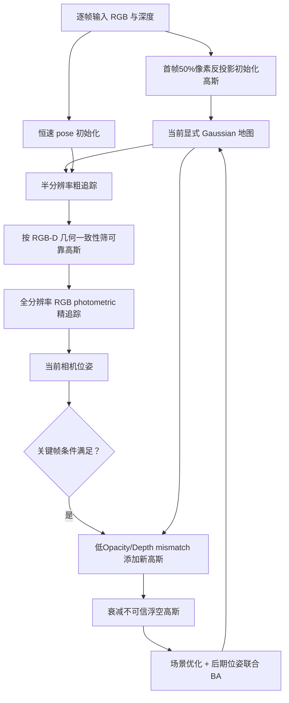
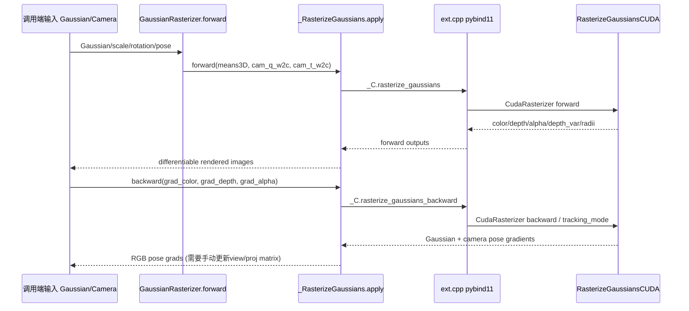

# GS-SLAM：自适应高斯扩展的稠密 RGB-D SLAM / Dense Visual SLAM with 3D Gaussian Splatting

## 一句话定义

GS-SLAM 通过**初帧 RGB-D 高斯初始化、低不透明度/深度残差驱动的增删、先半分辨率粗追踪再可靠高斯精追踪**联合估计相机位姿与三维地图；该工作区别于 Matsuki 的 MonoGS 和 Yugay 的 Gaussian-SLAM。

## 英文缩写速查

| 缩写 | 英文全称 | 简要说明 |
|---|---|---|
| GS | Gaussian Splatting | 高斯可微光栅化 |
| RGB-D | RGB & Depth | 彩色和深度观测 |
| ATE | Absolute Trajectory Error | 轨迹误差 |
| BA | Bundle Adjustment | 位姿与地图联合优化 |
| SH | Spherical Harmonics | 高斯颜色系数 |
| FPS | Frames Per Second | 论文分别报告渲染与完整 SLAM |

## 为什么重要

相比隐式 NeRF 系 SLAM，3D Gaussian Splatting 使用显式高斯场与 GPU tile rasterizer 加速渲染与局部更新。但三维重建场景有**新增可见区域和历史浮空高斯**，不能用静态 3DGS 的假设直接处理；GS-SLAM 提出针对 SLAM 的动态高斯密度控制和追踪时选择可靠高斯。官方仅公开改造 rasterizer，系统方法和完整代码复现是两种可验证层次。

## 核心原理与方法

1. **显式地图**：每高斯有 3D 均值、旋转/尺度参数化的协方差、opacity、SH 颜色；前向按 alpha blend 得 RGB、depth 和累计 opacity。
2. **初始建图**：第一帧随机反投影约 50% 有效 RGB-D 像素初始化高斯（Eq. 7），留下密度扩展空间。
3. **Adaptive expansion**：关键帧中累计 opacity 过小或 depth mismatch 的像素为新区域候选，反投影添加 Gaussian；对位于可见几何表面前的 floaters 降低 opacity，删除不可靠的拟合干扰（Eq. 8–9）。
4. **Coarse-to-fine tracking**：用先前位姿的恒速假设初始化，半分辨率采样粗跟踪，再以传感器深度筛选可靠高斯作全分辨率细跟踪；**位姿优化的 loss 为 RGB 光度项 Eq. 10**。
5. **关键帧 BA**：选 K 关键帧按深度和 RGB 图像误差构造优化，先优化 scene，再同时优化 scene 和相机位姿（Eq.13）。
6. **源码现实**：官方 rasterizer 支持 RGB+Depth/Alpha 前向及 backward，但 README 声明 depth loss→pose 梯度有问题；在追踪相机位姿时只能依赖 RGB loss，不可凭论文提到 RGB-D 就断言运行代码有可靠 depth-to-pose 梯度。

## 流程总览（论文 Fig. 2 / Algorithm 1）

## 公开源码运行时序图（*仅 rasterizer 内核*）

**发布范围限定**：`https://github.com/yanchi-3dv/diff-gaussian-rasterization-for-gsslam` 不包含整套 SLAM 前后端，不能声称下面是论文完整 Tracking/Mapping 的真实源码序列。核对 `diff_gaussian_rasterization/__init__.py`、`ext.cpp`、`rasterize_points.cu` 和 CUDA rasterizer 核心接口。

## 实验与评测

论文 §4 使用 Replica 8 场景和 TUM-RGBD 3 子集；作者设备为 RTX 4090 + i9-13900K，Replica 每测试运行 10 次并取平均。**区分渲染速度与 SLAM 全系统**：

| Replica 汇总 | 原论文报告 |
|---|---:|
| PSNR / SSIM / LPIPS（Table 6） | **34.27dB / 0.975 / 0.082** |
| 纯渲染速度（Table 6） | **386.91 FPS** |
| 追踪+建图整体运行（§4.4） | **约 8.34 FPS** |
| 地图表示内存 | **约 198.04 MB** |
| 重建平均 Depth L1（Table 3） | **1.16 cm** |

关键消融（§4.5/Table7-9）：不添加新高斯导致完整场景无法建出；不清理 floaters 损害渲染/几何；无 coarse-to-fine 跟踪使 ATE 和 Recall/PSNR 恶化。不能用 386.91 FPS 推断手机、机器人端 386 FPS 定位。

## 与其他工作对比

GS-SLAM（Yan）、[MonoGS](./paper-monogs.md)、[Gaussian-SLAM](./paper-gaussian-slam.md) 与 [SplaTAM](./paper-splatam.md) 同为 3DGS 稠密 SLAM，名字相近但设计与开源程度不同。

| 对照 | 差异 | 论文结果/说明 |
|---|---|---|
| [SplaTAM](./paper-splatam.md) | 两者都只在 RGB-D 下工作；SplaTAM 用 silhouette 掩码选追踪像素、决定增密，GS-SLAM 用"先半分辨率粗追踪、再按深度一致性筛可靠高斯精追踪"，并显式衰减前景浮空高斯 | 本论文消融（Table7–9）显示去掉 coarse-to-fine 或 floater 清理均会恶化 ATE/PSNR；SplaTAM 页面报告的是 ScanNet++ PSNR，与本页 Replica 指标数据集不同 |
| [MonoGS](./paper-monogs.md) | MonoGS 推导了相机位姿的解析雅可比，支持单目与 RGB-D，前后端异步；GS-SLAM 位姿追踪只用 RGB 光度项（Eq.10），且公开 rasterizer 的 depth→pose 梯度有已知 bug | MonoGS 完整系统开源；GS-SLAM 仅开源改造 rasterizer |
| [Gaussian-SLAM](./paper-gaussian-slam.md) | Gaussian-SLAM 把地图分成独立子地图，只优化活跃子图；GS-SLAM 维护单一地图，靠关键帧 BA 联合优化场景和位姿 | Gaussian-SLAM 指标为 TUM-RGBD 训练视角 PSNR，与本页 Replica Table6 不同条件 |
| [NICE-SLAM](./paper-nice-slam.md) | NICE-SLAM 是隐式分层 feature grid + 射线采样体渲染；GS-SLAM 用显式高斯 + tile rasterizer，渲染速度是主要卖点 | 本论文 386.91 FPS 为纯渲染，完整 SLAM 约 8.34 FPS（§4.4）；比较 SLAM 速度时只能用后者 |

## 结论

**GS-SLAM 的方法创新在于自适应维护高斯地图与可靠高斯选择，而非只使用高效 splatting。** 论文说明其在 RGB-D 室内场景兼顾质量与追踪速度，但开源的不是完整 SLAM 系统，只提供改造渲染内核，因此不能据此声称复现了论文的全部追踪/建图数字。

## 工程实践

- 研究方法复现须先实现论文 Eq.7–13 的高斯增删、Coarse→Fine 追踪和 BA；作者公开 [改造 rasterizer](https://github.com/yanchi-3dv/diff-gaussian-rasterization-for-gsslam) 只承担渲染/部分梯度。
- 开源 rasterizer 提供 `mapping_mode/tracking_mode`，需在更新 `cam_q_w2c` / `cam_t_w2c` 后 **手动同步 viewmatrix/projmatrix**。
- 追踪位姿仅用 RGB photometric loss 梯度；**depth-to-pose gradient 存在作者已知 bug**；地图更新中的深度 forward/backward 不能等同 pose gradient 正确。
- 暂无完整官方 `python run_slam.py` 启动命令，也未实际 CUDA 编译、复现。

## 局限与风险

1. 依赖 RGB-D 标定深度，室内相对稳定场景评测不等于室外、低纹理和动态物体强鲁棒。
2. 3D Gaussians 比部分轻量 NeRF 隐式地图内存高，论文约 198MB 的值只适用给定测试条件。
3. rasterizer 公共代码与论文系统方法存在披露缺口，尤其 depth-to-pose backward 已知问题；不能借其他类似项目仓库冒充作者实现。
4. 容易混淆 MonoGS（Matsuki）、Gaussian-SLAM（Yugay）与 GS-SLAM（Yan），三者论文、作者和源码均不同。

## 关联页面

- [MonoGS](./paper-monogs.md)
- [Gaussian-SLAM](./paper-gaussian-slam.md)
- [SplaTAM](./paper-splatam.md)

## 参考来源

- [GS-SLAM 作者完整论文+附录](../../sources/papers/vision3d_gs_slam_20261108.md)
- [GS-SLAM 原始项目主页](../../sources/sites/vision3d_gs_slam_20261108.md)
- [官方公开 rasterizer](../../sources/repos/vision3d_gs_slam_rasterizer_20261108.md)
- [论文完整 arXiv HTML](https://arxiv.org/html/2311.11700)
- [原作者项目页](https://gs-slam.github.io/)

## 推荐继续阅读

- [官方源码 README 与已知 pose gradient bug](https://github.com/yanchi-3dv/diff-gaussian-rasterization-for-gsslam#readme)
