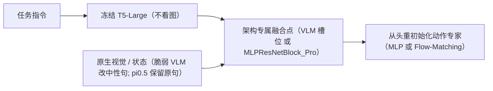
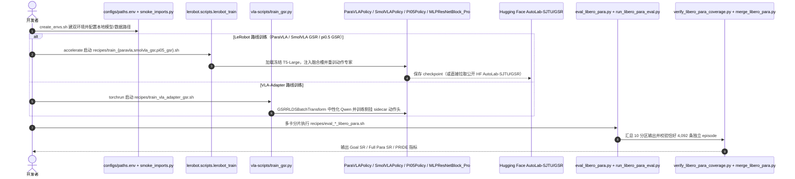

# GSR / ParaVLA：把任务语义从脆弱的联合路由里拆出来

**Grounded Semantic Re-binding（GSR）**（[arXiv:2608.02497](https://arxiv.org/abs/2608.02497)，[代码](https://github.com/AutoLab-SAI-SJTU/GSR-ParaVLA)）由 **上海交通大学 AutoLab**（实习于 Anyverse Dynamics）提出：VLA 在改写指令上崩，往往不是「语义没了」，而是 **动态图像和文本 jointly encode 后，动作头吃不消那点特征偏移**。

## 一句话定义

**用冻结 T5 单独抽出与当前画面无关的任务语义，再绑回模型自己的视觉/状态通路，并从零训练动作专家——只靠 canonical 演示，就能把改写指令成功率拉回来。**

## 英文缩写速查

| 缩写 | 英文全称 | 简要说明 |
|------|----------|----------|
| GSR | Grounded Semantic Re-binding | 本文的结构干预方案：冻结独立语义源并重绑定动作头 |
| VLA | Vision-Language-Action | 视觉–语言–动作控制策略 |
| VLM | Vision-Language Model | 视觉–语言骨干模型（本文分析 Qwen / SmolVLM / PaliGemma） |
| T5 | Text-to-Text Transfer Transformer | 冻结纯文本语义源（`google-t5/t5-large`），不看图像与本体状态 |
| OOD | Out-of-Distribution | 分布外泛化条件（本文指未见过的同义改写指令与实机 OOD 改写） |
| BDDL | Behavior Domain Definition Language | LIBERO 与 LIBERO-Para 任务与成功判据描述语言 |

## 为什么重要

- 基准指令模板一改写，VLA-Adapter / SmolVLA / \(\pi_{0.5}\) 可掉数十个点；业界默认答案是「再堆改写数据」。
- 探测显示任务身份还在：换回 canonical 语言特征，成功率 **60%→96%**。
- 结构解耦让轻量模型逼近重预训练基线，并给 \(\pi_{0.5}\) 再抬 PRIDE 到 **70.4**（高于报告的 Xiaomi-Robotics-0 的 69.2）。

## 核心信息

| 项 | 内容 |
|----|------|
| **机构** | 上海交通大学人工智能学院 AutoLab（SJTU）；Anyverse Dynamics |
| **评测** | LIBERO-Goal 训练，LIBERO-Para 4092 episode |
| **开源** | **已开源**（MIT + HF checkpoints） |

## 核心原理

### 方法栈与按架构注入位置

冻结 `T5-large` 只编码任务文本指令，不接收任何图像或本体状态。GSR 依据原模型信息流决定如何处理原生文本通路与 T5 注入点：

1. **VLA-Adapter（分离动作政策）：** Qwen 辅支输入固定中性句 `"perform the task"`；T5 投影后作为独立 sidecar K/V 注入每个 `MLPResNetBlock_Pro`（`use_semantic_sidecar=True`，独立 softmax + gate），24 层动作头从头随机初始化以 L1 回归重训。
2. **SmolVLA（早期图文融合）：** 实测直接接到动作头会崩溃（13.49%）；必须把 T5 投影通过 8 头 `grounding attention` 提前注入 `SmolVLM` 原生语言槽位（同时把原句中性化为 `"perform the task"`），随多模态层充分交互后驱动重初始化的 flow-matching 专家。
3. **\(\pi_{0.5}\)（大规模异构共训）：** 其原生 PaliGemma 语言通路本身对改写较稳（W/C 误指令实验证明原生通路主导动作），因此 **保留真实指令** 并把 T5 特征补充注入 `"State:"` 分隔符前的动态检测任务 token 区间，从零重训 300M `gemma_300m` flow 专家。
4. **ParaVLA（0.33B 原生解耦模型）：** 彻底移除 VLM，采用 `DINOv2-Large`（公开配方训练末 4 层与 patch embedding）+ 冻结 `T5-Large`（每任务缓存一次特征，无单步开销）+ 8 层 16 头解耦 flow-matching 动作专家。

### 流程总览

## 源码运行时序图

官方实现 [`AutoLab-SAI-SJTU/GSR-ParaVLA`](https://github.com/AutoLab-SAI-SJTU/GSR-ParaVLA)（MIT，含内嵌 `lerobot_backend/` 与 `vla_adapter_backend/`；归档见 [`sources/repos/gsr-paravla.md`](../../sources/repos/gsr-paravla.md)）：

- **最短复现：** `conda activate gsr-lerobot && python scripts/smoke_imports.py` → 拉取 `AutoLab-SJTU/GSR`（`gated: false`）→ `bash recipes/eval_lerobot_libero_para.sh`；快速验证训练链路可设 `STAGE=smoke`。
- **双环境原因：** `environments/lerobot.yml` 与 `environments/vla_adapter.yml` 依赖冲突，`README.md` 明确拆分为两套 conda 环境。

## 工程实践

| 项 | 建议 |
|----|------|
| 先做探测 | 同一观测下比较 paraphrase / canonical / 错任务动作距离 |
| 注入点 | 跟该 VLA 的融合层走，不要一律接到动作头 |
| 大动作头 | \(\pi_{0.5}\) 重初始化后 Goal SR 可能先掉，加倍步数可拉回 |
| 数据 | **不要**先上改写增强；GSR 只吃 canonical |

## 实验与评测

| 模型 | Goal SR | Full Para SR | PRIDE / 读法 |
|------|--------:|-------------:|------|
| SmolVLA Native → GSR | 72.0→78.0 | 4.47→**49.12** | PRIDE 2.6→41.4（+44.65 pp，文内最大跃迁） |
| VLA-Adapter Native → GSR | 98.2→98.0 | 46.82→**70.94** | PRIDE 36.7→62.0（轻量模型贴近重预训练） |
| \(\pi_{0.5}\) Native → GSR（6,250 步） | 93.0→91.0 | 73.60→**75.59** | PRIDE **70.4**（当前最高报告 PRIDE） |
| \(\pi_{0.5}\) GSR\*（12,500 步） | **96.0** | **75.76** | 加倍训练步数完全恢复 canonical SR，PRIDE 70.3 |
| ParaVLA（0.33B 原生解耦，Table 4） | 92（Goal-100 Canon） | **72.51** | Goal-100 Para 91（Drop 1 pp），PRIDE 66.9 |
| Xiaomi-Robotics-0（报告） | 98.8 | 76.0 | Full Para 略高，PRIDE 69.2 |

- **控制变量诊断：** 在 VLA-Adapter 的 Qwen 辅支输入固定假图即可把 Full Para 从 46.82% 抬到 61.58%，在最后 Bridge-Attention block（block 23）替换 canonical 特征可恢复 96.8% 动作差异（成功率 60%→96%），从正反两面验证 joint V-L 路由引入了系统性偏移。
- **AgileX PiPER 真机试点（Table 13）：** 4 抓取 + 2 堆叠共 6 任务、每条件 30 次试验（同桌面视觉布局迫使模型依赖语言区分任务），Native VLA-Adapter Canonical/OOD 均为 **0%**，GSR 提升至 Canonical **50%** / OOD **40%**。

## 与其他工作对比

相对「堆改写语料」：GSR 正交，给已经大规模共训的 \(\pi_{0.5}\) 仍能再涨。相对 [Xiaomi-Robotics-0](./xiaomi-robotics-0.md)：报告 Para SR 76.0 略高，但 GSR+\(\pi_{0.5}\) 的 PRIDE 更高。相对 [Why Action Chunking Improves BC](./paper-why-action-chunking-improves-bc.md)：后者拆动作时间结构，本文拆语言路由。

## 结论

**VLA 的改写鲁棒性，优先修「语义怎么送到动作头」，而不是先扩指令数据。**

1. **先确认语义还在** — Retrieval@1 / 特征替换实验能一票否决「模型没看懂」。
2. **指令编码不要和当前帧绑死** — T5 不看图。
3. **注入点跟架构走** — SmolVLA 必须早融合；接到动作头会崩。
4. **动作专家要重训** — 旧映射拟合的是那套偏移特征。
5. **轻量结构能打重预训练** — VLA-Adapter+GSR 的 Para 接近 \(\pi_{0.5}\) 量级。
6. **大专家给足步数** — 重初始化不是免费的。

## 局限与风险

- 主评测集中在 LIBERO-Goal/Para（4,092 episodes）；真机仅提供 AgileX PiPER 6 任务 30 试点的轻量验证（GSR OOD 40%，其中 3 项困难/堆叠任务为 0%）。
- 跨架构层级干预（Appendix D）表明并不存在适用于所有 VLA 的通用单一语义断点，96.8% 的单点恢复仅是 VLA-Adapter 末层 Bridge-Attention（block 23）的架构特性；SmolVLA（最高 10.5%）与 \(\pi_{0.5}\)（最高 31.3%）呈多层分布式表征。
- ParaVLA 在第 5 节明确报告存在视觉尺度瓶颈：将 DINO 视觉骨干继续放大时，未能展现典型 VLM 级别的扩展收益。
- T5-Large 与视觉编码端大多保持冻结，极端域外语言表达或剧烈视觉分布漂移仍可能叠加退化；\(\pi_{0.5}\) 短程重训会伤及 canonical SR，需拉长训练步数（如 `GSR*` 的 12,500 步）校验联合指标。

## 关联页面

- [VLA](../methods/vla.md)
- [LIBERO](./libero-benchmark.md)
- [Xiaomi-Robotics-0](./xiaomi-robotics-0.md)
- [π₀.₅ / π₀.₇](../methods/pi07-policy.md)
- [Why Action Chunking Improves BC](./paper-why-action-chunking-improves-bc.md)
- [ReflexVLA](./paper-reflexvla.md) — 同校；延迟感知动态任务，不是指令路由
- [Ego2Robot](./paper-ego2robot.md) — 数据侧补语言/物体扰动
- [Compression is Routing](./paper-compression-is-routing.md) — 路由脆弱性的另一解：重建误差路由 vs 语义重绑

## 参考来源

- [GSR 论文摘录](../../sources/papers/gsr_paravla_arxiv_2608_02497.md)
- [GSR-ParaVLA 仓库归档](../../sources/repos/gsr-paravla.md)
- [具身智能小站 9 篇盘点](../../sources/blogs/wechat_embodied_station_ego2robot_mango_grasp_2026-08-11.md)
- [arXiv:2608.02497](https://arxiv.org/abs/2608.02497)

## 推荐继续阅读

- [GSR 仓库与配方](https://github.com/AutoLab-SAI-SJTU/GSR-ParaVLA)
- [Hugging Face 权重](https://huggingface.co/AutoLab-SJTU/GSR)
